# Phần 1. Giới thiệu

## 1.1 Mục đích tài liệu

Tài liệu hướng dẫn cài đặt và sử dụng **ECMS – Hệ thống quản lý trung tâm tiếng Anh**, gồm: cài đặt môi trường, đăng nhập, thao tác chung trên giao diện, hướng dẫn chi tiết cho từng vai trò và các tác vụ quản trị CSDL (sao lưu, nhập / xuất dữ liệu). Mỗi chức năng được mô tả theo trình tự **mở trang → thao tác → kết quả mong đợi**, kèm hình minh hoạ chụp từ ứng dụng chạy trên dữ liệu mẫu.

## 1.2 Đối tượng sử dụng

| Vai trò | Công việc chính trên ECMS | Phạm vi dữ liệu |
|---|---|---|
| Quản lý | Danh mục chi nhánh – phòng – ca, nhân viên, tài khoản, nhật ký, toàn bộ nghiệp vụ và báo cáo | Toàn trung tâm (quản lý cấp trung tâm) hoặc chi nhánh mình |
| Giáo vụ | Khoá học, mở lớp, xếp lịch, hồ sơ học viên, kiểm tra đầu vào, ghi danh, theo dõi chuyên cần | Chi nhánh mình |
| Kế toán | Lập phiếu thu, in phiếu, công nợ, báo cáo doanh thu, bảng lương giáo viên | Chi nhánh mình |
| Giáo viên | Điểm danh, nhập điểm, xử lý cảnh báo chuyên cần, báo cáo lớp mình dạy | Các lớp mình phụ trách |
| Học viên | Xem lịch học tuần, bảng điểm, học phí còn nợ | Dữ liệu của chính mình |

## 1.3 Yêu cầu hệ thống

| Thành phần | Yêu cầu |
|---|---|
| Hệ điều hành | Windows 10/11, macOS 13 trở lên hoặc Linux |
| Cơ sở dữ liệu | Windows: SQL Server 2022 (Developer / Express); macOS / Linux: SQL Server 2025 chạy bằng Docker Desktop |
| Trình điều khiển | Microsoft ODBC Driver 18 for SQL Server |
| Python | 3.11 trở lên |
| Trình duyệt | Chrome, Edge, Firefox hoặc Safari bản mới |

# Phần 2. Cài đặt và khởi động

## 2.1 Lấy mã nguồn và cấu hình

```bash
git clone https://github.com/nhutruong-uit/ecms.git
cd ecms
cp .env.example .env        # Windows: copy .env.example .env
```

File `.env` chứa thông tin kết nối. Giá trị mặc định dùng được ngay với Docker; chỉ cần sửa khi SQL Server cài trên máy khác hoặc dùng cổng khác:

| Biến | Ý nghĩa | Mặc định |
|---|---|---|
| `SA_PASSWORD` | Mật khẩu `sa` của SQL Server (dùng cho script dựng CSDL, sao lưu) | `Ecms@12345` |
| `DB_SERVER`, `DB_PORT` | Máy chủ và cổng SQL Server | `localhost`, `1433` |
| `DB_USER`, `DB_PASSWORD` | Login ít quyền của ứng dụng web | `ecms_app` |
| `DB_TRUST_CERT` | Tin chứng chỉ tự ký của SQL Server | `yes` |

## 2.2 Khởi động SQL Server

**macOS / Linux (Docker):**

```bash
docker compose up -d        # lần đầu tải image khoảng 1,5 GB
docker compose ps           # chờ cột STATUS hiện "healthy"
```

Trên máy Apple Silicon cần bật *Settings → General → Use Rosetta for x86/amd64 emulation* trong Docker Desktop.

**Windows:** cài SQL Server 2022 Developer hoặc Express ở chế độ *Mixed Mode*, bật giao thức **TCP/IP** trong *SQL Server Configuration Manager*, cài thêm SSMS và ODBC Driver 18.

## 2.3 Dựng cơ sở dữ liệu

```bash
database/run_all.sh                                       # macOS / Linux / Git Bash
```

```powershell
.\database\run_all.ps1 -SqlLogin sa -Password "Ecms@12345"   # Windows PowerShell
```

Script chạy lần lượt `01_schema.sql` → `09_xml.sql`: tạo 22 bảng, nạp dữ liệu mẫu, tạo function, view, procedure, trigger, phân quyền và XML Schema. Toàn bộ mất khoảng 10–20 giây và có thể chạy lại bất cứ lúc nào để đưa CSDL về trạng thái ban đầu.

## 2.4 Chạy ứng dụng web

```bash
python3 -m venv .venv
source .venv/bin/activate   # Windows: .venv\Scripts\activate
pip install -r requirements.txt
streamlit run app/main.py
```

Mở trình duyệt tại `http://localhost:8501`. Sau khi đăng nhập bằng tài khoản Quản lý, vào **Hệ thống → Kiểm tra kết nối**: trang báo *Kết nối thành công* là môi trường đã sẵn sàng.

## 2.5 Tài khoản dùng thử

| Tên đăng nhập | Mật khẩu | Vai trò |
|---|---|---|
| `quanly` | `Ecms@2026` | Quản lý – xem toàn trung tâm |
| `giaovu` | `Ecms@2026` | Giáo vụ chi nhánh CN01 |
| `ketoan` | `Ecms@2026` | Kế toán chi nhánh CN01 |
| `giaovien` | `Ecms@2026` | Giáo viên (CN01) |
| `hocvien` | `Hocvien@2026` | Học viên |

Các tài khoản này chỉ dành cho môi trường thử nghiệm; khi triển khai thật cần đổi mật khẩu hoặc khoá lại (mục 4.1.4).

# Phần 3. Thao tác chung

## 3.1 Đăng nhập và đăng xuất

1. Mở `http://localhost:8501`, nhập **Tên đăng nhập** và **Mật khẩu**, nhấn **Đăng nhập** (hoặc Enter).
2. Đăng nhập sai 5 lần liên tiếp, tài khoản bị khoá – liên hệ Quản lý để mở khoá.
3. Muốn thoát, nhấn **Đăng xuất** ở cuối thanh menu bên trái.

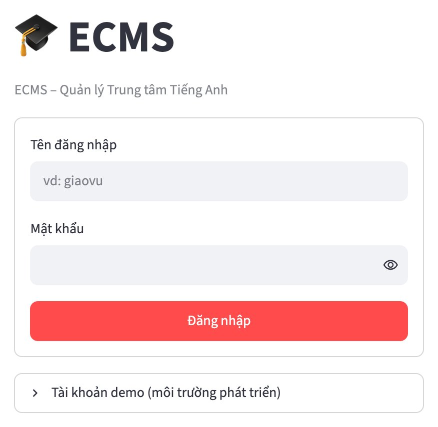

*Hình 3.1 – Màn hình đăng nhập*

## 3.2 Bố cục giao diện

- **Thanh menu bên trái** gom chức năng theo nhóm nghiệp vụ (Danh mục, Đào tạo, Học viên, Học tập, Tài chính, Báo cáo, Hệ thống). Mỗi vai trò chỉ thấy các mục mình được dùng; mục đang mở được tô nền.
- **Cuối thanh menu** hiển thị họ tên, vai trò, chi nhánh và nút Đăng xuất.
- **Trang chủ** hiện các chỉ số tóm tắt và danh sách lớp đang học / sắp mở trong phạm vi của người dùng.

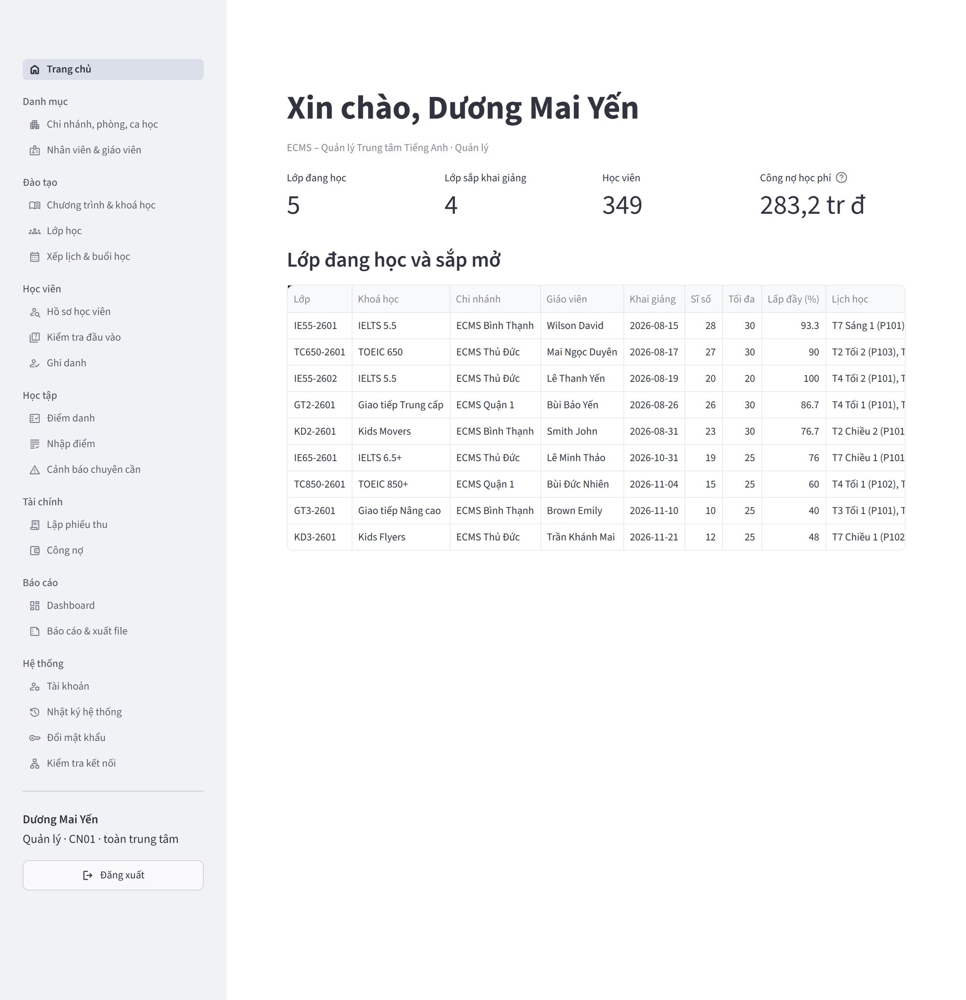

*Hình 3.2 – Trang chủ và menu đầy đủ của vai trò Quản lý*

## 3.3 Quy ước trên các trang nghiệp vụ

Hầu hết các trang dùng chung một cách thao tác:

1. **Lọc / tìm** bằng các ô ở đầu trang (chi nhánh, trạng thái, ô tìm kiếm).
2. **Chọn một dòng** trong bảng bằng ô vuông đầu dòng – form bên dưới chuyển sang chế độ **Sửa** với dữ liệu điền sẵn. Bỏ chọn để quay lại chế độ **Thêm mới**.
3. Nhập dữ liệu, nhấn **Lưu**. Ô có dấu `*` là bắt buộc; lỗi định dạng hiện ngay dưới ô sai (Hình 3.3).
4. Nút **Xoá** ghi rõ đối tượng sẽ xoá (ví dụ "Xoá chi nhánh CN02"). Dữ liệu đang được tham chiếu (chi nhánh còn lớp, lớp còn học viên…) sẽ bị CSDL từ chối xoá kèm thông báo lý do.
5. Thông báo thành công (khung xanh) hoặc lỗi nghiệp vụ (khung đỏ) hiện ngay sau khi lưu.

Bảng dữ liệu cho phép sắp xếp bằng cách nhấn tiêu đề cột; biểu tượng ở góc trên bên phải bảng dùng để tìm kiếm, phóng to hoặc tải bảng về dạng CSV.

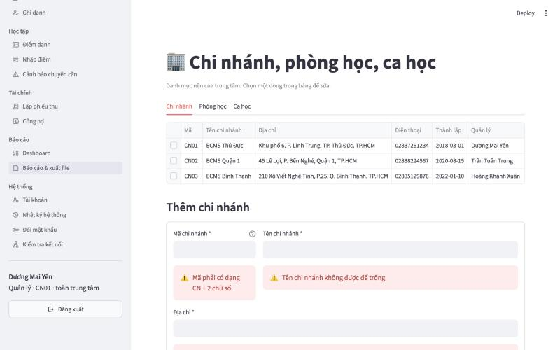

*Hình 3.3 – Lỗi nhập liệu hiện ngay dưới ô tương ứng*

## 3.4 Đổi mật khẩu

Vào **Hệ thống → Đổi mật khẩu**, nhập mật khẩu hiện tại và mật khẩu mới hai lần rồi nhấn **Đổi mật khẩu**. Mật khẩu mới phải từ 8 ký tự, có chữ hoa, chữ thường, chữ số, ký tự đặc biệt và khác mật khẩu cũ.

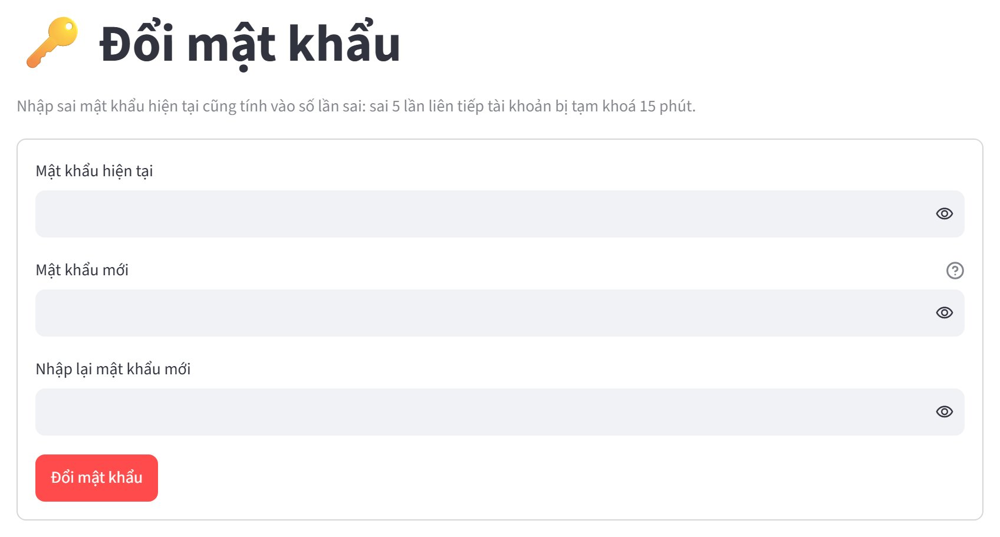

*Hình 3.4 – Đổi mật khẩu (mọi vai trò)*

# Phần 4. Hướng dẫn theo vai trò

## 4.1 Quản lý

### 4.1.1 Chi nhánh, phòng học, ca học

Menu **Danh mục → Chi nhánh, phòng, ca học** gồm 3 tab:

- **Chi nhánh**: mã dạng `CN` + 2 chữ số, tên, địa chỉ, điện thoại, ngày thành lập, người quản lý (phải là nhân viên chức vụ Quản lý).
- **Phòng học**: chọn chi nhánh, mã phòng, sức chứa. Phòng dùng để xếp lịch – sức chứa phải lớn hơn hoặc bằng sĩ số tối đa của lớp.
- **Ca học**: tên ca, giờ bắt đầu – kết thúc.

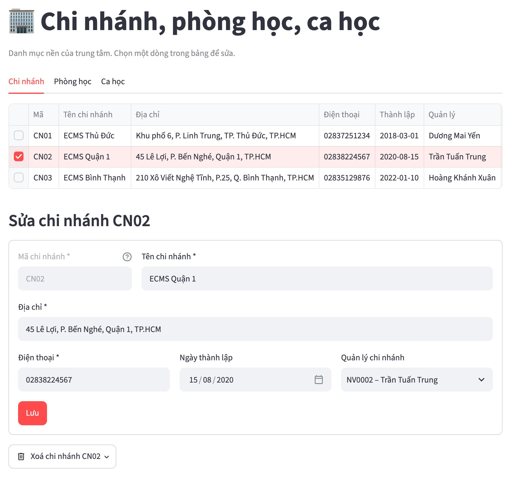

*Hình 4.1 – Danh mục chi nhánh, phòng học, ca học*

### 4.1.2 Nhân viên và giáo viên

Menu **Danh mục → Nhân viên & giáo viên**. Chọn một nhân viên để sửa thông tin chung; với giáo viên có thêm chuyên môn, đơn giá mỗi buổi và danh sách **chứng chỉ** (thêm bằng **Lưu chứng chỉ**). Nút **Xoá / cho nghỉ** chuyển nhân viên sang trạng thái nghỉ nếu đã có dữ liệu liên quan. Kế toán chỉ xem danh sách để tính lương.

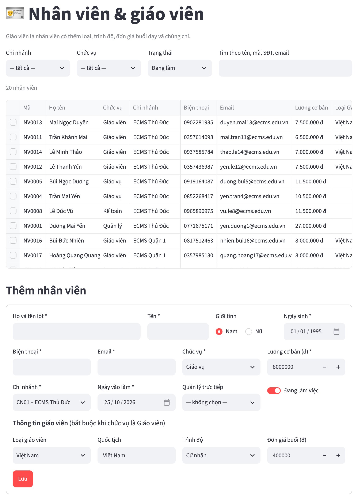

*Hình 4.2 – Danh mục nhân viên và giáo viên*

### 4.1.3 Dashboard

Menu **Báo cáo → Dashboard**. Chọn chi nhánh (hoặc *Toàn trung tâm*) và năm. Hàng chỉ số trên cùng so sánh với tháng trước (mũi tên xanh tăng, đỏ giảm); các biểu đồ bên dưới: doanh thu theo tháng xếp chồng theo chi nhánh, cơ cấu doanh thu theo chương trình, tỷ lệ lấp đầy lớp, học viên mới theo tháng, tương quan chuyên cần – điểm. Rê chuột lên biểu đồ để xem số liệu chi tiết.

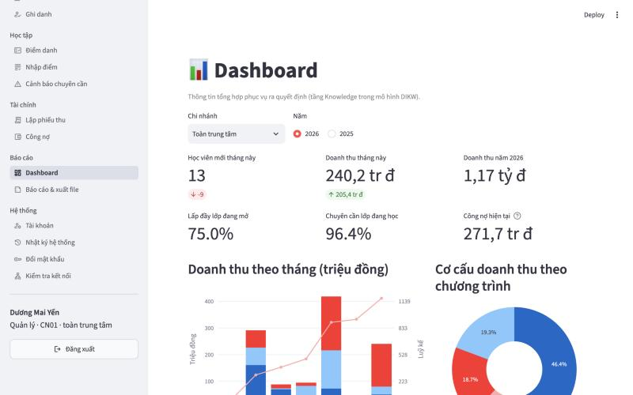

*Hình 4.3 – Dashboard tổng hợp*

### 4.1.4 Tài khoản người dùng

Menu **Hệ thống → Tài khoản**:

1. **Tạo tài khoản mới**: chọn cho nhân viên hoặc học viên, nhập tên đăng nhập (từ 4 ký tự, chữ thường không dấu, số, dấu chấm, gạch dưới), mật khẩu ban đầu và vai trò, nhấn **Tạo tài khoản**.
2. **Đổi vai trò / khoá / mở khoá**: chọn tài khoản trong bảng, đổi vai trò rồi **Lưu**, hoặc nhấn **Khoá tài khoản** / **Mở khoá tài khoản**. Không thể tự khoá tài khoản đang đăng nhập.

Mật khẩu chỉ được lưu dạng băm, không ai xem được mật khẩu gốc.

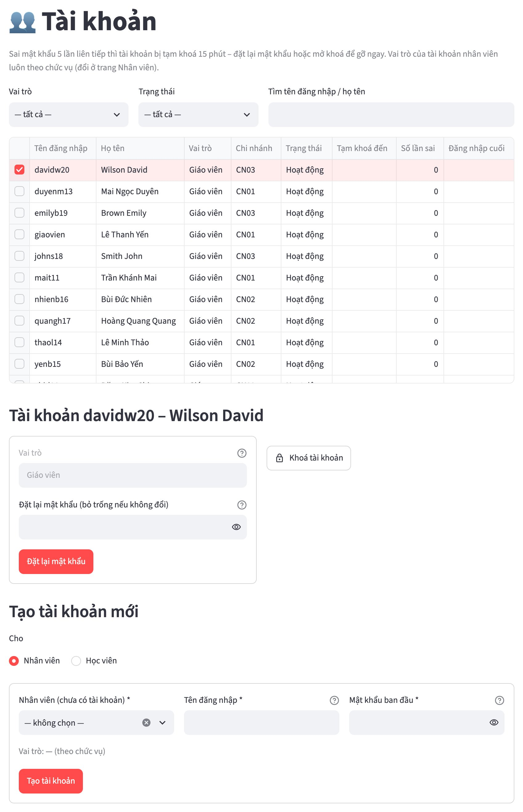

*Hình 4.4 – Quản lý tài khoản*

### 4.1.5 Nhật ký hệ thống

Menu **Hệ thống → Nhật ký hệ thống** liệt kê mọi thay đổi trên đăng ký, phiếu thu và lương nhân viên: thời gian, bảng, thao tác, khoá, tài khoản ứng dụng và login SQL thực hiện. Lọc theo bảng, thao tác và khoảng ngày; chọn một dòng để xem dữ liệu trước / sau khi thay đổi. Nhật ký chỉ đọc – không ai sửa hay xoá được.

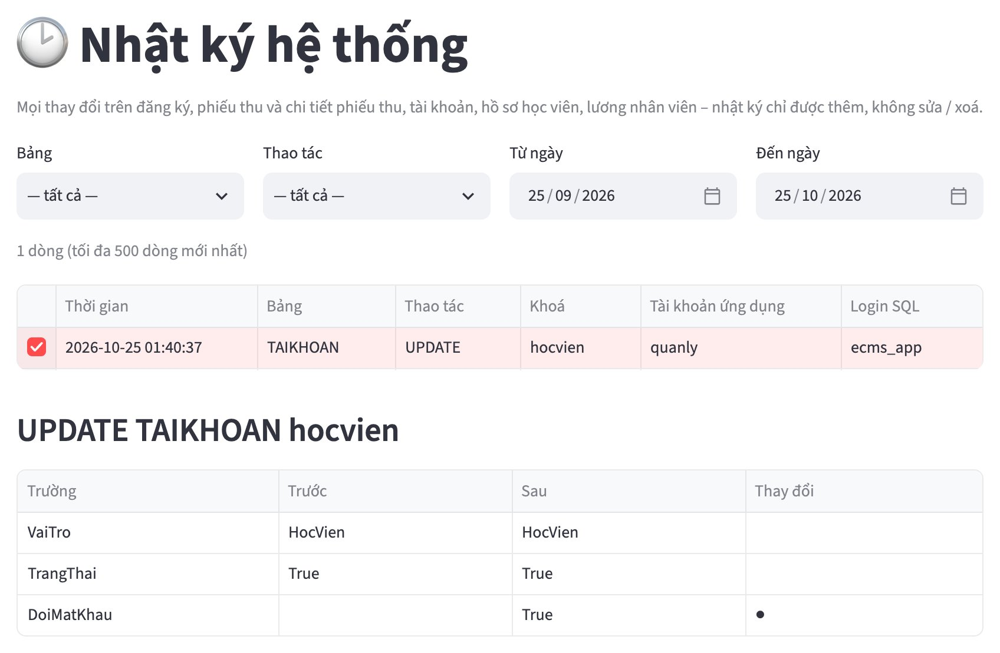

*Hình 4.5 – Nhật ký hệ thống*

## 4.2 Giáo vụ

### 4.2.1 Chương trình và khoá học

Menu **Đào tạo → Chương trình & khoá học**. Tab *Chương trình* quản lý 4 chương trình (IELTS, TOEIC, Giao tiếp, Thiếu nhi); tab *Khoá học* quản lý khoá: mã, tên, cấp độ, số buổi, học phí và **khoá tiên quyết** cùng chương trình (học viên phải hoàn thành khoá này mới được ghi danh khoá sau).

### 4.2.2 Mở lớp

Menu **Đào tạo → Lớp học**. Lọc theo chi nhánh, khoá học, trạng thái. Form **Mở lớp mới**: chọn khoá học, chi nhánh, giáo viên phụ trách; tên lớp được gợi ý sẵn theo khoá; nhập ngày khai giảng và sĩ số tối đa, nhấn **Lưu**. Mã lớp do hệ thống sinh theo khoá học (ví dụ `IE55-2602`). Lớp đã có học viên thì không đổi được khoá học và chi nhánh.

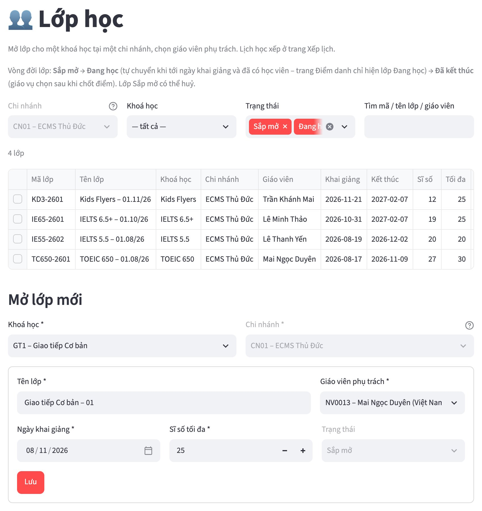

*Hình 4.6 – Danh sách lớp và form mở lớp*

### 4.2.3 Xếp lịch và sinh buổi học

Menu **Đào tạo → Xếp lịch & buổi học**, tab *Lịch của một lớp*:

1. Chọn lớp.
2. Ở **Lịch cố định trong tuần**, chọn thứ, ca, phòng rồi nhấn **Thêm vào lịch**; lặp lại cho các buổi khác trong tuần. Hệ thống từ chối nếu phòng hoặc giáo viên đã bận cùng thứ – ca, hoặc phòng không đủ sức chứa.
3. Nhấn **Sinh n buổi học tự động**: hệ thống duyệt từng ngày từ ngày khai giảng theo lịch cố định, **bỏ qua ngày lễ**, tạo đủ số buổi của khoá.
4. Khi chưa điểm danh buổi nào, có thể sửa lịch và nhấn **Sinh lại buổi học**.

Tab *Lịch tuần toàn chi nhánh* hiển thị lưới thứ × ca để kiểm tra phòng trống.

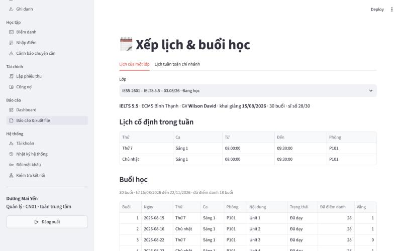

*Hình 4.7 – Lịch cố định và danh sách buổi học của lớp*

### 4.2.4 Hồ sơ học viên

Menu **Học viên → Hồ sơ học viên**. Nhập tên, mã, số điện thoại hoặc email, chọn bộ lọc rồi nhấn **Tìm** (kết quả phân trang 15 dòng, dùng nút *Trang trước / Trang sau*). Chọn một học viên để xem các tab *Lớp đã học & điểm*, *Kiểm tra đầu vào*, *Học phí*, *Sửa hồ sơ*. Thêm học viên mới ở form **Thêm học viên mới** cuối trang.

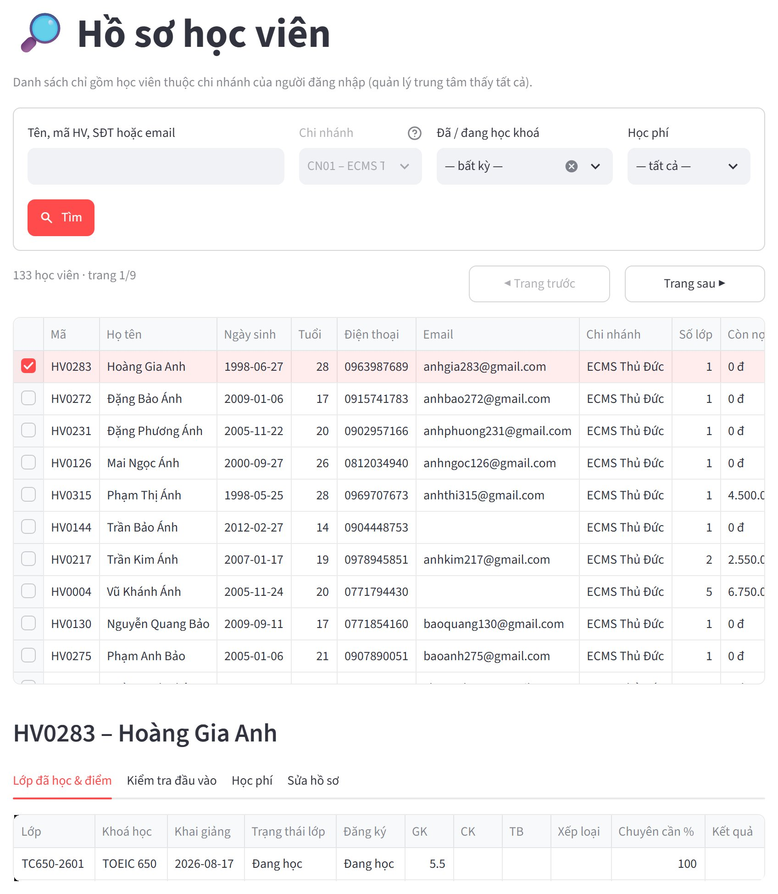

*Hình 4.8 – Tìm kiếm hồ sơ học viên*

### 4.2.5 Kiểm tra đầu vào

Menu **Học viên → Kiểm tra đầu vào**, tab *Nhập kết quả*:

1. Tìm và chọn học viên.
2. Chọn chương trình quan tâm, hình thức (tại trung tâm / online).
3. Nhập điểm 4 kỹ năng Listening, Reading, Writing, Speaking (0–10, bước 0,5) và nhận xét từng kỹ năng, nhận xét chung.
4. Nhấn **Lưu kết quả**. Kết quả được lưu dạng XML; điểm ngoài 0–10 bị từ chối. Ngay sau khi lưu, trang hiện khoá đề xuất và bảng **gợi ý khoá học** theo tổng điểm.

Tab *Xem chi tiết (đọc từ XML)* hiển thị lại điểm, nhận xét từng kỹ năng của các lần kiểm tra trước.

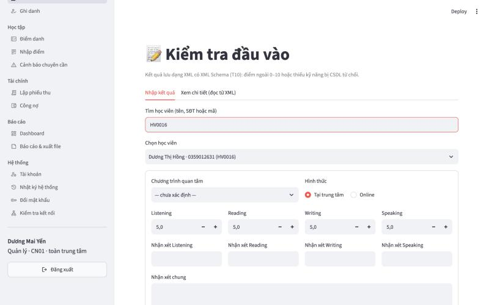

*Hình 4.9 – Nhập kết quả kiểm tra đầu vào*

### 4.2.6 Ghi danh, chuyển lớp, huỷ đăng ký

Menu **Học viên → Ghi danh**:

1. Nhập tên, số điện thoại hoặc mã học viên, chọn học viên. Trang hiện kết quả kiểm tra gần nhất và **khoá đề xuất**.
2. Ở **Ghi danh lớp mới**, bật / tắt *Chỉ hiện lớp của khoá đề xuất*, chọn lớp còn chỗ, nhập giảm giá (0–50%), nhấn **Ghi danh vào …**.
3. Ở **Đăng ký hiện có**, chọn một đăng ký để **Huỷ đăng ký** (chỉ khi chưa đóng tiền) hoặc chọn lớp cùng khoá ở *Chuyển sang lớp cùng khoá* rồi nhấn **Chuyển lớp**.

Hệ thống tự kiểm tra: lớp còn chỗ, học viên chưa đăng ký lớp đó, đã hoàn thành khoá tiên quyết. Sĩ số lớp cập nhật tự động.

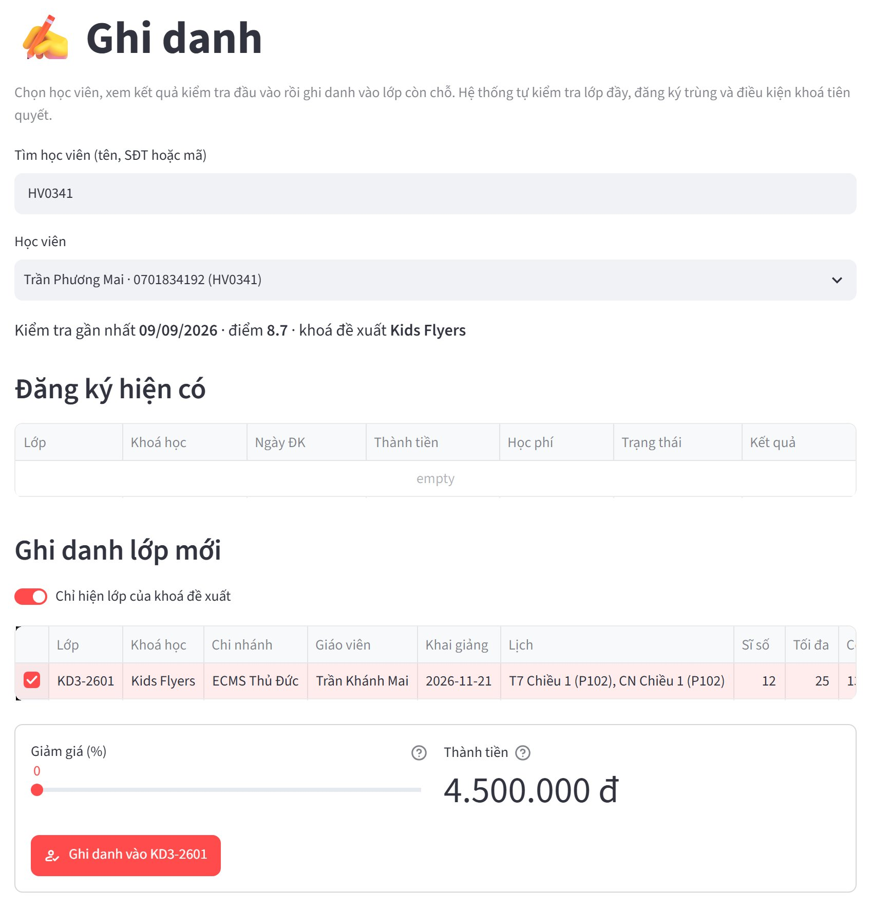

*Hình 4.10 – Ghi danh học viên*

## 4.3 Kế toán

### 4.3.1 Lập phiếu thu

Menu **Tài chính → Lập phiếu thu**, tab *Lập phiếu thu*:

1. **Thông tin phiếu**: tìm và chọn học viên – mỗi học viên hiển thị kèm số tiền còn nợ.
2. **Chi tiết**: bảng liệt kê các đăng ký còn nợ (khoản quá hạn có dấu ⚠). Tích chọn khoản cần thu; cột **Thu lần này** mặc định bằng số còn nợ, có thể sửa để thu một phần.
3. Chọn **Hình thức** (Tiền mặt / Chuyển khoản / Thẻ), ghi chú, kiểm tra **Tổng phiếu**, nhấn **Lập phiếu thu**.
4. Sau khi lập, nhấn **In phiếu … (PDF)** để tải phiếu thu có số tiền bằng chữ và chỗ ký.

Tab *Tra cứu phiếu thu* tìm lại phiếu theo khoảng ngày, xem chi tiết và in lại.

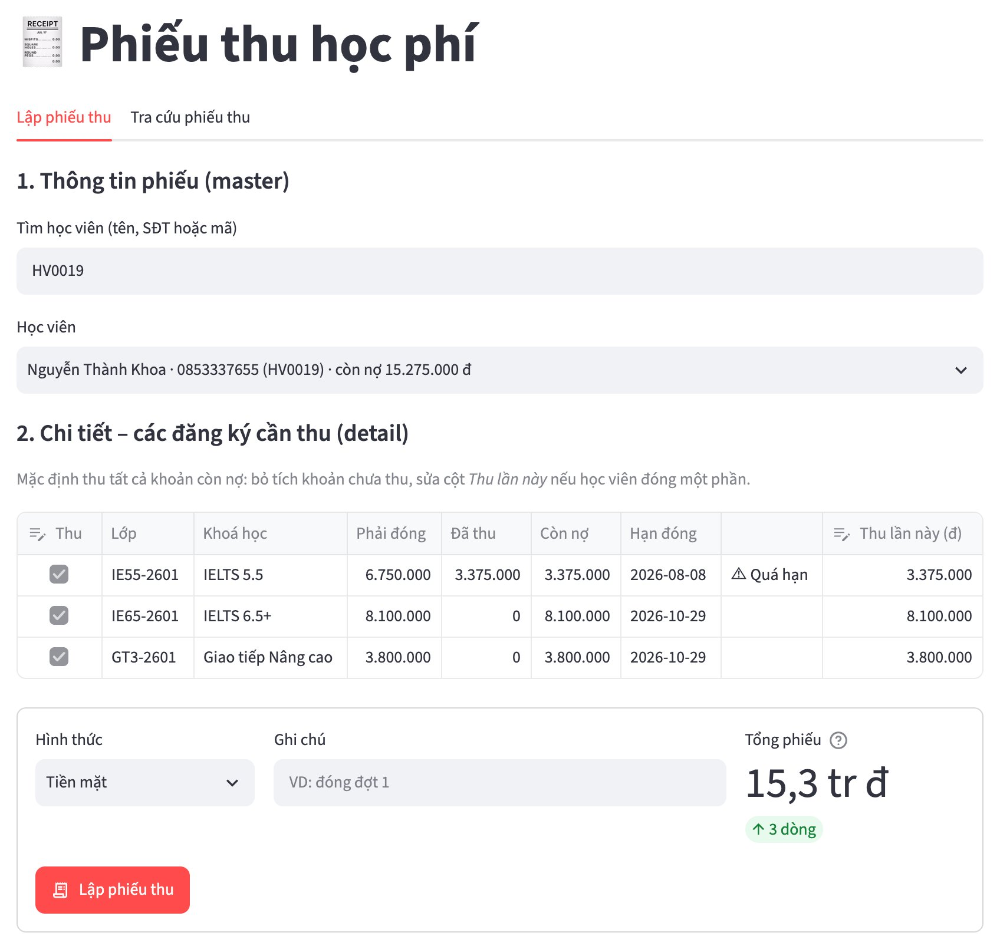

*Hình 4.11 – Lập phiếu thu nhiều khoản (master – detail)*

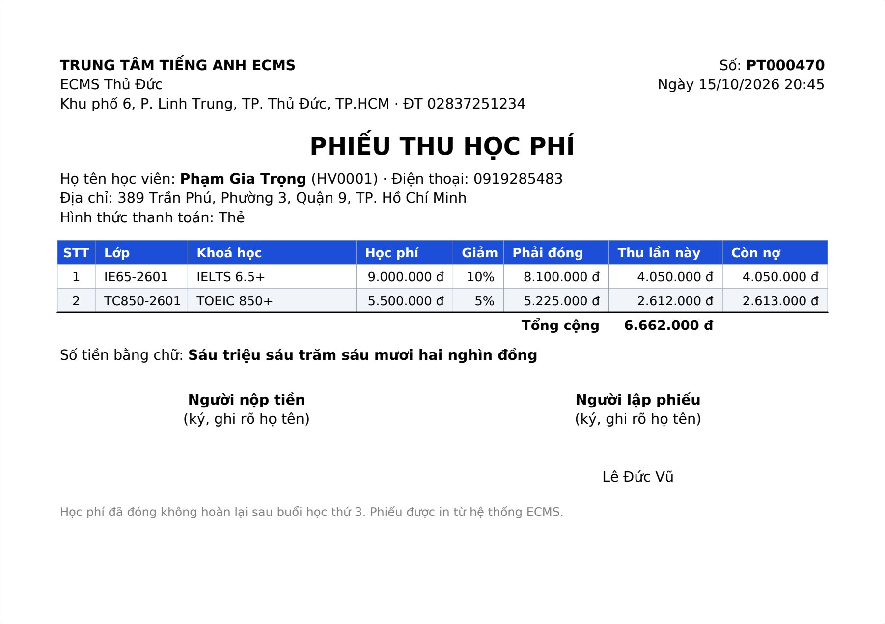

*Hình 4.12 – Phiếu thu in ra PDF*

### 4.3.2 Công nợ

Menu **Tài chính → Công nợ** liệt kê các đăng ký chưa đóng đủ, hạn đóng = ngày đăng ký + 14 ngày. Màu nền: đỏ đậm – quá hạn trên 30 ngày; đỏ nhạt – quá hạn; vàng – chưa đóng đồng nào, chưa tới hạn. Bật *Chỉ nợ quá hạn* hoặc nhập *Nợ từ (đ)* để lọc.

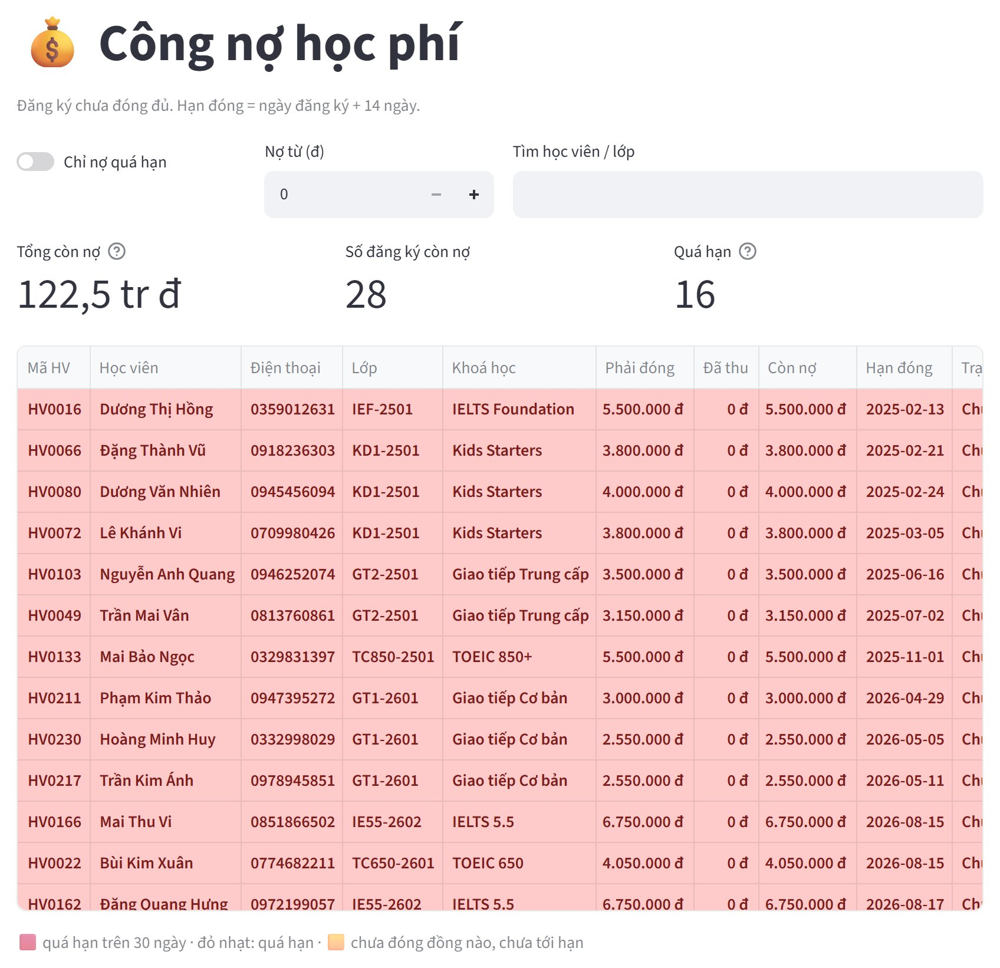

*Hình 4.13 – Theo dõi công nợ học phí*

### 4.3.3 Bảng lương giáo viên

Menu **Báo cáo → Báo cáo & xuất file**, chọn *Bảng lương giáo viên*, chọn tháng – năm. Nếu chưa có bảng lương, nhấn **Tính lại bảng lương tháng này**: hệ thống đếm số buổi đã dạy của từng giáo viên nhân đơn giá. Tải PDF / Excel ở cuối trang.

## 4.4 Giáo viên

### 4.4.1 Điểm danh

Menu **Học tập → Điểm danh**:

1. Chọn lớp, chọn buổi học (buổi đã điểm danh có dấu ✓; chỉ điểm danh được buổi đã đến ngày).
2. Cả lớp mặc định *Có mặt*; sửa cột **Trạng thái** cho học viên *Vắng*, *Muộn* hoặc *Có phép*, ghi chú nếu cần.
3. Nhấn **Lưu điểm danh** – cả lớp được lưu một lần.

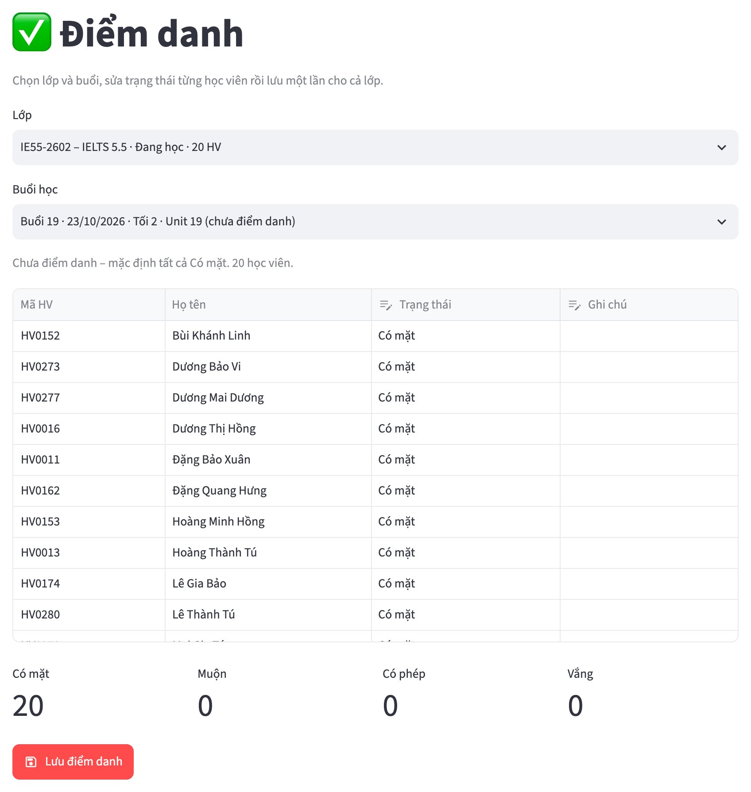

*Hình 4.14 – Điểm danh cả lớp*

### 4.4.2 Nhập điểm

Menu **Học tập → Nhập điểm**: chọn lớp, sửa trực tiếp cột *Giữa kỳ* và *Cuối kỳ* (0–10, bước 0,25). Điểm TB = 0,4 × GK + 0,6 × CK, xếp loại và kết quả (Đạt khi TB ≥ 5) tính tự động. Dòng chữ dưới bảng cho biết số học viên có thay đổi; nhấn **Lưu điểm**.

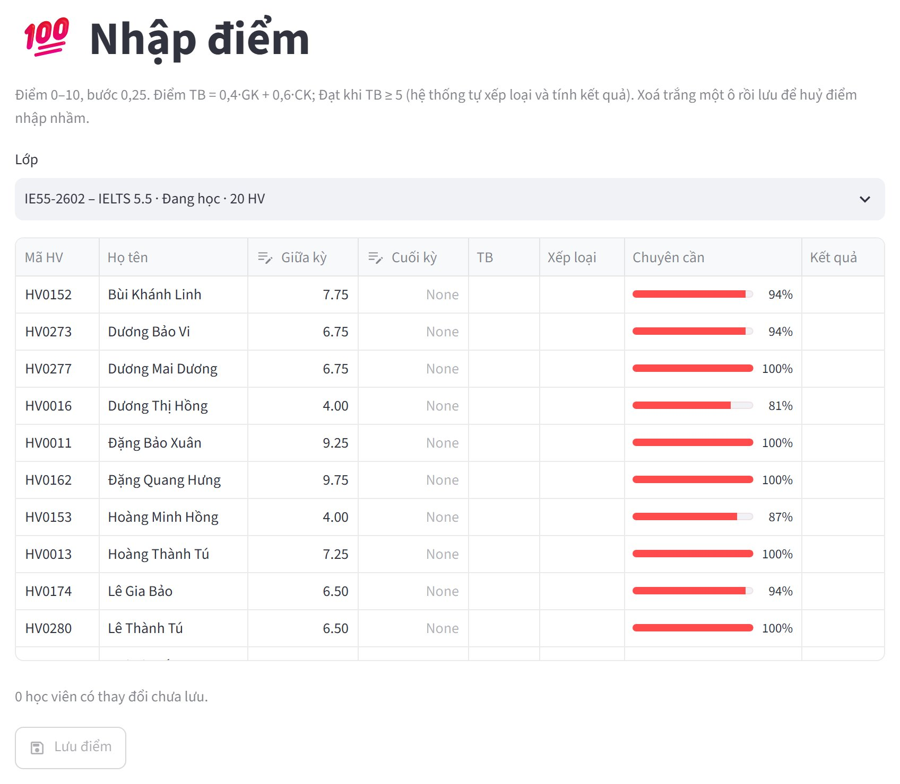

*Hình 4.15 – Nhập điểm giữa kỳ, cuối kỳ*

### 4.4.3 Cảnh báo chuyên cần

Menu **Học tập → Cảnh báo chuyên cần**: chọn ngưỡng vắng (mặc định 20%) và số buổi tối thiểu, nhấn **Quét cảnh báo hôm nay**. Danh sách hiện học viên vượt ngưỡng, mức *Nghiêm trọng* (trên 30%) hoặc *Nhắc nhở*, kèm số điện thoại học viên và phụ huynh để liên hệ. Sau khi liên hệ, chọn dòng và nhấn **Đã liên hệ / xử lý xong**; tắt *Chỉ hiện cảnh báo chưa xử lý* để xem lại cả các cảnh báo đã xử lý. Giáo vụ cũng dùng được trang này.

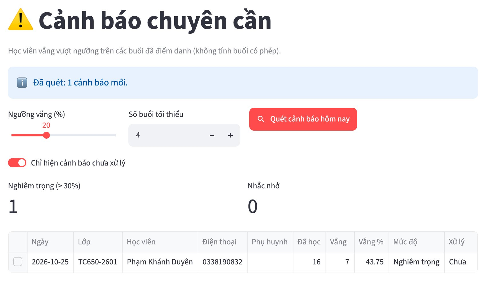

*Hình 4.16 – Cảnh báo học viên vắng nhiều*

## 4.5 Học viên

Menu **Học viên → Lịch học & kết quả của tôi** gồm 3 tab:

- **Lịch học tuần**: chọn một ngày để xem các buổi học trong tuần chứa ngày đó (ca, giờ, phòng, nội dung, giáo viên).
- **Bảng điểm**: điểm giữa kỳ, cuối kỳ, trung bình, chuyên cần và kết quả từng lớp.
- **Học phí**: số phải đóng, đã đóng, còn nợ và hạn đóng.

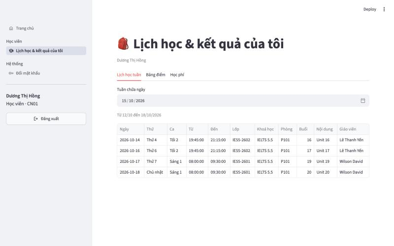

*Hình 4.17 – Trang thông tin cá nhân của học viên*

# Phần 5. Báo cáo và xuất file

Menu **Báo cáo → Báo cáo & xuất file**. Chọn báo cáo trong danh sách (mỗi vai trò chỉ thấy báo cáo của mình), nhập tham số, xem trước trên màn hình rồi nhấn **Tải PDF** hoặc **Tải Excel**.

| Báo cáo | Tham số | Vai trò |
|---|---|---|
| Danh sách học viên theo lớp | Lớp | Quản lý, Giáo vụ, Giáo viên |
| Doanh thu theo chi nhánh → tháng | Từ ngày – đến ngày | Quản lý, Kế toán |
| Bảng điểm lớp | Lớp | Quản lý, Giáo vụ, Giáo viên |
| Lịch sử học tập học viên | Học viên | Quản lý, Giáo vụ |
| Công nợ học viên | Ngưỡng nợ, chỉ quá hạn | Quản lý, Kế toán, Giáo vụ |
| Bảng lương giáo viên | Tháng, năm | Quản lý, Kế toán |
| Tổng hợp theo chương trình | Năm | Quản lý, Kế toán |

File PDF có tên trung tâm, tên báo cáo, tham số, tổng phụ theo nhóm, tổng cộng và số trang "Trang X / Y"; file Excel có định dạng tiền và dòng tổng bằng công thức.

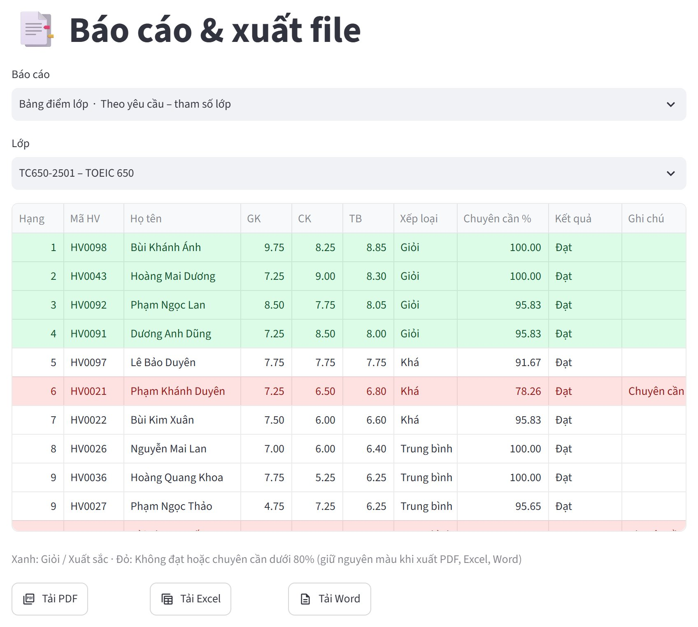

*Hình 5.1 – Chọn báo cáo, nhập tham số và tải file*

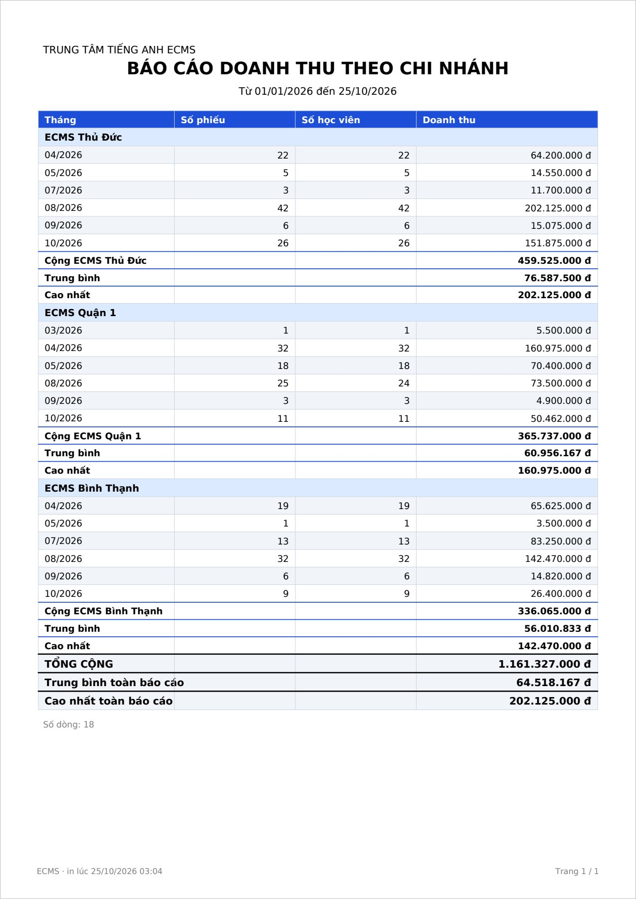

*Hình 5.2 – Báo cáo doanh thu theo chi nhánh xuất PDF*

# Phần 6. Quản trị cơ sở dữ liệu

## 6.1 Sao lưu và phục hồi

Lịch sao lưu khuyến nghị: **FULL** chủ nhật 01:00, **DIFF** thứ Hai – thứ Bảy 01:00, **LOG** mỗi 15 phút, giữ file 14 ngày. Có SQL Server Agent thì dùng job tạo bởi `database/11_backup_restore.sql`; không có Agent (bản Express, Docker) thì đặt cron gọi script:

```bash
scripts/backup.sh FULL      # hoặc DIFF, LOG – file lưu trong thư mục backups/
```

Phục hồi đến một thời điểm: làm theo phần *Phục hồi* trong `database/11_backup_restore.sql` (khôi phục FULL → DIFF gần nhất → các file LOG với `STOPAT`), nên phục hồi ra CSDL tên khác để đối chiếu trước khi thay thế CSDL chính.

## 6.2 Nhập và xuất dữ liệu

```bash
python3 scripts/import_export.py import data/import/hocvien_online.csv   # kiểm tra + nạp danh sách đăng ký online
python3 scripts/import_export.py export --format csv xlsx json xml        # xuất dữ liệu ra data/export/
```

Lệnh `import` kiểm tra từng dòng (ngày, số điện thoại, email, chi nhánh, khoá học, trùng lặp), nạp dòng hợp lệ và in danh sách dòng lỗi kèm lý do.

## 6.3 Kiểm thử sau khi cập nhật

```bash
database/run_all.sh                 # dựng lại CSDL
cd app && pytest ../tests -q        # mở mọi trang với từng vai trò, sinh mọi báo cáo
```

Các bộ kiểm thử SQL trong `database/tests/` (dữ liệu mẫu, procedure, trigger, phân quyền) chạy được bằng `sqlcmd -i`; mỗi bộ báo lỗi nếu có ca không đạt.

# Phần 7. Xử lý sự cố

## 7.1 Lỗi cài đặt và kết nối

| Hiện tượng | Cách xử lý |
|---|---|
| `Can't open lib 'ODBC Driver 18 for SQL Server'` | Chưa cài ODBC Driver 18 (mục 1.3) |
| `SSL Provider: certificate verify failed` | Đặt `DB_TRUST_CERT=yes` trong `.env` |
| `Login timeout expired` | SQL Server chưa chạy xong (`docker compose ps`), Windows chưa bật TCP/IP; trên macOS thử `DB_SERVER=127.0.0.1` |
| `Login failed for user 'sa'` | `SA_PASSWORD` khác mật khẩu lúc tạo container: `docker compose down -v` rồi `docker compose up -d` |
| `Login failed for user 'ecms_app'` | Chưa chạy `08_security.sql` – chạy lại `database/run_all.sh` |
| Trang báo "Bạn không có quyền truy cập chức năng này" | Vai trò hiện tại không được dùng chức năng – đăng nhập đúng tài khoản |

## 7.2 Thông báo nghiệp vụ thường gặp

Các thông báo dưới đây do CSDL trả về khi dữ liệu vi phạm quy tắc nghiệp vụ – đây là hành vi đúng, không phải lỗi phần mềm.

| Thông báo | Nguyên nhân và cách xử lý |
|---|---|
| Lớp đã đủ sĩ số. | Chọn lớp khác cùng khoá hoặc tăng sĩ số tối đa của lớp |
| Học viên đã đăng ký lớp này. | Đăng ký đã tồn tại – xem ở *Đăng ký hiện có* |
| Lớp đã có lịch vào thứ và ca này. / trùng phòng, trùng giáo viên | Chọn thứ, ca hoặc phòng khác |
| Sức chứa phòng nhỏ hơn sĩ số tối đa của lớp. | Chọn phòng lớn hơn |
| Lớp đã sinh buổi học, không thể sửa lịch cố định. | Lớp đã điểm danh – giữ lịch hiện tại |
| Chưa tới ngày học, không thể điểm danh. | Chỉ điểm danh buổi từ hôm nay trở về trước |
| Giáo viên chỉ được thao tác trên lớp mình phụ trách. | Đăng nhập đúng giáo viên phụ trách lớp |
| Điểm phải nằm trong khoảng 0 – 10. | Sửa lại điểm |
| Số tiền thu vượt quá số tiền còn nợ của đăng ký. | Giảm số tiền ở cột *Thu lần này* |
| Đăng ký đã có phiếu thu, không thể huỷ (cần hoàn tiền trước). | Dùng *Chuyển lớp* hoặc xử lý hoàn tiền trước |
| Chỉ được chuyển sang lớp cùng khoá học. | Huỷ đăng ký rồi ghi danh khoá khác |
| Chi nhánh đã có nhân viên, lớp học hoặc học viên – không thể xoá. | Chuyển dữ liệu sang chi nhánh khác trước khi xoá |
| Mật khẩu mới phải từ 8 ký tự, có chữ hoa, chữ thường, chữ số và ký tự đặc biệt. | Đặt mật khẩu mạnh hơn |
