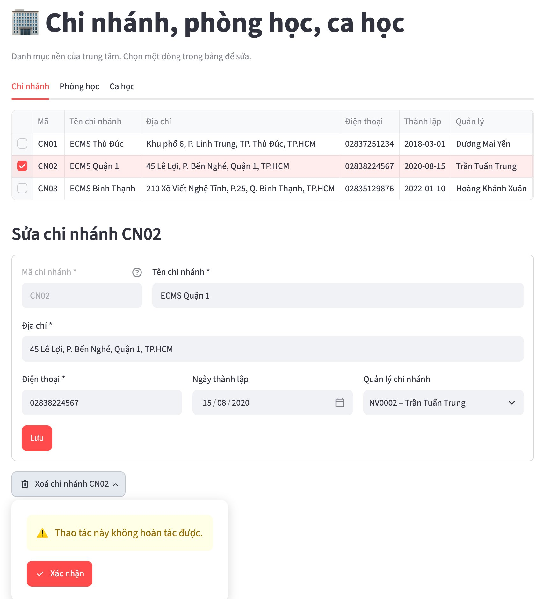

# Phần 1. Giới thiệu

## 1.1 Mục đích tài liệu

Tài liệu này hướng dẫn sử dụng **ECMS – Hệ thống quản lý trung tâm tiếng Anh** cho người dùng nghiệp vụ: quản lý, giáo vụ, kế toán, giáo viên và học viên. Nội dung gồm: các thao tác chung trên giao diện, hướng dẫn chi tiết theo từng vai trò, báo cáo và xuất tệp, một quy trình nghiệp vụ mẫu từ lúc tư vấn đến lúc thu học phí và điểm danh, các quy tắc nghiệp vụ hệ thống tự kiểm tra, cách xử lý thông báo lỗi và các câu hỏi thường gặp.

Phần dành cho người quản trị kỹ thuật – cài đặt máy chủ, dựng CSDL, sao lưu và phục hồi, nhập xuất dữ liệu, kiểm thử – được tách riêng thành các phụ lục ở cuối tài liệu.

Mỗi chức năng được mô tả theo cùng một trình tự: **mở trang → thao tác từng bước → kết quả mong đợi**, kèm hình minh hoạ chụp từ ứng dụng chạy trên dữ liệu mẫu, bằng đúng tài khoản của vai trò được mô tả.

## 1.2 Tổng quan hệ thống

ECMS quản lý toàn bộ hoạt động của một chuỗi trung tâm tiếng Anh nhiều chi nhánh. Các chức năng được chia thành bảy phân hệ (Bảng 1.1):

*Bảng 1.1 – Các phân hệ của ECMS*

| Phân hệ | Chức năng chính |
|---|---|
| Danh mục | Chi nhánh, phòng học, ca học; nhân viên, giáo viên và chứng chỉ |
| Đào tạo | Chương trình, khoá học (có khoá tiên quyết), lớp học, lịch học cố định, buổi học |
| Học viên | Hồ sơ học viên, kiểm tra đầu vào, ghi danh, chuyển lớp, huỷ đăng ký |
| Học tập | Điểm danh, nhập điểm, cảnh báo chuyên cần |
| Tài chính | Lập phiếu thu học phí, in phiếu, theo dõi công nợ |
| Báo cáo | Dashboard, các báo cáo xuất PDF, Excel và Word |
| Hệ thống | Tài khoản, nhật ký thay đổi, đổi mật khẩu, kiểm tra kết nối |

Mọi quy tắc nghiệp vụ – lớp còn chỗ, khoá tiên quyết, không trùng phòng, không thu vượt học phí… – đều được CSDL kiểm tra (Phần 7). Vì vậy khi thao tác sai, người dùng sẽ nhận được thông báo bằng tiếng Việt giải thích lý do; đây là hành vi đúng của hệ thống chứ không phải lỗi phần mềm.

## 1.3 Đối tượng sử dụng

Hệ thống có năm vai trò. Mỗi vai trò chỉ nhìn thấy các chức năng và phạm vi dữ liệu của mình (Bảng 1.2):

*Bảng 1.2 – Vai trò và phạm vi dữ liệu*

| Vai trò | Công việc chính trên ECMS | Phạm vi dữ liệu |
|---|---|---|
| Quản lý | Danh mục, nhân viên, tài khoản, nhật ký, theo dõi toàn bộ nghiệp vụ và báo cáo | Toàn trung tâm (quản lý cấp trung tâm) hoặc chi nhánh của mình |
| Giáo vụ | Khoá học, mở lớp, xếp lịch, hồ sơ học viên, kiểm tra đầu vào, ghi danh, theo dõi chuyên cần và công nợ | Chi nhánh của mình |
| Kế toán | Lập phiếu thu, in phiếu, công nợ, báo cáo doanh thu, bảng lương giáo viên | Chi nhánh của mình |
| Giáo viên | Điểm danh, nhập điểm, xử lý cảnh báo chuyên cần, báo cáo các lớp mình dạy | Các lớp mình phụ trách |
| Học viên | Xem lịch học tuần, bảng điểm, học phí còn nợ | Dữ liệu của chính mình |

Vai trò của tài khoản nhân viên luôn đi theo **chức vụ** của nhân viên đó: Quản lý không chọn vai trò khi tạo tài khoản, và muốn đổi vai trò thì đổi chức vụ ở trang Nhân viên. Bảng 1.3 cho biết mỗi vai trò thấy những mục menu nào (dấu ✓ là có quyền):

*Bảng 1.3 – Mục menu theo vai trò*

| Nhóm menu | Mục | Quản lý | Giáo vụ | Kế toán | Giáo viên | Học viên |
|---|---|:-:|:-:|:-:|:-:|:-:|
| – | Trang chủ | ✓ | ✓ | ✓ | ✓ | ✓ |
| Danh mục | Chi nhánh, phòng, ca học | ✓ | | | | |
| | Nhân viên & giáo viên | ✓ | | ✓ | | |
| Đào tạo | Chương trình & khoá học | ✓ | ✓ | | | |
| | Lớp học | ✓ | ✓ | | | |
| | Xếp lịch & buổi học | ✓ | ✓ | | | |
| Học viên | Hồ sơ học viên | ✓ | ✓ | | | |
| | Kiểm tra đầu vào | ✓ | ✓ | | | |
| | Ghi danh | ✓ | ✓ | | | |
| | Lịch học & kết quả của tôi | | | | | ✓ |
| Học tập | Điểm danh | ✓ | | | ✓ | |
| | Nhập điểm | ✓ | | | ✓ | |
| | Cảnh báo chuyên cần | ✓ | ✓ | | ✓ | |
| Tài chính | Lập phiếu thu | ✓ | | ✓ | | |
| | Công nợ | ✓ | ✓ | ✓ | | |
| Báo cáo | Dashboard | ✓ | | ✓ | | |
| | Báo cáo & xuất file | ✓ | ✓ | ✓ | ✓ | |
| Hệ thống | Tài khoản | ✓ | | | | |
| | Nhật ký hệ thống | ✓ | | | | |
| | Đổi mật khẩu | ✓ | ✓ | ✓ | ✓ | ✓ |
| | Kiểm tra kết nối | ✓ | | | | |

## 1.4 Quy ước trình bày

- Tên nút, ô nhập, thẻ trên giao diện được in **đậm**, ví dụ nút **Lưu**.
- Đường dẫn menu được viết theo dạng **Nhóm → Mục**, ví dụ **Học viên → Ghi danh**.
- Thông báo của hệ thống được đặt trong ngoặc kép, ví dụ "Lớp đã đủ sĩ số."
- Đoạn bắt đầu bằng **Lưu ý** là thông tin cần đọc kỹ để tránh thao tác sai.

## 1.5 Thuật ngữ

*Bảng 1.4 – Thuật ngữ dùng trong tài liệu*

| Thuật ngữ | Ý nghĩa |
|---|---|
| Chương trình | Nhóm khoá học cùng mục tiêu, ví dụ Luyện thi IELTS, Tiếng Anh Thiếu nhi |
| Khoá học | Một cấp độ trong chương trình, có số buổi, học phí, khoảng điểm đầu vào phù hợp và có thể có khoá tiên quyết, ví dụ IELTS 5.5 (mã IE55) |
| Khoá tiên quyết | Khoá phải Đạt trước khi học khoá này (hoặc có điểm kiểm tra đầu vào đủ cao) |
| Lớp | Một lần mở khoá học tại một chi nhánh, có giáo viên phụ trách, ngày khai giảng và sĩ số tối đa; mã lớp dạng `IE55-2602` |
| Lịch cố định | Các thứ, ca, phòng lặp lại hằng tuần của một lớp, ví dụ Thứ 2 và Thứ 4, ca Tối 2, phòng P103 |
| Buổi học | Một ngày học cụ thể, được hệ thống sinh từ lịch cố định |
| Ca học | Khung giờ học trong ngày, ví dụ Tối 2 từ 19:45 đến 21:15 |
| Kiểm tra đầu vào | Bài kiểm tra bốn kỹ năng Listening, Reading, Writing, Speaking để xếp học viên vào khoá phù hợp |
| Khoá đề xuất | Khoá học có khoảng điểm đầu vào chứa điểm tổng của bài kiểm tra |
| Ghi danh (đăng ký) | Việc học viên vào học một lớp; mỗi đăng ký có học phí, giảm giá, thành tiền, trạng thái học phí và kết quả |
| Phiếu thu | Chứng từ thu tiền, một phiếu có thể thu cho nhiều đăng ký của cùng một học viên |
| Công nợ | Số tiền học viên còn phải đóng của các đăng ký chưa đóng đủ |
| Quá hạn | Đăng ký chưa đóng đủ sau hạn đóng (14 ngày kể từ ngày đăng ký) |
| Chuyên cần | Tỷ lệ buổi có đi học trên số buổi đã điểm danh, không tính buổi có phép |
| Cảnh báo chuyên cần | Danh sách học viên vắng vượt ngưỡng, để giáo viên, giáo vụ liên hệ |
| Phạm vi chi nhánh | Chi nhánh mà tài khoản được xem và thao tác; quản lý cấp trung tâm có phạm vi toàn trung tâm |
| Tạm khoá | Tài khoản bị khoá 15 phút do nhập sai mật khẩu 5 lần liên tiếp |

# Phần 2. Bắt đầu sử dụng

## 2.1 Mở ứng dụng

ECMS là ứng dụng web: người dùng chỉ cần trình duyệt Chrome, Edge, Firefox hoặc Safari phiên bản mới, không phải cài thêm gì. Địa chỉ của ứng dụng do người quản trị cung cấp; trên máy cài đặt thử, địa chỉ là `http://localhost:8501`. Cách cài đặt máy chủ và dựng CSDL được trình bày ở Phụ lục A.

## 2.2 Tài khoản dùng thử

Dữ liệu mẫu có sẵn năm tài khoản đại diện cho năm vai trò (Bảng 2.1). Các hình trong tài liệu được chụp bằng đúng các tài khoản này.

*Bảng 2.1 – Tài khoản dùng thử*

| Tên đăng nhập | Mật khẩu | Vai trò |
|---|---|---|
| `quanly` | `Ecms@2026` | Quản lý – xem toàn trung tâm |
| `giaovu` | `Ecms@2026` | Giáo vụ chi nhánh CN01 |
| `ketoan` | `Ecms@2026` | Kế toán chi nhánh CN01 |
| `giaovien` | `Ecms@2026` | Giáo viên chi nhánh CN01 |
| `hocvien` | `Hocvien@2026` | Học viên |

**Lưu ý:** các tài khoản này chỉ dành cho môi trường thử nghiệm. Khi triển khai thật, cần đổi mật khẩu hoặc khoá các tài khoản này (mục 4.1.4) và tắt khung "Tài khoản demo" trên màn hình đăng nhập (Phụ lục A.2).

# Phần 3. Thao tác chung

## 3.1 Đăng nhập và đăng xuất

1. Mở địa chỉ của ứng dụng.
2. Nhập **Tên đăng nhập** và **Mật khẩu**, nhấn **Đăng nhập** hoặc phím Enter.
3. Khi muốn thoát, nhấn **Đăng xuất** ở cuối thanh menu bên trái.

Nếu nhập sai tên đăng nhập hoặc mật khẩu, hệ thống chỉ báo "Sai tên đăng nhập hoặc mật khẩu." mà không nói sai ở ô nào – để người ngoài không dò được tên tài khoản. **Sai 5 lần liên tiếp, tài khoản bị tạm khoá 15 phút**; trong thời gian này, đăng nhập đúng mật khẩu cũng nhận thông báo "Tài khoản tạm khoá đến … do nhập sai mật khẩu 5 lần liên tiếp". Chờ hết 15 phút, hoặc nhờ Quản lý gỡ tạm khoá ngay (mục 4.1.4).

Hệ thống có thể **tự đăng xuất** và hiện lý do trên màn hình đăng nhập trong ba trường hợp:

- không thao tác quá 30 phút: "Phiên đã hết hạn do không thao tác quá 30 phút";
- Quản lý vừa khoá tài khoản: "Tài khoản đã bị khoá. Liên hệ quản trị viên.";
- chức vụ của nhân viên vừa thay đổi nên vai trò đổi theo: "Vai trò của tài khoản vừa thay đổi. Vui lòng đăng nhập lại."

Hệ thống kiểm tra lại trạng thái tài khoản khoảng mỗi phút, nên thay đổi có hiệu lực ngay cả với tab trình duyệt đang mở.


*Hình 3.1 – Màn hình đăng nhập*

## 3.2 Bố cục giao diện

Sau khi đăng nhập, màn hình gồm ba vùng:

- **Thanh menu bên trái** gom các chức năng theo nhóm nghiệp vụ. Mỗi vai trò chỉ thấy các mục mình được dùng; mục đang mở được tô nền đậm.
- **Cuối thanh menu** hiển thị họ tên, vai trò, chi nhánh, phạm vi dữ liệu và nút **Đăng xuất**.
- **Vùng nội dung** bên phải. Trang chủ hiển thị các chỉ số tóm tắt và danh sách lớp đang học, sắp mở trong phạm vi của người dùng.


*Hình 3.2 – Trang chủ và menu đầy đủ của vai trò Quản lý*

## 3.3 Quy ước trên các trang nghiệp vụ

Hầu hết các trang dùng chung một cách thao tác:

1. **Lọc và tìm** bằng các ô ở đầu trang như chi nhánh, trạng thái, ô tìm kiếm. Ô tìm kiếm nhận giá trị khi nhấn Enter.
2. **Chọn một dòng** trong bảng bằng ô vuông ở đầu dòng. Form bên dưới chuyển sang chế độ **sửa** với dữ liệu được điền sẵn. Bỏ chọn để quay lại chế độ **thêm mới**.
3. Nhập dữ liệu rồi nhấn **Lưu**. Ô có dấu `*` là bắt buộc; ô có biểu tượng dấu hỏi (?) cạnh nhãn có giải thích quy tắc nhập khi rê chuột lên. Nếu nhập sai định dạng, lỗi hiện ngay dưới ô tương ứng (Hình 3.3) và dữ liệu chưa được gửi đi.
4. Nút xoá luôn ghi rõ đối tượng sẽ bị xoá, ví dụ **Xoá chi nhánh CN02**. Bấm nút chỉ mở một hộp cảnh báo; phải bấm tiếp **Xác nhận** thì mới xoá (Hình 3.4). Bấm ra ngoài hộp để huỷ. Dữ liệu đang được sử dụng ở nơi khác (chi nhánh còn lớp, lớp còn học viên…) sẽ bị từ chối xoá kèm thông báo lý do.
5. Sau khi lưu, khung xanh báo thành công hoặc khung đỏ báo lỗi nghiệp vụ xuất hiện ngay trên trang.

Một số ô và nút bị làm mờ có chủ đích để tránh thao tác sai, không phải lỗi: ô mã (chi nhánh, khoá học…) không sửa được khi đang sửa một bản ghi có sẵn; khoá học và chi nhánh của lớp đã có học viên không đổi được; tài khoản cấp chi nhánh không chọn được chi nhánh khác.


*Hình 3.3 – Lỗi nhập liệu hiển thị ngay dưới ô tương ứng*



*Hình 3.4 – Hộp xác nhận hiện ra khi bấm nút xoá*

## 3.4 Làm việc với bảng dữ liệu

- Nhấn vào tiêu đề cột để sắp xếp tăng hoặc giảm dần.
- Rê chuột lên góc trên bên phải bảng để hiện các biểu tượng **tìm kiếm** trong bảng, **phóng to** bảng và **tải về** dạng CSV.
- Với các bảng sửa trực tiếp (điểm danh, nhập điểm, chi tiết phiếu thu), cột sửa được có biểu tượng bút; nhấn đúp vào ô để sửa, dùng phím mũi tên để di chuyển giữa các ô. Các cột còn lại chỉ để xem.
- Ngày trong bảng hiển thị theo dạng năm-tháng-ngày (`2026-10-25`); ô nhập ngày và các tệp báo cáo dùng dạng ngày/tháng/năm.

**Lưu ý:** ECMS chưa có phím tắt riêng (ví dụ Ctrl+S để lưu). Dùng Enter để gửi ô tìm kiếm hoặc form, Tab để chuyển sang ô kế tiếp.

## 3.5 Đổi mật khẩu

1. Vào **Hệ thống → Đổi mật khẩu**.
2. Nhập **Mật khẩu hiện tại**, **Mật khẩu mới** và **Nhập lại mật khẩu mới**.
3. Nhấn **Đổi mật khẩu**.

Mật khẩu mới phải có từ 8 ký tự trở lên, gồm chữ hoa, chữ thường, chữ số, ký tự đặc biệt, và phải khác mật khẩu cũ. Nhập sai mật khẩu hiện tại cũng tính vào số lần sai: sai 5 lần liên tiếp thì tài khoản bị tạm khoá 15 phút. Chức năng này dành cho mọi vai trò.


*Hình 3.5 – Trang đổi mật khẩu*

# Phần 4. Hướng dẫn theo vai trò

## 4.1 Quản lý

### 4.1.1 Chi nhánh, phòng học và ca học

Vào **Danh mục → Chi nhánh, phòng, ca học**. Trang có ba thẻ:

- **Chi nhánh**: mã chi nhánh có dạng `CN` và hai chữ số; tên; địa chỉ; điện thoại; ngày thành lập; người quản lý (phải là nhân viên có chức vụ Quản lý).
- **Phòng học**: chọn chi nhánh, nhập số phòng, sức chứa và loại phòng. Phòng được dùng khi xếp lịch, vì vậy sức chứa phải từ sĩ số tối đa của lớp trở lên.
- **Ca học**: mã ca, tên ca, giờ bắt đầu và giờ kết thúc; khung giờ không được trùng với ca khác.


*Hình 4.1 – Danh mục chi nhánh, phòng học, ca học*

### 4.1.2 Nhân viên và giáo viên

Vào **Danh mục → Nhân viên & giáo viên**.

1. Lọc theo chi nhánh, chức vụ, trạng thái; chọn một nhân viên để sửa thông tin chung.
2. Với nhân viên có chức vụ Giáo viên, nhập thêm loại giáo viên, quốc tịch, trình độ, đơn giá mỗi buổi. Sau khi lưu, chọn lại giáo viên để thêm **chứng chỉ** bằng nút **Lưu chứng chỉ**.
3. Nút **Xoá / cho nghỉ** mở hộp xác nhận: nhân viên chưa phát sinh dữ liệu thì bị xoá; nhân viên đã có lớp, phiếu thu, bảng lương… thì được chuyển sang Đã nghỉ và tài khoản bị khoá.

Nhân viên phải từ 18 đến 65 tuổi tính tại ngày vào làm. Đổi **chức vụ** của nhân viên thì vai trò của tài khoản đổi theo và phiên đang mở của người đó bị đăng xuất. Không đổi được chức vụ của giáo viên đang phụ trách lớp hoặc đã có bảng lương – khi đó hãy cho nghỉ việc và tạo hồ sơ mới.

Kế toán cũng mở được trang này để xem danh sách phục vụ việc tính lương, chỉ trong chi nhánh của mình và không sửa được. Mọi thay đổi lương cơ bản đều được ghi vào nhật ký hệ thống.


*Hình 4.2 – Danh mục nhân viên và giáo viên*

### 4.1.3 Dashboard

Vào **Báo cáo → Dashboard**, chọn chi nhánh (hoặc toàn trung tâm) và năm. Tài khoản cấp chi nhánh chỉ xem được chi nhánh của mình.

- **Hàng chỉ số** trên cùng gồm sáu ô, mỗi ô có dòng so sánh bên dưới: học viên mới và doanh thu tháng này so với tháng trước; doanh thu năm so với cùng kỳ năm trước; tỷ lệ lấp đầy lớp và tỷ lệ chuyên cần so với mục tiêu 80%; công nợ hiện tại kèm phần đã quá hạn. Mũi tên xanh là tốt, đỏ là cần chú ý.
- **Các biểu đồ** bên dưới gồm doanh thu theo tháng xếp chồng theo chi nhánh, cơ cấu doanh thu theo chương trình, tỷ lệ lấp đầy của từng lớp, học viên mới theo tháng, tương quan giữa chuyên cần và điểm của các lớp đã kết thúc.

Rê chuột lên biểu đồ để xem số liệu chi tiết của từng điểm.


*Hình 4.3 – Dashboard tổng hợp*

### 4.1.4 Tài khoản người dùng

Vào **Hệ thống → Tài khoản**. Bảng liệt kê các tài khoản với vai trò, chi nhánh, trạng thái (Hoạt động, ⏳ Tạm khoá, 🔒 Bị khoá), thời điểm hết tạm khoá, số lần đăng nhập sai và lần đăng nhập cuối.

**Tạo tài khoản mới:**

1. Chọn tài khoản dành **Cho** nhân viên hay học viên. Với nhân viên, chọn trong danh sách nhân viên chưa có tài khoản; với học viên, nhập mã học viên dạng `HV0123`.
2. Nhập **Tên đăng nhập** (4 – 30 ký tự, chữ thường không dấu, số, dấu chấm, gạch dưới) và **Mật khẩu ban đầu**. Vai trò được hệ thống tự xác định theo chức vụ và hiện ngay dưới form.
3. Nhấn **Tạo tài khoản**.

**Với một tài khoản có sẵn**, chọn tài khoản trong bảng rồi:

- **Đặt lại mật khẩu** khi người dùng quên mật khẩu: nhập mật khẩu mới rồi nhấn nút **Đặt lại mật khẩu**. Thao tác này đồng thời gỡ tạm khoá nếu có.
- **Gỡ tạm khoá** (chỉ hiện khi tài khoản đang bị tạm khoá do nhập sai): cho người dùng đăng nhập lại ngay, không phải chờ 15 phút.
- **Khoá tài khoản** / **Mở khoá tài khoản**: khoá hẳn tài khoản, ví dụ khi nhân viên nghỉ việc. Người đang đăng nhập bằng tài khoản đó bị đăng xuất ở thao tác kế tiếp.

**Lưu ý:** vai trò không sửa trực tiếp được ở trang này – muốn đổi vai trò, đổi chức vụ của nhân viên ở trang Nhân viên (mục 4.1.2). Không thể tự khoá tài khoản đang đăng nhập. Mật khẩu chỉ được lưu ở dạng băm nên không ai, kể cả Quản lý, xem được mật khẩu gốc.


*Hình 4.4 – Quản lý tài khoản*

### 4.1.5 Nhật ký hệ thống

Vào **Hệ thống → Nhật ký hệ thống**. Trang liệt kê mọi thay đổi trên đăng ký, phiếu thu và chi tiết phiếu thu, tài khoản, hồ sơ học viên và lương nhân viên: thời gian, bảng, thao tác, khoá của dòng bị thay đổi, tài khoản ứng dụng và login SQL đã thực hiện.

1. Lọc theo **Bảng**, **Thao tác** và khoảng ngày (mặc định 30 ngày gần nhất, tối đa 500 dòng mới nhất).
2. Chọn một dòng để xem từng trường trước và sau khi thay đổi; trường bị thay đổi có dấu ●.

Nhật ký chỉ để đọc – không ai sửa hay xoá được. Nhật ký tài khoản ghi việc đổi vai trò, khoá, mở khoá và đổi mật khẩu nhưng không bao giờ ghi mật khẩu.


*Hình 4.5 – Nhật ký hệ thống*

## 4.2 Giáo vụ

### 4.2.1 Chương trình và khoá học

Vào **Đào tạo → Chương trình & khoá học**.

- Thẻ **Chương trình** quản lý các chương trình đào tạo: mã (2 – 5 chữ in hoa), tên, đối tượng học viên, mô tả.
- Thẻ **Khoá học** quản lý khoá học: mã (2 – 5 ký tự chữ in hoa hoặc số, ví dụ `IE55`), tên, chương trình, cấp độ, khoảng điểm kiểm tra đầu vào phù hợp, mục tiêu đầu ra, số buổi, học phí và **khoá tiên quyết** cùng chương trình. Học viên phải Đạt khoá tiên quyết (hoặc có điểm đầu vào đủ cao) mới được ghi danh khoá sau.

Không xoá được khoá học đã mở lớp hoặc đang là tiên quyết của khoá khác; không xoá được chương trình còn khoá học.

### 4.2.2 Mở lớp và vòng đời của lớp

Vào **Đào tạo → Lớp học**.

1. Lọc danh sách theo chi nhánh, khoá học, trạng thái (mặc định hiện lớp Sắp mở và Đang học).
2. Ở phần **Mở lớp mới**, chọn khoá học, chi nhánh và giáo viên phụ trách; tên lớp được gợi ý sẵn theo khoá.
3. Nhập **Ngày khai giảng** (từ hôm nay trở đi), **Sĩ số tối đa** (từ 5 đến 40), nhấn **Lưu**.

Mã lớp do hệ thống sinh tự động gồm mã khoá học, hai số cuối của năm khai giảng và số thứ tự lớp trong năm; ví dụ `IE55-2602` là lớp thứ hai của khoá IELTS 5.5 khai giảng năm 2026. Bước tiếp theo là xếp lịch học (mục 4.2.3).

**Vòng đời của lớp** gồm các trạng thái sau:

- **Sắp mở**: lớp vừa mở, đang nhận ghi danh. Lớp Sắp mở có thể xoá (chưa có học viên) hoặc huỷ (đã có học viên ghi danh) bằng nút **Xoá / huỷ lớp** kèm hộp xác nhận.
- **Đang học**: hệ thống **tự chuyển** lớp Sắp mở sang Đang học khi đã tới ngày khai giảng và lớp có ít nhất một học viên – việc kiểm tra chạy mỗi khi có người đăng nhập. Giáo vụ cũng có thể chọn lại trạng thái khi sửa lớp. **Trang Điểm danh chỉ liệt kê lớp Đang học**, vì vậy giáo viên không thấy lớp nào ở trạng thái khác.
- **Đã kết thúc**: giáo vụ chọn khi sửa lớp, sau khi giáo viên đã nhập đủ điểm cuối kỳ. Lớp đã kết thúc không mở lại được.
- **Huỷ**: lớp không mở được, đã có học viên ghi danh.

**Lưu ý:** khi sửa một lớp đã hoạt động, hệ thống chặn các thay đổi làm sai dữ liệu đã có:

- lớp đã có học viên thì không đổi được khoá học và chi nhánh;
- sĩ số tối đa không được nhỏ hơn số học viên đang có;
- đổi ngày khai giảng của lớp đã sinh buổi học nhưng chưa điểm danh: hệ thống xoá các buổi đã sinh theo ngày cũ; vào trang Xếp lịch nhấn **Sinh n buổi học tự động** để sinh lại (mục 4.2.3). Lớp đã điểm danh thì không đổi được ngày khai giảng;
- đổi giáo viên phụ trách cho lớp đã có lịch thì hệ thống kiểm tra giáo viên mới có bị trùng lịch hay không.


*Hình 4.6 – Danh sách lớp, vòng đời lớp và form mở lớp*

### 4.2.3 Xếp lịch và sinh buổi học

Vào **Đào tạo → Xếp lịch & buổi học**, thẻ **Lịch của một lớp**, chọn lớp cần xếp lịch. Thao tác tuỳ theo tình trạng của lớp:

**Lớp chưa có buổi học:**

1. Ở phần **Lịch cố định trong tuần**, chọn **Thứ**, **Ca** và **Phòng**, nhấn **Thêm vào lịch**. Lặp lại cho các buổi khác trong tuần. Muốn bỏ một buổi, chọn ở ô **Bỏ một buổi khỏi lịch** rồi nhấn **Bỏ khỏi lịch**.
2. Nhấn **Sinh n buổi học tự động** (n là số buổi của khoá). Hệ thống duyệt từng ngày từ ngày khai giảng theo lịch cố định, **bỏ qua ngày lễ** và tạo đủ số buổi; ngày kết thúc của lớp được cập nhật theo buổi cuối cùng.

**Lớp đã sinh buổi học nhưng chưa điểm danh buổi nào:** vẫn sửa được lịch cố định. Thêm hoặc bỏ một dòng lịch sẽ xoá các buổi đã sinh; sau đó nhấn **Sinh n buổi học tự động** để tạo lại theo lịch mới. Nút **Sinh lại buổi học** ở dưới danh sách buổi xoá các buổi đã sinh và sinh lại theo lịch cố định hiện tại. Đổi ngày khai giảng ở trang Lớp học cũng xoá các buổi đã sinh khi lớp chưa điểm danh (mục 4.2.2).

**Lớp đã điểm danh:** lịch cố định và các buổi học được giữ nguyên để không làm lệch dữ liệu điểm danh – form xếp lịch và nút **Sinh lại buổi học** không còn hiện, trang ghi "Lớp đã điểm danh nên không sửa được lịch cố định."

Hệ thống từ chối thêm lịch nếu phòng hoặc giáo viên đã bận cùng thứ và ca trong khoảng thời gian của lớp, hoặc nếu phòng không đủ sức chứa. Thẻ **Lịch tuần toàn chi nhánh** hiển thị lưới thứ × ca để tìm phòng trống trước khi xếp.


*Hình 4.7 – Lịch cố định và danh sách buổi học của một lớp đã điểm danh*

### 4.2.4 Hồ sơ học viên

Vào **Học viên → Hồ sơ học viên**.

1. Nhập tên, mã, số điện thoại hoặc email vào ô tìm kiếm, chọn thêm bộ lọc khoá học, tình trạng học phí nếu cần, nhấn **Tìm**. Kết quả được phân trang 15 dòng; dùng nút **◀ Trang trước** và **Trang sau ▶** để chuyển trang.
2. Chọn một học viên để xem các thẻ **Lớp đã học & điểm**, **Kiểm tra đầu vào**, **Học phí** và **Sửa hồ sơ**.
3. Để thêm học viên mới, bỏ chọn mọi dòng, điền form **Thêm học viên mới** ở cuối trang rồi nhấn **Lưu hồ sơ**. Học viên phải từ 4 tuổi; với học viên dưới 16 tuổi, phải nhập họ tên phụ huynh.

Danh sách chỉ gồm học viên thuộc chi nhánh của người đăng nhập. Hệ thống từ chối tạo hồ sơ trùng họ tên và số điện thoại với một học viên đã có.


*Hình 4.8 – Tìm kiếm và xem chi tiết hồ sơ học viên*

### 4.2.5 Kiểm tra đầu vào

Vào **Học viên → Kiểm tra đầu vào**, thẻ **Nhập kết quả**:

1. Tìm và chọn học viên.
2. Chọn chương trình quan tâm và **Hình thức** thi (Tại trung tâm hoặc Online).
3. Nhập điểm bốn kỹ năng Listening, Reading, Writing, Speaking (từ 0 đến 10, bước 0,5), nhận xét từng kỹ năng và nhận xét chung.
4. Nhấn **Lưu kết quả**.

Ngay sau khi lưu, trang hiển thị điểm tổng, khoá được đề xuất và bảng **gợi ý khoá học** phù hợp với điểm, kèm nút **Ghi danh ngay**. Điểm ngoài khoảng 0 – 10 sẽ bị từ chối. Thẻ **Xem chi tiết (đọc từ XML)** hiển thị lại điểm, biểu đồ và nhận xét của các lần kiểm tra trước.


*Hình 4.9 – Nhập kết quả kiểm tra đầu vào*

### 4.2.6 Ghi danh, chuyển lớp và huỷ đăng ký

Vào **Học viên → Ghi danh**.

**Ghi danh vào lớp mới:**

1. Nhập tên, số điện thoại hoặc mã học viên rồi chọn học viên. Trang hiển thị kết quả kiểm tra gần nhất và **khoá được đề xuất**.
2. Ở phần **Ghi danh lớp mới**, công tắc **Chỉ hiện lớp của khoá đề xuất** được bật sẵn; tắt đi nếu muốn chọn khoá khác.
3. Chọn lớp còn chỗ (lớp đầy có chữ "ĐẦY" ở cột Còn chỗ), kéo thanh **Giảm giá (%)** nếu có ưu đãi (từ 0 đến 50%, bước 5%) và kiểm tra **Thành tiền**.
4. Nhấn **Ghi danh vào** kèm mã lớp.

**Chuyển lớp hoặc huỷ đăng ký:** ở phần **Đăng ký hiện có**, chọn một đăng ký đang học hoặc bảo lưu, rồi:

- chọn lớp ở ô **Chuyển sang lớp cùng khoá** (chỉ liệt kê lớp cùng khoá còn chỗ) và nhấn **Chuyển lớp** – số tiền đã đóng được chuyển theo; hoặc
- nhấn **Huỷ đăng ký** rồi **Xác nhận** – chỉ dùng cho trường hợp ghi danh nhầm: đăng ký chưa đóng tiền và học viên chưa đi buổi nào. Học viên đã đi học thì dùng Chuyển lớp.

Hệ thống tự kiểm tra lớp còn chỗ, học viên chưa đăng ký lớp đó và đã đủ điều kiện tiên quyết; sĩ số lớp được cập nhật tự động. Sau khi ghi danh, đăng ký xuất hiện ở trang **Công nợ** để kế toán lập phiếu thu.


*Hình 4.10 – Ghi danh học viên*

### 4.2.7 Theo dõi chuyên cần và công nợ

Giáo vụ dùng được hai trang theo dõi:

- **Học tập → Cảnh báo chuyên cần**: xem và xử lý học viên vắng nhiều, cách dùng như ở mục 4.4.3.
- **Tài chính → Công nợ**: xem các đăng ký còn nợ để nhắc học viên đóng học phí, cách dùng như ở mục 4.3.2.

## 4.3 Kế toán

### 4.3.1 Lập phiếu thu

Vào **Tài chính → Lập phiếu thu**, thẻ **Lập phiếu thu**:

1. **Thông tin phiếu**: tìm và chọn học viên; mỗi học viên được hiển thị kèm tổng số tiền còn nợ.
2. **Chi tiết**: bảng liệt kê các đăng ký còn nợ của học viên; khoản quá hạn có dấu **⚠ Quá hạn**. **Mọi khoản đã được tích sẵn** ở cột **Thu**, với cột **Thu lần này (đ)** bằng số còn nợ. Bỏ tích các khoản học viên chưa đóng lần này; sửa số ở cột **Thu lần này (đ)** nếu học viên chỉ đóng một phần.
3. Chọn **Hình thức** (Tiền mặt, Chuyển khoản hoặc Thẻ), nhập **Ghi chú** nếu cần, kiểm tra **Tổng phiếu** và số dòng.
4. Nhấn **Lập phiếu thu**. Hệ thống báo "Đã lập phiếu thu PTxxxxxx. Tổng … đ." với số phiếu vừa tạo.
5. Nhấn **In phiếu PTxxxxxx (PDF)** ngay dưới thông báo để tải phiếu thu khổ A5 có số tiền bằng chữ và chỗ ký.

Nút **Lập phiếu thu** bị mờ khi chưa tích khoản nào hoặc có dòng nhập sai (số tiền bằng 0 hoặc vượt số còn nợ). Lỡ bấm nút hai lần cũng chỉ tạo **một** phiếu.

Thẻ **Tra cứu phiếu thu** dùng để tìm lại phiếu theo khoảng ngày, số phiếu hoặc học viên; chọn một phiếu để xem chi tiết và in lại.

**Lưu ý:** phiếu thu đã lập không sửa hay xoá được. Hệ thống từ chối nếu số tiền thu vượt quá số còn nợ của đăng ký.


*Hình 4.11 – Lập phiếu thu cho nhiều khoản (master – detail)*


*Hình 4.12 – Phiếu thu in ra PDF*

### 4.3.2 Công nợ

Vào **Tài chính → Công nợ**. Trang liệt kê các đăng ký chưa đóng đủ học phí kèm số điện thoại học viên; hạn đóng là 14 ngày kể từ ngày đăng ký. Ba chỉ số trên cùng tóm tắt tổng còn nợ, số đăng ký còn nợ và số đăng ký quá hạn. Màu nền của dòng cho biết mức độ (Bảng 4.1):

*Bảng 4.1 – Ý nghĩa màu trên trang công nợ*

| Màu | Ý nghĩa |
|---|---|
| Đỏ đậm | Quá hạn trên 30 ngày |
| Đỏ nhạt | Đã quá hạn |
| Vàng | Chưa đóng đồng nào, chưa tới hạn |
| Không màu | Đã đóng một phần, chưa tới hạn |

Để lọc danh sách cần nhắc nợ: bật **Chỉ nợ quá hạn**, nhập **Nợ từ (đ)** để chỉ giữ các khoản còn nợ từ mức đó trở lên, hoặc gõ tên học viên, mã lớp vào ô tìm kiếm.


*Hình 4.13 – Theo dõi công nợ học phí*

### 4.3.3 Bảng lương giáo viên

1. Vào **Báo cáo → Báo cáo & xuất file**, chọn báo cáo *Bảng lương giáo viên*.
2. Nhập **Tháng (yyyy-MM)**, ví dụ `2026-10`.
3. Nếu tháng đó chưa có bảng lương, hoặc cần cập nhật theo số buổi dạy mới nhất, nhấn **Tính lại bảng lương tháng này**: hệ thống đếm số buổi đã dạy của từng giáo viên, nhân với đơn giá và cộng lương cơ bản.
4. Nhấn **Tải PDF**, **Tải Excel** hoặc **Tải Word** ở cuối trang.

Kế toán chi nhánh chỉ thấy lương giáo viên của chi nhánh mình.

## 4.4 Giáo viên

### 4.4.1 Điểm danh

Vào **Học tập → Điểm danh**:

1. Chọn **Lớp**, rồi chọn **Buổi học**. Danh sách lớp chỉ gồm các lớp **Đang học** mà mình phụ trách. Buổi đã điểm danh có dấu ✔, buổi chưa điểm danh ghi "(chưa điểm danh)"; chỉ điểm danh được các buổi từ hôm nay trở về trước.
2. Cả lớp mặc định ở trạng thái *Có mặt*. Sửa cột **Trạng thái** cho học viên *Vắng*, *Muộn* hoặc *Có phép*; ghi chú nếu cần. Bốn ô đếm dưới bảng cho biết số học viên ở mỗi trạng thái.
3. Nhấn **Lưu điểm danh** – cả lớp được lưu trong một lần. Buổi đã điểm danh vẫn sửa lại được.

Nếu không thấy lớp của mình, xem mục 4.2.2: lớp chỉ chuyển sang Đang học khi đã tới ngày khai giảng và có học viên.


*Hình 4.14 – Điểm danh cả lớp*

### 4.4.2 Nhập điểm

Vào **Học tập → Nhập điểm**:

1. Chọn lớp (lớp Đang học hoặc Đã kết thúc mà mình phụ trách).
2. Sửa trực tiếp cột *Giữa kỳ* và *Cuối kỳ* (từ 0 đến 10, bước 0,25); ô chưa có điểm hiện mờ chữ *None*. Điểm trung bình được tính theo công thức 0,4 × giữa kỳ + 0,6 × cuối kỳ khi đã có đủ hai cột điểm; xếp loại và kết quả (Đạt khi điểm trung bình từ 5 trở lên) được tính tự động.
3. Dòng chữ dưới bảng cho biết số học viên có thay đổi chưa lưu; nút **Lưu điểm** chỉ bật khi có thay đổi. Nhấn **Lưu điểm**.

Nhập nhầm điểm cho một học viên: xoá trắng ô đó rồi lưu để huỷ điểm.


*Hình 4.15 – Nhập điểm giữa kỳ, cuối kỳ*

### 4.4.3 Cảnh báo chuyên cần

Vào **Học tập → Cảnh báo chuyên cần**:

1. Chọn **Ngưỡng vắng (%)** (mặc định 20%) và **Số buổi tối thiểu** đã điểm danh để bắt đầu xét (mặc định 4).
2. Nhấn **Quét cảnh báo hôm nay**. Danh sách hiện các học viên vắng vượt ngưỡng với mức *Nghiêm trọng* (vắng trên 30%) hoặc *Nhắc nhở*, kèm số điện thoại của học viên và họ tên phụ huynh. Buổi *Có phép* không bị tính là vắng. Quét lại trong cùng ngày không tạo cảnh báo trùng.
3. Sau khi liên hệ, chọn dòng và nhấn **Đã liên hệ / xử lý xong**.

Tắt **Chỉ hiện cảnh báo chưa xử lý** để xem lại cả các cảnh báo đã xử lý. Giáo viên chỉ quét và thấy cảnh báo của các lớp mình phụ trách; Giáo vụ và Quản lý quét và xem được mọi lớp trong phạm vi chi nhánh của mình.


*Hình 4.16 – Cảnh báo học viên vắng nhiều (tài khoản Giáo vụ, phạm vi chi nhánh)*

## 4.5 Học viên

Vào **Học viên → Lịch học & kết quả của tôi**. Trang có ba thẻ:

- **Lịch học tuần**: chọn một ngày ở ô **Tuần chứa ngày** để xem các buổi học trong tuần đó (ca, giờ, lớp, phòng, nội dung, giáo viên).
- **Bảng điểm**: điểm giữa kỳ, cuối kỳ, trung bình, xếp loại, tỷ lệ chuyên cần và kết quả của từng lớp.
- **Học phí**: tổng số **Còn phải đóng** ở trên cùng; bảng bên dưới cho từng đăng ký học phí, số **đã đóng**, số **còn nợ**, trạng thái và hạn đóng.


*Hình 4.17 – Trang thông tin cá nhân của học viên*

# Phần 5. Báo cáo và xuất file

Vào **Báo cáo → Báo cáo & xuất file**:

1. Chọn báo cáo ở ô **Báo cáo**; mỗi vai trò chỉ thấy các báo cáo của mình (Bảng 5.1).
2. Nhập tham số của báo cáo.
3. Xem trước kết quả trên màn hình.
4. Nhấn **Tải PDF**, **Tải Excel** hoặc **Tải Word**.

*Bảng 5.1 – Các báo cáo và tham số*

| Báo cáo | Tham số | Vai trò được dùng |
|---|---|---|
| Danh sách học viên theo lớp | Lớp | Quản lý, Giáo vụ, Giáo viên |
| Doanh thu theo chi nhánh và tháng | Từ ngày, đến ngày | Quản lý, Kế toán |
| Bảng điểm lớp | Lớp | Quản lý, Giáo vụ, Giáo viên |
| Lịch sử học tập của học viên | Học viên | Quản lý, Giáo vụ |
| Công nợ học viên | Chỉ lấy học viên nợ từ (đ) | Quản lý, Kế toán, Giáo vụ |
| Bảng lương giáo viên | Tháng | Quản lý, Kế toán |
| Tổng hợp theo chương trình | Năm | Quản lý, Kế toán |

Giáo viên chỉ chọn được các lớp mình dạy, và danh sách học viên in cho giáo viên không có các cột học phí. Tài khoản cấp chi nhánh chỉ thấy số liệu của chi nhánh mình. Ba định dạng tệp phục vụ ba mục đích khác nhau (Bảng 5.2):

*Bảng 5.2 – Chọn định dạng tệp xuất*

| Định dạng | Dùng khi | Đặc điểm |
|---|---|---|
| PDF | In, lưu trữ, gửi cho người khác | Tên trung tâm, tên báo cáo, dòng tham số, tổng phụ theo nhóm, tổng cộng, dòng trung bình – thấp nhất – cao nhất, số trang dạng "Trang X / Y"; khổ A4 ngang (báo cáo doanh thu: A4 dọc) |
| Excel | Cần tính toán, lọc, sắp xếp tiếp | Dòng tổng và thống kê là công thức nên tự tính lại khi sửa số; dòng tiêu đề cố định, có bộ lọc; đã đặt sẵn trang in A4 ngang. Báo cáo công nợ có thêm trang tính chi tiết từng đăng ký |
| Word | Cần sửa câu chữ, thêm ý kiến, ký duyệt | Cùng tiêu đề, bảng và dòng tổng; chân trang có số trang |

Ở cả ba định dạng, các dòng được tô màu giống trên màn hình: trong bảng điểm và lịch sử học tập, **xanh** là học viên Giỏi hoặc Xuất sắc, **đỏ** là học viên không đạt hoặc chuyên cần dưới 80%; trong báo cáo công nợ, **đỏ** là học viên có khoản đã quá hạn.


*Hình 5.1 – Chọn báo cáo, nhập tham số, xem trước và tải tệp*


*Hình 5.2 – Báo cáo doanh thu theo chi nhánh xuất ra PDF*

# Phần 6. Quy trình nghiệp vụ mẫu

Phần này hướng dẫn thực hiện trọn vẹn vòng đời của một học viên mới, đi qua nhiều vai trò, để người dùng thấy các chức năng liên kết với nhau như thế nào (Bảng 6.1). Có thể thực hành ngay trên dữ liệu mẫu bằng các tài khoản ở mục 2.2.

*Bảng 6.1 – Các bước của quy trình mẫu*

| Bước | Vai trò | Thao tác | Hướng dẫn chi tiết |
|:-:|---|---|:-:|
| 1 | Giáo vụ | Tư vấn và lập hồ sơ học viên mới | Mục 4.2.4 |
| 2 | Giáo vụ | Ghi nhận kết quả kiểm tra đầu vào, xem khoá được đề xuất | Mục 4.2.5 |
| 3 | Giáo vụ | Ghi danh học viên vào một lớp của khoá đề xuất | Mục 4.2.6 |
| 4 | Kế toán | Lập phiếu thu cho đăng ký vừa tạo và in phiếu | Mục 4.3.1 |
| 5 | Giáo viên | Điểm danh các buổi học của lớp (lớp phải ở trạng thái Đang học) | Mục 4.4.1 |
| 6 | Giáo viên | Nhập điểm giữa kỳ, cuối kỳ | Mục 4.4.2 |
| 7 | Giáo vụ | Chuyển lớp sang Đã kết thúc sau khi đủ điểm | Mục 4.2.2 |
| 8 | Học viên | Xem lịch học, bảng điểm và học phí của mình | Mục 4.5 |
| 9 | Quản lý | Theo dõi doanh thu, sĩ số trên dashboard; xem nhật ký thay đổi | Mục 4.1.3, 4.1.5 |

**Kết quả mong đợi sau từng bước:**

- Sau bước 3, sĩ số của lớp tăng thêm một; đăng ký mới có trạng thái học phí *Chưa đóng* và xuất hiện ở trang **Công nợ**.
- Sau bước 4, trạng thái học phí chuyển thành *Đã đóng* (hoặc *Đóng một phần* nếu thu một phần) và đăng ký biến mất khỏi danh sách công nợ nếu đã đóng đủ.
- Ở bước 5, nếu giáo viên chưa thấy lớp: lớp sẽ tự chuyển sang Đang học khi tới ngày khai giảng (mục 4.2.2).
- Sau bước 6, khi đã có cả điểm giữa kỳ và cuối kỳ, cột kết quả của đăng ký hiển thị *Đạt* hoặc *Không đạt*.
- Ở bước 9, trang **Nhật ký hệ thống** có các dòng ghi lại thao tác ghi danh và lập phiếu thu, kèm đúng tên tài khoản giáo vụ và kế toán đã thực hiện.

# Phần 7. Quy tắc nghiệp vụ

Các quy tắc dưới đây được CSDL kiểm tra tự động; thao tác vi phạm sẽ bị từ chối kèm thông báo (Phần 8). Người dùng nên nắm các quy tắc này để tư vấn cho học viên và tránh thao tác sai.

## 7.1 Điểm, xếp loại và chuyên cần

- Điểm giữa kỳ và cuối kỳ từ 0 đến 10. Điểm trung bình = 0,4 × giữa kỳ + 0,6 × cuối kỳ, làm tròn 2 chữ số thập phân.
- Kết quả **Đạt** khi điểm trung bình từ 5 trở lên, ngược lại là **Không đạt**.
- Xếp loại theo điểm trung bình như Bảng 7.1.

*Bảng 7.1 – Xếp loại theo điểm trung bình*

| Điểm trung bình | Xếp loại |
|---|---|
| Từ 9 trở lên | Xuất sắc |
| Từ 8 đến dưới 9 | Giỏi |
| Từ 6,5 đến dưới 8 | Khá |
| Từ 5 đến dưới 6,5 | Trung bình |
| Dưới 5 | Yếu |

- Điểm danh có bốn trạng thái: *Có mặt*, *Muộn* (tính là có đi học), *Vắng*, *Có phép*. Buổi **Có phép** không tính vào tỷ lệ chuyên cần lẫn tỷ lệ vắng.
- Chuyên cần = số buổi có mặt hoặc muộn ÷ số buổi đã điểm danh không tính buổi có phép. Học viên có chuyên cần dưới 80% được tô đỏ trên bảng điểm.
- Cảnh báo chuyên cần chỉ xét học viên đã học từ số buổi tối thiểu trở lên (mặc định 4 buổi); vắng trên 30% là mức *Nghiêm trọng*, còn lại là *Nhắc nhở*.

## 7.2 Ghi danh và học phí

- Chỉ ghi danh vào lớp **Sắp mở** hoặc **Đang học** còn chỗ; mỗi học viên chỉ đăng ký một lớp một lần.
- Khoá có tiên quyết: học viên phải **Đạt** khoá tiên quyết, hoặc có điểm kiểm tra đầu vào từ mức điểm thấp nhất của khoá trở lên.
- Giảm giá từ 0 đến 50%, chọn theo bước 5% trên giao diện (học viên cũ học tiếp thường được 10%). Thành tiền = học phí × (100% − giảm giá), làm tròn đến nghìn đồng.
- Hạn đóng học phí là **14 ngày** kể từ ngày đăng ký; quá hạn mà chưa đóng đủ thì khoản nợ được đánh dấu quá hạn.
- Một phiếu thu có thể thu nhiều đăng ký của cùng một học viên; số thu mỗi dòng phải lớn hơn 0 và không vượt số còn nợ. Phiếu thu không sửa, không xoá.
- **Học phí đã đóng không hoàn lại sau buổi học thứ 3** (quy định in trên phiếu thu). Hệ thống không có chức năng hoàn tiền: đăng ký đã có phiếu thu hoặc học viên đã đi học thì không huỷ được, chỉ chuyển sang lớp khác **cùng khoá** – số tiền đã đóng được chuyển theo.

## 7.3 Lớp, lịch học và buổi học

- Sĩ số tối đa từ 5 đến 40 và không nhỏ hơn số học viên đang có; phòng học phải có sức chứa từ sĩ số tối đa trở lên.
- Một phòng, một giáo viên không được xếp hai lớp cùng thứ và ca trong cùng khoảng thời gian.
- Buổi học được sinh tự động theo lịch cố định, bỏ qua ngày lễ. Lớp đã điểm danh thì không sửa được lịch cố định và không sinh lại buổi học.
- Lớp tự chuyển từ Sắp mở sang Đang học khi tới ngày khai giảng và đã có học viên; chỉ lớp Đang học mới điểm danh được.

## 7.4 Tài khoản và bảo mật

- Mật khẩu từ 8 ký tự, có chữ hoa, chữ thường, chữ số và ký tự đặc biệt.
- Sai mật khẩu 5 lần liên tiếp (khi đăng nhập hoặc khi đổi mật khẩu) thì tài khoản bị tạm khoá 15 phút; Quản lý gỡ được ngay.
- Phiên làm việc hết hạn sau 30 phút không thao tác; tài khoản bị khoá hoặc đổi vai trò thì bị đăng xuất ngay ở thao tác kế tiếp.
- Mỗi tài khoản chỉ xem và thao tác trong phạm vi chi nhánh của mình; giáo viên chỉ thao tác trên lớp mình phụ trách; học viên chỉ xem dữ liệu của chính mình.

# Phần 8. Xử lý sự cố và câu hỏi thường gặp

## 8.1 Thông báo nghiệp vụ thường gặp

Các thông báo trong Bảng 8.1 do CSDL trả về khi dữ liệu vi phạm quy tắc nghiệp vụ. Đây là hành vi đúng của hệ thống; người dùng chỉ cần điều chỉnh dữ liệu theo hướng dẫn. Lỗi cài đặt và kết nối dành cho người quản trị được liệt kê ở Phụ lục C.

*Bảng 8.1 – Thông báo nghiệp vụ thường gặp và cách xử lý*

| Thông báo | Nguyên nhân và cách xử lý |
|---|---|
| Sai tên đăng nhập hoặc mật khẩu. | Kiểm tra lại cả hai ô (bật/tắt Caps Lock, bộ gõ tiếng Việt). Sai 5 lần liên tiếp tài khoản sẽ bị tạm khoá 15 phút |
| Tài khoản tạm khoá đến … do nhập sai mật khẩu 5 lần liên tiếp. | Chờ tới giờ ghi trong thông báo, hoặc nhờ Quản lý gỡ tạm khoá ở **Hệ thống → Tài khoản** |
| Tài khoản đã bị khoá. Liên hệ quản trị viên. | Quản lý đã khoá tài khoản – nhờ Quản lý mở khoá nếu cần |
| Bạn không có quyền truy cập chức năng này. | Vai trò hiện tại không được dùng chức năng đó – đăng nhập bằng đúng tài khoản |
| Lớp thuộc chi nhánh nằm ngoài phạm vi của tài khoản đang đăng nhập. | Tài khoản chỉ thao tác trong chi nhánh của mình – nhờ người phụ trách chi nhánh kia thực hiện |
| Lớp đã đủ sĩ số. | Chọn lớp khác cùng khoá hoặc tăng sĩ số tối đa của lớp |
| Học viên đã đăng ký lớp này. | Đăng ký đã tồn tại – xem ở phần **Đăng ký hiện có** |
| Chưa đủ điều kiện: cần Đạt khoá … hoặc điểm kiểm tra đầu vào từ … trở lên. | Học viên chưa đạt khoá tiên quyết – ghi danh khoá cấp thấp hơn hoặc cho học viên kiểm tra đầu vào lại |
| Lớp đã có lịch vào thứ và ca này. · Trùng phòng … với lớp …. · Giáo viên đã dạy lớp … vào thứ và ca này. | Chọn thứ, ca hoặc phòng khác; xem thẻ **Lịch tuần toàn chi nhánh** để tìm phòng trống |
| Sức chứa phòng nhỏ hơn sĩ số tối đa của lớp. | Chọn phòng lớn hơn |
| Đang có người xếp lịch khác, vui lòng thử lại sau ít giây. | Một người khác đang xếp lịch cùng lúc – chờ vài giây rồi bấm lại |
| Lớp đã điểm danh – không sửa được lịch cố định. | Lớp đã có buổi được điểm danh nên lịch cố định và các buổi đã sinh được giữ nguyên để không lệch dữ liệu điểm danh – giữ lịch hiện tại |
| Lớp đã có buổi học. Chọn "sinh lại" để tạo lại. | Dùng nút **Sinh lại buổi học** thay cho nút sinh buổi học |
| Lớp đã điểm danh – không đổi được ngày khai giảng. | Lớp đã có buổi điểm danh nên giữ nguyên ngày khai giảng; nếu cần mở lại với ngày khác, tạo lớp mới và chuyển học viên sang (mục 4.2.6) |
| Chưa tới ngày học, không thể điểm danh. | Chỉ điểm danh các buổi từ hôm nay trở về trước |
| Tài khoản không có quyền điểm danh lớp này (giáo viên chỉ thao tác trên lớp mình phụ trách). | Đăng nhập bằng tài khoản của giáo viên phụ trách lớp; nhập điểm cũng có thông báo tương tự |
| Điểm phải nằm trong khoảng 0 – 10. | Sửa lại điểm |
| Số tiền thu vượt quá số tiền còn nợ của đăng ký. | Giảm số tiền ở cột **Thu lần này (đ)** |
| Chỉ kế toán hoặc quản lý được lập phiếu thu. | Đăng nhập bằng tài khoản Kế toán |
| Đăng ký đã có phiếu thu – không thể huỷ (cần hoàn tiền trước). | Dùng chức năng **Chuyển lớp**; việc hoàn tiền theo quy định ở mục 7.2 xử lý ngoài hệ thống |
| Học viên đã đi học – dùng chức năng bảo lưu / chuyển lớp thay vì huỷ. | Dùng **Chuyển lớp** |
| Chỉ được chuyển sang lớp cùng khoá học. | Huỷ đăng ký (nếu được) rồi ghi danh khoá khác |
| Chi nhánh đã có nhân viên, lớp học hoặc học viên – không thể xoá. | Chuyển dữ liệu sang chi nhánh khác trước khi xoá |
| Giáo viên đã có bảng lương / buổi dạy – không đổi được chức vụ. Hãy cho nghỉ việc và tạo hồ sơ mới. | Làm đúng như hướng dẫn trong thông báo, để giữ nguyên bảng lương lịch sử |
| Vai trò tài khoản phải khớp chức vụ – đổi chức vụ ở trang Nhân viên, vai trò sẽ đổi theo. | Đổi chức vụ ở **Danh mục → Nhân viên & giáo viên** |
| Mật khẩu mới phải từ 8 ký tự, có chữ hoa, chữ thường, chữ số và ký tự đặc biệt. | Đặt mật khẩu mạnh hơn |
| Mật khẩu hiện tại không đúng. | Nhập lại mật khẩu hiện tại; lần sai này được tính vào số lần sai |

## 8.2 Câu hỏi thường gặp

**Tôi quên mật khẩu thì làm thế nào?**
Liên hệ Quản lý. Quản lý vào **Hệ thống → Tài khoản**, chọn tài khoản của bạn, nhập mật khẩu mới vào ô **Đặt lại mật khẩu** rồi nhấn nút **Đặt lại mật khẩu**; tài khoản đang bị tạm khoá cũng được gỡ khoá luôn. Sau khi đăng nhập, bạn nên đổi lại mật khẩu của riêng mình (mục 3.5).

**Vì sao tôi bị đăng xuất giữa chừng?**
Phiên hết hạn sau 30 phút không thao tác, hoặc Quản lý vừa khoá tài khoản, hoặc chức vụ của bạn vừa thay đổi. Lý do được ghi trên màn hình đăng nhập (mục 3.1).

**Vì sao tôi không thấy học viên hoặc lớp của chi nhánh khác?**
Mỗi tài khoản chỉ xem được dữ liệu trong phạm vi chi nhánh của mình. Chỉ Quản lý cấp trung tâm xem được toàn bộ.

**Vì sao giáo viên không thấy lớp ở trang Điểm danh?**
Trang Điểm danh chỉ liệt kê lớp **Đang học** do giáo viên đó phụ trách. Lớp Sắp mở tự chuyển sang Đang học khi tới ngày khai giảng và đã có học viên; giáo vụ cũng có thể chọn trạng thái Đang học khi sửa lớp (mục 4.2.2).

**Vì sao không sửa được lịch cố định của lớp?**
Lớp đã điểm danh ít nhất một buổi, nên lịch và các buổi đã sinh được giữ nguyên (mục 4.2.3).

**Vì sao một số ô hoặc nút bị mờ, không bấm được?**
Hệ thống khoá các điều khiển không được dùng trong tình huống hiện tại. Ví dụ: ô mã không sửa được khi đang sửa bản ghi có sẵn; nút **Lưu điểm** chỉ bật khi đã sửa ít nhất một điểm; nút **Lập phiếu thu** chỉ bật khi đã chọn ít nhất một khoản và không có dòng nào nhập sai; nút **◀ Trang trước** mờ ở trang đầu tiên.

**Có xoá được một phiếu thu đã lập không?**
Không. Phiếu thu là chứng từ tài chính nên không được sửa hay xoá; mọi thao tác trên phiếu thu đều được ghi vào nhật ký.

**Dữ liệu tôi nhập có bị mất khi tắt trình duyệt không?**
Không. Dữ liệu được lưu ngay vào CSDL khi nhấn **Lưu**. Dữ liệu đang nhập dở nhưng chưa nhấn **Lưu** thì không được giữ lại.

# Phụ lục A. Cài đặt và khởi động (dành cho quản trị viên)

## A.1 Yêu cầu hệ thống

*Bảng A.1 – Yêu cầu hệ thống*

| Thành phần | Yêu cầu |
|---|---|
| Hệ điều hành | Windows 10/11, macOS 13 trở lên hoặc Linux |
| Cơ sở dữ liệu | Windows: SQL Server 2022 (Developer hoặc Express) kèm SSMS; macOS, Linux: SQL Server 2025 chạy bằng Docker Desktop |
| Trình điều khiển | Microsoft ODBC Driver 18 for SQL Server |
| Python | 3.11 trở lên |
| Trình duyệt | Chrome, Edge, Firefox hoặc Safari phiên bản mới |

## A.2 Lấy mã nguồn và cấu hình

Mở cửa sổ dòng lệnh, tải mã nguồn và tạo tệp cấu hình từ tệp mẫu:

```bash
git clone https://github.com/nhutruong-uit/ecms.git
cd ecms
cp .env.example .env        # Windows: copy .env.example .env
```

Tệp `.env` chứa thông tin kết nối (Bảng A.2). Giá trị mặc định dùng được ngay với Docker; chỉ cần sửa khi SQL Server cài trên máy khác, dùng cổng khác hoặc dùng bản Express.

*Bảng A.2 – Các biến trong tệp .env*

| Biến | Ý nghĩa | Giá trị mặc định |
|---|---|---|
| `SA_PASSWORD` | Mật khẩu tài khoản `sa` của SQL Server, dùng cho script dựng CSDL và sao lưu | `Ecms@12345` |
| `DB_SERVER`, `DB_PORT` | Địa chỉ và cổng của SQL Server. Bản Express: `DB_SERVER=localhost\SQLEXPRESS` và để trống `DB_PORT` | `localhost`, `1433` |
| `DB_USER`, `DB_PASSWORD` | Login ít quyền của ứng dụng web | `ecms_app` và mật khẩu có sẵn trong tệp mẫu |
| `DB_TRUST_CERT` | Tin chứng chỉ tự ký của SQL Server | `yes` |
| `DB_TRUSTED` | Dùng Windows Authentication thay cho tên và mật khẩu | `no` |
| `ECMS_SHOW_DEMO` | Hiện khung "Tài khoản demo" ở màn hình đăng nhập – đặt `no` khi triển khai thật | `yes` |

**Lưu ý:** tệp `.env` chứa mật khẩu nên không được đưa lên kho mã nguồn.

## A.3 Khởi động SQL Server

**Trên macOS hoặc Linux (Docker):**

```bash
docker compose up -d --wait   # lần đầu tải image khoảng 1,5 GB, chờ trạng thái "healthy"
```

Trên máy Mac dùng chip Apple Silicon, cần bật **Settings → General → Use Rosetta for x86/amd64 emulation** trong Docker Desktop trước khi chạy lệnh trên. Container chỉ báo *healthy* khi SQL Server đã đổi xong bảng mã tiếng Việt (khoảng 15 – 20 giây ở lần đầu), chạy theo giờ Việt Nam và đã bật sẵn SQL Server Agent.

**Trên Windows:**

1. Cài SQL Server 2022 Developer hoặc Express, chọn chế độ xác thực **Mixed Mode** khi cài đặt và đặt mật khẩu `sa`.
2. Bật giao thức **TCP/IP** trong *SQL Server Configuration Manager*, khởi động lại dịch vụ.
3. Cài SQL Server Management Studio (SSMS) và ODBC Driver 18.
4. Với bản **Express**, sửa `.env`: `DB_SERVER=localhost\SQLEXPRESS`, để trống `DB_PORT`.
5. Nên giữ `DB_USER=ecms_app` (cần Mixed Mode) để ứng dụng chỉ có quyền gọi procedure và đọc view như thiết kế. Chỉ đặt `DB_TRUSTED=yes` (Windows Authentication) khi không bật được Mixed Mode: tài khoản Windows thường là quản trị máy chủ nên bỏ qua phân quyền của `ecms_app`, dù các kiểm tra phạm vi trong procedure vẫn áp dụng.

*Bảng A.3 – Khác biệt theo bản SQL Server*

| Bản | Ảnh hưởng |
|---|---|
| Express | Không có SQL Server Agent: sao lưu định kỳ chạy bằng Task Scheduler (mục B.1). Không có mã hoá TDE: phần TDE của kịch bản mã hoá tự bỏ qua |
| Developer, Standard, Enterprise, Docker | Chạy đủ mọi chức năng, kể cả lịch sao lưu bằng Agent |

## A.4 Dựng cơ sở dữ liệu

Chạy script dựng CSDL tương ứng với hệ điều hành:

```bash
database/run_all.sh          # macOS, Linux hoặc Git Bash
```

```powershell
# Windows PowerShell – SQL Authentication
.\database\run_all.ps1 -SqlLogin sa -Password "Ecms@12345"
# Windows Authentication, bản Express
.\database\run_all.ps1 -Server ".\SQLEXPRESS"
```

Script chờ SQL Server sẵn sàng rồi lần lượt tạo bảng, nạp dữ liệu mẫu, tạo function, view, procedure, trigger, phân quyền và XML Schema. Toàn bộ mất khoảng 20 giây.

**Lưu ý:** script xoá CSDL ECMS cũ trước khi tạo mới. Có thể chạy lại bất cứ lúc nào để đưa hệ thống về trạng thái dữ liệu mẫu ban đầu, nhưng mọi dữ liệu đã nhập sẽ mất – hãy sao lưu trước nếu cần (mục B.1).

## A.5 Chạy ứng dụng web

```bash
python3 -m venv .venv
source .venv/bin/activate   # Windows: .venv\Scripts\activate
pip install -r requirements.txt
streamlit run app/main.py
```

Mở trình duyệt tại địa chỉ `http://localhost:8501`. Đăng nhập bằng tài khoản Quản lý (mục 2.2), vào **Hệ thống → Kiểm tra kết nối**: nếu trang báo *Kết nối thành công* thì môi trường đã sẵn sàng.

# Phụ lục B. Quản trị cơ sở dữ liệu

## B.1 Sao lưu và phục hồi

Lịch sao lưu khuyến nghị như Bảng B.1.

*Bảng B.1 – Lịch sao lưu khuyến nghị*

| Loại sao lưu | Lịch | Thời gian giữ |
|---|---|---|
| Toàn bộ (FULL) | Chủ nhật 01:00 | 4 tuần |
| Vi sai (DIFF) | Thứ Hai đến thứ Bảy 01:00 | 1 tuần |
| Nhật ký (LOG) | Mỗi 15 phút | 2 tuần |

**Có SQL Server Agent** (bản Developer, Standard, Enterprise và bản Docker của dự án): chạy script `database/11_backup_restore.sql` một lần. Script tạo ba job *ECMS – Full hằng tuần*, *ECMS – Diff hằng ngày*, *ECMS – Log 15 phút* ở trạng thái **tắt** và chạy thử job Log một lần. Để bật lịch thật, mở SSMS → **SQL Server Agent → Jobs**, nhấp phải từng job → **Enable**.

**Không có Agent** (bản Express): đặt lịch chạy định kỳ (Task Scheduler trên Windows, cron trên macOS, Linux) cho lệnh:

```bash
# hoặc DIFF, LOG – tệp sao lưu được lưu trong thư mục backups/
scripts/backup.sh FULL
```

**Phục hồi đến một thời điểm:** làm theo phần phục hồi trong `database/11_backup_restore.sql` – khôi phục bản FULL, sau đó bản DIFF gần nhất, rồi lần lượt các bản LOG với tuỳ chọn dừng tại thời điểm cần phục hồi.

**Lưu ý:** nên phục hồi ra một CSDL có tên khác để đối chiếu trước, chỉ thay thế CSDL chính khi đã chắc chắn dữ liệu đúng.

## B.2 Nhập và xuất dữ liệu

```bash
# kiểm tra và nạp danh sách đăng ký trực tuyến
python3 scripts/import_export.py import data/import/hocvien_online.csv
# xuất dữ liệu ra thư mục data/export/
python3 scripts/import_export.py export --format csv xlsx json xml
```

Lệnh `import` kiểm tra từng dòng (ngày sinh, số điện thoại, email, chi nhánh, khoá học, dòng trùng…), nạp các dòng hợp lệ và in danh sách dòng lỗi kèm lý do để gửi trả bộ phận cung cấp dữ liệu.

## B.3 Kiểm thử sau khi cập nhật

Sau mỗi lần cập nhật mã nguồn hoặc script CSDL, chạy lại bộ kiểm thử để bảo đảm hệ thống vẫn hoạt động đúng:

```bash
database/run_all.sh      # dựng lại CSDL từ đầu
pip install pytest       # một lần – pytest không nằm trong requirements.txt
pytest tests/ -q         # mở mọi trang với từng vai trò, sinh mọi báo cáo PDF / Excel / Word
```

Các bộ kiểm thử SQL trong thư mục `database/tests/` (dữ liệu mẫu, procedure, trigger, phân quyền) chạy được bằng `sqlcmd -i` hoặc mở trong SSMS và nhấn F5; mỗi bộ báo lỗi nếu có ca kiểm thử không đạt.

Ảnh minh hoạ trong tài liệu này được chụp lại tự động bằng `python scripts/chup_anh.py` trên CSDL vừa dựng (cần `pip install playwright pypdfium2` và `python -m playwright install chromium`).

# Phụ lục C. Lỗi cài đặt và kết nối

*Bảng C.1 – Lỗi cài đặt, kết nối và cách xử lý*

| Hiện tượng | Nguyên nhân và cách xử lý |
|---|---|
| `Can't open lib 'ODBC Driver 18 for SQL Server'` | Chưa cài ODBC Driver 18 – cài theo mục A.1 |
| `SSL Provider: certificate verify failed` | Đặt `DB_TRUST_CERT=yes` trong tệp `.env` |
| `Login timeout expired` | SQL Server chưa khởi động xong (kiểm tra bằng `docker compose ps`) hoặc Windows chưa bật TCP/IP; bản Express cần `DB_SERVER=localhost\SQLEXPRESS` và dịch vụ SQL Server Browser; trên macOS thử đặt `DB_SERVER=127.0.0.1` |
| `Login failed for user 'sa'` | `SA_PASSWORD` khác với mật khẩu lúc tạo container – chạy `docker compose down -v` rồi `docker compose up -d` để tạo lại |
| `Login failed for user 'ecms_app'` | Chưa chạy script phân quyền, hoặc SQL Server chưa bật Mixed Mode – chạy lại script dựng CSDL (mục A.4) |
| Trang đăng nhập báo "Không kết nối được CSDL: …" | Ứng dụng không tới được SQL Server – vào mục A.5 kiểm tra lại `.env` và trạng thái máy chủ |
| Tiếng Việt bị lỗi font trong kết quả `sqlcmd` | Chạy kèm tham số `-f 65001` (các script `run_all` đã có sẵn) |
