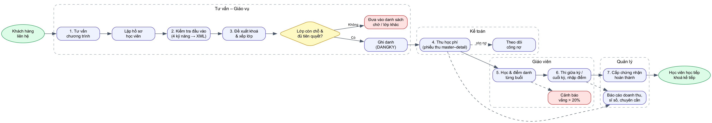

# Chương 1. Tổng quan

## 1.1 Giới thiệu bài toán

**ECMS (English Center Management System)** là hệ thống quản lý thông tin cho một chuỗi trung tâm tiếng Anh giả định gồm **3 chi nhánh** tại TP.HCM:

| Mã | Chi nhánh | Địa chỉ | Phòng học |
|---|---|---|:---:|
| CN01 | Thủ Đức | Khu phố 6, P. Linh Trung, TP. Thủ Đức | 4 |
| CN02 | Quận 1 | Đường Lê Lợi, P. Bến Nghé, Quận 1 | 4 |
| CN03 | Bình Thạnh | Đường Xô Viết Nghệ Tĩnh, P.25, Bình Thạnh | 4 |

Trung tâm mở **4 chương trình**: IELTS, TOEIC, Giao tiếp và Thiếu nhi. Mỗi chương trình gồm nhiều khoá học xếp theo trình độ (VD: IELTS Foundation → IELTS 5.5 → IELTS 6.5+), khoá sau yêu cầu học xong khoá trước (**khoá tiên quyết**). Mỗi khoá được mở thành nhiều **lớp** ở các chi nhánh, lớp có lịch cố định theo thứ – ca – phòng.

**Cơ cấu tổ chức**

| Vai trò | Số lượng (mỗi CN) | Công việc chính |
|---|:---:|---|
| Quản lý chi nhánh | 1 | Điều hành chi nhánh, duyệt mở lớp, xem báo cáo doanh thu – sĩ số |
| Giáo vụ (tư vấn) | 1–2 | Tư vấn, kiểm tra đầu vào, ghi danh, xếp lịch lớp |
| Kế toán | 1 | Thu học phí, theo dõi công nợ, tính lương giáo viên |
| Giáo viên | 3–4 | Dạy, điểm danh, nhập điểm, nhận xét học viên |
| Học viên | ~100 | Xem lịch học, điểm, công nợ của mình |

Nhân viên có thể có **người quản lý trực tiếp** (giáo viên → quản lý chi nhánh). Giáo viên là một loại nhân viên đặc biệt, có thêm loại (Việt Nam / bản ngữ), quốc tịch, trình độ, đơn giá mỗi buổi dạy và **nhiều chứng chỉ** (IELTS 8.0, TESOL, CELTA…).

## 1.2 Khảo sát quy trình nghiệp vụ

*Hình 1.1 – Quy trình nghiệp vụ trung tâm (file nguồn `docs/design/quy-trinh-nghiep-vu.drawio`, sinh từ `quy-trinh-nghiep-vu.dot`).*

| Bước | Nghiệp vụ | Người thực hiện | Dữ liệu tạo ra |
|:---:|---|---|---|
| 1 | **Tư vấn**: giới thiệu chương trình, học phí, lịch khai giảng; lập hồ sơ học viên | Giáo vụ | HOCVIEN |
| 2 | **Kiểm tra đầu vào**: test 4 kỹ năng Listening/Reading/Writing/Speaking; ghi nhận xét | Giáo vụ, giáo viên | KIEMTRA_DAUVAO (kết quả chi tiết dạng XML) |
| 3 | **Xếp lớp – ghi danh**: đề xuất khoá phù hợp điểm test, chọn lớp còn chỗ, kiểm tra khoá tiên quyết, áp dụng giảm giá | Giáo vụ | DANGKY |
| 4 | **Thu học phí**: lập phiếu thu cho một hoặc nhiều đăng ký, thu đủ hoặc thu một phần | Kế toán | PHIEUTHU, CT_PHIEUTHU |
| 5 | **Học & điểm danh**: mỗi buổi giáo viên điểm danh có mặt / vắng / đi muộn / có phép | Giáo viên | BUOIHOC, DIEMDANH |
| 6 | **Thi & đánh giá**: điểm giữa kỳ, cuối kỳ → điểm trung bình, kết quả Đạt / Không đạt | Giáo viên | DANGKY.DiemGK, DiemCK |
| 7 | **Cấp chứng nhận**: học viên đạt và chuyên cần ≥ 80% được cấp chứng nhận, tư vấn khoá kế tiếp | Quản lý | DANGKY.KetQua |

Song song là các nghiệp vụ nền: quản lý chi nhánh – phòng – ca, nhân sự và chứng chỉ giáo viên, xếp lịch lớp không trùng phòng/giáo viên, cảnh báo học viên vắng nhiều, tính lương giáo viên theo số buổi dạy, báo cáo cho quản lý.

## 1.3 Hiện trạng và vấn đề

Hiện trung tâm quản lý bằng **các file Excel rời** (mỗi chi nhánh một file ghi danh, kế toán một file thu tiền, giáo viên một file điểm danh). Khảo sát một file ghi danh mẫu (xem `docs/design/flat-example.xlsx`, task T06) cho thấy:

| Vấn đề | Biểu hiện thực tế |
|---|---|
| **Trùng lặp dữ liệu** | Họ tên, số điện thoại học viên lặp lại ở mỗi dòng ghi danh; tên khoá, học phí lặp lại ở mỗi học viên |
| **Sai lệch (dị thường cập nhật)** | Học viên đổi số điện thoại, chỉ sửa ở 1 trong 3 dòng → không biết số nào đúng |
| **Dị thường thêm / xoá** | Không thể nhập lớp mới chưa có học viên; xoá học viên cuối cùng của lớp thì mất luôn thông tin lớp |
| **Khó tổng hợp** | Doanh thu theo chi nhánh – tháng phải copy thủ công từ 3 file, mất 1–2 ngày mỗi cuối tháng |
| **Không kiểm soát ràng buộc** | Lớp vượt sĩ số, trùng phòng, ghi danh khi chưa học khoá tiên quyết vẫn nhập được |
| **Không phân quyền, không vết** | Ai có file cũng xem được lương giáo viên; không biết ai đã sửa số tiền phiếu thu |
| **Rủi ro mất dữ liệu** | File nằm trên máy cá nhân, không có sao lưu định kỳ |

⇒ Cần một **CSDL quan hệ tập trung** có ràng buộc toàn vẹn, phân quyền theo vai trò, nhật ký kiểm toán, sao lưu và một ứng dụng web có form nhập liệu – báo cáo.

## 1.4 Đặc tả yêu cầu

### 1.4.1 Tác nhân

| Tác nhân | Mô tả | Vai trò CSDL (T15) |
|---|---|---|
| Quản lý | Quản lý chi nhánh / ban giám đốc | `r_QuanLy` |
| Giáo vụ | Tư vấn, tuyển sinh, xếp lớp | `r_GiaoVu` |
| Kế toán | Thu học phí, công nợ, lương | `r_KeToan` |
| Giáo viên | Giảng dạy, điểm danh, nhập điểm | `r_GiaoVien` |
| Học viên | Tra cứu thông tin cá nhân | `r_HocVien` |
| Quản trị hệ thống | Tài khoản, phân quyền, sao lưu | `db_owner` |

### 1.4.2 Yêu cầu chức năng

| Mã | Yêu cầu | Tác nhân | Task |
|---|---|---|:---:|
| FR01 | Đăng nhập / đăng xuất, mật khẩu được băm, menu hiển thị theo vai trò | Tất cả | T15, T19 |
| FR02 | Quản lý danh mục chi nhánh, phòng học, ca học | Quản lý | T19 |
| FR03 | Quản lý nhân viên, giáo viên và chứng chỉ giáo viên (lương chỉ quản lý/kế toán thấy) | Quản lý | T19 |
| FR04 | Quản lý chương trình, khoá học, khoá tiên quyết | Giáo vụ | T20 |
| FR05 | Mở lớp: chọn khoá, chi nhánh, giáo viên, ngày khai giảng, sĩ số tối đa | Giáo vụ | T20 |
| FR06 | Xếp lịch học theo thứ – ca – phòng, báo trùng phòng / trùng giáo viên | Giáo vụ | T11, T20 |
| FR07 | Sinh tự động các buổi học từ lịch và ngày khai giảng, bỏ qua ngày lễ | Giáo vụ | T14, T20 |
| FR08 | Quản lý hồ sơ học viên, tìm kiếm nhiều tiêu chí có phân trang | Giáo vụ | T11, T21 |
| FR09 | Ghi nhận kiểm tra đầu vào 4 kỹ năng, lưu chi tiết dạng XML, gợi ý khoá học | Giáo vụ | T10, T21 |
| FR10 | Ghi danh học viên vào lớp: kiểm tra lớp còn chỗ, chưa đăng ký trùng, đã học khoá tiên quyết | Giáo vụ | T11, T21 |
| FR11 | Chuyển lớp cho học viên trong cùng khoá | Giáo vụ | T11 |
| FR12 | Lập phiếu thu master–detail cho nhiều đăng ký, in phiếu thu PDF | Kế toán | T11, T23 |
| FR13 | Theo dõi công nợ học viên, tô đỏ nợ quá hạn | Kế toán | T16, T23 |
| FR14 | Tính lương giáo viên theo số buổi dạy trong tháng | Kế toán | T14 |
| FR15 | Điểm danh cả lớp một lần lưu; giáo viên chỉ thấy lớp mình dạy | Giáo viên | T11, T22 |
| FR16 | Nhập điểm giữa kỳ / cuối kỳ, tự tính điểm TB, xếp loại, kết quả | Giáo viên | T11, T13, T22 |
| FR17 | Cảnh báo học viên vắng > 20% số buổi | Giáo viên, Giáo vụ | T14, T22 |
| FR18 | Học viên xem lịch học, bảng điểm, công nợ của mình | Học viên | T12, T16 |
| FR19 | Báo cáo danh sách lớp, doanh thu theo chi nhánh – tháng, bảng điểm, dashboard KPI; xuất PDF/Excel | Quản lý | T24 |
| FR20 | Ghi nhật ký mọi thay đổi trên đăng ký, phiếu thu, lương; xem nhật ký | Quản trị | T13, T19 |
| FR21 | Quản lý tài khoản người dùng, khoá / mở tài khoản | Quản trị | T19 |
| FR22 | Sao lưu – phục hồi CSDL, nhập / xuất dữ liệu CSV, XML, JSON | Quản trị | T17, T18 |

### 1.4.3 Yêu cầu phi chức năng

| Mã | Yêu cầu |
|---|---|
| NFR01 | **Toàn vẹn**: mọi nghiệp vụ nhiều bước (ghi danh, thu phí, chuyển lớp) chạy trong transaction; ràng buộc đặt tại CSDL (CHECK, FK, trigger) |
| NFR02 | **Bảo mật**: quyền tối thiểu – ứng dụng chỉ `EXECUTE` procedure và `SELECT` view, không truy cập bảng gốc; lương bị ẩn với vai trò không liên quan |
| NFR03 | **Truy vết**: thay đổi dữ liệu nhạy cảm được ghi vào NHATKY kèm người thực hiện và thời điểm |
| NFR04 | **Sẵn sàng**: RPO ≤ 15 phút, RTO ≤ 1 giờ (T17) |
| NFR05 | **Hiệu năng**: tra cứu học viên, lịch học < 1 giây với 10.000 học viên (chỉ mục phù hợp, T07/T09) |
| NFR06 | **Tiếng Việt**: collation `Vietnamese_CI_AS`, chuỗi `NVARCHAR`, báo cáo PDF hiển thị đúng dấu |
| NFR07 | **Dễ dùng**: menu tối đa 2 cấp, form có kiểm tra dữ liệu và thông báo lỗi rõ ràng (Chương 4) |
| NFR08 | **Tái lập**: dựng lại toàn bộ CSDL từ đầu bằng một lệnh `run_all` trên Windows và macOS |

### 1.4.4 Danh sách báo cáo cần có

| Báo cáo | Loại | Người dùng |
|---|---|---|
| Danh sách học viên theo lớp | Định kỳ (đầu khoá) | Giáo viên, Giáo vụ |
| Doanh thu theo chi nhánh → tháng (tổng phụ, tổng cộng) | Định kỳ (tháng/quý) | Quản lý, Kế toán |
| Bảng điểm lớp / lịch sử học tập học viên | Theo yêu cầu (có tham số) | Giáo viên, Học viên |
| Công nợ học viên | Theo yêu cầu | Kế toán |
| Cảnh báo chuyên cần | Định kỳ (tuần) | Giáo vụ |
| Bảng lương giáo viên | Định kỳ (tháng) | Kế toán |
| Dashboard KPI: học viên mới, doanh thu, lấp đầy lớp, chuyên cần | Tổng hợp | Quản lý |

## 1.5 Quy trình quản lý thông tin áp dụng vào ECMS

| Giai đoạn QLTT | Áp dụng trong ECMS | Kỹ thuật / chương |
|---|---|---|
| **1. Thu thập** | Form web nhập hồ sơ học viên, kết quả test, điểm danh, phiếu thu; import CSV đăng ký online; nhận XML từ hệ thống khác | Form (Ch.4), BULK INSERT / OPENXML (T10, T18) |
| **2. Tổ chức** | ERD → lược đồ quan hệ 3NF, 19 bảng, khoá, chỉ mục, RBTV; kết quả test lưu XML có XML Schema | Ch.2 (T04–T07) |
| **3. Chuyển đổi (xử lý)** | Truy vấn, view, procedure, function, trigger, cursor biến dữ liệu thô thành thông tin: sĩ số, công nợ, tỷ lệ chuyên cần, doanh thu | Ch.3 (T09–T14, T16) |
| **4. Trình bày** | Menu theo vai trò, form CRUD và master–detail, báo cáo PDF/Excel, dashboard | Ch.4 (T19–T24) |
| **5. An toàn** | Xác thực, phân quyền, view bảo mật, băm mật khẩu, nhật ký kiểm toán, sao lưu – phục hồi | Ch.3 (T13, T15–T17) |

## 1.6 Mô hình DIKW trên bài toán chuyên cần

| Tầng | Ví dụ trong ECMS | Đối tượng CSDL |
|---|---|---|
| **Data** – dữ liệu | Bản ghi điểm danh: *HV0123, lớp IE55-01, buổi 7, Vắng* | Bảng `DIEMDANH` |
| **Information** – thông tin | Học viên HV0123 vắng 4/12 buổi → **tỷ lệ chuyên cần 66,7%** | `fn_TyLeChuyenCan(@MaDK)` |
| **Knowledge** – tri thức | Thống kê nhiều khoá: học viên chuyên cần < 80% sau 1/3 khoá có tỷ lệ *Không đạt* cao hơn hẳn → **nhóm nguy cơ bỏ học** | `sp_CanhBaoChuyenCan`, báo cáo T24 |
| **Wisdom** – quyết định | Giáo vụ gọi điện chăm sóc, đề xuất học bù hoặc chuyển lớp phù hợp lịch; quản lý điều chỉnh ca học | Quy trình chăm sóc học viên |

Giá trị của hệ thống không nằm ở việc lưu dữ liệu điểm danh mà ở chuỗi biến đổi dữ liệu thành quyết định giữ chân học viên.

## 1.7 Bài thực hành 1 – Công cụ quản lý thông tin trong thực tế

Nhóm khảo sát ba nhóm công cụ các trung tâm ngoại ngữ đang dùng phổ biến:

| Tiêu chí | Excel / Google Sheets | Phần mềm quản lý trung tâm (CRM giáo dục) | LMS (Moodle, Google Classroom) |
|---|---|---|---|
| Mục đích chính | Bảng tính đa năng | Tuyển sinh, lớp, học phí, chăm sóc khách hàng | Giảng dạy, bài tập, chấm điểm trực tuyến |
| Mô hình dữ liệu | Phẳng (sheet) | Quan hệ (ẩn sau giao diện) | Quan hệ (Moodle: MySQL/PostgreSQL) |
| Ràng buộc toàn vẹn | Gần như không (data validation đơn giản) | Có, theo nghiệp vụ cài sẵn | Có, theo khoá học / người dùng |
| Phân quyền | Theo file (xem / sửa) | Theo vai trò | Theo vai trò (giảng viên, học viên) |
| Học phí, công nợ | Tự làm công thức | Có sẵn | Không có |
| Điểm danh, điểm số | Thủ công | Có | Có (mạnh về bài tập) |
| Báo cáo | Pivot thủ công | Mẫu có sẵn, khó tuỳ biến | Báo cáo học tập |
| Chi phí | Miễn phí / thấp | Thuê bao theo tháng, theo số học viên | Moodle miễn phí (tự vận hành), Classroom miễn phí |
| Tuỳ biến | Cao nhưng dễ sai | Thấp | Trung bình (plugin) |
| Truy vết, sao lưu | Lịch sử phiên bản (Sheets) | Có | Có |

**Rút ra yêu cầu cho ECMS**

1. Giữ sự **linh hoạt nhập liệu** của Excel nhưng chặn sai ngay tại CSDL (CHECK, trigger) → FR10, NFR01.
2. Học theo CRM: **luồng tuyển sinh liền mạch** từ test đầu vào → ghi danh → thu phí → FR09–FR12.
3. Học theo LMS: **giáo viên tự điểm danh, nhập điểm** trên lớp của mình → FR15–FR16.
4. Bổ sung điều cả ba công cụ ít làm tốt cho trung tâm nhỏ: **báo cáo tuỳ biến theo chi nhánh**, nhật ký kiểm toán và phân quyền đến mức cột (lương) → FR19–FR20, NFR02.

## 1.8 Phạm vi và giới hạn

- Không quản lý tuyển dụng nhân sự, kho giáo trình, thanh toán trực tuyến.
- Lương giáo viên chỉ tính theo số buổi dạy × đơn giá, không tính thuế, bảo hiểm.
- Ứng dụng web phục vụ nội bộ và học viên tra cứu; không có ứng dụng di động.
