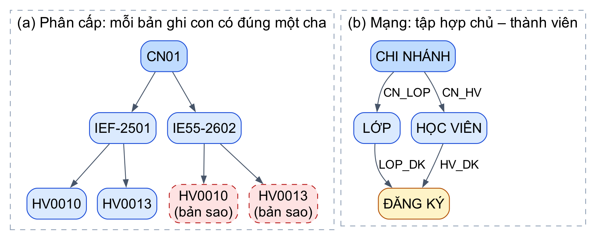
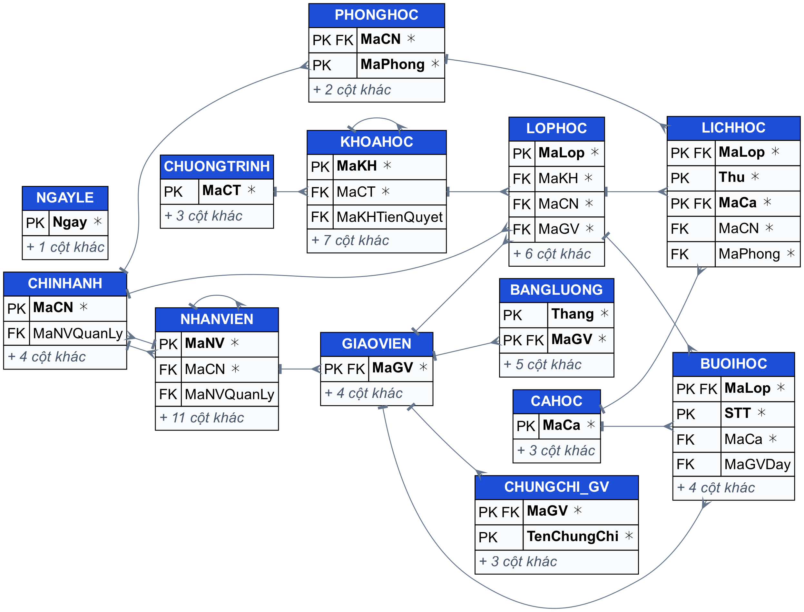
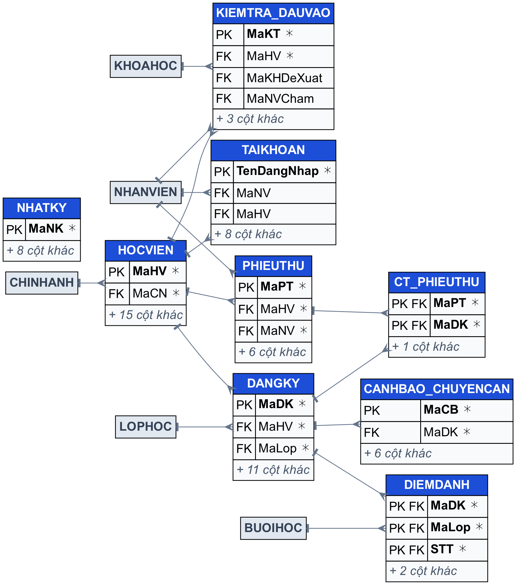

# Chương 2. Tổ chức thông tin

Tổ chức thông tin là bước quyết định chất lượng của mọi bước xử lý và trình bày phía sau: một mô hình dữ liệu tốt giúp loại bỏ trùng lặp, ngăn dữ liệu sai ngay từ khi nhập và cho phép truy vấn linh hoạt. Chương này đi từ mức khái niệm đến mức vật lý: mô hình thực thể – mối kết hợp (ERD), sơ đồ lớp UML, lược đồ quan hệ và chuẩn hoá, ràng buộc toàn vẹn, so sánh với mô hình phẳng, mô hình có cấu trúc và XML, cuối cùng là cài đặt CSDL trên SQL Server và sinh dữ liệu mẫu. Từ điển dữ liệu chi tiết từng cột được đặt ở Phụ lục C.

## 2.1 Mô hình thực thể – mối kết hợp

### 2.1.1 Tập thực thể

Từ quy trình nghiệp vụ ở mục 1.2, nhóm xác định **12 tập thực thể nghiệp vụ** và **2 tập thực thể hệ thống** (tài khoản đăng nhập, nhật ký thay đổi). Trong đó có một cấu trúc chuyên biệt hoá (giáo viên là một loại nhân viên) và hai thực thể yếu (phòng học phụ thuộc chi nhánh, buổi học phụ thuộc lớp học).

*Bảng 2.1 – Các tập thực thể của ECMS*

| Thực thể | Loại | Mô tả | Khoá |
|---|---|---|---|
| CHINHANH | Mạnh | Chi nhánh của trung tâm | MaCN |
| NHANVIEN | Mạnh (tổng quát) | Mọi nhân viên: quản lý, giáo vụ, kế toán, giáo viên | MaNV |
| GIAOVIEN | Chuyên biệt của NHANVIEN | Nhân viên giảng dạy, có thêm loại giáo viên, trình độ, đơn giá | MaGV (trùng MaNV) |
| PHONGHOC | Yếu, phụ thuộc CHINHANH | Phòng học; số phòng chỉ duy nhất trong một chi nhánh | (MaCN, MaPhong) |
| CAHOC | Mạnh | Ca học trong ngày | MaCa |
| CHUONGTRINH | Mạnh | Chương trình IELTS, TOEIC, Giao tiếp, Thiếu nhi | MaCT |
| KHOAHOC | Mạnh | Khoá học thuộc một chương trình | MaKH |
| LOPHOC | Mạnh | Một lần mở khoá học tại một chi nhánh | MaLop |
| BUOIHOC | Yếu, phụ thuộc LOPHOC | Buổi học thứ *n* của lớp | (MaLop, STT) |
| HOCVIEN | Mạnh | Người học | MaHV |
| KIEMTRA_DAUVAO | Mạnh | Một lần kiểm tra xếp lớp của học viên | MaKT |
| PHIEUTHU | Mạnh | Phiếu thu học phí | MaPT |
| TAIKHOAN | Mạnh (hệ thống) | Tài khoản đăng nhập ứng dụng | TenDangNhap |
| NHATKY | Mạnh (hệ thống) | Nhật ký thay đổi dữ liệu | MaNK |

Ngoài ra, bốn mối kết hợp có thuộc tính riêng sẽ được **thực thể hoá** thành bảng khi cài đặt: ĐĂNG KÝ (giữa học viên và lớp học), ĐIỂM DANH (giữa đăng ký và buổi học), CHI TIẾT PHIẾU THU (giữa phiếu thu và đăng ký) và LỊCH HỌC (mối kết hợp ba ngôi giữa lớp học, phòng học và ca học). Thuộc tính đa trị *Chứng chỉ* của giáo viên được tách thành bảng CHUNGCHI_GV. Ba bảng phụ trợ NGAYLE, CANHBAO_CHUYENCAN và BANGLUONG chứa dữ liệu tham số hoặc kết quả tính toán của procedure nên không được vẽ thành thực thể trên ERD. Như vậy 22 bảng của CSDL gồm 14 thực thể, 4 mối kết hợp được thực thể hoá, 1 bảng thuộc tính đa trị và 3 bảng phụ trợ.

### 2.1.2 Sơ đồ ERD

Sơ đồ ERD được vẽ theo ký hiệu Chen: thực thể là hình chữ nhật, thực thể yếu có viền đôi, mối kết hợp là hình thoi (viền đôi nếu là mối kết hợp xác định của thực thể yếu), bản số ghi theo dạng (min, max) cạnh mỗi thực thể tham gia. Hình 2.1 là sơ đồ tổng quan, vẽ 13 tập thực thể: thực thể NHATKY không tham gia mối kết hợp nào – mỗi dòng nhật ký do trigger ghi và chỉ lưu khoá của dòng bị thay đổi dưới dạng văn bản – nên không đưa lên sơ đồ. Hình 2.2 minh hoạ chi tiết các loại thuộc tính trên một số thực thể tiêu biểu.


*Hình 2.1 – Sơ đồ ERD tổng quan của ECMS*


*Hình 2.2 – Các loại thuộc tính trên ERD*

### 2.1.3 Phân loại thuộc tính

Bài toán ECMS có đủ các loại thuộc tính của mô hình ERD. Mỗi loại được cài đặt theo một cách khác nhau ở mức quan hệ, như tóm tắt trong Bảng 2.2:

*Bảng 2.2 – Các loại thuộc tính và cách cài đặt*

| Loại thuộc tính | Ví dụ trong ECMS | Cách cài đặt |
|---|---|---|
| Đơn trị, đơn | NgaySinh, SoDienThoai, HocPhi | Một cột |
| Khoá | MaHV, MaLop; khoá bộ phận của thực thể yếu: MaPhong, STT | PRIMARY KEY |
| Phức hợp | Họ tên gồm Họ và Tên; Địa chỉ gồm Số nhà, Phường/Xã, Quận/Huyện, Tỉnh/Thành phố | Tách thành nhiều cột; cột `HoTen` được tính bằng cách ghép lại |
| Đa trị | Một giáo viên có nhiều chứng chỉ (IELTS 8.0, TESOL, CELTA) | Bảng riêng CHUNGCHI_GV |
| Suy diễn | Tuổi từ ngày sinh; Thành tiền từ học phí và giảm giá; Điểm TB từ điểm giữa kỳ, cuối kỳ; Sĩ số hiện tại từ số đăng ký; Tổng tiền phiếu thu từ các dòng chi tiết; Điểm tổng kiểm tra đầu vào từ bốn kỹ năng | Cột tính toán (Tuổi, Thành tiền, Điểm TB); cột lưu sẵn do trigger duy trì (Sĩ số hiện tại, Tổng tiền); cột do procedure tính khi ghi (Điểm tổng) |
| Thuộc tính của mối kết hợp | ĐĂNG KÝ: ngày đăng ký, học phí, giảm giá, điểm, kết quả; ĐIỂM DANH: trạng thái | Cột của bảng liên kết |
| Bán cấu trúc | Kết quả chi tiết kiểm tra đầu vào (bốn kỹ năng, nhận xét) | Kiểu XML có XML Schema (mục 2.6.3, 3.1.3) |

### 2.1.4 Mối kết hợp và bản số

Bảng 2.3 liệt kê 22 mối kết hợp của ERD kèm bản số và loại. Cột cuối giải thích ý nghĩa nghiệp vụ, giúp kiểm tra bản số có đúng với thực tế hay không.

*Bảng 2.3 – Các mối kết hợp và bản số*

| STT | Mối kết hợp | Thực thể tham gia | Bản số | Loại | Ý nghĩa |
|:-:|---|---|---|---|---|
| 1 | Làm việc | CHINHANH – NHANVIEN | (1,n) – (1,1) | 1 – N | Mỗi nhân viên thuộc đúng một chi nhánh; chi nhánh có ít nhất một nhân viên |
| 2 | Quản lý chi nhánh | CHINHANH – NHANVIEN | (0,1) – (0,1) | 1 – 1 | Mỗi chi nhánh có tối đa một quản lý; một nhân viên quản lý tối đa một chi nhánh |
| 3 | Quản lý trực tiếp | NHANVIEN – NHANVIEN | (0,n) – (0,1) | Đệ quy 1 – N | Nhân viên có thể có một người quản lý trực tiếp |
| 4 | ISA | NHANVIEN – GIAOVIEN | – | Chuyên biệt hoá, rời nhau, không toàn phần | Giáo viên là nhân viên có thêm thuộc tính riêng; các nhân viên khác không là giáo viên |
| 5 | Có phòng | CHINHANH – PHONGHOC | (1,n) – (1,1) | 1 – N, xác định | Phòng chỉ định danh được khi biết chi nhánh |
| 6 | Gồm | CHUONGTRINH – KHOAHOC | (1,n) – (1,1) | 1 – N | Chương trình có nhiều khoá theo cấp độ |
| 7 | Tiên quyết | KHOAHOC – KHOAHOC | (0,n) – (0,1) | Đệ quy 1 – N | Một khoá yêu cầu tối đa một khoá phải học trước |
| 8 | Mở | KHOAHOC – LOPHOC | (0,n) – (1,1) | 1 – N | Một khoá được mở thành nhiều lớp |
| 9 | Tổ chức | CHINHANH – LOPHOC | (0,n) – (1,1) | 1 – N | Lớp học diễn ra tại một chi nhánh |
| 10 | Phụ trách | GIAOVIEN – LOPHOC | (0,n) – (1,1) | 1 – N | Mỗi lớp có một giáo viên phụ trách |
| 11 | Lịch học | LOPHOC – PHONGHOC – CAHOC | (1,n) – (0,n) – (0,n) | Ba ngôi | Lớp học vào một ca, tại một phòng, theo thứ trong tuần |
| 12 | Có buổi | LOPHOC – BUOIHOC | (0,n) – (1,1) | 1 – N, xác định | Buổi học thứ *n* của lớp; lớp mới mở chưa sinh buổi học nên bản số tối thiểu là 0 |
| 13 | Tiếp nhận | CHINHANH – HOCVIEN | (0,n) – (1,1) | 1 – N | Chi nhánh lập hồ sơ học viên |
| 14 | Dự kiểm tra | HOCVIEN – KIEMTRA_DAUVAO | (0,n) – (1,1) | 1 – N | Học viên có thể kiểm tra nhiều lần |
| 15 | Đề xuất | KHOAHOC – KIEMTRA_DAUVAO | (0,n) – (0,1) | 1 – N | Kết quả kiểm tra đề xuất một khoá học |
| 16 | Đăng ký | HOCVIEN – LOPHOC | (0,n) – (0,n) | N – M | Học viên học nhiều lớp, lớp có nhiều học viên; có thuộc tính học phí, điểm |
| 17 | Điểm danh | ĐĂNG KÝ – BUOIHOC | (0,n) – (0,n) | N – M (kết hợp hoá) | Mỗi đăng ký được điểm danh ở mỗi buổi của lớp |
| 18 | Đóng tiền | HOCVIEN – PHIEUTHU | (0,n) – (1,1) | 1 – N | Phiếu thu thuộc một học viên |
| 19 | Lập phiếu | NHANVIEN – PHIEUTHU | (0,n) – (1,1) | 1 – N | Kế toán lập phiếu thu |
| 20 | Chi tiết phiếu thu | PHIEUTHU – ĐĂNG KÝ | (1,n) – (0,n) | N – M | Một phiếu thu cho nhiều đăng ký; một đăng ký có thể đóng nhiều lần |
| 21 | Sử dụng | NHANVIEN – TAIKHOAN | (0,1) – (0,1) | 1 – 1 | Tài khoản ứng dụng của nhân viên |
| 22 | Sử dụng | HOCVIEN – TAIKHOAN | (0,1) – (0,1) | 1 – 1 | Tài khoản ứng dụng của học viên |

**Nhận xét.** ERD của ECMS chứa đủ các cấu trúc mà đề cương môn học yêu cầu: mối kết hợp 1 – 1 (số 2, 21, 22), 1 – N (số 1, 6, 8…), N – M (số 16, 17, 20), đệ quy (số 3, 7), ba ngôi (số 11), thực thể yếu (số 5, 12) và chuyên biệt hoá (số 4). Các cấu trúc này không được thêm vào cho đủ yêu cầu mà xuất phát trực tiếp từ nghiệp vụ: chẳng hạn mối kết hợp đệ quy *Tiên quyết* mô tả lộ trình học, còn mối kết hợp ba ngôi *Lịch học* là cách duy nhất diễn tả đồng thời lớp nào học ở phòng nào vào ca nào.

## 2.2 Từ điển dữ liệu

Từ điển dữ liệu mô tả từng cột của 22 bảng sau khi cài đặt: ý nghĩa, kiểu dữ liệu, cho phép NULL hay không và các ràng buộc. Vì dài khoảng mười trang, từ điển được đặt ở **Phụ lục C**; Bảng 2.4 tóm tắt cách chia nhóm. Để bảo đảm từ điển luôn khớp với script, nhóm sinh khung từ điển trực tiếp từ siêu dữ liệu của CSDL (`sys.columns`, `sys.check_constraints`, `sys.foreign_keys`) rồi bổ sung ý nghĩa và diễn giải ràng buộc.

*Bảng 2.4 – Các nhóm bảng trong từ điển dữ liệu*

| Nhóm | Bảng | Số bảng | Phụ lục |
|---|---|:-:|:-:|
| Danh mục | CHINHANH, NHANVIEN, GIAOVIEN, CHUNGCHI_GV, PHONGHOC, CAHOC, NGAYLE | 7 | C.1 |
| Đào tạo | CHUONGTRINH, KHOAHOC, LOPHOC, LICHHOC, BUOIHOC | 5 | C.2 |
| Học viên và học tập | HOCVIEN, KIEMTRA_DAUVAO, DANGKY, DIEMDANH, CANHBAO_CHUYENCAN | 5 | C.3 |
| Tài chính | PHIEUTHU, CT_PHIEUTHU, BANGLUONG | 3 | C.4 |
| Hệ thống | TAIKHOAN, NHATKY | 2 | C.5 |

Ba cột được bổ sung trong đợt rà soát cuối cùng đều xuất phát từ nghiệp vụ: `BUOIHOC.MaGVDay` ghi giáo viên thực sự dạy từng buổi để tính lương đúng khi đổi giáo viên giữa khoá; `PHIEUTHU.MaYeuCau` là mã yêu cầu lập phiếu, giúp lần bấm "Lập phiếu thu" thứ hai không sinh phiếu trùng; `TAIKHOAN.KhoaDen` ghi thời điểm hết tạm khoá sau 5 lần nhập sai mật khẩu.

## 2.3 Sơ đồ lớp UML

Song song với ERD, nhóm xây dựng sơ đồ lớp (Class Diagram) để nhìn bài toán theo góc độ hướng đối tượng: mỗi lớp gồm cả dữ liệu lẫn hành vi. Sơ đồ này là cơ sở cho lược đồ hướng đối tượng ở Chương 5. Ký hiệu phạm vi truy cập: `+` public, `-` private, `#` protected.


*Hình 2.3 – Sơ đồ lớp của ECMS*

### 2.3.1 Các lớp chính

Bảng 2.5 liệt kê các lớp chính, thuộc tính và phương thức tiêu biểu, cùng đối tượng CSDL hiện thực phương thức đó. Như vậy hành vi trong sơ đồ lớp không chỉ dừng ở thiết kế mà đều có đối tượng tương ứng ở Chương 3.

*Bảng 2.5 – Các lớp chính và đối tượng CSDL hiện thực phương thức*

| Lớp | Thuộc tính tiêu biểu | Phương thức | Hiện thực trong CSDL |
|---|---|---|---|
| «abstract» Nguoi | # ho, # ten, # ngaySinh, # gioiTinh | + hoTen(), + tuoi() | Các cột chung của HOCVIEN, NHANVIEN; cột tính toán `Tuoi` |
| HocVien | - maHV, - diaChi : DiaChi | + dangKy(), + congNo(), + lichHoc() | `sp_DangKyHoc`, `fn_SoTienConNo`, `fn_LichHocHocVien` |
| NhanVien | - chucVu, - luongCoBan | + nguoiQuanLy(), + lapPhieuThu() | `sp_ThuHocPhi` |
| GiaoVien | - loaiGV, - donGiaBuoi | + lopDangDay(), + tinhLuong() | `fn_LopCuaGiaoVien`, `sp_TinhLuongGiaoVien` |
| LopHoc | - maLop, - siSoToiDa | + siSoHienTai(), + siSoConLai(), + xepLich(), + sinhBuoiHoc() | Trigger sĩ số, `sp_XepLichLop`, `sp_SinhBuoiHoc` |
| DangKy «association class» | - hocPhi, - giamGia, - diemGK, - diemCK | + thanhTien(), + diemTB(), + ketQua(), + tyLeChuyenCan() | Cột tính toán, trigger kết quả, `fn_TyLeChuyenCan` |
| PhieuThu | - soPhieu, - ngayThu | + tinhTong(), + themDong(), + inPDF() | Trigger tổng tiền, báo cáo PDF |
| KiemTraDauVao | - listening, - reading, - writing, - speaking | + diemTong(), + deXuatKhoa() | `sp_GhiKetQuaKiemTra`, `fn_GoiYKhoaHoc` |

### 2.3.2 Các loại quan hệ giữa lớp

Sơ đồ lớp thể hiện được nhiều sắc thái quan hệ hơn ERD, đặc biệt là sự phân biệt giữa quan hệ thành phần và kết tập (Bảng 2.6).

*Bảng 2.6 – Các loại quan hệ giữa lớp*

| Quan hệ | Ký hiệu | Ví dụ trong ECMS | Ý nghĩa |
|---|---|---|---|
| Kế thừa (generalization) | Tam giác rỗng | Nguoi ← HocVien; Nguoi ← NhanVien ← GiaoVien | GiaoVien *là một* NhanVien, kế thừa họ tên, ngày sinh và phương thức tuoi() |
| Thành phần (composition) | Hình thoi đặc | LopHoc – BuoiHoc; PhieuThu – CTPhieuThu; ChiNhanh – PhongHoc; GiaoVien – ChungChi | Bộ phận không tồn tại độc lập: xoá lớp thì xoá buổi học (`ON DELETE CASCADE`) |
| Kết tập (aggregation) | Hình thoi rỗng | ChuongTrinh – KhoaHoc | Khoá học thuộc chương trình nhưng vẫn có ý nghĩa riêng; xoá chương trình không xoá khoá |
| Kết hợp (association) | Đường thẳng có bản số | GiaoVien 1 – 0..* LopHoc; KhoaHoc 0..1 – 0..* KhoaHoc | Liên kết thông thường, có thể đệ quy |
| Lớp liên kết (association class) | Nét đứt nối vào kết hợp | DangKy gắn với kết hợp HocVien 0..* – 0..* LopHoc | Kết hợp N – M có thuộc tính riêng |

### 2.3.3 So sánh ERD và sơ đồ lớp

Hai sơ đồ cùng mô tả một bài toán nhưng phục vụ hai mục đích khác nhau. Bảng 2.7 so sánh hai sơ đồ trên chính các cấu trúc của ECMS.

*Bảng 2.7 – So sánh ERD và sơ đồ lớp*

| Tiêu chí | ERD (ký hiệu Chen) | Sơ đồ lớp (UML) |
|---|---|---|
| Mục đích | Mô hình hoá **dữ liệu** cần lưu trữ, làm cơ sở thiết kế CSDL quan hệ | Mô hình hoá **đối tượng** gồm dữ liệu và hành vi, làm cơ sở thiết kế phần mềm |
| Thành phần | Thực thể, thuộc tính, mối kết hợp | Lớp, thuộc tính, phương thức, quan hệ |
| Hành vi | Không thể hiện; nghiệp vụ nằm ở procedure và trigger | Nằm ngay trong lớp: `LopHoc.siSoConLai()`, `PhieuThu.tinhTong()` |
| Đóng gói | Không có | Phạm vi truy cập `+`, `-`, `#` |
| Thuộc tính phức hợp | Hình elip con (Địa chỉ gồm Số nhà, Phường…) | Kiểu dữ liệu riêng `diaChi : DiaChi` |
| Thuộc tính đa trị | Hình elip đôi; khi cài đặt phải tách bảng | Thuộc tính kiểu tập hợp hoặc lớp thành phần ChungChi |
| Thuộc tính suy diễn | Hình elip nét đứt (Tuổi, Thành tiền) | Phương thức `tuoi()`, `thanhTien()` |
| Chuyên biệt hoá | ISA, ràng buộc rời nhau / toàn phần | Kế thừa, đa hình |
| Bản số | (min, max) đặt cạnh thực thể | Multiplicity `0..1`, `1..*`, `*` đặt ở đầu bên kia |
| Toàn thể – bộ phận | Chỉ biểu diễn gián tiếp qua thực thể yếu | Phân biệt rõ thành phần và kết tập |
| N – M có thuộc tính | Mối kết hợp có thuộc tính (ĐĂNG KÝ) | Lớp liên kết DangKy |
| Chuyển sang cài đặt | Gần như một – một sang lược đồ quan hệ (mục 2.4) | Sang mã nguồn hoặc CSDL hướng đối tượng (Chương 5) |

**Nhận xét.** Hai sơ đồ nhất quán với nhau về tập lớp, tập thực thể và bản số; chẳng hạn LopHoc 1 – 0..* BuoiHoc trên sơ đồ lớp tương ứng với bản số (0,n) – (1,1) của mối kết hợp *Có buổi* trên ERD. ERD phù hợp để thiết kế CSDL quan hệ – trọng tâm của đồ án; sơ đồ lớp bổ sung góc nhìn hành vi, và mỗi phương thức trong sơ đồ đều được hiện thực bằng function, procedure hoặc trigger ở Chương 3.

## 2.4 Mô hình quan hệ và chuẩn hoá

ERD và sơ đồ lớp ở hai mục trên thuộc **mức khái niệm**; lược đồ quan hệ trong mục này thuộc **mức logic**. Bảng 2.8 đối chiếu hai mức trên chính các thành phần của ECMS; mức thứ ba – mức vật lý với kiểu dữ liệu, chỉ mục, bảng mã so sánh – được trình bày ở mục 2.7.

*Bảng 2.8 – So sánh mô hình mức khái niệm và mức logic*

| Tiêu chí | Mức khái niệm (ERD, sơ đồ lớp) | Mức logic (lược đồ quan hệ) |
|---|---|---|
| Câu hỏi trả lời | Cần lưu thông tin gì, các đối tượng liên hệ với nhau ra sao | Thông tin được tổ chức thành những quan hệ nào, khoá nào |
| Phụ thuộc công nghệ | Không phụ thuộc mô hình dữ liệu hay hệ quản trị CSDL | Phụ thuộc mô hình dữ liệu đã chọn (quan hệ), chưa phụ thuộc hệ quản trị cụ thể |
| Người sử dụng chính | Người dùng nghiệp vụ, phân tích viên | Thiết kế viên CSDL, lập trình viên |
| Thành phần | Thực thể, thuộc tính, mối kết hợp, bản số | Quan hệ, thuộc tính, khoá chính, khoá ngoại, phụ thuộc hàm |
| Thuộc tính phức hợp, đa trị | Biểu diễn trực tiếp (Địa chỉ, Chứng chỉ) | Phải tách cột (SoNha, PhuongXa…) và tách quan hệ (CHUNGCHI_GV) |
| Mối kết hợp N – M | Hình thoi ĐĂNG KÝ có thuộc tính | Quan hệ riêng DANGKY với khoá thay thế MaDK |
| Ràng buộc biểu diễn được | Bản số, khoá thực thể, chuyên biệt hoá | Khoá, khoá ngoại, miền giá trị, phụ thuộc hàm |
| Cách kiểm tra chất lượng | Đối chiếu với quy trình nghiệp vụ (mục 1.2) | Kiểm tra dạng chuẩn (mục 2.4.3) |

### 2.4.1 Quy tắc chuyển ERD sang lược đồ quan hệ

Việc chuyển đổi tuân theo các quy tắc chuẩn của môn học. Bảng 2.9 ghi lại quy tắc và kết quả áp dụng cho từng loại cấu trúc của ERD.

*Bảng 2.9 – Quy tắc chuyển ERD sang lược đồ quan hệ*

| Cấu trúc ERD | Quy tắc chuyển đổi | Áp dụng trong ECMS |
|---|---|---|
| Thực thể mạnh | Mỗi thực thể thành một quan hệ; khoá thực thể thành khoá chính | CHINHANH, HOCVIEN, KHOAHOC… |
| Thực thể yếu | Quan hệ mới có khoá chính gồm khoá của thực thể chủ và khoá bộ phận | PHONGHOC (<u>MaCN, MaPhong</u>), BUOIHOC (<u>MaLop, STT</u>) |
| Thuộc tính phức hợp | Chỉ giữ các thuộc tính thành phần | HoHV, TenHV; SoNha, PhuongXa, QuanHuyen, TinhTP |
| Thuộc tính đa trị | Quan hệ riêng gồm khoá thực thể và giá trị | CHUNGCHI_GV (<u>MaGV, TenChungChi</u>, …) |
| Thuộc tính suy diễn | Không lưu, hoặc lưu có kiểm soát | Cột tính toán, trigger hoặc procedure (mục 2.4.3) |
| Mối kết hợp 1 – 1 | Khoá ngoại đặt ở một phía, kèm ràng buộc duy nhất | CHINHANH.*MaNVQuanLy*; TAIKHOAN.*MaNV*, *MaHV* |
| Mối kết hợp 1 – N | Khoá ngoại đặt ở phía N | LOPHOC.*MaKH*, *MaCN*, *MaGV*; PHIEUTHU.*MaHV* |
| Mối kết hợp N – M | Quan hệ mới có khoá là tổ hợp khoá hai phía, kèm thuộc tính của mối kết hợp | DANGKY, CT_PHIEUTHU, DIEMDANH |
| Mối kết hợp đệ quy | Khoá ngoại trỏ về chính quan hệ | NHANVIEN.*MaNVQuanLy*, KHOAHOC.*MaKHTienQuyet* |
| Mối kết hợp ba ngôi | Quan hệ mới chứa khoá của cả ba thực thể | LICHHOC (<u>*MaLop*, Thu, *MaCa*</u>, *MaCN*, *MaPhong*) |
| Chuyên biệt hoá | Một quan hệ cho lớp cha, một quan hệ cho lớp con; khoá lớp con đồng thời là khoá ngoại tới lớp cha | NHANVIEN, GIAOVIEN (<u>*MaGV*</u>) |

Riêng quan hệ DANGKY dùng **khoá thay thế** MaDK (số tự tăng) thay cho khoá tự nhiên (MaHV, MaLop). Khoá tự nhiên vẫn được giữ bằng ràng buộc UNIQUE, nhưng MaDK ngắn hơn khi làm khoá ngoại ở ba bảng DIEMDANH, CT_PHIEUTHU và CANHBAO_CHUYENCAN, giúp giảm kích thước chỉ mục và đơn giản tham số của các procedure.

### 2.4.2 Lược đồ quan hệ

Áp dụng các quy tắc trên thu được 22 lược đồ quan hệ (Bảng 2.10). Quy ước: <u>gạch chân</u> là khoá chính được khai báo, *in nghiêng* là khoá ngoại, dấu ° đánh dấu thuộc tính suy diễn được lưu.

*Bảng 2.10 – Lược đồ quan hệ của ECMS*

| STT | Lược đồ quan hệ |
|:-:|---|
| 1 | CHINHANH (<u>MaCN</u>, TenCN, DiaChi, SoDienThoai, NgayThanhLap, *MaNVQuanLy*) |
| 2 | NHANVIEN (<u>MaNV</u>, HoNV, TenNV, NgaySinh, GioiTinh, SoDienThoai, Email, ChucVu, LuongCoBan, NgayVaoLam, *MaCN*, *MaNVQuanLy*, TrangThai) |
| 3 | GIAOVIEN (<u>*MaGV*</u>, LoaiGV, QuocTich, TrinhDo, DonGiaBuoi) |
| 4 | CHUNGCHI_GV (<u>*MaGV*, TenChungChi</u>, Diem, NgayCap, NoiCap) |
| 5 | PHONGHOC (<u>*MaCN*, MaPhong</u>, SucChua, LoaiPhong) |
| 6 | CAHOC (<u>MaCa</u>, TenCa, GioBatDau, GioKetThuc) |
| 7 | CHUONGTRINH (<u>MaCT</u>, TenCT, DoiTuong, MoTa) |
| 8 | KHOAHOC (<u>MaKH</u>, TenKH, *MaCT*, CapDo, DiemDauVaoTu, DiemDauVaoDen, MucTieuDauRa, SoBuoi, HocPhi, *MaKHTienQuyet*) |
| 9 | LOPHOC (<u>MaLop</u>, TenLop, *MaKH*, *MaCN*, *MaGV*, NgayKhaiGiang, NgayKetThuc, SiSoToiDa, SiSoHienTai°, TrangThai) |
| 10 | LICHHOC (<u>*MaLop*, Thu, *MaCa*</u>, *MaCN*, *MaPhong*) |
| 11 | BUOIHOC (<u>*MaLop*, STT</u>, NgayHoc, *MaCa*, MaPhong, NoiDung, TrangThai, *MaGVDay*) |
| 12 | HOCVIEN (<u>MaHV</u>, HoHV, TenHV, NgaySinh, GioiTinh, SoDienThoai, Email, SoNha, PhuongXa, QuanHuyen, TinhTP, HoTenPhuHuynh, NgayTao, *MaCN*, TrangThai) |
| 13 | KIEMTRA_DAUVAO (<u>MaKT</u>, *MaHV*, NgayKT, DiemTong°, KetQuaChiTiet, *MaKHDeXuat*, *MaNVCham*) |
| 14 | DANGKY (<u>MaDK</u>, *MaHV*, *MaLop*, NgayDK, HocPhi, GiamGia, ThanhTien°, HanDongHP°, TrangThaiHP°, DiemGK, DiemCK, DiemTB°, KetQua°, TrangThai) |
| 15 | DIEMDANH (<u>*MaDK*, *MaLop*, *STT*</u>, TrangThai, GhiChu) |
| 16 | PHIEUTHU (<u>MaPT</u>, SoPhieu°, *MaHV*, *MaNV*, NgayThu, HinhThuc, TongTien°, GhiChu, MaYeuCau) |
| 17 | CT_PHIEUTHU (<u>*MaPT*, *MaDK*</u>, SoTien) |
| 18 | TAIKHOAN (<u>TenDangNhap</u>, MatKhauHash, Salt, VaiTro, *MaNV*, *MaHV*, TrangThai, SoLanSai, KhoaDen, LanDangNhapCuoi, NgayTao) |
| 19 | NHATKY (<u>MaNK</u>, TenBang, ThaoTac, KhoaChinh, DuLieuCu, DuLieuMoi, NguoiThucHien, NguoiDungUD, ThoiGian) |
| 20 | NGAYLE (<u>Ngay</u>, TenNgayLe) |
| 21 | CANHBAO_CHUYENCAN (<u>MaCB</u>, *MaDK*, NgayCanhBao, SoBuoiDaHoc°, SoBuoiVang°, TyLeVang°, MucDo°, DaXuLy) |
| 22 | BANGLUONG (<u>Thang, *MaGV*</u>, SoBuoiDay, DonGiaBuoi, LuongCoBan, TongLuong°, NgayTinh) |

Trong đó LICHHOC có hai khoá ngoại phức hợp (MaLop, MaCN) → LOPHOC và (MaCN, MaPhong) → PHONGHOC; DIEMDANH có hai khoá ngoại phức hợp (MaDK, MaLop) → DANGKY và (MaLop, STT) → BUOIHOC. Hai quan hệ này chứa cột dư thừa để khai báo được các khoá ngoại phức hợp; hệ quả đối với dạng chuẩn được phân tích ở mục 2.4.3.

### 2.4.3 Phụ thuộc hàm và kiểm tra dạng chuẩn

Nhóm kiểm tra dạng chuẩn theo các định nghĩa của môn học, xét trên **khoá dự tuyển** (khoá tối tiểu) chứ không chỉ trên khoá chính được khai báo:

- **2NF:** không có thuộc tính không khoá nào phụ thuộc vào *một phần* của một khoá dự tuyển.
- **3NF:** với mọi phụ thuộc X → A không hiển nhiên, X là siêu khoá hoặc A là thuộc tính khoá – tức không có thuộc tính không khoá phụ thuộc *bắc cầu* qua một thuộc tính không khoá khác.
- **BCNF:** với mọi phụ thuộc X → A không hiển nhiên, X là siêu khoá.

Với mỗi quan hệ, nhóm liệt kê các phụ thuộc hàm ngoài phụ thuộc "khoá chính xác định mọi thuộc tính". Hai cột tính toán không lưu (`HoTen`, `Tuoi`) không được xét vì không chiếm chỗ lưu trữ và luôn được tính lại khi đọc, tương tự một view. Sáu quan hệ không có phụ thuộc hàm nào khác – GIAOVIEN, CHUNGCHI_GV, PHONGHOC, CT_PHIEUTHU, NHATKY, NGAYLE – hiển nhiên đạt BCNF; 16 quan hệ còn lại được phân tích trong Bảng 2.11.

*Bảng 2.11 – Phụ thuộc hàm và dạng chuẩn của 16 quan hệ*

| Quan hệ | Phụ thuộc hàm khác | Khoá dự tuyển | Dạng chuẩn cao nhất |
|---|---|---|---|
| CHINHANH | TenCN → MaCN; MaNVQuanLy → MaCN | MaCN, TenCN, MaNVQuanLy | BCNF |
| NHANVIEN | SoDienThoai → MaNV; Email → MaNV | MaNV, SoDienThoai, Email | BCNF |
| CAHOC | TenCa → MaCa | MaCa, TenCa | BCNF |
| CHUONGTRINH | TenCT → MaCT | MaCT, TenCT | BCNF |
| KHOAHOC | TenKH → MaKH; (MaCT, CapDo) → MaKH | MaKH, TenKH, (MaCT, CapDo) | BCNF |
| LOPHOC | Không có trong nội bộ quan hệ; SiSoHienTai được suy ra từ số dòng của DANGKY | MaLop | BCNF, có giá trị suy diễn từ quan hệ khác |
| BUOIHOC | (MaLop, NgayHoc, MaCa) → STT | (MaLop, STT), (MaLop, NgayHoc, MaCa) | BCNF |
| HOCVIEN | Không có (tên phường trùng nhau giữa các quận nên PhuongXa không xác định QuanHuyen) | MaHV | BCNF |
| TAIKHOAN | MaNV → TenDangNhap; MaHV → TenDangNhap | TenDangNhap, MaNV, MaHV | BCNF |
| PHIEUTHU | SoPhieu → MaPT; MaYeuCau → MaPT; TongTien được suy ra từ CT_PHIEUTHU | MaPT, SoPhieu, MaYeuCau | BCNF, có giá trị suy diễn từ quan hệ khác |
| DANGKY | (MaHV, MaLop) → MaDK; (HocPhi, GiamGia) → ThanhTien; NgayDK → HanDongHP; (DiemGK, DiemCK) → DiemTB; DiemTB → KetQua | MaDK, (MaHV, MaLop) | 2NF – vi phạm 3NF |
| KIEMTRA_DAUVAO | KetQuaChiTiet → DiemTong | MaKT | 2NF – vi phạm 3NF |
| BANGLUONG | (LuongCoBan, SoBuoiDay, DonGiaBuoi) → TongLuong | (Thang, MaGV) | 2NF – vi phạm 3NF |
| CANHBAO_CHUYENCAN | (MaDK, NgayCanhBao) → MaCB; (SoBuoiDaHoc, SoBuoiVang) → TyLeVang; TyLeVang → MucDo | MaCB, (MaDK, NgayCanhBao) | 2NF – vi phạm 3NF |
| LICHHOC | MaLop → MaCN | (MaLop, Thu, MaCa) | 1NF – vi phạm 2NF |
| DIEMDANH | MaDK → MaLop | (MaDK, STT) | 1NF – vi phạm 2NF |

Tổng hợp lại, lược đồ đạt **1NF** cho mọi quan hệ: thuộc tính phức hợp đã tách cột, thuộc tính đa trị đã tách bảng; riêng cột `KetQuaChiTiet` kiểu XML được xem là một giá trị nguyên tố đối với mô hình quan hệ và chỉ được phân tích bằng các phương thức XML. **16/22 quan hệ đạt BCNF**; 4 quan hệ chỉ đạt **2NF** vì lưu thuộc tính suy diễn; 2 quan hệ **vi phạm 2NF** vì chứa cột dư thừa phục vụ khoá ngoại phức hợp. Các trường hợp chưa chuẩn hoá được phân tích dưới đây.

**DIEMDANH – vi phạm 2NF.** Khoá chính được khai báo là (MaDK, MaLop, STT). Vì mỗi đăng ký thuộc đúng một lớp nên có phụ thuộc MaDK → MaLop; do đó (MaDK, STT) đã xác định mọi thuộc tính của quan hệ. Khoá khai báo vì vậy không tối tiểu – nó là một siêu khoá – và khoá dự tuyển duy nhất là (MaDK, STT). MaLop không thuộc khoá dự tuyển nào nên là thuộc tính không khoá, lại phụ thuộc vào một phần của khoá (MaDK): đây là **phụ thuộc bộ phận**, nên DIEMDANH vi phạm 2NF.

Phương án chuẩn hoá là tách DIEMDANH thành R<sub>1</sub>(MaDK, MaLop) và R<sub>2</sub>(MaDK, STT, TrangThai, GhiChu). Phép tách này không mất thông tin vì R<sub>1</sub> ∩ R<sub>2</sub> = MaDK là khoá của R<sub>1</sub>, và bảo toàn phụ thuộc hàm. R<sub>1</sub> thực chất đã có sẵn trong DANGKY, nên kết quả chỉ là bỏ cột MaLop khỏi DIEMDANH; quan hệ còn lại đạt BCNF. Nhóm **không** chọn phương án này vì một lý do cụ thể: ràng buộc RB13 (học viên chỉ được điểm danh ở buổi học của lớp mình đăng ký, mục 2.5) cần so khớp cặp (MaLop, STT) với khoá của BUOIHOC. Khi DIEMDANH không có MaLop, ràng buộc này không khai báo được bằng khoá ngoại mà phải viết trigger kết nối sang DANGKY ở mỗi lần thêm, sửa điểm danh. Bảng 2.12 so sánh hai phương án.

*Bảng 2.12 – Hai phương án thiết kế DIEMDANH*

| Tiêu chí | Giữ MaLop (phương án đang dùng) | Bỏ MaLop (đạt BCNF) |
|---|---|---|
| Dạng chuẩn | 1NF, vi phạm 2NF | BCNF |
| Cài đặt RB13 | Hai khoá ngoại phức hợp (MaDK, MaLop) → DANGKY và (MaLop, STT) → BUOIHOC, CSDL tự kiểm tra | Trigger tra MaLop của đăng ký rồi kiểm tra buổi học, có thể bị vô hiệu hoá nhầm |
| Dị thường cập nhật | Không xảy ra: khoá ngoại (MaDK, MaLop) chỉ nhận đúng cặp đang có trong DANGKY, nên hai dòng cùng MaDK không thể mang hai MaLop khác nhau | Không có |
| Điểm danh cả lớp theo buổi | Đọc thẳng chỉ mục `IX_DIEMDANH_Buoi (MaLop, STT)` | Phải kết nối với DANGKY để lọc theo lớp |
| Chi phí lưu trữ | Thêm khoảng 85 KB cho 10.063 dòng (đo bằng `DATALENGTH`) | Không |

Lưu ý thêm: vì MaLop được khoá ngoại xác định theo MaDK, khoá chính khai báo (MaDK, MaLop, STT) bảo đảm đúng cùng một tính duy nhất như (MaDK, STT), nên dữ liệu không thể sai. Tuy vậy, về lý thuyết nên khai báo khoá chính là đúng khoá dự tuyển (MaDK, STT); nhóm ghi nhận đây là điểm sẽ điều chỉnh nếu thiết kế lại.

**LICHHOC – vi phạm 2NF.** Tình huống tương tự: khoá dự tuyển là (MaLop, Thu, MaCa) và có phụ thuộc bộ phận MaLop → MaCN. Nếu bỏ MaCN khỏi LICHHOC để đạt BCNF, khoá ngoại tới PHONGHOC chỉ còn dựa trên MaPhong – không đủ vì số phòng chỉ duy nhất trong một chi nhánh – hoặc phải viết trigger tra ngược chi nhánh của lớp mỗi lần thêm, sửa lịch. Phương án giữ MaCN tốn thêm 4 byte mỗi dòng nhưng để CSDL tự kiểm tra bằng ràng buộc khai báo: nhanh hơn trigger, không thể bị vô hiệu hoá nhầm và dễ đọc hơn. Nhóm chọn phương án này.

**DANGKY, KIEMTRA_DAUVAO, BANGLUONG, CANHBAO_CHUYENCAN – đạt 2NF, vi phạm 3NF.** Cả bốn quan hệ không có phụ thuộc bộ phận, nhưng đều chứa thuộc tính suy diễn phụ thuộc bắc cầu qua thuộc tính không khoá, ví dụ MaDK → (HocPhi, GiamGia) → ThanhTien hay MaKT → KetQuaChiTiet → DiemTong. Phương án chuẩn hoá là không lưu các thuộc tính suy diễn mà tính chúng trong view; khi đó cả bốn quan hệ đạt BCNF. Nhóm vẫn lưu chúng vì ba lý do: truy vấn công nợ, bảng điểm và lọc theo điểm đầu vào chạy trên hàng trăm dòng mỗi lần mở trang; cột lưu sẵn đánh chỉ mục được; và BANGLUONG, CANHBAO_CHUYENCAN là **chứng từ** chốt tại một thời điểm – lương tháng 9 không được thay đổi khi đơn giá của giáo viên tăng vào tháng 10. Các thuộc tính DonGiaBuoi, LuongCoBan trong BANGLUONG và SoBuoiDaHoc, SoBuoiVang trong CANHBAO_CHUYENCAN chính là ảnh chụp tại thời điểm tính nên không phụ thuộc hàm vào MaGV hay MaDK.

Rủi ro của việc lưu thuộc tính suy diễn là dị thường cập nhật: giá trị nguồn thay đổi nhưng giá trị suy diễn không đổi theo. Bảng 2.13 ghi lại cơ chế loại bỏ rủi ro này cho từng trường hợp; cột cuối nêu rõ giá trị được ai tính và ai được phép ghi.

*Bảng 2.13 – Chỗ chưa chuẩn hoá đầy đủ và cơ chế bảo đảm nhất quán*

| Quan hệ | Phụ thuộc chưa chuẩn hoá | Lý do giữ | Cơ chế bảo đảm nhất quán |
|---|---|---|---|
| LICHHOC | MaLop → MaCN (vi phạm 2NF) | Khoá ngoại (MaCN, MaPhong) bắt phòng phải thuộc chi nhánh của lớp | Khoá ngoại (MaLop, MaCN) → LOPHOC chỉ chấp nhận đúng cặp lớp – chi nhánh đang có |
| DIEMDANH | MaDK → MaLop (vi phạm 2NF) | Khoá ngoại (MaLop, STT) bắt buổi học thuộc đúng lớp của đăng ký | Khoá ngoại (MaDK, MaLop) → DANGKY |
| DANGKY | ThanhTien, HanDongHP, DiemTB (vi phạm 3NF) | Truy vấn công nợ, bảng điểm nhanh | Cột tính toán lưu sẵn (PERSISTED): SQL Server tự tính lại, không ai ghi trực tiếp được |
| DANGKY | KetQua (vi phạm 3NF) | Báo cáo kết quả, kiểm tra khoá tiên quyết | Trigger `trg_DangKy_KetQua` tính lại mỗi khi điểm thay đổi |
| KIEMTRA_DAUVAO | DiemTong (vi phạm 3NF) | Lọc và gợi ý khoá học mà không phải phân tích XML | Chỉ được ghi qua `sp_GhiKetQuaKiemTra`, procedure tính DiemTong và dựng XML từ cùng bốn điểm kỹ năng; tài khoản của ứng dụng (`r_App`) bị DENY trên mọi bảng, vai trò giáo vụ chỉ có SELECT |
| BANGLUONG | TongLuong (vi phạm 3NF) | Bảng lương là chứng từ theo tháng | Cột tính toán lưu sẵn |
| CANHBAO_CHUYENCAN | TyLeVang, MucDo (vi phạm 3NF) | Ảnh chụp tình trạng chuyên cần tại ngày cảnh báo | Do `sp_CanhBaoChuyenCan` tính và ghi một lần; ứng dụng chỉ sửa được cờ DaXuLy qua `sp_XuLyCanhBao` |
| LOPHOC, PHIEUTHU, DANGKY | SiSoHienTai, TongTien, TrangThaiHP (suy diễn từ quan hệ khác) | Kiểm tra lớp còn chỗ, báo cáo doanh thu và công nợ | Trigger trên DANGKY và CT_PHIEUTHU |

Riêng DiemTong không có trigger hay cột tính toán bảo vệ, nên nhóm kiểm tra trực tiếp trên dữ liệu: cả **357/357** bài kiểm tra có DiemTong bằng trung bình bốn điểm kỹ năng trong XML (làm tròn một chữ số). Thao tác duy nhất có thể làm lệch là sửa XML trực tiếp bằng `.modify()` với quyền chủ sở hữu CSDL; truy vấn minh hoạ X09 ở mục 3.1.3 vì vậy tính lại DiemTong ngay trong cùng giao dịch. Hướng cải tiến là thay DiemTong bằng cột tính toán gọi hàm đọc XML, đổi lại mỗi lần đọc phải phân tích XML.

## 2.5 Ràng buộc toàn vẹn

### 2.5.1 Đặc tả ràng buộc

Ràng buộc toàn vẹn (RBTV) là các quy tắc mà dữ liệu phải luôn thoả. Nhóm đặc tả 21 RBTV, phân theo năm loại của môn học: miền giá trị, liên thuộc tính, liên bộ, khoá ngoại và liên quan hệ (Bảng 2.14). Cột cuối cho biết cơ chế cài đặt; nguyên tắc chung là ưu tiên ràng buộc khai báo (CHECK, UNIQUE, khoá ngoại) và chỉ dùng trigger hoặc procedure khi ràng buộc vượt quá phạm vi một dòng.

*Bảng 2.14 – Đặc tả ràng buộc toàn vẹn*

| Mã | Loại | Nội dung | Bối cảnh | Cài đặt |
|---|---|---|---|---|
| RB01 | Miền giá trị | Giới tính thuộc {Nam, Nữ} | NHANVIEN, HOCVIEN | CHECK |
| RB02 | Miền giá trị | Điểm giữa kỳ, cuối kỳ từ 0 đến 10; giảm giá từ 0 đến 50% | DANGKY | CHECK |
| RB03 | Miền giá trị | Trạng thái điểm danh thuộc {Có mặt, Vắng, Muộn, Có phép} | DIEMDANH | CHECK |
| RB04 | Liên thuộc tính | Giờ kết thúc lớn hơn giờ bắt đầu | CAHOC | CHECK |
| RB05 | Liên thuộc tính | Ngày kết thúc sau ngày khai giảng | LOPHOC | CHECK |
| RB06 | Liên thuộc tính | Sĩ số hiện tại không vượt sĩ số tối đa | LOPHOC | CHECK và trigger `trg_DangKy_KiemTraSiSo` chặn khi lớp đầy |
| RB07 | Liên thuộc tính | Nhân viên từ 18 đến 65 tuổi tại ngày vào làm | NHANVIEN | CHECK `CK_NHANVIEN_Tuoi` (cận dưới, so ngày chính xác) và `CK_NHANVIEN_TuoiLaoDong` (cả hai cận, gọi hàm `fn_TinhTuoi`, mục 3.3.2) |
| RB08 | Liên bộ | Mỗi học viên đăng ký một lớp tối đa một lần | DANGKY | UNIQUE (MaHV, MaLop) |
| RB09 | Liên bộ | Một phòng, một ca, một thứ chỉ có một lớp trong cùng khoảng thời gian | LICHHOC, LOPHOC | Trigger `trg_LichHoc_KiemTraTrung`, procedure `sp_XepLichLop` |
| RB10 | Liên bộ | Giáo viên không dạy hai lớp cùng thứ, cùng ca trong cùng khoảng thời gian | LICHHOC, LOPHOC | Trigger `trg_LichHoc_KiemTraTrung` |
| RB11 | Khoá ngoại | Mỗi lớp thuộc một khoá học, chi nhánh và giáo viên đang tồn tại | LOPHOC | FOREIGN KEY |
| RB12 | Liên quan hệ | Phòng của lịch học phải thuộc chi nhánh của lớp | LICHHOC, LOPHOC, PHONGHOC | Khoá ngoại phức hợp (MaLop, MaCN), (MaCN, MaPhong) |
| RB13 | Liên quan hệ | Học viên chỉ được điểm danh ở buổi học của lớp mình đăng ký | DIEMDANH, DANGKY, BUOIHOC | Khoá ngoại phức hợp (MaDK, MaLop), (MaLop, STT) |
| RB14 | Liên quan hệ | Sĩ số hiện tại bằng số đăng ký đang học hoặc đã hoàn thành của lớp | LOPHOC, DANGKY | Trigger `trg_DangKy_SiSo` |
| RB15 | Liên quan hệ | Tổng tiền phiếu thu bằng tổng số tiền các dòng chi tiết | PHIEUTHU, CT_PHIEUTHU | Trigger `trg_CTPhieuThu_TongTien` |
| RB16 | Liên quan hệ | Đăng ký trong chi tiết phiếu thu phải của chính học viên trên phiếu; tổng đã thu không vượt thành tiền | CT_PHIEUTHU, PHIEUTHU, DANGKY | Trigger `trg_CTPhieuThu_TongTien` |
| RB17 | Liên quan hệ | Học viên chỉ được đăng ký khoá có tiên quyết khi đã đạt khoá tiên quyết hoặc có điểm đầu vào đủ cao | DANGKY, LOPHOC, KHOAHOC | Procedure `sp_DangKyHoc` |
| RB18 | Liên thuộc tính | Tài khoản vai trò Học viên gắn mã học viên, các vai trò khác gắn mã nhân viên | TAIKHOAN | CHECK |
| RB19 | Miền giá trị | Mã khoá học dài 2 đến 5 ký tự, chỉ gồm chữ in hoa và chữ số, để mã lớp tự sinh (MaKH-yynn) vừa 10 ký tự | KHOAHOC | CHECK `CK_KHOAHOC_MaKH` |
| RB20 | Liên bộ | Mỗi mã yêu cầu lập phiếu chỉ sinh một phiếu thu (bấm "Lập phiếu thu" hai lần không tạo phiếu trùng) | PHIEUTHU | Chỉ mục duy nhất có lọc `UX_PHIEUTHU_MaYeuCau`, procedure `sp_ThuHocPhi` |
| RB21 | Liên quan hệ | Giáo viên đã có bảng lương hoặc buổi đã dạy không bị xoá và không đổi được sang chức vụ khác | GIAOVIEN, BANGLUONG, BUOIHOC | Khoá ngoại chặn xoá; procedure `sp_LuuNhanVien` (lỗi 50132), `sp_XoaNhanVien` |

### 2.5.2 Bảng tầm ảnh hưởng

Bảng tầm ảnh hưởng xác định thao tác nào trên quan hệ nào có thể làm vi phạm ràng buộc, từ đó biết cần kiểm tra ở đâu. Ký hiệu: **+** là thao tác có thể vi phạm (phải kiểm tra), **–** là không vi phạm, **+(cột)** là chỉ vi phạm khi sửa cột đó. Các RBTV miền giá trị và liên thuộc tính trên một dòng đơn giản (RB01–RB04, RB07, RB18, RB19) được CHECK kiểm tra ở mọi thao tác thêm và sửa nên không đưa vào Bảng 2.15.

*Bảng 2.15 – Bảng tầm ảnh hưởng của các ràng buộc liên dòng và liên quan hệ*

| RBTV | Quan hệ | Thêm | Xoá | Sửa |
|---|---|:-:|:-:|:-:|
| RB05 | LOPHOC | + | – | +(NgayKhaiGiang, NgayKetThuc) |
| RB06, RB14 | LOPHOC | + | – | +(SiSoToiDa, SiSoHienTai) |
| | DANGKY | + | + | +(MaLop, TrangThai) |
| RB08 | DANGKY | + | – | +(MaHV, MaLop) |
| RB09, RB10 | LICHHOC | + | – | +(Thu, MaCa, MaPhong) |
| | LOPHOC | – | – | +(MaGV, NgayKhaiGiang, NgayKetThuc) |
| RB12 | LICHHOC | + | – | +(MaCN, MaPhong) |
| | LOPHOC | – | – | +(MaCN), bị khoá ngoại chặn |
| | PHONGHOC | – | + | +(MaCN, MaPhong) |
| RB13 | DIEMDANH | + | – | +(MaDK, MaLop, STT) |
| | DANGKY | – | + (xoá lan truyền) | +(MaLop) |
| | BUOIHOC | – | + | +(MaLop, STT) |
| RB15, RB16 | CT_PHIEUTHU | + | + | +(SoTien, MaDK) |
| | PHIEUTHU | – | + (xoá lan truyền) | +(MaHV) |
| | DANGKY | – | + | +(HocPhi, GiamGia) |
| RB17 | DANGKY | + | – | +(MaLop) |
| | DANGKY của khoá tiên quyết | – | + | +(KetQua) |
| RB20 | PHIEUTHU | + | – | +(MaYeuCau) |
| RB21 | NHANVIEN | – | + (xoá lan truyền sang GIAOVIEN) | +(ChucVu) |
| | GIAOVIEN | – | + | – |

**Nhận xét.** Bảng tầm ảnh hưởng giải thích vì sao trigger trên DANGKY phải đăng ký cả ba sự kiện INSERT, UPDATE và DELETE: sĩ số của lớp có thể thay đổi khi thêm đăng ký, khi xoá đăng ký và khi sửa lớp hoặc trạng thái của đăng ký. Nếu chỉ bắt sự kiện INSERT như cách làm phổ biến, sĩ số sẽ sai ngay khi có học viên chuyển lớp hoặc bảo lưu. Tương tự, dòng RB21 cho thấy thao tác nguy hiểm không chỉ là xoá giáo viên mà còn là *sửa chức vụ* của nhân viên, vì procedure lưu nhân viên xoá phần chuyên biệt GIAOVIEN khi chức vụ không còn là Giáo viên.

## 2.6 So sánh mô hình phẳng, mô hình có cấu trúc, mô hình quan hệ và XML

Để thấy rõ lợi ích của mô hình quan hệ, nhóm biểu diễn cùng một phần dữ liệu ghi danh theo các mô hình mà môn học giới thiệu rồi so sánh.

### 2.6.1 Mô hình phẳng

Nhóm dựng lại tệp ghi danh Excel của chi nhánh Thủ Đức theo đúng cách trung tâm đang làm (tệp `docs/design/flat-example.xlsx`): mỗi dòng gộp thông tin học viên, lớp, khoá học, giáo viên, lịch học và tiền đã đóng. Tệp mô phỏng cách làm *trước khi* có ECMS nên mã lớp (IE55-01) và học phí được ghi theo thói quen cũ, khác danh mục đã chuẩn hoá trong CSDL (lớp IE55-2602, học phí 7.500.000 đồng). Chỉ với 6 dòng dữ liệu, tệp đã xuất hiện đủ các loại dị thường (Bảng 2.16).

*Bảng 2.16 – Các dị thường trên tệp ghi danh phẳng*

| Dị thường | Ví dụ trong tệp mẫu |
|---|---|
| Dư thừa | Thông tin giáo viên Trần Thị Mai lặp lại ở 4 dòng |
| Cập nhật | Học viên An có hai số điện thoại khác nhau ở dòng 1 và dòng 3 |
| Thêm | Không thể ghi nhận lớp TC650-03 khi lớp chưa có học viên |
| Xoá | Xoá dòng của học viên Hà làm mất luôn mức học phí 6.800.000 đồng đã thoả thuận |
| Không nhất quán | Cùng một khoá được ghi "IELTS 5,5" và "IELTS 5.5"; cùng một phòng ghi "P.101" và "P101" |
| Không kiểm tra ràng buộc | Lớp IE65-01 và IE55-01 cùng phòng P101, cùng giờ mà không có cảnh báo |

Dù vậy, mô hình phẳng có những ưu điểm thật, giải thích vì sao trung tâm dùng nó lâu như vậy (Bảng 2.17).

*Bảng 2.17 – Ưu điểm của mô hình phẳng*

| Ưu điểm | Biểu hiện trong thực tế trung tâm |
|---|---|
| Dễ dùng | Nhân viên mới mở Excel là làm được, không cần đào tạo hay cài đặt |
| Chi phí thấp | Không cần máy chủ, không cần người quản trị CSDL |
| Đọc trực tiếp | Mỗi dòng tự đủ ngữ cảnh (học viên, lớp, giáo viên, tiền) mà không phải kết nối bảng |
| Linh hoạt | Thêm một cột "Ghi chú" hay "Ngày gọi lại" chỉ mất vài giây |
| Trao đổi dễ | CSV, Excel đọc được bằng hầu hết phần mềm, gửi qua email thuận tiện |
| Hợp với dữ liệu nhỏ | Một người dùng, vài trăm dòng thì dị thường ít khi bộc lộ |

Vì vậy ECMS vẫn dùng mô hình phẳng ở đúng chỗ của nó: tệp CSV nhập đăng ký trực tuyến và các báo cáo xuất Excel (mục 3.2.5, 4.3); còn dữ liệu gốc được lưu trong CSDL quan hệ.

### 2.6.2 Mô hình có cấu trúc: phân cấp và mạng

Trước mô hình quan hệ, các hệ quản trị CSDL thế hệ đầu dùng **mô hình có cấu trúc**, trong đó mối liên hệ giữa các bản ghi được lưu tường minh bằng con trỏ:

- **Mô hình phân cấp** (tiêu biểu là IBM IMS): dữ liệu là một cây, mỗi bản ghi con có đúng một bản ghi cha, truy cập luôn đi từ gốc xuống. Mối liên hệ 1 – N như chi nhánh – lớp học biểu diễn rất tự nhiên, nhưng mối kết hợp N – M như ĐĂNG KÝ buộc phải chép bản ghi học viên vào dưới mỗi lớp mà học viên đó học.
- **Mô hình mạng** (chuẩn CODASYL, tiêu biểu là IDMS): bản ghi được nối bằng các *kiểu tập hợp* (set type) chủ – thành viên, mỗi kiểu tập hợp là một liên hệ 1 – N. Một bản ghi có thể là thành viên của nhiều tập hợp nên dữ liệu là một đồ thị. Mối kết hợp N – M được tách bằng một *bản ghi liên kết*: ĐĂNG KÝ là thành viên đồng thời của tập hợp LOP_DK (chủ là LỚP) và HV_DK (chủ là HỌC VIÊN) – ý tưởng giống hệt bảng DANGKY.

Hình 2.4 biểu diễn cùng dữ liệu thật của chi nhánh CN01 theo hai mô hình: học viên HV0010 và HV0013 cùng học hai lớp IEF-2501 và IE55-2602.



*Hình 2.4 – Dữ liệu ghi danh theo mô hình phân cấp (a) và mô hình mạng (b)*

Bảng 2.18 so sánh hai mô hình có cấu trúc với mô hình quan hệ trên các thao tác cụ thể của ECMS.

*Bảng 2.18 – So sánh mô hình phân cấp, mô hình mạng và mô hình quan hệ*

| Tiêu chí | Phân cấp | Mạng | Quan hệ |
|---|---|---|---|
| Cấu trúc | Cây | Đồ thị gồm bản ghi và kiểu tập hợp | Các bảng độc lập |
| Liên kết giữa dữ liệu | Con trỏ cha – con, cố định khi thiết kế | Con trỏ chủ – thành viên | Giá trị khoá ngoại, kết nối khi truy vấn |
| Ghi danh N – M | Lặp bản ghi học viên dưới mỗi lớp (HV0010 xuất hiện 2 lần) | Bản ghi liên kết ĐĂNG KÝ, không lặp | Bảng DANGKY, không lặp |
| "HV0010 học những lớp nào?" | Duyệt mọi lớp của mọi chi nhánh để tìm các bản sao | Đi theo tập hợp HV_DK rồi tìm chủ LỚP của từng ĐĂNG KÝ | Một câu SELECT kết nối DANGKY với LOPHOC |
| Cách truy vấn | Điều hướng từng bản ghi trong chương trình | Điều hướng (FIND OWNER, FIND NEXT WITHIN SET) | Khai báo (SQL), hệ quản trị tự chọn đường truy cập |
| Thêm lớp chưa có học viên | Được (lớp là nút cha) | Được | Được |
| Thêm học viên chưa học lớp nào | Không có chỗ đặt nếu cây gốc là chi nhánh → lớp → học viên | Được (thành viên của CN_HV) | Được |
| Độc lập dữ liệu | Thấp: đổi cây là phải sửa chương trình | Thấp: chương trình phụ thuộc kiểu tập hợp | Cao: chương trình chỉ phụ thuộc tên bảng, tên cột |
| Ưu điểm còn lại | Đọc theo đường đã định rất nhanh | Biểu diễn được N – M và nhiều cha | Linh hoạt, có nền tảng toán học (đại số quan hệ) |

Mô hình có cấu trúc không còn dùng để xây hệ thống mới như ECMS, nhưng ý tưởng của chúng vẫn sống trong các mô hình hiện đại: tài liệu XML, JSON và MongoDB (mục 2.6.3 và Chương 5) là cây phân cấp, còn CSDL đồ thị là hậu duệ của mô hình mạng.

### 2.6.3 Mô hình XML

Cùng dữ liệu ghi danh của Hình 2.4 được biểu diễn dưới dạng XML như sau (số liệu lấy từ CSDL mẫu):

```xml title="Dữ liệu ghi danh của chi nhánh CN01 biểu diễn bằng XML"
<TrungTam>
  <ChiNhanh MaCN="CN01" Ten="Thủ Đức">
    <Lop MaLop="IEF-2501" KhoaHoc="IELTS Foundation" HocPhi="5500000">
      <GiaoVien MaGV="NV0011" HoTen="Trần Khánh Mai"/>
      <Lich Thu="2" Ca="5" Phong="P101"/>
      <Lich Thu="4" Ca="5" Phong="P101"/>
      <HocVien MaHV="HV0010" HoTen="Trần Thu Thảo" DaDong="5500000"/>
      <HocVien MaHV="HV0013" HoTen="Hoàng Thành Tú" DaDong="5500000"/>
    </Lop>
    <Lop MaLop="IE55-2602" KhoaHoc="IELTS 5.5" HocPhi="7500000">
      <GiaoVien MaGV="NV0012" HoTen="Lê Thanh Yến"/>
      <Lich Thu="4" Ca="6" Phong="P101"/>
      <Lich Thu="6" Ca="6" Phong="P101"/>
      <HocVien MaHV="HV0010" HoTen="Trần Thu Thảo" GiamGia="10"
               DaDong="6750000"/>
      <HocVien MaHV="HV0013" HoTen="Hoàng Thành Tú" GiamGia="10"
               DaDong="6750000"/>
    </Lop>
  </ChiNhanh>
</TrungTam>
```

XML là dữ liệu **bán cấu trúc** và **tự mô tả**: tên thẻ, tên thuộc tính đi kèm từng giá trị nên tài liệu đọc được mà không cần lược đồ, và các phần tử cùng loại không bắt buộc có cùng tập thuộc tính (chỉ học viên lớp IE55-2602 có `GiamGia`). Cây XML gom dữ liệu theo phân cấp tự nhiên chi nhánh, lớp, học viên nên dễ đọc hơn bảng phẳng. Tuy nhiên, giống mô hình phân cấp, học viên học hai lớp vẫn bị **lặp** ở hai nhánh. Muốn tránh lặp phải dùng cơ chế tham chiếu `ID/IDREF`, khi đó XML mất ưu điểm đọc trực quan và việc truy vấn trở nên phức tạp.

Để kiểm soát cấu trúc của tài liệu XML có hai ngôn ngữ lược đồ: **DTD** (Document Type Definition) và **XML Schema** (XSD). ECMS dùng XSD `XSC_KetQuaKiemTra` cho cột `KIEMTRA_DAUVAO.KetQuaChiTiet` (mục 3.1.3). Để so sánh, nhóm viết lại cùng cấu trúc đó bằng DTD:

```text title="DTD tương đương với XML Schema XSC_KetQuaKiemTra"
<!ELEMENT KetQua (KyNang, KyNang, KyNang, KyNang, NhanXetChung?, DeXuat?)>
<!ATTLIST KetQua HinhThuc CDATA #REQUIRED
                 DeThi    CDATA #IMPLIED>
<!ELEMENT KyNang (NhanXet?)>
<!ATTLIST KyNang Ten  (Listening | Reading | Writing | Speaking) #REQUIRED
                 Diem CDATA #REQUIRED>
<!ELEMENT NhanXet      (#PCDATA)>
<!ELEMENT NhanXetChung (#PCDATA)>
<!ELEMENT DeXuat EMPTY>
<!ATTLIST DeXuat MaKH CDATA #REQUIRED>
```

Bản DTD mô tả được trình tự phần tử nhưng để lọt hai ràng buộc quan trọng mà XSD kiểm tra được: điểm `Diem` chỉ là chuỗi bất kỳ (DTD không có kiểu số), và hình thức `HinhThuc` không liệt kê được vì giá trị "Tại trung tâm" chứa khoảng trắng – danh sách liệt kê của DTD chỉ nhận các token liền. Bảng 2.19 tổng hợp khác biệt giữa hai ngôn ngữ.

*Bảng 2.19 – So sánh DTD và XML Schema trên tài liệu kết quả kiểm tra đầu vào*

| Tiêu chí | DTD | XML Schema (dùng trong ECMS) |
|---|---|---|
| Cú pháp | Cú pháp riêng, không phải XML | Bản thân là tài liệu XML, xử lý được bằng công cụ XML |
| Kiểu dữ liệu | Chỉ có chuỗi (CDATA, #PCDATA) và danh sách token | Nhiều kiểu dựng sẵn (decimal, date…) và kiểu tự định nghĩa: `Diem` là decimal từ 0 đến 10, một chữ số thập phân |
| Liệt kê giá trị | Chỉ token không chứa khoảng trắng | `xs:enumeration` với chuỗi bất kỳ: Online, Tại trung tâm |
| Số lần xuất hiện | `?`, `*`, `+` hoặc viết lặp tường minh (KyNang bốn lần) | `minOccurs`, `maxOccurs` bất kỳ: đúng 4 phần tử KyNang |
| Không gian tên | Không hỗ trợ | Hỗ trợ đầy đủ |
| Trong SQL Server | Không gắn được vào cột | XML SCHEMA COLLECTION gắn vào cột (typed XML): CSDL từ chối tài liệu sai cấu trúc hoặc điểm ngoài 0 – 10 |
| Hỗ trợ truy vấn | Không | XQuery biết `@Diem` là số nên so sánh, tính trung bình không cần ép kiểu |

### 2.6.4 Bảng so sánh

*Bảng 2.20 – So sánh mô hình phẳng, có cấu trúc, quan hệ và XML*

| Tiêu chí | Phẳng (Excel) | Có cấu trúc (phân cấp, mạng) | Quan hệ (SQL Server) | XML |
|---|---|---|---|---|
| Cấu trúc | Một bảng hai chiều | Cây hoặc đồ thị bản ghi nối bằng con trỏ | Nhiều quan hệ liên kết qua khoá | Cây phân cấp |
| Lược đồ | Không có, chỉ có tiêu đề cột | Bắt buộc, gắn chặt với đường truy cập | Bắt buộc và chặt chẽ (DDL) | Tuỳ chọn (DTD, XSD), linh hoạt |
| Dư thừa | Rất cao | Phân cấp: cao khi có N – M; mạng: thấp | Thấp nhờ chuẩn hoá | Trung bình, lặp khi có quan hệ N – M |
| Dị thường thêm, xoá, sửa | Có đủ ba loại | Phân cấp có với dữ liệu N – M | Hầu như không | Có với dữ liệu N – M |
| Toàn vẹn | Kiểm tra nhập liệu đơn giản | Theo cấu trúc liên kết | Khoá chính, khoá ngoại, CHECK, trigger, giao dịch | XSD kiểm tra kiểu và cấu trúc, không kiểm tra giữa các tài liệu |
| Truy vấn | Lọc, bảng tổng hợp thủ công | Điều hướng từng bản ghi trong chương trình | SQL mạnh: kết nối, gom nhóm, hàm cửa sổ | XPath, XQuery; tốt trên một cây, kém khi kết nối nhiều tài liệu |
| Đồng thời, phân quyền | Khoá cả tệp | Theo bản ghi | Theo dòng, theo cột, theo vai trò | Theo tài liệu |
| Trao đổi dữ liệu | CSV dễ dùng nhưng mất kiểu | Khó, định dạng riêng của từng hệ | Cần xuất ra định dạng khác | Tốt nhất: tự mô tả, chuẩn mở |
| Thay đổi cấu trúc | Thêm cột tuỳ ý | Khó, phải sửa chương trình | Phải ALTER TABLE | Thêm phần tử tuỳ ý |
| Vai trò trong ECMS | Nhập liệu ban đầu, báo cáo gửi đi | Không dùng; ý tưởng tái xuất hiện ở MongoDB (Chương 5) | Lưu trữ chính của toàn hệ thống | Kết quả kiểm tra đầu vào, trao đổi danh sách lớp với hệ thống khác |

**Kết luận.** ECMS dùng mô hình quan hệ làm nền tảng lưu trữ, kết hợp kiểu dữ liệu XML cho phần bán cấu trúc là kết quả kiểm tra đầu vào, và giữ mô hình phẳng cho trao đổi với người dùng văn phòng. Cách kết hợp này tận dụng được ưu điểm của từng mô hình và đúng với xu hướng các hệ quản trị CSDL hiện đại hỗ trợ đa mô hình.

## 2.7 Cài đặt CSDL trên SQL Server

### 2.7.1 Tạo CSDL và các bảng

Toàn bộ lược đồ được cài đặt trong script `database/01_schema.sql`. Script được viết để **chạy lại được nhiều lần**: nếu CSDL `ECMS` đã tồn tại thì chuyển sang chế độ một người dùng để ngắt mọi kết nối rồi xoá, sau đó tạo mới với bảng mã so sánh `Vietnamese_CI_AS` – không phân biệt chữ hoa, chữ thường và sắp xếp đúng thứ tự tiếng Việt (đáp ứng NFR06).

```sql title="Mã lệnh – Khởi tạo CSDL ECMS"
USE master;
GO
IF DB_ID(N'ECMS') IS NOT NULL
BEGIN
    -- ngắt mọi kết nối đang mở
    ALTER DATABASE ECMS SET SINGLE_USER WITH ROLLBACK IMMEDIATE;
    DROP DATABASE ECMS;
END
GO
CREATE DATABASE ECMS COLLATE Vietnamese_CI_AS;
GO
```

Bảng DANGKY là ví dụ tiêu biểu vì tập trung gần đủ các loại ràng buộc: khoá chính thay thế, khoá dự tuyển, khoá ngoại, giá trị mặc định, CHECK miền giá trị và cột tính toán lưu sẵn.

```sql title="Mã lệnh – Tạo bảng DANGKY"
CREATE TABLE DANGKY (
    MaDK        INT IDENTITY(1,1) NOT NULL,
    MaHV        CHAR(6)        NOT NULL,
    MaLop       VARCHAR(10)    NOT NULL,
    NgayDK      DATE           NOT NULL
                CONSTRAINT DF_DANGKY_NgayDK DEFAULT CAST(GETDATE() AS DATE),
    HocPhi      DECIMAL(12,0)  NOT NULL,
    GiamGia     DECIMAL(5,2)   NOT NULL
                CONSTRAINT DF_DANGKY_GiamGia DEFAULT 0,
    ThanhTien AS CAST(ROUND(HocPhi * (100 - GiamGia) / 100, -3)
                      AS DECIMAL(12,0)) PERSISTED,
    HanDongHP AS DATEADD(DAY, 14, NgayDK) PERSISTED,
    TrangThaiHP NVARCHAR(20)   NOT NULL
                CONSTRAINT DF_DANGKY_TrangThaiHP DEFAULT N'Chưa đóng',
    DiemGK      DECIMAL(4,2)   NULL,
    DiemCK      DECIMAL(4,2)   NULL,
    DiemTB AS CAST(ROUND(DiemGK * 0.4 + DiemCK * 0.6, 2)
                   AS DECIMAL(4,2)) PERSISTED,
    KetQua      NVARCHAR(10)   NULL,
    TrangThai   NVARCHAR(20)   NOT NULL
                CONSTRAINT DF_DANGKY_TrangThai DEFAULT N'Đang học',
    CONSTRAINT PK_DANGKY PRIMARY KEY (MaDK),
    CONSTRAINT UQ_DANGKY_HV_Lop UNIQUE (MaHV, MaLop),
    -- để DIEMDANH tham chiếu (MaDK, MaLop)
    CONSTRAINT UQ_DANGKY_DK_Lop UNIQUE (MaDK, MaLop),
    CONSTRAINT FK_DANGKY_HOCVIEN
        FOREIGN KEY (MaHV) REFERENCES HOCVIEN (MaHV),
    CONSTRAINT FK_DANGKY_LOPHOC
        FOREIGN KEY (MaLop) REFERENCES LOPHOC (MaLop),
    CONSTRAINT CK_DANGKY_HocPhi CHECK (HocPhi > 0),
    CONSTRAINT CK_DANGKY_GiamGia CHECK (GiamGia BETWEEN 0 AND 50),
    CONSTRAINT CK_DANGKY_DiemGK CHECK (DiemGK BETWEEN 0 AND 10),
    CONSTRAINT CK_DANGKY_DiemCK CHECK (DiemCK BETWEEN 0 AND 10),
    CONSTRAINT CK_DANGKY_TrangThaiHP
        CHECK (TrangThaiHP IN (N'Chưa đóng', N'Đóng một phần', N'Đã đóng')),
    CONSTRAINT CK_DANGKY_KetQua CHECK (KetQua IN (N'Đạt', N'Không đạt')),
    CONSTRAINT CK_DANGKY_TrangThai
        CHECK (TrangThai IN (N'Đang học', N'Hoàn thành', N'Bảo lưu',
                             N'Đã chuyển lớp', N'Huỷ'))
);
```

Bảng 2.21 tổng hợp các thành phần được tạo; số liệu được đếm lại từ các khung nhìn hệ thống (`sys.tables`, `sys.foreign_keys`, `sys.check_constraints`, `sys.indexes`…) sau khi dựng CSDL.

*Bảng 2.21 – Các thành phần của lược đồ sau khi cài đặt*

| Thành phần | Số lượng | Ví dụ |
|---|:-:|---|
| Bảng | 22 | 19 bảng nghiệp vụ và 3 bảng phụ trợ NGAYLE, CANHBAO_CHUYENCAN, BANGLUONG |
| Khoá chính | 22 | Khoá phức hợp của thực thể yếu `PK_BUOIHOC (MaLop, STT)` |
| Khoá ngoại | 33 | 11 xoá lan truyền, 22 chặn xoá; khoá ngoại phức hợp `FK_LICHHOC_LOPHOC (MaLop, MaCN)`, `FK_DIEMDANH_DANGKY (MaDK, MaLop)` |
| UNIQUE | 13 ràng buộc và 5 chỉ mục duy nhất có lọc | `UQ_DANGKY_HV_Lop`; `UX_CHINHANH_QuanLy … WHERE MaNVQuanLy IS NOT NULL` cho quan hệ 1 – 1 cho phép NULL |
| CHECK | 53 | 52 ràng buộc trong `01_schema.sql`, ví dụ `CK_LOPHOC_SiSo (SiSoHienTai <= SiSoToiDa)`, `CK_KHOAHOC_MaKH`; ràng buộc thứ 53 `CK_NHANVIEN_TuoiLaoDong` gọi hàm nên được tạo sau, cùng các function (mục 3.3.2) |
| DEFAULT | 29 | `NgayDK DEFAULT GETDATE()`, `NguoiThucHien DEFAULT SUSER_SNAME()` |
| Cột tính toán | 8 | `ThanhTien`, `DiemTB`, `HanDongHP`, `SoPhieu`, `TongLuong` (lưu sẵn); `Tuoi`, hai cột `HoTen` (không lưu) |
| Cột XML | 1 | `KIEMTRA_DAUVAO.KetQuaChiTiet`, gắn XML Schema ở mục 3.1.3 |
| Chỉ mục không phân cụm | 23 | 18 chỉ mục thường và 5 chỉ mục duy nhất có lọc, trình bày ở mục 2.7.3 |
| Hàm | 1 | `fn_BamMatKhau` (băm mật khẩu 10.000 vòng SHA2_256), đặt ở đây vì dữ liệu mẫu cần dùng để tạo tài khoản |

Chỉ mục duy nhất có lọc (filtered unique index) là kỹ thuật cần thiết cho quan hệ 1 – 1 cho phép NULL: ràng buộc UNIQUE thông thường của SQL Server coi hai giá trị NULL là trùng nhau, nên nhiều chi nhánh chưa có quản lý sẽ vi phạm; chỉ mục có điều kiện `WHERE MaNVQuanLy IS NOT NULL` chỉ kiểm tra tính duy nhất trên các giá trị khác NULL. Kỹ thuật này được dùng 5 lần: quản lý chi nhánh, email học viên, hai chủ sở hữu tài khoản và mã yêu cầu lập phiếu thu (RB20).

### 2.7.2 Hành vi khi xoá dữ liệu được tham chiếu

Với mỗi khoá ngoại, nhóm chọn hành vi khi xoá dòng cha dựa trên ngữ nghĩa của mối quan hệ (Bảng 2.22).

*Bảng 2.22 – Hành vi khi xoá dữ liệu được tham chiếu*

| Khoá ngoại | Hành vi | Lý do |
|---|---|---|
| GIAOVIEN → NHANVIEN, CHUNGCHI_GV → GIAOVIEN | Xoá lan truyền (CASCADE) | Lớp con và thuộc tính đa trị không tồn tại độc lập |
| PHONGHOC → CHINHANH, BUOIHOC → LOPHOC, LICHHOC → LOPHOC | Xoá lan truyền | Thực thể yếu và quan hệ thành phần |
| CT_PHIEUTHU → PHIEUTHU, DIEMDANH → DANGKY, CANHBAO_CHUYENCAN → DANGKY | Xoá lan truyền | Dòng chi tiết của cặp master – detail và dữ liệu chỉ có nghĩa cùng đăng ký |
| KIEMTRA_DAUVAO → HOCVIEN, TAIKHOAN → NHANVIEN và HOCVIEN | Xoá lan truyền | Chỉ xoá được hồ sơ chưa phát sinh nghiệp vụ; khi đó bài kiểm tra và tài khoản đi theo hồ sơ |
| DANGKY → HOCVIEN và LOPHOC, PHIEUTHU → HOCVIEN | Chặn xoá (mặc định) | Không cho xoá học viên, lớp đã phát sinh học phí, nhằm giữ lịch sử tài chính |
| BANGLUONG → GIAOVIEN, BUOIHOC.MaGVDay → GIAOVIEN | Chặn xoá | Bảng lương và buổi đã dạy là chứng từ, không được mất khi xoá giáo viên hoặc đổi chức vụ (RB21) |
| KHOAHOC → CHUONGTRINH | Chặn xoá | Quan hệ kết tập: phải chuyển khoá sang chương trình khác trước khi xoá |

Trường hợp BANGLUONG cho thấy vì sao phải xét cả *chuỗi* xoá lan truyền chứ không chỉ từng khoá ngoại. GIAOVIEN đã xoá lan truyền theo NHANVIEN; nếu BANGLUONG cũng xoá lan truyền theo GIAOVIEN thì một lệnh xoá nhân viên – hoặc chỉ một lần đổi chức vụ, vì procedure lưu nhân viên xoá dòng GIAOVIEN khi người đó không còn là giáo viên – sẽ âm thầm xoá luôn lịch sử lương. Với khoá ngoại chặn xoá, thao tác đó bị SQL Server từ chối, còn `sp_LuuNhanVien` báo lỗi 50132 rõ ràng trước khi chạm vào dữ liệu.

SQL Server không cho phép nhiều đường xoá lan truyền cùng đi tới một bảng. Bảng DIEMDANH vừa phụ thuộc DANGKY vừa phụ thuộc BUOIHOC, vì vậy khoá ngoại tới BUOIHOC được để ở chế độ chặn xoá; khi cần xoá buổi học, procedure sẽ xoá điểm danh trước.

### 2.7.3 Thuộc tính suy diễn và chỉ mục

Các thuộc tính suy diễn được cài đặt bằng cột tính toán. Cột có từ khoá `PERSISTED` được lưu vật lý và tự cập nhật khi cột nguồn thay đổi, nhờ đó có thể đánh chỉ mục. Riêng cột `Tuoi` dùng hàm `GETDATE()` – một hàm không tất định – nên không thể lưu sẵn mà chỉ được tính khi đọc.

```sql title="Mã lệnh – Các cột tính toán tiêu biểu"
ThanhTien AS CAST(ROUND(HocPhi * (100 - GiamGia) / 100, -3)
                  AS DECIMAL(12,0)) PERSISTED,
DiemTB    AS CAST(ROUND(DiemGK * 0.4 + DiemCK * 0.6, 2)
                  AS DECIMAL(4,2)) PERSISTED,
HanDongHP AS DATEADD(DAY, 14, NgayDK) PERSISTED,
-- không lưu sẵn được vì GETDATE() không tất định
Tuoi      AS (DATEDIFF(YEAR, NgaySinh, GETDATE())
              - CASE WHEN ... THEN 1 ELSE 0 END)
```

SQL Server tự tạo chỉ mục phân cụm cho khoá chính và chỉ mục cho ràng buộc UNIQUE, nhưng **không** tự tạo chỉ mục cho khoá ngoại. Nhóm bổ sung **23 chỉ mục không phân cụm** chia theo ba mục đích (Bảng 2.23): 11 chỉ mục cho khoá ngoại hay được kết nối, 7 chỉ mục cho tìm kiếm và báo cáo, 5 chỉ mục duy nhất có lọc để cài đặt ràng buộc. Ngoài ra, view `vw_DoanhThuThang` có một chỉ mục phân cụm duy nhất (indexed view, mục 3.2.3), còn hai chỉ mục XML chỉ được tạo tạm trong thí nghiệm X18 rồi xoá (mục 3.1.3).

*Bảng 2.23 – Các chỉ mục không phân cụm bổ sung*

| Mục đích | Chỉ mục | Phục vụ |
|---|---|---|
| Kết nối theo khoá ngoại (11) | `IX_DANGKY_MaLop (MaLop) INCLUDE (MaHV, TrangThai, TrangThaiHP)` | Danh sách lớp, đếm sĩ số; là chỉ mục bao phủ nên không phải tra lại bảng |
| | `IX_CT_PHIEUTHU_MaDK (MaDK) INCLUDE (SoTien)` | Tính số tiền đã đóng của một đăng ký (công nợ) |
| | `IX_LOPHOC_MaGV (MaGV) INCLUDE (NgayKhaiGiang, NgayKetThuc, TrangThai)`, `IX_LICHHOC_Phong (MaCN, MaPhong, Thu, MaCa)` | Kiểm tra trùng lịch giáo viên và phòng học |
| | `IX_DIEMDANH_Buoi (MaLop, STT) INCLUDE (TrangThai)` | Điểm danh cả lớp theo buổi |
| | `IX_KIEMTRA_MaHV (MaHV, NgayKT DESC)` | Lấy bài kiểm tra gần nhất của học viên khi ghi danh |
| | `IX_NHANVIEN_MaCN`, `IX_NHANVIEN_QuanLy`, `IX_KHOAHOC_MaCT`, `IX_LOPHOC_MaKH`, `IX_PHIEUTHU_MaHV` | Các phép kết nối danh mục thường gặp |
| Tìm kiếm, lọc, báo cáo (7) | `IX_HOCVIEN_Ten (TenHV, HoHV)`, `IX_HOCVIEN_SDT` | Tra cứu học viên theo tên (người Việt thường tìm theo tên, không theo họ) và theo số điện thoại khi tư vấn |
| | `IX_HOCVIEN_MaCN (MaCN, NgayTao)`, `IX_LOPHOC_CN_TrangThai (MaCN, TrangThai, NgayKhaiGiang)` | Danh sách học viên, lớp theo chi nhánh của người đăng nhập |
| | `IX_PHIEUTHU_NgayThu (NgayThu) INCLUDE (TongTien, MaHV)` | Doanh thu theo khoảng thời gian |
| | `IX_BUOIHOC_Ngay (NgayHoc, MaCa)` | Lịch theo ngày; đếm số buổi dạy trong tháng để tính lương |
| | `IX_NHATKY_Bang_ThoiGian (TenBang, ThoiGian DESC)` | Xem nhật ký mới nhất theo bảng |
| Cài đặt ràng buộc (5) | `UX_CHINHANH_QuanLy`, `UX_HOCVIEN_Email`, `UX_TAIKHOAN_MaNV`, `UX_TAIKHOAN_MaHV`, `UX_PHIEUTHU_MaYeuCau` | Duy nhất trên các giá trị khác NULL (mục 2.7.1) |

Hiệu quả của chỉ mục được đo cụ thể ở mục 3.1.2.

### 2.7.4 Kiểm thử ràng buộc

Sau khi tạo bảng, nhóm thử chèn dữ liệu vi phạm để xác nhận các ràng buộc hoạt động. Kịch bản gồm ba trường hợp đại diện cho ba loại ràng buộc: liên thuộc tính, miền giá trị và khoá ngoại phức hợp.

```sql title="Kiểm thử – Chèn dữ liệu vi phạm ràng buộc"
-- (1) Giờ kết thúc trước giờ bắt đầu
INSERT CAHOC VALUES (1, N'Sáng 1', '09:00', '08:00');
-- (2) Mã chi nhánh sai định dạng
INSERT CHINHANH (MaCN, ...) VALUES ('X1', ...);
-- (3) Cặp lớp L1 – chi nhánh CN01 không tồn tại trong LOPHOC
INSERT LICHHOC VALUES ('L1', 2, 1, 'CN01', 'P101');
```

Kết quả – cả ba lệnh đều bị SQL Server từ chối với đúng ràng buộc tương ứng (Bảng 2.24):

*Bảng 2.24 – Kết quả kiểm thử ràng buộc*

| Trường hợp | Ràng buộc vi phạm | Thông báo của SQL Server |
|:-:|---|---|
| 1 | `CK_CAHOC_Gio` (RB04) | The INSERT statement conflicted with the CHECK constraint "CK_CAHOC_Gio" |
| 2 | `CK_CHINHANH_MaCN` | The INSERT statement conflicted with the CHECK constraint "CK_CHINHANH_MaCN" |
| 3 | `FK_LICHHOC_LOPHOC` (RB12) | The INSERT statement conflicted with the FOREIGN KEY constraint "FK_LICHHOC_LOPHOC" |

Các ràng buộc phức tạp hơn (trigger, procedure) được kiểm thử tự động bằng bộ test ở mục 3.3. Script được chạy lại nhiều lần trên CSDL trống – mỗi lần dựng lại bằng `database/run_all` và trong mỗi lần chạy CI – đều tạo đủ 22 bảng.

### 2.7.5 Sơ đồ CSDL

Để đối chiếu kết quả cài đặt với thiết kế, nhóm sinh sơ đồ CSDL trực tiếp từ siêu dữ liệu của SQL Server (các khung nhìn hệ thống `sys.tables`, `sys.columns`, `sys.foreign_keys`), tương đương chức năng Database Diagram của SSMS. Một sơ đồ đủ 22 bảng và toàn bộ cột sẽ không đọc được khi in trên khổ A4, nên sơ đồ được tách thành hai nhóm bảng và mỗi bảng chỉ liệt kê các cột khoá; danh sách cột đầy đủ ở Phụ lục C. Trong sơ đồ, **PK** là khoá chính, **FK** là khoá ngoại, dấu ✱ đánh dấu cột NOT NULL, ô xám là bảng thuộc nhóm còn lại.



*Hình 2.5 – Sơ đồ CSDL sinh từ siêu dữ liệu: nhóm danh mục và đào tạo (13 bảng, 18 khoá ngoại)*



*Hình 2.6 – Sơ đồ CSDL sinh từ siêu dữ liệu: nhóm học viên, học tập, tài chính và hệ thống (9 bảng, 15 khoá ngoại)*

Hai sơ đồ có đủ 22 bảng và 33 khoá ngoại, khớp với các mối kết hợp của ERD ở mục 2.1 và lược đồ quan hệ ở mục 2.4.

## 2.8 Dữ liệu mẫu

### 2.8.1 Phương pháp sinh dữ liệu

Dữ liệu mẫu cần đủ lớn và đủ "thật" để các truy vấn, báo cáo ở những chương sau có ý nghĩa. Thay vì sinh ngẫu nhiên độc lập từng bảng – cách dễ tạo ra dữ liệu mâu thuẫn như học viên được điểm danh trước ngày ghi danh – nhóm viết chương trình Python `scripts/gen_seed.py` **mô phỏng hoạt động của trung tâm theo trình tự thời gian**:

1. Tạo danh mục: 3 chi nhánh, 20 nhân viên (3 quản lý, 4 giáo vụ, 3 kế toán, 10 giáo viên trong đó 3 giáo viên bản ngữ), 12 phòng, 6 ca học, 4 chương trình, 12 khoá học (mỗi chương trình 3 cấp, cấp sau có tiên quyết là cấp trước) và 30 ngày lễ trong hai năm 2025 – 2026.
2. Mở 25 lớp có ngày khai giảng từ 10/02/2025 đến 21/11/2026. Lịch học được xếp theo chiến lược tham lam: thử lần lượt các mẫu lịch (thứ 2 – 4, thứ 3 – 5, thứ 7 – Chủ nhật…) với từng ca, chỉ nhận khi cả phòng và giáo viên đều rảnh trong toàn bộ thời gian của lớp. Buổi học được sinh theo lịch và bỏ qua ngày lễ.
3. Với mỗi lớp, ưu tiên ghi danh học viên đã đạt khoá tiên quyết ở lớp kết thúc trước đó (được giảm 10% học phí); phần còn lại là học viên mới – được lập hồ sơ, kiểm tra đầu vào với điểm nằm đúng khoảng của khoá rồi mới ghi danh.
4. Mô phỏng từng buổi học đã diễn ra: mỗi học viên được gán ngẫu nhiên một mức chuyên cần (97%, 90% hoặc 68% với tỷ lệ chọn 6 : 3 : 1) để có cả các trường hợp vắng nhiều; điểm giữa kỳ, cuối kỳ tương quan với năng lực và chuyên cần.
5. Mô phỏng thu học phí theo từng lượt ghi danh (một học viên, một ngày): xác suất đóng đủ một lần là 72% (93% nếu lớp đã kết thúc), đóng hai đợt là 18% – đợt hai chỉ phát sinh nếu ngày đóng dự kiến không sau ngày tham chiếu – và còn lại là chưa đóng. Một số học viên ghi danh hai lớp cùng ngày để tạo phiếu thu nhiều dòng.
6. Tính sẵn các giá trị suy diễn: sĩ số hiện tại, tổng tiền phiếu thu, trạng thái học phí và kết quả học tập.

Các tỷ lệ ở bước 4 và 5 là **tham số đầu vào** của chương trình; kết quả thực tế sau mô phỏng được đo lại bằng truy vấn trên CSDL và trình bày ở mục 2.8.2. Chương trình dùng **hạt giống ngẫu nhiên cố định** và **ngày tham chiếu cố định là 15/10/2026** thay cho ngày hiện tại, nên mỗi lần chạy đều sinh ra cùng một tệp `02_seed.sql`; nhờ vậy cả nhóm có cùng một bộ dữ liệu để đối chiếu kết quả truy vấn. Họ tên, địa chỉ tiếng Việt được sinh bằng thư viện Faker với ngôn ngữ `vi_VN`. Khi nạp, script tạm vô hiệu hoá trigger để các giá trị đã tính sẵn không bị tính lại, nạp xong thì bật lại.

### 2.8.2 Quy mô dữ liệu

Bảng 2.25 thống kê số dòng của từng bảng sau khi nạp dữ liệu mẫu.

*Bảng 2.25 – Số dòng của từng bảng sau khi nạp dữ liệu mẫu*

| Bảng | Số dòng | Bảng | Số dòng |
|---|--:|---|--:|
| CHINHANH | 3 | HOCVIEN | 349 |
| NHANVIEN | 20 | KIEMTRA_DAUVAO | 357 |
| GIAOVIEN | 10 | DANGKY | 539 |
| CHUNGCHI_GV | 15 | DIEMDANH | 10.063 |
| PHONGHOC | 12 | PHIEUTHU | 501 |
| CAHOC | 6 | CT_PHIEUTHU | 508 |
| CHUONGTRINH | 4 | TAIKHOAN | 80 |
| KHOAHOC | 12 | NGAYLE | 30 |
| LOPHOC | 25 | BUOIHOC | 598 |
| LICHHOC | 50 | NHATKY, CANHBAO_CHUYENCAN, BANGLUONG | 0 (do trigger, procedure sinh ra) |

Trong 25 lớp có 16 lớp đã kết thúc, 5 lớp đang học và 4 lớp sắp mở; mỗi chi nhánh đều có lớp ở cả ba cấp độ. Doanh thu trải đều hai năm 2025 (1.082.090.000 đồng) và 2026 (1.161.327.000 đồng) để báo cáo theo tháng, theo quý có ý nghĩa. Kết quả mô phỏng đo lại trên CSDL:

- **Học phí:** trong 539 đăng ký, 456 (84,6%) đóng đủ trong một lần, 16 (3,0%) đóng đủ qua từ hai đợt, 67 (12,4%) còn nợ – gồm 47 chưa đóng và 20 đóng một phần. Tỷ lệ đóng một lần cao hơn tham số 72% vì phần lớn lớp đã kết thúc, khi đó xác suất đóng đủ là 93%; nhiều lượt đóng hai đợt chưa tới hạn đợt hai nên vẫn được tính là còn nợ.
- **Chuyên cần:** trong 483 đăng ký đã có điểm danh, tỷ lệ chuyên cần trung bình là 96,2%; 427 đăng ký (88,4%) đạt từ 90% trở lên và 14 đăng ký (2,9%) dưới 80%.

### 2.8.3 Các trường hợp biên có sẵn

Dữ liệu mẫu được chủ động đưa vào các trường hợp biên để phục vụ kiểm thử ở Chương 3 và Chương 4 (Bảng 2.26). Cột số lượng đếm theo đơn vị ghi ở cột đầu; với các trường hợp theo đăng ký, số học viên tương ứng được ghi trong ngoặc.

*Bảng 2.26 – Các trường hợp biên có sẵn trong dữ liệu mẫu*

| Trường hợp | Số lượng | Dùng để kiểm thử |
|---|--:|---|
| Lớp đã đủ sĩ số | 1 lớp | Chặn ghi danh vào lớp đầy |
| Đăng ký còn nợ học phí (chưa đóng hoặc đóng một phần) | 67 đăng ký | Công nợ, làm nổi bật nợ quá hạn |
| Đăng ký có tỷ lệ chuyên cần dưới 80% | 14 đăng ký (13 học viên) | Cảnh báo chuyên cần |
| Đăng ký có kết quả Không đạt | 41 đăng ký | Bảng điểm, xếp loại |
| Đăng ký bảo lưu giữa khoá | 15 đăng ký (15 học viên) | Sĩ số không tính học viên bảo lưu |
| Đăng ký khoá cấp sau của người đã học khoá tiên quyết | 197 đăng ký (114 học viên) | Kiểm tra khoá tiên quyết |
| Khách tiềm năng đã kiểm tra đầu vào nhưng chưa ghi danh | 15 học viên | Truy vấn lồng `NOT EXISTS` |
| Phiếu thu nhiều dòng | 7 phiếu | Form master – detail |

### 2.8.4 Kiểm tra tính nhất quán

Bộ kiểm thử `database/tests/test_seed.sql` kiểm tra 11 điều kiện nhất quán trên dữ liệu mẫu: sĩ số khớp số đăng ký, tổng tiền phiếu thu khớp chi tiết, không thu vượt học phí, chi tiết phiếu thu đúng học viên, trạng thái học phí khớp số tiền đã thu, không trùng phòng và giáo viên, khoá tiên quyết hợp lệ, kết quả khớp điểm trung bình, ngày đăng ký không trước ngày lập hồ sơ và không có buổi học rơi vào ngày lễ. Kết quả **không có lỗi nào ở cả 11 điều kiện**, chứng tỏ dữ liệu mẫu thoả mọi ràng buộc nghiệp vụ.

Ngoài ra, thư mục `data/import/` chứa ba tệp CSV phục vụ phần nhập dữ liệu ở mục 3.2.5: tệp 1.200 đăng ký trực tuyến có 40 dòng lỗi cố ý (3,3% – ngày sai, thiếu số điện thoại, email sai, chi nhánh hoặc khoá học không tồn tại, dòng trùng), tệp 10.000 dòng hợp lệ để đo tốc độ nhập và tệp danh mục 12 khoá học.

## 2.9 Tiểu kết chương

Chương 2 đã xây dựng mô hình dữ liệu của ECMS qua đủ ba mức: mức khái niệm với ERD gồm 14 thực thể, 22 mối kết hợp và sơ đồ lớp UML; mức logic với 22 lược đồ quan hệ được kiểm tra dạng chuẩn trên khoá dự tuyển – 16 quan hệ đạt BCNF, 4 quan hệ đạt 2NF do lưu thuộc tính suy diễn và 2 quan hệ vi phạm 2NF có chủ đích để khai báo khoá ngoại phức hợp – cùng 21 ràng buộc toàn vẹn và bảng tầm ảnh hưởng; mức vật lý với script cài đặt trên SQL Server gồm 33 khoá ngoại, 53 ràng buộc CHECK, 8 cột tính toán và 23 chỉ mục không phân cụm bổ sung. Mọi điểm chưa chuẩn hoá hoàn toàn đều được chỉ ra phương án chuẩn hoá trên lý thuyết, lý do giữ lại và cơ chế bảo đảm nhất quán. Việc so sánh với mô hình phẳng, mô hình phân cấp, mô hình mạng và XML trên cùng dữ liệu ghi danh cho thấy vì sao mô hình quan hệ được chọn làm nền tảng, đồng thời XML và tệp phẳng vẫn giữ vai trò riêng. Bộ dữ liệu mẫu sinh theo nghiệp vụ, có sẵn các trường hợp biên và đã được kiểm tra nhất quán, là nền tảng cho phần xử lý thông tin ở Chương 3.
