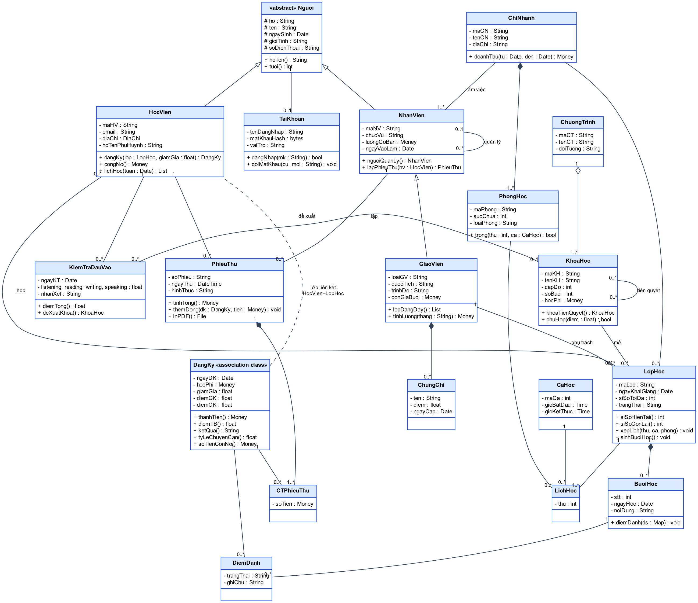
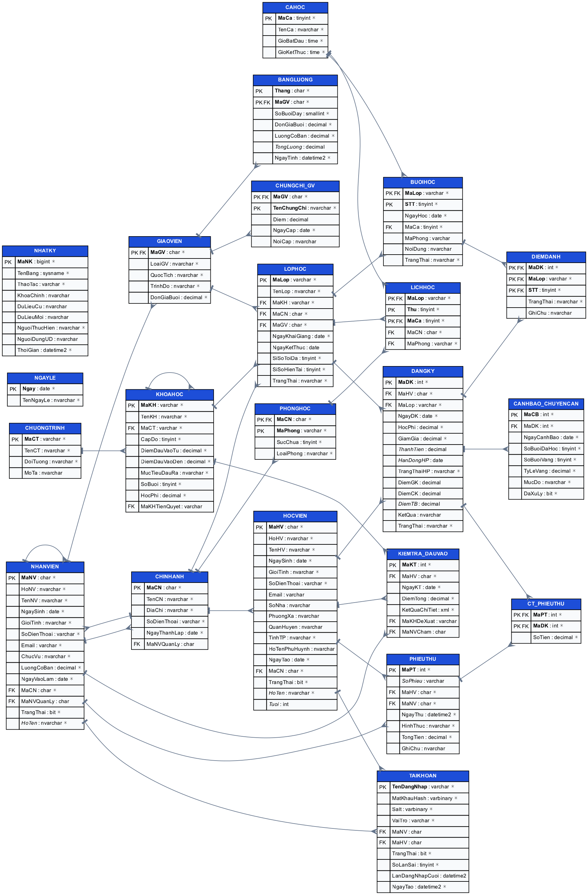

# Chương 2. Tổ chức thông tin

Tổ chức thông tin là bước quyết định chất lượng của mọi bước xử lý và trình bày phía sau: một mô hình dữ liệu tốt giúp loại bỏ trùng lặp, ngăn dữ liệu sai ngay từ khi nhập và cho phép truy vấn linh hoạt. Chương này đi từ mức khái niệm đến mức vật lý: mô hình thực thể – mối kết hợp (ERD) và từ điển dữ liệu, sơ đồ lớp UML, lược đồ quan hệ và chuẩn hoá, ràng buộc toàn vẹn, so sánh với mô hình phẳng và XML, cuối cùng là cài đặt CSDL trên SQL Server và sinh dữ liệu mẫu.

## 2.1 Mô hình thực thể – mối kết hợp

### 2.1.1 Tập thực thể

Từ quy trình nghiệp vụ ở mục 1.2, nhóm xác định **12 tập thực thể nghiệp vụ** và **2 tập thực thể hệ thống** (tài khoản đăng nhập, nhật ký thay đổi). Trong đó có một quan hệ chuyên biệt hoá (giáo viên là một loại nhân viên) và hai thực thể yếu (phòng học phụ thuộc chi nhánh, buổi học phụ thuộc lớp học).

| Thực thể | Loại | Mô tả | Khoá |
|---|---|---|---|
| CHINHANH | Mạnh | Chi nhánh của trung tâm | MaCN |
| NHANVIEN | Mạnh (tổng quát) | Mọi nhân viên: quản lý, giáo vụ, kế toán, giáo viên | MaNV |
| GIAOVIEN | Chuyên biệt của NHANVIEN | Nhân viên giảng dạy, có thêm loại giáo viên, trình độ, đơn giá | MaGV (trùng MaNV) |
| PHONGHOC | Yếu, phụ thuộc CHINHANH | Phòng học; số phòng chỉ duy nhất trong một chi nhánh | (MaCN, MaPhong) |
| CAHOC | Mạnh | Ca học trong ngày | MaCa |
| CHUONGTRINH | Mạnh | Chương trình IELTS, TOEIC, Giao tiếp, Thiếu nhi | MaCT |
| KHOAHOC | Mạnh | Khoá học thuộc một chương trình | MaKH |
| LOPHOC | Mạnh | Một lần mở khoá học tại một chi nhánh | MaLop |
| BUOIHOC | Yếu, phụ thuộc LOPHOC | Buổi học thứ *n* của lớp | (MaLop, STT) |
| HOCVIEN | Mạnh | Người học | MaHV |
| KIEMTRA_DAUVAO | Mạnh | Một lần kiểm tra xếp lớp của học viên | MaKT |
| PHIEUTHU | Mạnh | Phiếu thu học phí | MaPT |
| TAIKHOAN | Mạnh (hệ thống) | Tài khoản đăng nhập ứng dụng | TenDangNhap |
| NHATKY | Mạnh (hệ thống) | Nhật ký thay đổi dữ liệu | MaNK |

Ngoài ra, bốn mối kết hợp có thuộc tính riêng sẽ được **thực thể hoá** thành bảng khi cài đặt: ĐĂNG KÝ (giữa học viên và lớp học), ĐIỂM DANH (giữa đăng ký và buổi học), CHI TIẾT PHIẾU THU (giữa phiếu thu và đăng ký) và LỊCH HỌC (mối kết hợp ba ngôi giữa lớp học, phòng học và ca học). Thuộc tính đa trị *Chứng chỉ* của giáo viên được tách thành bảng CHUNGCHI_GV.

### 2.1.2 Sơ đồ ERD

Sơ đồ ERD được vẽ theo ký hiệu Chen: thực thể là hình chữ nhật, thực thể yếu có viền đôi, mối kết hợp là hình thoi (viền đôi nếu là mối kết hợp xác định của thực thể yếu), bản số ghi theo dạng (min, max) cạnh mỗi thực thể tham gia. Hình 2.1 là sơ đồ tổng quan; Hình 2.2 minh hoạ chi tiết các loại thuộc tính trên một số thực thể tiêu biểu.


*Hình 2.1 – Sơ đồ ERD tổng quan của ECMS*


*Hình 2.2 – Các loại thuộc tính trên ERD*

### 2.1.3 Phân loại thuộc tính

Bài toán ECMS có đủ các loại thuộc tính của mô hình ERD. Mỗi loại được cài đặt theo một cách khác nhau ở mức quan hệ, như tóm tắt dưới đây:

| Loại thuộc tính | Ví dụ trong ECMS | Cách cài đặt |
|---|---|---|
| Đơn trị, đơn | NgaySinh, SoDienThoai, HocPhi | Một cột |
| Khoá | MaHV, MaLop; khoá bộ phận của thực thể yếu: MaPhong, STT | PRIMARY KEY |
| Phức hợp | Họ tên gồm Họ và Tên; Địa chỉ gồm Số nhà, Phường/Xã, Quận/Huyện, Tỉnh/Thành phố | Tách thành nhiều cột; cột `HoTen` được tính bằng cách ghép lại |
| Đa trị | Một giáo viên có nhiều chứng chỉ (IELTS 8.0, TESOL, CELTA) | Bảng riêng CHUNGCHI_GV |
| Suy diễn | Tuổi từ ngày sinh; Thành tiền từ học phí và giảm giá; Điểm TB từ điểm giữa kỳ, cuối kỳ; Sĩ số hiện tại từ số đăng ký; Tổng tiền phiếu thu từ các dòng chi tiết | Cột tính toán (Tuổi, Thành tiền, Điểm TB) hoặc cột lưu sẵn được trigger duy trì (Sĩ số hiện tại, Tổng tiền) |
| Thuộc tính của mối kết hợp | ĐĂNG KÝ: ngày đăng ký, học phí, giảm giá, điểm, kết quả; ĐIỂM DANH: trạng thái | Cột của bảng liên kết |
| Bán cấu trúc | Kết quả chi tiết kiểm tra đầu vào (bốn kỹ năng, nhận xét) | Kiểu XML có XML Schema (mục 3.1.3) |

### 2.1.4 Mối kết hợp và bản số

Bảng dưới đây liệt kê 22 mối kết hợp của ERD kèm bản số và loại. Cột cuối giải thích ý nghĩa nghiệp vụ, giúp kiểm tra bản số có đúng với thực tế hay không.

| STT | Mối kết hợp | Thực thể tham gia | Bản số | Loại | Ý nghĩa |
|:-:|---|---|---|---|---|
| 1 | Làm việc | CHINHANH – NHANVIEN | (1,n) – (1,1) | 1 – N | Mỗi nhân viên thuộc đúng một chi nhánh; chi nhánh có ít nhất một nhân viên |
| 2 | Quản lý chi nhánh | CHINHANH – NHANVIEN | (0,1) – (0,1) | 1 – 1 | Mỗi chi nhánh có tối đa một quản lý; một nhân viên quản lý tối đa một chi nhánh |
| 3 | Quản lý trực tiếp | NHANVIEN – NHANVIEN | (0,n) – (0,1) | Đệ quy 1 – N | Nhân viên có thể có một người quản lý trực tiếp |
| 4 | ISA | NHANVIEN – GIAOVIEN | – | Chuyên biệt hoá, rời nhau, không toàn phần | Giáo viên là nhân viên có thêm thuộc tính riêng; các nhân viên khác không là giáo viên |
| 5 | Có phòng | CHINHANH – PHONGHOC | (1,n) – (1,1) | 1 – N, xác định | Phòng chỉ định danh được khi biết chi nhánh |
| 6 | Gồm | CHUONGTRINH – KHOAHOC | (1,n) – (1,1) | 1 – N | Chương trình có nhiều khoá theo cấp độ |
| 7 | Tiên quyết | KHOAHOC – KHOAHOC | (0,n) – (0,1) | Đệ quy 1 – N | Một khoá yêu cầu tối đa một khoá phải học trước |
| 8 | Mở | KHOAHOC – LOPHOC | (0,n) – (1,1) | 1 – N | Một khoá được mở thành nhiều lớp |
| 9 | Tổ chức | CHINHANH – LOPHOC | (0,n) – (1,1) | 1 – N | Lớp học diễn ra tại một chi nhánh |
| 10 | Phụ trách | GIAOVIEN – LOPHOC | (0,n) – (1,1) | 1 – N | Mỗi lớp có một giáo viên phụ trách |
| 11 | Lịch học | LOPHOC – PHONGHOC – CAHOC | (1,n) – (0,n) – (0,n) | Ba ngôi | Lớp học vào một ca, tại một phòng, theo thứ trong tuần |
| 12 | Có buổi | LOPHOC – BUOIHOC | (0,n) – (1,1) | 1 – N, xác định | Buổi học thứ *n* của lớp |
| 13 | Tiếp nhận | CHINHANH – HOCVIEN | (0,n) – (1,1) | 1 – N | Chi nhánh lập hồ sơ học viên |
| 14 | Dự kiểm tra | HOCVIEN – KIEMTRA_DAUVAO | (0,n) – (1,1) | 1 – N | Học viên có thể kiểm tra nhiều lần |
| 15 | Đề xuất | KHOAHOC – KIEMTRA_DAUVAO | (0,n) – (0,1) | 1 – N | Kết quả kiểm tra đề xuất một khoá học |
| 16 | Đăng ký | HOCVIEN – LOPHOC | (0,n) – (0,n) | N – M | Học viên học nhiều lớp, lớp có nhiều học viên; có thuộc tính học phí, điểm |
| 17 | Điểm danh | ĐĂNG KÝ – BUOIHOC | (0,n) – (0,n) | N – M (kết hợp hoá) | Mỗi đăng ký được điểm danh ở mỗi buổi của lớp |
| 18 | Đóng tiền | HOCVIEN – PHIEUTHU | (0,n) – (1,1) | 1 – N | Phiếu thu thuộc một học viên |
| 19 | Lập phiếu | NHANVIEN – PHIEUTHU | (0,n) – (1,1) | 1 – N | Kế toán lập phiếu thu |
| 20 | Chi tiết phiếu thu | PHIEUTHU – ĐĂNG KÝ | (1,n) – (0,n) | N – M | Một phiếu thu cho nhiều đăng ký; một đăng ký có thể đóng nhiều lần |
| 21 | Sử dụng | NHANVIEN – TAIKHOAN | (0,1) – (0,1) | 1 – 1 | Tài khoản ứng dụng của nhân viên |
| 22 | Sử dụng | HOCVIEN – TAIKHOAN | (0,1) – (0,1) | 1 – 1 | Tài khoản ứng dụng của học viên |

**Nhận xét.** ERD của ECMS chứa đủ các cấu trúc mà đề cương môn học yêu cầu: mối kết hợp 1 – 1 (số 2, 21, 22), 1 – N (số 1, 6, 8…), N – M (số 16, 17, 20), đệ quy (số 3, 7), ba ngôi (số 11), thực thể yếu (số 5, 12) và chuyên biệt hoá (số 4). Các cấu trúc này không được thêm vào cho đủ yêu cầu mà xuất phát trực tiếp từ nghiệp vụ: chẳng hạn mối kết hợp đệ quy *Tiên quyết* mô tả lộ trình học, còn mối kết hợp ba ngôi *Lịch học* là cách duy nhất diễn tả đồng thời lớp nào học ở phòng nào vào ca nào.

## 2.2 Từ điển dữ liệu

Từ điển dữ liệu mô tả từng cột của 22 bảng sau khi cài đặt. Để bảo đảm từ điển luôn khớp với script, nhóm sinh khung từ điển trực tiếp từ siêu dữ liệu của CSDL rồi bổ sung ý nghĩa và diễn giải ràng buộc. Quy ước: **PK** là khoá chính, **FK** là khoá ngoại, cột NULL ghi "Có" nếu được phép để trống; cột tính toán được ghi kiểu "tính toán" kèm công thức.

### 2.2.1 Nhóm danh mục

**CHINHANH – Chi nhánh**

| Cột | Ý nghĩa | Kiểu | NULL | Ràng buộc |
|---|---|---|:---:|---|
| MaCN | Mã chi nhánh | CHAR(4) | | PK; dạng `CN` + 2 chữ số |
| TenCN | Tên chi nhánh | NVARCHAR(100) | | Duy nhất |
| DiaChi | Địa chỉ | NVARCHAR(200) | | |
| SoDienThoai | Số điện thoại | VARCHAR(15) | | Chỉ gồm chữ số |
| NgayThanhLap | Ngày thành lập | DATE | | |
| MaNVQuanLy | Nhân viên quản lý chi nhánh | CHAR(6) | Có | FK → NHANVIEN; duy nhất khi khác NULL (quan hệ 1 – 1) |

**NHANVIEN – Nhân viên**

| Cột | Ý nghĩa | Kiểu | NULL | Ràng buộc |
|---|---|---|:---:|---|
| MaNV | Mã nhân viên | CHAR(6) | | PK; dạng `NV` + 4 chữ số |
| HoNV | Họ và tên lót | NVARCHAR(50) | | |
| TenNV | Tên | NVARCHAR(20) | | |
| NgaySinh | Ngày sinh | DATE | | Đủ 18 tuổi tại ngày vào làm |
| GioiTinh | Giới tính | NVARCHAR(3) | | Nam hoặc Nữ |
| SoDienThoai | Số điện thoại | VARCHAR(15) | | Duy nhất |
| Email | Thư điện tử | VARCHAR(100) | | Duy nhất; đúng dạng địa chỉ email |
| ChucVu | Chức vụ | NVARCHAR(20) | | Quản lý, Giáo vụ, Kế toán hoặc Giáo viên |
| LuongCoBan | Lương cơ bản mỗi tháng (đồng) | DECIMAL(12,0) | | Mặc định 0; không âm |
| NgayVaoLam | Ngày vào làm | DATE | | Mặc định ngày hiện tại |
| MaCN | Chi nhánh làm việc | CHAR(4) | | FK → CHINHANH |
| MaNVQuanLy | Người quản lý trực tiếp | CHAR(6) | Có | FK → NHANVIEN; khác chính MaNV |
| TrangThai | Đang làm việc | BIT | | Mặc định 1 |
| HoTen | Họ tên đầy đủ (suy diễn) | tính toán | | HoNV + ' ' + TenNV |

**GIAOVIEN – Giáo viên (chuyên biệt hoá của NHANVIEN)**

| Cột | Ý nghĩa | Kiểu | NULL | Ràng buộc |
|---|---|---|:---:|---|
| MaGV | Mã giáo viên, trùng mã nhân viên | CHAR(6) | | PK; FK → NHANVIEN, xoá theo nhân viên |
| LoaiGV | Loại giáo viên | NVARCHAR(20) | | Việt Nam hoặc Bản ngữ |
| QuocTich | Quốc tịch | NVARCHAR(50) | | Mặc định Việt Nam |
| TrinhDo | Trình độ học vấn | NVARCHAR(30) | | Cử nhân, Thạc sĩ hoặc Tiến sĩ |
| DonGiaBuoi | Đơn giá mỗi buổi dạy (đồng) | DECIMAL(10,0) | | Từ 100.000 đến 5.000.000 |

**CHUNGCHI_GV – Chứng chỉ của giáo viên (thuộc tính đa trị)**

| Cột | Ý nghĩa | Kiểu | NULL | Ràng buộc |
|---|---|---|:---:|---|
| MaGV | Mã giáo viên | CHAR(6) | | PK; FK → GIAOVIEN, xoá theo giáo viên |
| TenChungChi | Tên chứng chỉ | NVARCHAR(50) | | PK |
| Diem | Điểm chứng chỉ | DECIMAL(5,1) | Có | Không âm |
| NgayCap | Ngày cấp | DATE | | |
| NoiCap | Nơi cấp | NVARCHAR(100) | Có | |

**PHONGHOC – Phòng học (thực thể yếu)**

| Cột | Ý nghĩa | Kiểu | NULL | Ràng buộc |
|---|---|---|:---:|---|
| MaCN | Chi nhánh | CHAR(4) | | PK; FK → CHINHANH, xoá theo chi nhánh |
| MaPhong | Số phòng | VARCHAR(5) | | PK |
| SucChua | Sức chứa (người) | TINYINT | | Từ 5 đến 60 |
| LoaiPhong | Loại phòng | NVARCHAR(20) | | Thường, Lab hoặc Hội trường; mặc định Thường |

**CAHOC – Ca học**

| Cột | Ý nghĩa | Kiểu | NULL | Ràng buộc |
|---|---|---|:---:|---|
| MaCa | Mã ca | TINYINT | | PK |
| TenCa | Tên ca | NVARCHAR(30) | | Duy nhất |
| GioBatDau | Giờ bắt đầu | TIME(0) | | |
| GioKetThuc | Giờ kết thúc | TIME(0) | | Lớn hơn giờ bắt đầu |

**NGAYLE – Ngày nghỉ lễ (bảng phụ trợ)**

| Cột | Ý nghĩa | Kiểu | NULL | Ràng buộc |
|---|---|---|:---:|---|
| Ngay | Ngày nghỉ | DATE | | PK |
| TenNgayLe | Tên ngày lễ | NVARCHAR(100) | | |

### 2.2.2 Nhóm đào tạo

**CHUONGTRINH – Chương trình đào tạo**

| Cột | Ý nghĩa | Kiểu | NULL | Ràng buộc |
|---|---|---|:---:|---|
| MaCT | Mã chương trình | VARCHAR(5) | | PK |
| TenCT | Tên chương trình | NVARCHAR(100) | | Duy nhất |
| DoiTuong | Đối tượng học viên | NVARCHAR(100) | | |
| MoTa | Mô tả | NVARCHAR(500) | Có | |

**KHOAHOC – Khoá học**

| Cột | Ý nghĩa | Kiểu | NULL | Ràng buộc |
|---|---|---|:---:|---|
| MaKH | Mã khoá học | VARCHAR(6) | | PK |
| TenKH | Tên khoá học | NVARCHAR(100) | | Duy nhất |
| MaCT | Chương trình | VARCHAR(5) | | FK → CHUONGTRINH |
| CapDo | Cấp độ trong chương trình | TINYINT | | Cặp (MaCT, CapDo) duy nhất |
| DiemDauVaoTu | Điểm kiểm tra đầu vào tối thiểu | DECIMAL(3,1) | | Từ 0, không lớn hơn điểm tối đa |
| DiemDauVaoDen | Điểm kiểm tra đầu vào tối đa | DECIMAL(3,1) | | Không quá 10 |
| MucTieuDauRa | Mục tiêu đầu ra | NVARCHAR(50) | | |
| SoBuoi | Số buổi học | TINYINT | | Từ 8 đến 60 |
| HocPhi | Học phí (đồng) | DECIMAL(12,0) | | Lớn hơn 0 |
| MaKHTienQuyet | Khoá tiên quyết | VARCHAR(6) | Có | FK → KHOAHOC; khác chính MaKH |

**LOPHOC – Lớp học**

| Cột | Ý nghĩa | Kiểu | NULL | Ràng buộc |
|---|---|---|:---:|---|
| MaLop | Mã lớp | VARCHAR(10) | | PK; cặp (MaLop, MaCN) duy nhất để LICHHOC tham chiếu |
| TenLop | Tên lớp | NVARCHAR(100) | | |
| MaKH | Khoá học | VARCHAR(6) | | FK → KHOAHOC |
| MaCN | Chi nhánh | CHAR(4) | | FK → CHINHANH |
| MaGV | Giáo viên phụ trách | CHAR(6) | | FK → GIAOVIEN |
| NgayKhaiGiang | Ngày khai giảng | DATE | | |
| NgayKetThuc | Ngày kết thúc | DATE | Có | Sau ngày khai giảng |
| SiSoToiDa | Sĩ số tối đa | TINYINT | | Từ 5 đến 40; mặc định 20 |
| SiSoHienTai | Sĩ số hiện tại (suy diễn, trigger duy trì) | TINYINT | | Mặc định 0; không vượt sĩ số tối đa |
| TrangThai | Trạng thái lớp | NVARCHAR(20) | | Sắp mở, Đang học, Đã kết thúc hoặc Huỷ; mặc định Sắp mở |

**LICHHOC – Lịch học cố định (mối kết hợp ba ngôi)**

| Cột | Ý nghĩa | Kiểu | NULL | Ràng buộc |
|---|---|---|:---:|---|
| MaLop | Lớp học | VARCHAR(10) | | PK; FK (MaLop, MaCN) → LOPHOC, xoá theo lớp |
| Thu | Thứ trong tuần (2 là thứ Hai, 8 là Chủ nhật) | TINYINT | | PK; từ 2 đến 8 |
| MaCa | Ca học | TINYINT | | PK; FK → CAHOC |
| MaCN | Chi nhánh của lớp | CHAR(4) | | Thuộc FK (MaLop, MaCN) và FK (MaCN, MaPhong) |
| MaPhong | Phòng học | VARCHAR(5) | | FK (MaCN, MaPhong) → PHONGHOC |

**BUOIHOC – Buổi học (thực thể yếu)**

| Cột | Ý nghĩa | Kiểu | NULL | Ràng buộc |
|---|---|---|:---:|---|
| MaLop | Lớp học | VARCHAR(10) | | PK; FK → LOPHOC, xoá theo lớp |
| STT | Số thứ tự buổi | TINYINT | | PK; từ 1; bộ (MaLop, NgayHoc, MaCa) duy nhất |
| NgayHoc | Ngày học | DATE | | |
| MaCa | Ca học | TINYINT | | FK → CAHOC |
| MaPhong | Phòng học | VARCHAR(5) | Có | |
| NoiDung | Nội dung buổi học | NVARCHAR(200) | Có | |
| TrangThai | Trạng thái buổi | NVARCHAR(20) | | Đã lên lịch, Đã dạy hoặc Nghỉ; mặc định Đã lên lịch |

### 2.2.3 Nhóm học viên và học tập

**HOCVIEN – Học viên**

| Cột | Ý nghĩa | Kiểu | NULL | Ràng buộc |
|---|---|---|:---:|---|
| MaHV | Mã học viên | CHAR(6) | | PK; dạng `HV` + 4 chữ số |
| HoHV | Họ và tên lót | NVARCHAR(50) | | |
| TenHV | Tên | NVARCHAR(20) | | |
| NgaySinh | Ngày sinh | DATE | | Từ năm 1950; học viên ít nhất 4 tuổi khi lập hồ sơ |
| GioiTinh | Giới tính | NVARCHAR(3) | | Nam hoặc Nữ |
| SoDienThoai | Số điện thoại | VARCHAR(15) | | 9 đến 11 chữ số |
| Email | Thư điện tử | VARCHAR(100) | Có | Đúng dạng email; duy nhất khi khác NULL |
| SoNha | Số nhà, đường | NVARCHAR(100) | Có | |
| PhuongXa | Phường, xã | NVARCHAR(50) | Có | |
| QuanHuyen | Quận, huyện | NVARCHAR(50) | Có | |
| TinhTP | Tỉnh, thành phố | NVARCHAR(50) | | Mặc định TP. Hồ Chí Minh |
| HoTenPhuHuynh | Họ tên phụ huynh | NVARCHAR(70) | Có | |
| NgayTao | Ngày lập hồ sơ | DATE | | Mặc định ngày hiện tại |
| MaCN | Chi nhánh tiếp nhận | CHAR(4) | | FK → CHINHANH |
| TrangThai | Còn hoạt động | BIT | | Mặc định 1 |
| HoTen | Họ tên đầy đủ (suy diễn) | tính toán | | HoHV + ' ' + TenHV |
| Tuoi | Tuổi (suy diễn) | tính toán | Có | Tính từ NgaySinh tới ngày hiện tại |

**KIEMTRA_DAUVAO – Kiểm tra đầu vào**

| Cột | Ý nghĩa | Kiểu | NULL | Ràng buộc |
|---|---|---|:---:|---|
| MaKT | Mã lần kiểm tra | INT | | PK; tự tăng |
| MaHV | Học viên | CHAR(6) | | FK → HOCVIEN, xoá theo học viên |
| NgayKT | Ngày kiểm tra | DATE | | Mặc định ngày hiện tại |
| DiemTong | Điểm tổng (trung bình bốn kỹ năng) | DECIMAL(3,1) | | Từ 0 đến 10 |
| KetQuaChiTiet | Kết quả chi tiết | XML | | Kiểm tra theo XML Schema `XSC_KetQuaKiemTra` |
| MaKHDeXuat | Khoá học đề xuất | VARCHAR(6) | Có | FK → KHOAHOC |
| MaNVCham | Nhân viên chấm | CHAR(6) | Có | FK → NHANVIEN |

**DANGKY – Đăng ký học (mối kết hợp N – M có thuộc tính)**

| Cột | Ý nghĩa | Kiểu | NULL | Ràng buộc |
|---|---|---|:---:|---|
| MaDK | Mã đăng ký | INT | | PK; tự tăng |
| MaHV | Học viên | CHAR(6) | | FK → HOCVIEN; cặp (MaHV, MaLop) duy nhất |
| MaLop | Lớp học | VARCHAR(10) | | FK → LOPHOC |
| NgayDK | Ngày đăng ký | DATE | | Mặc định ngày hiện tại |
| HocPhi | Học phí tại thời điểm ghi danh | DECIMAL(12,0) | | Lớn hơn 0 |
| GiamGia | Giảm giá (%) | DECIMAL(5,2) | | Từ 0 đến 50; mặc định 0 |
| ThanhTien | Thành tiền | tính toán | | HocPhi × (100 − GiamGia) / 100, làm tròn nghìn đồng; lưu sẵn |
| HanDongHP | Hạn đóng học phí | tính toán | | NgayDK + 14 ngày; lưu sẵn |
| TrangThaiHP | Trạng thái học phí (trigger duy trì) | NVARCHAR(20) | | Chưa đóng, Đóng một phần hoặc Đã đóng |
| DiemGK | Điểm giữa kỳ | DECIMAL(4,2) | Có | Từ 0 đến 10 |
| DiemCK | Điểm cuối kỳ | DECIMAL(4,2) | Có | Từ 0 đến 10 |
| DiemTB | Điểm trung bình | tính toán | Có | 0,4 × DiemGK + 0,6 × DiemCK; lưu sẵn |
| KetQua | Kết quả (trigger duy trì) | NVARCHAR(10) | Có | Đạt hoặc Không đạt |
| TrangThai | Trạng thái đăng ký | NVARCHAR(20) | | Đang học, Hoàn thành, Bảo lưu, Đã chuyển lớp hoặc Huỷ |

**DIEMDANH – Điểm danh**

| Cột | Ý nghĩa | Kiểu | NULL | Ràng buộc |
|---|---|---|:---:|---|
| MaDK | Đăng ký | INT | | PK; FK (MaDK, MaLop) → DANGKY, xoá theo đăng ký |
| MaLop | Lớp học | VARCHAR(10) | | PK; thuộc hai khoá ngoại phức hợp |
| STT | Buổi học | TINYINT | | PK; FK (MaLop, STT) → BUOIHOC |
| TrangThai | Trạng thái | NVARCHAR(10) | | Có mặt, Vắng, Muộn hoặc Có phép; mặc định Có mặt |
| GhiChu | Ghi chú | NVARCHAR(200) | Có | |

**CANHBAO_CHUYENCAN – Cảnh báo chuyên cần (bảng phụ trợ)**

| Cột | Ý nghĩa | Kiểu | NULL | Ràng buộc |
|---|---|---|:---:|---|
| MaCB | Mã cảnh báo | INT | | PK; tự tăng |
| MaDK | Đăng ký bị cảnh báo | INT | | FK → DANGKY; mỗi đăng ký tối đa một cảnh báo mỗi ngày |
| NgayCanhBao | Ngày cảnh báo | DATE | | Mặc định ngày hiện tại |
| SoBuoiDaHoc | Số buổi đã diễn ra | TINYINT | | |
| SoBuoiVang | Số buổi vắng | TINYINT | | |
| TyLeVang | Tỷ lệ vắng (%) | DECIMAL(5,2) | | |
| MucDo | Mức độ | NVARCHAR(20) | | Nhắc nhở hoặc Nghiêm trọng |
| DaXuLy | Đã liên hệ xử lý | BIT | | Mặc định 0 |

### 2.2.4 Nhóm tài chính

**PHIEUTHU – Phiếu thu (master)**

| Cột | Ý nghĩa | Kiểu | NULL | Ràng buộc |
|---|---|---|:---:|---|
| MaPT | Mã phiếu thu | INT | | PK; tự tăng |
| SoPhieu | Số phiếu in trên chứng từ | tính toán | | `PT` + 6 chữ số của MaPT; duy nhất |
| MaHV | Học viên nộp tiền | CHAR(6) | | FK → HOCVIEN |
| MaNV | Nhân viên lập phiếu | CHAR(6) | | FK → NHANVIEN |
| NgayThu | Thời điểm thu | DATETIME2(0) | | Mặc định thời điểm hiện tại |
| HinhThuc | Hình thức thanh toán | NVARCHAR(20) | | Tiền mặt, Chuyển khoản hoặc Thẻ |
| TongTien | Tổng tiền (trigger duy trì) | DECIMAL(12,0) | | Bằng tổng các dòng chi tiết; không âm |
| GhiChu | Ghi chú | NVARCHAR(200) | Có | |

**CT_PHIEUTHU – Chi tiết phiếu thu (detail)**

| Cột | Ý nghĩa | Kiểu | NULL | Ràng buộc |
|---|---|---|:---:|---|
| MaPT | Phiếu thu | INT | | PK; FK → PHIEUTHU, xoá theo phiếu |
| MaDK | Đăng ký được thu tiền | INT | | PK; FK → DANGKY |
| SoTien | Số tiền thu cho đăng ký | DECIMAL(12,0) | | Lớn hơn 0 |

**BANGLUONG – Bảng lương giáo viên (bảng phụ trợ)**

| Cột | Ý nghĩa | Kiểu | NULL | Ràng buộc |
|---|---|---|:---:|---|
| Thang | Tháng lương, dạng yyyy-MM | CHAR(7) | | PK |
| MaGV | Giáo viên | CHAR(6) | | PK; FK → GIAOVIEN |
| SoBuoiDay | Số buổi đã dạy | SMALLINT | | |
| DonGiaBuoi | Đơn giá mỗi buổi tại thời điểm tính | DECIMAL(10,0) | | |
| LuongCoBan | Lương cơ bản tại thời điểm tính | DECIMAL(12,0) | | |
| TongLuong | Tổng lương | tính toán | | LuongCoBan + SoBuoiDay × DonGiaBuoi; lưu sẵn |
| NgayTinh | Thời điểm tính | DATETIME2(0) | | Mặc định thời điểm hiện tại |

### 2.2.5 Nhóm hệ thống

**TAIKHOAN – Tài khoản ứng dụng**

| Cột | Ý nghĩa | Kiểu | NULL | Ràng buộc |
|---|---|---|:---:|---|
| TenDangNhap | Tên đăng nhập | VARCHAR(30) | | PK |
| MatKhauHash | Mật khẩu đã băm SHA2_256 | VARBINARY(32) | | |
| Salt | Chuỗi ngẫu nhiên trộn vào khi băm | VARBINARY(16) | | |
| VaiTro | Vai trò | VARCHAR(10) | | QuanLy, GiaoVu, KeToan, GiaoVien hoặc HocVien |
| MaNV | Nhân viên sở hữu | CHAR(6) | Có | FK → NHANVIEN; duy nhất khi khác NULL |
| MaHV | Học viên sở hữu | CHAR(6) | Có | FK → HOCVIEN; duy nhất khi khác NULL |
| TrangThai | Đang hoạt động | BIT | | Mặc định 1 |
| SoLanSai | Số lần nhập sai liên tiếp | TINYINT | | Mặc định 0 |
| LanDangNhapCuoi | Lần đăng nhập cuối | DATETIME2(0) | Có | |
| NgayTao | Ngày tạo | DATETIME2(0) | | Mặc định thời điểm hiện tại |

Ràng buộc mức bảng: tài khoản vai trò HocVien phải gắn MaHV, các vai trò còn lại phải gắn MaNV.

**NHATKY – Nhật ký kiểm toán**

| Cột | Ý nghĩa | Kiểu | NULL | Ràng buộc |
|---|---|---|:---:|---|
| MaNK | Mã nhật ký | BIGINT | | PK; tự tăng |
| TenBang | Bảng bị thay đổi | SYSNAME | | |
| ThaoTac | Thao tác | VARCHAR(6) | | INSERT, UPDATE hoặc DELETE |
| KhoaChinh | Khoá chính của dòng bị thay đổi | NVARCHAR(100) | Có | |
| DuLieuCu | Dữ liệu trước khi thay đổi | NVARCHAR(MAX) | Có | Phải là JSON hợp lệ |
| DuLieuMoi | Dữ liệu sau khi thay đổi | NVARCHAR(MAX) | Có | Phải là JSON hợp lệ |
| NguoiThucHien | Login SQL Server thực hiện | NVARCHAR(128) | | Mặc định `SUSER_SNAME()` |
| NguoiDungUD | Tài khoản ứng dụng thực hiện | NVARCHAR(30) | Có | |
| ThoiGian | Thời điểm | DATETIME2(3) | | Mặc định thời điểm hiện tại |

## 2.3 Sơ đồ lớp UML

Song song với ERD, nhóm xây dựng sơ đồ lớp (Class Diagram) để nhìn bài toán theo góc độ hướng đối tượng: mỗi lớp gồm cả dữ liệu lẫn hành vi. Sơ đồ này là cơ sở cho lược đồ hướng đối tượng ở Chương 5. Ký hiệu phạm vi truy cập: `+` public, `-` private, `#` protected.



*Hình 2.3 – Sơ đồ lớp của ECMS*

### 2.3.1 Các lớp chính

Bảng dưới đây liệt kê các lớp chính, thuộc tính và phương thức tiêu biểu, cùng đối tượng CSDL hiện thực phương thức đó. Như vậy hành vi trong sơ đồ lớp không chỉ dừng ở thiết kế mà đều có đối tượng tương ứng ở Chương 3.

| Lớp | Thuộc tính tiêu biểu | Phương thức | Hiện thực trong CSDL |
|---|---|---|---|
| «abstract» Nguoi | # ho, # ten, # ngaySinh, # gioiTinh | + hoTen(), + tuoi() | Các cột chung của HOCVIEN, NHANVIEN; cột tính toán `Tuoi` |
| HocVien | - maHV, - diaChi : DiaChi | + dangKy(), + congNo(), + lichHoc() | `sp_DangKyHoc`, `fn_SoTienConNo`, `fn_LichHocHocVien` |
| NhanVien | - chucVu, - luongCoBan | + nguoiQuanLy(), + lapPhieuThu() | `sp_ThuHocPhi` |
| GiaoVien | - loaiGV, - donGiaBuoi | + lopDangDay(), + tinhLuong() | `fn_LopCuaGiaoVien`, `sp_TinhLuongGiaoVien` |
| LopHoc | - maLop, - siSoToiDa | + siSoHienTai(), + siSoConLai(), + xepLich(), + sinhBuoiHoc() | Trigger sĩ số, `sp_XepLichLop`, `sp_SinhBuoiHoc` |
| DangKy «association class» | - hocPhi, - giamGia, - diemGK, - diemCK | + thanhTien(), + diemTB(), + ketQua(), + tyLeChuyenCan() | Cột tính toán, `fn_TyLeChuyenCan` |
| PhieuThu | - soPhieu, - ngayThu | + tinhTong(), + themDong(), + inPDF() | Trigger tổng tiền, báo cáo PDF |
| KiemTraDauVao | - listening, - reading, - writing, - speaking | + diemTong(), + deXuatKhoa() | Cột XML, `fn_GoiYKhoaHoc` |

### 2.3.2 Các loại quan hệ giữa lớp

Sơ đồ lớp thể hiện được nhiều sắc thái quan hệ hơn ERD, đặc biệt là sự phân biệt giữa quan hệ thành phần và kết tập:

| Quan hệ | Ký hiệu | Ví dụ trong ECMS | Ý nghĩa |
|---|---|---|---|
| Kế thừa (generalization) | Tam giác rỗng | Nguoi ← HocVien; Nguoi ← NhanVien ← GiaoVien | GiaoVien *là một* NhanVien, kế thừa họ tên, ngày sinh và phương thức tuoi() |
| Thành phần (composition) | Hình thoi đặc | LopHoc – BuoiHoc; PhieuThu – CTPhieuThu; ChiNhanh – PhongHoc; GiaoVien – ChungChi | Bộ phận không tồn tại độc lập: xoá lớp thì xoá buổi học (`ON DELETE CASCADE`) |
| Kết tập (aggregation) | Hình thoi rỗng | ChuongTrinh – KhoaHoc | Khoá học thuộc chương trình nhưng vẫn có ý nghĩa riêng; xoá chương trình không xoá khoá |
| Kết hợp (association) | Đường thẳng có bản số | GiaoVien 1 – 0..* LopHoc; KhoaHoc 0..1 – 0..* KhoaHoc | Liên kết thông thường, có thể đệ quy |
| Lớp liên kết (association class) | Nét đứt nối vào kết hợp | DangKy gắn với kết hợp HocVien 0..* – 0..* LopHoc | Kết hợp N – M có thuộc tính riêng |

### 2.3.3 So sánh ERD và sơ đồ lớp

Hai sơ đồ cùng mô tả một bài toán nhưng phục vụ hai mục đích khác nhau. Bảng so sánh dưới đây được lập trên chính các cấu trúc của ECMS:

| Tiêu chí | ERD (ký hiệu Chen) | Sơ đồ lớp (UML) |
|---|---|---|
| Mục đích | Mô hình hoá **dữ liệu** cần lưu trữ, làm cơ sở thiết kế CSDL quan hệ | Mô hình hoá **đối tượng** gồm dữ liệu và hành vi, làm cơ sở thiết kế phần mềm |
| Thành phần | Thực thể, thuộc tính, mối kết hợp | Lớp, thuộc tính, phương thức, quan hệ |
| Hành vi | Không thể hiện; nghiệp vụ nằm ở procedure và trigger | Nằm ngay trong lớp: `LopHoc.siSoConLai()`, `PhieuThu.tinhTong()` |
| Đóng gói | Không có | Phạm vi truy cập `+`, `-`, `#` |
| Thuộc tính phức hợp | Hình elip con (Địa chỉ gồm Số nhà, Phường…) | Kiểu dữ liệu riêng `diaChi : DiaChi` |
| Thuộc tính đa trị | Hình elip đôi; khi cài đặt phải tách bảng | Thuộc tính kiểu tập hợp hoặc lớp thành phần ChungChi |
| Thuộc tính suy diễn | Hình elip nét đứt (Tuổi, Thành tiền) | Phương thức `tuoi()`, `thanhTien()` |
| Chuyên biệt hoá | ISA, ràng buộc rời nhau / toàn phần | Kế thừa, đa hình |
| Bản số | (min, max) đặt cạnh thực thể | Multiplicity `0..1`, `1..*`, `*` đặt ở đầu bên kia |
| Toàn thể – bộ phận | Chỉ biểu diễn gián tiếp qua thực thể yếu | Phân biệt rõ thành phần và kết tập |
| N – M có thuộc tính | Mối kết hợp có thuộc tính (ĐĂNG KÝ) | Lớp liên kết DangKy |
| Chuyển sang cài đặt | Gần như một – một sang lược đồ quan hệ (mục 2.4) | Sang mã nguồn hoặc CSDL hướng đối tượng (Chương 5) |

**Nhận xét.** Hai sơ đồ nhất quán với nhau về tập lớp, tập thực thể và bản số. ERD phù hợp để thiết kế CSDL quan hệ – trọng tâm của đồ án; sơ đồ lớp bổ sung góc nhìn hành vi, và mỗi phương thức trong sơ đồ đều được hiện thực bằng function hoặc procedure ở Chương 3.

## 2.4 Mô hình quan hệ và chuẩn hoá

### 2.4.1 Quy tắc chuyển ERD sang lược đồ quan hệ

Việc chuyển đổi tuân theo các quy tắc chuẩn của môn học. Bảng dưới đây ghi lại quy tắc và kết quả áp dụng cho từng loại cấu trúc của ERD:

| Cấu trúc ERD | Quy tắc chuyển đổi | Áp dụng trong ECMS |
|---|---|---|
| Thực thể mạnh | Mỗi thực thể thành một quan hệ; khoá thực thể thành khoá chính | CHINHANH, HOCVIEN, KHOAHOC… |
| Thực thể yếu | Quan hệ mới có khoá chính gồm khoá của thực thể chủ và khoá bộ phận | PHONGHOC (<u>MaCN, MaPhong</u>), BUOIHOC (<u>MaLop, STT</u>) |
| Thuộc tính phức hợp | Chỉ giữ các thuộc tính thành phần | HoHV, TenHV; SoNha, PhuongXa, QuanHuyen, TinhTP |
| Thuộc tính đa trị | Quan hệ riêng gồm khoá thực thể và giá trị | CHUNGCHI_GV (<u>MaGV, TenChungChi</u>, …) |
| Thuộc tính suy diễn | Không lưu, hoặc lưu có kiểm soát | Cột tính toán hoặc trigger (mục 2.4.3) |
| Mối kết hợp 1 – 1 | Khoá ngoại đặt ở một phía, kèm ràng buộc duy nhất | CHINHANH.*MaNVQuanLy*; TAIKHOAN.*MaNV*, *MaHV* |
| Mối kết hợp 1 – N | Khoá ngoại đặt ở phía N | LOPHOC.*MaKH*, *MaCN*, *MaGV*; PHIEUTHU.*MaHV* |
| Mối kết hợp N – M | Quan hệ mới có khoá là tổ hợp khoá hai phía, kèm thuộc tính của mối kết hợp | DANGKY, CT_PHIEUTHU, DIEMDANH |
| Mối kết hợp đệ quy | Khoá ngoại trỏ về chính quan hệ | NHANVIEN.*MaNVQuanLy*, KHOAHOC.*MaKHTienQuyet* |
| Mối kết hợp ba ngôi | Quan hệ mới chứa khoá của cả ba thực thể | LICHHOC (<u>*MaLop*, Thu, *MaCa*</u>, *MaCN*, *MaPhong*) |
| Chuyên biệt hoá | Một quan hệ cho lớp cha, một quan hệ cho lớp con; khoá lớp con đồng thời là khoá ngoại tới lớp cha | NHANVIEN, GIAOVIEN (<u>*MaGV*</u>) |

Riêng quan hệ DANGKY dùng **khoá thay thế** MaDK (số tự tăng) thay cho khoá tự nhiên (MaHV, MaLop). Khoá tự nhiên vẫn được giữ bằng ràng buộc UNIQUE, nhưng MaDK ngắn hơn khi làm khoá ngoại ở ba bảng DIEMDANH, CT_PHIEUTHU và CANHBAO_CHUYENCAN, giúp giảm kích thước chỉ mục và đơn giản tham số của các procedure.

### 2.4.2 Lược đồ quan hệ

Áp dụng các quy tắc trên thu được 22 lược đồ quan hệ. Quy ước: <u>gạch chân</u> là khoá chính, *in nghiêng* là khoá ngoại, dấu ° đánh dấu thuộc tính suy diễn được lưu.

| STT | Lược đồ quan hệ |
|:-:|---|
| 1 | CHINHANH (<u>MaCN</u>, TenCN, DiaChi, SoDienThoai, NgayThanhLap, *MaNVQuanLy*) |
| 2 | NHANVIEN (<u>MaNV</u>, HoNV, TenNV, NgaySinh, GioiTinh, SoDienThoai, Email, ChucVu, LuongCoBan, NgayVaoLam, *MaCN*, *MaNVQuanLy*, TrangThai) |
| 3 | GIAOVIEN (<u>*MaGV*</u>, LoaiGV, QuocTich, TrinhDo, DonGiaBuoi) |
| 4 | CHUNGCHI_GV (<u>*MaGV*, TenChungChi</u>, Diem, NgayCap, NoiCap) |
| 5 | PHONGHOC (<u>*MaCN*, MaPhong</u>, SucChua, LoaiPhong) |
| 6 | CAHOC (<u>MaCa</u>, TenCa, GioBatDau, GioKetThuc) |
| 7 | CHUONGTRINH (<u>MaCT</u>, TenCT, DoiTuong, MoTa) |
| 8 | KHOAHOC (<u>MaKH</u>, TenKH, *MaCT*, CapDo, DiemDauVaoTu, DiemDauVaoDen, MucTieuDauRa, SoBuoi, HocPhi, *MaKHTienQuyet*) |
| 9 | LOPHOC (<u>MaLop</u>, TenLop, *MaKH*, *MaCN*, *MaGV*, NgayKhaiGiang, NgayKetThuc, SiSoToiDa, SiSoHienTai°, TrangThai) |
| 10 | LICHHOC (<u>*MaLop*, Thu, *MaCa*</u>, *MaCN*, *MaPhong*) |
| 11 | BUOIHOC (<u>*MaLop*, STT</u>, NgayHoc, *MaCa*, MaPhong, NoiDung, TrangThai) |
| 12 | HOCVIEN (<u>MaHV</u>, HoHV, TenHV, NgaySinh, GioiTinh, SoDienThoai, Email, SoNha, PhuongXa, QuanHuyen, TinhTP, HoTenPhuHuynh, NgayTao, *MaCN*, TrangThai) |
| 13 | KIEMTRA_DAUVAO (<u>MaKT</u>, *MaHV*, NgayKT, DiemTong°, KetQuaChiTiet, *MaKHDeXuat*, *MaNVCham*) |
| 14 | DANGKY (<u>MaDK</u>, *MaHV*, *MaLop*, NgayDK, HocPhi, GiamGia, ThanhTien°, HanDongHP°, TrangThaiHP°, DiemGK, DiemCK, DiemTB°, KetQua°, TrangThai) |
| 15 | DIEMDANH (<u>*MaDK*, *MaLop*, *STT*</u>, TrangThai, GhiChu) |
| 16 | PHIEUTHU (<u>MaPT</u>, SoPhieu°, *MaHV*, *MaNV*, NgayThu, HinhThuc, TongTien°, GhiChu) |
| 17 | CT_PHIEUTHU (<u>*MaPT*, *MaDK*</u>, SoTien) |
| 18 | TAIKHOAN (<u>TenDangNhap</u>, MatKhauHash, Salt, VaiTro, *MaNV*, *MaHV*, TrangThai, SoLanSai, LanDangNhapCuoi, NgayTao) |
| 19 | NHATKY (<u>MaNK</u>, TenBang, ThaoTac, KhoaChinh, DuLieuCu, DuLieuMoi, NguoiThucHien, NguoiDungUD, ThoiGian) |
| 20 | NGAYLE (<u>Ngay</u>, TenNgayLe) |
| 21 | CANHBAO_CHUYENCAN (<u>MaCB</u>, *MaDK*, NgayCanhBao, SoBuoiDaHoc, SoBuoiVang, TyLeVang, MucDo, DaXuLy) |
| 22 | BANGLUONG (<u>Thang, *MaGV*</u>, SoBuoiDay, DonGiaBuoi, LuongCoBan, TongLuong°, NgayTinh) |

Trong đó LICHHOC có hai khoá ngoại phức hợp (MaLop, MaCN) → LOPHOC và (MaCN, MaPhong) → PHONGHOC; DIEMDANH có hai khoá ngoại phức hợp (MaDK, MaLop) → DANGKY và (MaLop, STT) → BUOIHOC. Ý nghĩa của các khoá ngoại phức hợp này được phân tích ở mục 2.4.3.

### 2.4.3 Phụ thuộc hàm và kiểm tra dạng chuẩn

Để kiểm tra dạng chuẩn, nhóm liệt kê các phụ thuộc hàm của từng quan hệ ngoài phụ thuộc hiển nhiên "khoá chính xác định mọi thuộc tính". Các quan hệ không có phụ thuộc hàm nào khác (GIAOVIEN, CHUNGCHI_GV, PHONGHOC, CT_PHIEUTHU, NHATKY, NGAYLE) đạt BCNF và không đưa vào bảng.

| Quan hệ | Phụ thuộc hàm khác | Khoá dự tuyển | Dạng chuẩn |
|---|---|---|---|
| CHINHANH | TenCN → MaCN; MaNVQuanLy → MaCN | MaCN, TenCN, MaNVQuanLy | BCNF |
| NHANVIEN | SoDienThoai → MaNV; Email → MaNV | MaNV, SoDienThoai, Email | BCNF |
| CAHOC | TenCa → MaCa | MaCa, TenCa | BCNF |
| CHUONGTRINH | TenCT → MaCT | MaCT, TenCT | BCNF |
| KHOAHOC | TenKH → MaKH; (MaCT, CapDo) → MaKH | MaKH, TenKH, (MaCT, CapDo) | BCNF |
| BUOIHOC | (MaLop, NgayHoc, MaCa) → STT | (MaLop, STT), (MaLop, NgayHoc, MaCa) | BCNF |
| HOCVIEN | Không có (tên phường trùng nhau giữa các quận nên PhuongXa không xác định QuanHuyen) | MaHV | BCNF |
| TAIKHOAN | MaNV → TenDangNhap; MaHV → TenDangNhap | TenDangNhap, MaNV, MaHV | BCNF |
| LOPHOC | SiSoHienTai được suy ra từ số dòng DANGKY | MaLop | BCNF, có thuộc tính suy diễn được lưu |
| PHIEUTHU | MaPT → SoPhieu; TongTien được suy ra từ CT_PHIEUTHU | MaPT, SoPhieu | BCNF, có thuộc tính suy diễn được lưu |
| KIEMTRA_DAUVAO | KetQuaChiTiet → DiemTong | MaKT | 3NF, có thuộc tính suy diễn được lưu |
| DANGKY | (MaHV, MaLop) → MaDK; (HocPhi, GiamGia) → ThanhTien; (DiemGK, DiemCK) → DiemTB → KetQua | MaDK, (MaHV, MaLop) | 3NF, có thuộc tính suy diễn được lưu |
| DIEMDANH | MaDK → MaLop (MaLop là thuộc tính khoá) | (MaDK, MaLop, STT) | 3NF, chưa đạt BCNF |
| LICHHOC | MaLop → MaCN (MaLop chỉ là một phần của khoá) | (MaLop, Thu, MaCa) | Vi phạm 2NF đối với MaCN |

Kết quả cho thấy lược đồ đạt **1NF** cho mọi quan hệ: thuộc tính phức hợp đã tách cột, thuộc tính đa trị đã tách bảng; riêng cột `KetQuaChiTiet` kiểu XML được xem là một giá trị nguyên tố đối với mô hình quan hệ và chỉ được phân tích bằng các phương thức XML. Phần lớn quan hệ đạt **BCNF**. Những chỗ chưa đạt dạng chuẩn cao nhất thuộc hai nhóm, đều được nhóm giữ lại có chủ đích:

- **Thuộc tính suy diễn được lưu** (ThanhTien, DiemTB, KetQua, SiSoHienTai, TongTien, DiemTong…). Chúng được lưu để truy vấn công nợ, bảng điểm, sĩ số nhanh mà không phải tính lại. Rủi ro dị thường cập nhật được loại bỏ vì giá trị không do người dùng nhập: một phần là cột tính toán do SQL Server tự tính lại, phần còn lại do trigger duy trì.
- **Khoá ngoại phức hợp phục vụ ràng buộc liên quan hệ** (LICHHOC.MaCN, DIEMDANH.MaLop). Cột dư thừa cho phép dùng khoá ngoại phức hợp để CSDL tự kiểm tra rằng phòng học thuộc đúng chi nhánh của lớp và học viên chỉ được điểm danh ở buổi học của lớp mình đăng ký.

Bảng dưới đây ghi lại cơ chế bảo đảm nhất quán cho từng trường hợp:

| Quan hệ | Chỗ chưa chuẩn hoá đầy đủ | Lý do giữ | Cơ chế bảo đảm nhất quán |
|---|---|---|---|
| LICHHOC | MaLop → MaCN | Khoá ngoại (MaCN, MaPhong) bắt phòng phải thuộc chi nhánh của lớp | Khoá ngoại (MaLop, MaCN) → LOPHOC chỉ chấp nhận đúng cặp lớp – chi nhánh đang có |
| DIEMDANH | MaDK → MaLop | Khoá ngoại (MaLop, STT) bắt buổi học thuộc đúng lớp của đăng ký | Khoá ngoại (MaDK, MaLop) → DANGKY |
| DANGKY | ThanhTien, DiemTB, HanDongHP | Truy vấn công nợ, bảng điểm nhanh | Cột tính toán lưu sẵn (PERSISTED) |
| DANGKY, PHIEUTHU | TrangThaiHP, KetQua, TongTien | Báo cáo doanh thu, công nợ, kết quả học tập | Trigger trên DANGKY và CT_PHIEUTHU |
| LOPHOC | SiSoHienTai | Kiểm tra lớp còn chỗ ở mỗi lần ghi danh | Trigger trên DANGKY |

**So sánh với phương án chuẩn hoá đầy đủ cho LICHHOC.** Nếu bỏ MaCN khỏi LICHHOC để đạt BCNF, khoá ngoại tới PHONGHOC chỉ còn dựa trên MaPhong – không đủ vì số phòng chỉ duy nhất trong một chi nhánh – hoặc phải viết trigger tra ngược chi nhánh của lớp mỗi lần thêm, sửa lịch. Phương án giữ MaCN tốn thêm 4 byte mỗi dòng nhưng để CSDL tự kiểm tra bằng ràng buộc khai báo: nhanh hơn trigger, không thể bị vô hiệu hoá nhầm và dễ đọc hơn. Nhóm chọn phương án này.

## 2.5 Ràng buộc toàn vẹn

### 2.5.1 Đặc tả ràng buộc

Ràng buộc toàn vẹn (RBTV) là các quy tắc mà dữ liệu phải luôn thoả. Nhóm đặc tả 18 RBTV, phân theo năm loại của môn học: miền giá trị, liên thuộc tính, liên bộ, khoá ngoại và liên quan hệ. Cột cuối cho biết cơ chế cài đặt; nguyên tắc chung là ưu tiên ràng buộc khai báo (CHECK, UNIQUE, khoá ngoại) và chỉ dùng trigger hoặc procedure khi ràng buộc vượt quá phạm vi một dòng.

| Mã | Loại | Nội dung | Bối cảnh | Cài đặt |
|---|---|---|---|---|
| RB01 | Miền giá trị | Giới tính thuộc {Nam, Nữ} | NHANVIEN, HOCVIEN | CHECK |
| RB02 | Miền giá trị | Điểm giữa kỳ, cuối kỳ từ 0 đến 10; giảm giá từ 0 đến 50% | DANGKY | CHECK |
| RB03 | Miền giá trị | Trạng thái điểm danh thuộc {Có mặt, Vắng, Muộn, Có phép} | DIEMDANH | CHECK |
| RB04 | Liên thuộc tính | Giờ kết thúc lớn hơn giờ bắt đầu | CAHOC | CHECK |
| RB05 | Liên thuộc tính | Ngày kết thúc sau ngày khai giảng | LOPHOC | CHECK |
| RB06 | Liên thuộc tính | Sĩ số hiện tại không vượt sĩ số tối đa | LOPHOC | CHECK và trigger chặn khi lớp đầy |
| RB07 | Liên thuộc tính | Nhân viên đủ 18 tuổi khi vào làm | NHANVIEN | CHECK |
| RB08 | Liên bộ | Mỗi học viên đăng ký một lớp tối đa một lần | DANGKY | UNIQUE (MaHV, MaLop) |
| RB09 | Liên bộ | Một phòng, một ca, một thứ chỉ có một lớp trong cùng khoảng thời gian | LICHHOC, LOPHOC | Trigger `trg_LichHoc_KiemTraTrung`, procedure `sp_XepLichLop` |
| RB10 | Liên bộ | Giáo viên không dạy hai lớp cùng thứ, cùng ca trong cùng khoảng thời gian | LICHHOC, LOPHOC | Trigger `trg_LichHoc_KiemTraTrung` |
| RB11 | Khoá ngoại | Mỗi lớp thuộc một khoá học, chi nhánh và giáo viên đang tồn tại | LOPHOC | FOREIGN KEY |
| RB12 | Liên quan hệ | Phòng của lịch học phải thuộc chi nhánh của lớp | LICHHOC, LOPHOC, PHONGHOC | Khoá ngoại phức hợp (MaLop, MaCN), (MaCN, MaPhong) |
| RB13 | Liên quan hệ | Học viên chỉ được điểm danh ở buổi học của lớp mình đăng ký | DIEMDANH, DANGKY, BUOIHOC | Khoá ngoại phức hợp (MaDK, MaLop), (MaLop, STT) |
| RB14 | Liên quan hệ | Sĩ số hiện tại bằng số đăng ký đang học hoặc đã hoàn thành của lớp | LOPHOC, DANGKY | Trigger `trg_DangKy_SiSo` |
| RB15 | Liên quan hệ | Tổng tiền phiếu thu bằng tổng số tiền các dòng chi tiết | PHIEUTHU, CT_PHIEUTHU | Trigger `trg_CTPhieuThu_TongTien` |
| RB16 | Liên quan hệ | Đăng ký trong chi tiết phiếu thu phải của chính học viên trên phiếu; tổng đã thu không vượt thành tiền | CT_PHIEUTHU, PHIEUTHU, DANGKY | Trigger `trg_CTPhieuThu_TongTien` |
| RB17 | Liên quan hệ | Học viên chỉ được đăng ký khoá có tiên quyết khi đã đạt khoá tiên quyết hoặc có điểm đầu vào đủ cao | DANGKY, LOPHOC, KHOAHOC | Procedure `sp_DangKyHoc` |
| RB18 | Liên thuộc tính | Tài khoản vai trò Học viên gắn mã học viên, các vai trò khác gắn mã nhân viên | TAIKHOAN | CHECK |

### 2.5.2 Bảng tầm ảnh hưởng

Bảng tầm ảnh hưởng xác định thao tác nào trên quan hệ nào có thể làm vi phạm ràng buộc, từ đó biết cần kiểm tra ở đâu. Ký hiệu: **+** là thao tác có thể vi phạm (phải kiểm tra), **–** là không vi phạm, **+(cột)** là chỉ vi phạm khi sửa cột đó. Các RBTV miền giá trị và liên thuộc tính trên một dòng đơn giản (RB01–RB04, RB07) được CHECK kiểm tra ở mọi thao tác thêm và sửa nên không đưa vào bảng.

| RBTV | Quan hệ | Thêm | Xoá | Sửa |
|---|---|:-:|:-:|:-:|
| RB05 | LOPHOC | + | – | +(NgayKhaiGiang, NgayKetThuc) |
| RB06, RB14 | LOPHOC | + | – | +(SiSoToiDa, SiSoHienTai) |
| | DANGKY | + | + | +(MaLop, TrangThai) |
| RB08 | DANGKY | + | – | +(MaHV, MaLop) |
| RB09, RB10 | LICHHOC | + | – | +(Thu, MaCa, MaPhong) |
| | LOPHOC | – | – | +(MaGV, NgayKhaiGiang, NgayKetThuc) |
| RB12 | LICHHOC | + | – | +(MaCN, MaPhong) |
| | LOPHOC | – | – | +(MaCN), bị khoá ngoại chặn |
| | PHONGHOC | – | + | +(MaCN, MaPhong) |
| RB13 | DIEMDANH | + | – | +(MaDK, MaLop, STT) |
| | DANGKY | – | + (xoá lan truyền) | +(MaLop) |
| | BUOIHOC | – | + | +(MaLop, STT) |
| RB15, RB16 | CT_PHIEUTHU | + | + | +(SoTien, MaDK) |
| | PHIEUTHU | – | + (xoá lan truyền) | +(MaHV) |
| | DANGKY | – | + | +(HocPhi, GiamGia) |
| RB17 | DANGKY | + | – | +(MaLop) |
| | DANGKY của khoá tiên quyết | – | + | +(KetQua) |

**Nhận xét.** Bảng tầm ảnh hưởng giải thích vì sao trigger trên DANGKY phải đăng ký cả ba sự kiện INSERT, UPDATE và DELETE: sĩ số của lớp có thể thay đổi khi thêm đăng ký, khi xoá đăng ký và khi sửa lớp hoặc trạng thái của đăng ký. Nếu chỉ bắt sự kiện INSERT như cách làm phổ biến, sĩ số sẽ sai ngay khi có học viên chuyển lớp hoặc bảo lưu.

## 2.6 So sánh mô hình phẳng – quan hệ – XML

Để thấy rõ lợi ích của mô hình quan hệ, nhóm biểu diễn cùng một phần dữ liệu ghi danh theo ba mô hình và so sánh.

### 2.6.1 Mô hình phẳng

Nhóm dựng lại tệp ghi danh Excel của chi nhánh Thủ Đức theo đúng cách trung tâm đang làm: mỗi dòng gộp thông tin học viên, lớp, khoá học, giáo viên, lịch học và tiền đã đóng. Chỉ với vài chục dòng, tệp đã xuất hiện đủ các loại dị thường:

| Dị thường | Ví dụ trong tệp mẫu |
|---|---|
| Dư thừa | Thông tin giáo viên Trần Thị Mai lặp lại ở 4 dòng |
| Cập nhật | Học viên An có hai số điện thoại khác nhau ở dòng 1 và dòng 3 |
| Thêm | Không thể ghi nhận lớp TC650-03 khi lớp chưa có học viên |
| Xoá | Xoá dòng của học viên Hà làm mất luôn mức học phí 6.800.000 đồng đã thoả thuận |
| Không nhất quán | Cùng một khoá được ghi "IELTS 5,5" và "IELTS 5.5"; cùng một phòng ghi "P.101" và "P101" |

### 2.6.2 Mô hình XML

Cùng dữ liệu đó được biểu diễn dưới dạng XML như sau:

```xml title="Dữ liệu ghi danh biểu diễn bằng XML"
<TrungTam>
  <ChiNhanh MaCN="CN01" Ten="Thủ Đức">
    <Lop MaLop="IE55-01" KhoaHoc="IELTS 5.5" HocPhi="6500000">
      <GiaoVien MaGV="NV0004" HoTen="Trần Thị Mai" SDT="0912000111"/>
      <Lich Thu="2" Ca="5" Phong="P101"/>
      <Lich Thu="4" Ca="5" Phong="P101"/>
      <HocVien MaHV="HV0001" HoTen="Nguyễn Văn An" SDT="0901234567" DaDong="6500000"/>
      <HocVien MaHV="HV0002" HoTen="Lê Thị Bình" SDT="0987654321" DaDong="3000000"/>
    </Lop>
    <Lop MaLop="TC650-02" KhoaHoc="TOEIC 650" HocPhi="5000000">
      <HocVien MaHV="HV0001" HoTen="Nguyễn Văn An" SDT="0901234567" DaDong="5000000"/>
    </Lop>
  </ChiNhanh>
</TrungTam>
```

Cây XML gom dữ liệu theo phân cấp tự nhiên chi nhánh, lớp, học viên nên dễ đọc hơn bảng phẳng. Tuy nhiên học viên An học hai lớp vẫn bị **lặp** ở hai nhánh. Muốn tránh lặp phải dùng cơ chế tham chiếu `ID/IDREF`, khi đó XML mất ưu điểm đọc trực quan và việc truy vấn trở nên phức tạp.

### 2.6.3 Bảng so sánh

| Tiêu chí | Phẳng (Excel) | Quan hệ (SQL Server) | XML |
|---|---|---|---|
| Cấu trúc | Một bảng hai chiều | Nhiều quan hệ liên kết qua khoá | Cây phân cấp |
| Lược đồ | Không có, chỉ có tiêu đề cột | Bắt buộc và chặt chẽ (DDL) | Tuỳ chọn (XSD), linh hoạt |
| Dư thừa | Rất cao | Thấp nhờ chuẩn hoá | Trung bình, lặp khi có quan hệ N – M |
| Dị thường thêm, xoá, sửa | Có đủ ba loại | Hầu như không | Có với dữ liệu N – M |
| Toàn vẹn | Kiểm tra nhập liệu đơn giản | Khoá chính, khoá ngoại, CHECK, trigger, giao dịch | XSD kiểm tra kiểu và cấu trúc, không kiểm tra giữa các tài liệu |
| Truy vấn | Lọc, bảng tổng hợp thủ công | SQL mạnh: kết nối, gom nhóm, hàm cửa sổ | XPath, XQuery; tốt trên một cây, kém khi kết nối nhiều tài liệu |
| Đồng thời, phân quyền | Khoá cả tệp | Theo dòng, theo cột, theo vai trò | Theo tài liệu |
| Trao đổi dữ liệu | CSV dễ dùng nhưng mất kiểu | Cần xuất ra định dạng khác | Tốt nhất: tự mô tả, chuẩn mở |
| Thay đổi cấu trúc | Thêm cột tuỳ ý | Phải ALTER TABLE | Thêm phần tử tuỳ ý |
| Vai trò trong ECMS | Nhập liệu ban đầu, báo cáo gửi đi | Lưu trữ chính của toàn hệ thống | Kết quả kiểm tra đầu vào, trao đổi danh sách lớp với hệ thống khác |

**Kết luận.** ECMS dùng mô hình quan hệ làm nền tảng lưu trữ, kết hợp kiểu dữ liệu XML cho phần bán cấu trúc là kết quả kiểm tra đầu vào. Cách kết hợp này tận dụng được ưu điểm của cả hai mô hình và đúng với xu hướng các hệ quản trị CSDL hiện đại hỗ trợ đa mô hình.

## 2.7 Cài đặt CSDL trên SQL Server

### 2.7.1 Tạo CSDL và các bảng

Toàn bộ lược đồ được cài đặt trong script `database/01_schema.sql`. Script được viết để **chạy lại được nhiều lần**: nếu CSDL `ECMS` đã tồn tại thì chuyển sang chế độ một người dùng để ngắt mọi kết nối rồi xoá, sau đó tạo mới với bảng mã so sánh `Vietnamese_CI_AS` – không phân biệt chữ hoa, chữ thường và sắp xếp đúng thứ tự tiếng Việt (đáp ứng NFR06).

```sql title="Mã lệnh – Khởi tạo CSDL ECMS"
USE master;
GO
IF DB_ID(N'ECMS') IS NOT NULL
BEGIN
    ALTER DATABASE ECMS SET SINGLE_USER WITH ROLLBACK IMMEDIATE;  -- ngắt mọi kết nối đang mở
    DROP DATABASE ECMS;
END
GO
CREATE DATABASE ECMS COLLATE Vietnamese_CI_AS;
GO
```

Bảng DANGKY là ví dụ tiêu biểu vì tập trung gần đủ các loại ràng buộc: khoá chính thay thế, khoá dự tuyển, khoá ngoại, giá trị mặc định, CHECK miền giá trị và cột tính toán lưu sẵn.

```sql title="Mã lệnh – Tạo bảng DANGKY"
CREATE TABLE DANGKY (
    MaDK          INT IDENTITY(1,1) NOT NULL,
    MaHV          CHAR(6)        NOT NULL,
    MaLop         VARCHAR(10)    NOT NULL,
    NgayDK        DATE           NOT NULL CONSTRAINT DF_DANGKY_NgayDK DEFAULT CAST(GETDATE() AS DATE),
    HocPhi        DECIMAL(12,0)  NOT NULL,
    GiamGia       DECIMAL(5,2)   NOT NULL CONSTRAINT DF_DANGKY_GiamGia DEFAULT 0,
    ThanhTien AS CAST(ROUND(HocPhi * (100 - GiamGia) / 100, -3) AS DECIMAL(12,0)) PERSISTED,
    HanDongHP AS DATEADD(DAY, 14, NgayDK) PERSISTED,
    TrangThaiHP   NVARCHAR(20)   NOT NULL CONSTRAINT DF_DANGKY_TrangThaiHP DEFAULT N'Chưa đóng',
    DiemGK        DECIMAL(4,2)   NULL,
    DiemCK        DECIMAL(4,2)   NULL,
    DiemTB AS CAST(ROUND(DiemGK * 0.4 + DiemCK * 0.6, 2) AS DECIMAL(4,2)) PERSISTED,
    KetQua        NVARCHAR(10)   NULL,
    TrangThai     NVARCHAR(20)   NOT NULL CONSTRAINT DF_DANGKY_TrangThai DEFAULT N'Đang học',
    CONSTRAINT PK_DANGKY PRIMARY KEY (MaDK),
    CONSTRAINT UQ_DANGKY_HV_Lop UNIQUE (MaHV, MaLop),
    CONSTRAINT UQ_DANGKY_DK_Lop UNIQUE (MaDK, MaLop),       -- để DIEMDANH tham chiếu (MaDK, MaLop)
    CONSTRAINT FK_DANGKY_HOCVIEN FOREIGN KEY (MaHV) REFERENCES HOCVIEN (MaHV),
    CONSTRAINT FK_DANGKY_LOPHOC FOREIGN KEY (MaLop) REFERENCES LOPHOC (MaLop),
    CONSTRAINT CK_DANGKY_HocPhi CHECK (HocPhi > 0),
    CONSTRAINT CK_DANGKY_GiamGia CHECK (GiamGia BETWEEN 0 AND 50),
    CONSTRAINT CK_DANGKY_DiemGK CHECK (DiemGK BETWEEN 0 AND 10),
    CONSTRAINT CK_DANGKY_DiemCK CHECK (DiemCK BETWEEN 0 AND 10),
    CONSTRAINT CK_DANGKY_TrangThaiHP CHECK (TrangThaiHP IN (N'Chưa đóng', N'Đóng một phần', N'Đã đóng')),
    CONSTRAINT CK_DANGKY_KetQua CHECK (KetQua IN (N'Đạt', N'Không đạt')),
    CONSTRAINT CK_DANGKY_TrangThai CHECK (TrangThai IN (N'Đang học', N'Hoàn thành', N'Bảo lưu', N'Đã chuyển lớp', N'Huỷ'))
);
```

Tổng hợp các thành phần được tạo bởi script:

| Thành phần | Số lượng | Ví dụ |
|---|:-:|---|
| Bảng | 22 | 19 bảng nghiệp vụ và 3 bảng phụ trợ NGAYLE, CANHBAO_CHUYENCAN, BANGLUONG |
| Khoá chính | 22 | Khoá phức hợp của thực thể yếu `PK_BUOIHOC (MaLop, STT)` |
| Khoá ngoại | 32 | Khoá ngoại phức hợp `FK_LICHHOC_LOPHOC (MaLop, MaCN)`, `FK_DIEMDANH_DANGKY (MaDK, MaLop)` |
| UNIQUE | 13 ràng buộc và 4 chỉ mục duy nhất có lọc | `UQ_DANGKY_HV_Lop`; `UX_CHINHANH_QuanLy … WHERE MaNVQuanLy IS NOT NULL` cho quan hệ 1 – 1 cho phép NULL |
| CHECK | 51 | `CK_LOPHOC_SiSo (SiSoHienTai <= SiSoToiDa)`, `CK_TAIKHOAN_ChuSoHuu` |
| DEFAULT | 29 | `NgayDK DEFAULT GETDATE()`, `NguoiThucHien DEFAULT SUSER_SNAME()` |
| Cột tính toán | 8 | `ThanhTien`, `DiemTB`, `HanDongHP`, `SoPhieu`, `TongLuong` (lưu sẵn); `Tuoi`, `HoTen` |
| Cột XML | 1 | `KIEMTRA_DAUVAO.KetQuaChiTiet`, gắn XML Schema ở mục 3.1.3 |
| Chỉ mục không phân cụm | 18 | Trình bày ở mục 2.7.3 |

Chỉ mục duy nhất có lọc (filtered unique index) là kỹ thuật cần thiết cho quan hệ 1 – 1 cho phép NULL: ràng buộc UNIQUE thông thường của SQL Server coi hai giá trị NULL là trùng nhau, nên nhiều chi nhánh chưa có quản lý sẽ vi phạm; chỉ mục có điều kiện `WHERE MaNVQuanLy IS NOT NULL` chỉ kiểm tra tính duy nhất trên các giá trị khác NULL.

### 2.7.2 Hành vi khi xoá dữ liệu được tham chiếu

Với mỗi khoá ngoại, nhóm chọn hành vi khi xoá dòng cha dựa trên ngữ nghĩa của mối quan hệ:

| Khoá ngoại | Hành vi | Lý do |
|---|---|---|
| GIAOVIEN → NHANVIEN, CHUNGCHI_GV → GIAOVIEN | Xoá lan truyền (CASCADE) | Lớp con và thuộc tính đa trị không tồn tại độc lập |
| PHONGHOC → CHINHANH, BUOIHOC → LOPHOC, LICHHOC → LOPHOC | Xoá lan truyền | Thực thể yếu và quan hệ thành phần |
| CT_PHIEUTHU → PHIEUTHU, DIEMDANH → DANGKY | Xoá lan truyền | Dòng chi tiết của cặp master – detail |
| DANGKY → HOCVIEN và LOPHOC, PHIEUTHU → HOCVIEN | Chặn xoá (mặc định) | Không cho xoá học viên, lớp đã phát sinh học phí, nhằm giữ lịch sử tài chính |
| KHOAHOC → CHUONGTRINH | Chặn xoá | Quan hệ kết tập: phải chuyển khoá sang chương trình khác trước khi xoá |

SQL Server không cho phép nhiều đường xoá lan truyền cùng đi tới một bảng. Bảng DIEMDANH vừa phụ thuộc DANGKY vừa phụ thuộc BUOIHOC, vì vậy khoá ngoại tới BUOIHOC được để ở chế độ chặn xoá; khi cần xoá buổi học, procedure sẽ xoá điểm danh trước.

### 2.7.3 Thuộc tính suy diễn và chỉ mục

Các thuộc tính suy diễn được cài đặt bằng cột tính toán. Cột có từ khoá `PERSISTED` được lưu vật lý và tự cập nhật khi cột nguồn thay đổi, nhờ đó có thể đánh chỉ mục. Riêng cột `Tuoi` dùng hàm `GETDATE()` – một hàm không tất định – nên không thể lưu sẵn mà chỉ được tính khi đọc.

```sql title="Mã lệnh – Các cột tính toán tiêu biểu"
ThanhTien AS CAST(ROUND(HocPhi * (100 - GiamGia) / 100, -3) AS DECIMAL(12,0)) PERSISTED,
DiemTB    AS CAST(ROUND(DiemGK * 0.4 + DiemCK * 0.6, 2) AS DECIMAL(4,2)) PERSISTED,
HanDongHP AS DATEADD(DAY, 14, NgayDK) PERSISTED,
Tuoi      AS (DATEDIFF(YEAR, NgaySinh, GETDATE()) - CASE WHEN ... THEN 1 ELSE 0 END)   -- không lưu sẵn được
```

SQL Server tự tạo chỉ mục phân cụm cho khoá chính và chỉ mục cho ràng buộc UNIQUE, nhưng **không** tự tạo chỉ mục cho khoá ngoại. Nhóm bổ sung 18 chỉ mục không phân cụm theo hai nhóm mục đích:

| Mục đích | Chỉ mục | Phục vụ |
|---|---|---|
| Kết nối theo khoá ngoại | `IX_DANGKY_MaLop (MaLop) INCLUDE (MaHV, TrangThai, TrangThaiHP)` | Danh sách lớp, đếm sĩ số; là chỉ mục bao phủ nên không phải tra lại bảng |
| | `IX_CT_PHIEUTHU_MaDK (MaDK) INCLUDE (SoTien)` | Tính số tiền đã đóng của một đăng ký (công nợ) |
| | `IX_LOPHOC_MaGV`, `IX_LICHHOC_Phong` | Kiểm tra trùng lịch giáo viên và phòng học |
| | `IX_DIEMDANH_Buoi (MaLop, STT)` | Điểm danh cả lớp theo buổi |
| Tìm kiếm, lọc, báo cáo | `IX_HOCVIEN_Ten (TenHV, HoHV)`, `IX_HOCVIEN_SDT` | Tra cứu học viên theo tên (người Việt thường tìm theo tên, không theo họ) và theo số điện thoại khi tư vấn |
| | `IX_PHIEUTHU_NgayThu (NgayThu) INCLUDE (TongTien, MaHV)` | Doanh thu theo khoảng thời gian |
| | `IX_BUOIHOC_Ngay (NgayHoc, MaCa)` | Lịch theo ngày; đếm số buổi dạy trong tháng để tính lương |
| | `IX_NHATKY_Bang_ThoiGian` | Xem nhật ký mới nhất theo bảng |

Hiệu quả của chỉ mục được đo cụ thể ở mục 3.1.2.

### 2.7.4 Kiểm thử ràng buộc

Sau khi tạo bảng, nhóm thử chèn dữ liệu vi phạm để xác nhận các ràng buộc hoạt động. Kịch bản gồm ba trường hợp đại diện cho ba loại ràng buộc: liên thuộc tính, miền giá trị và khoá ngoại phức hợp.

```sql title="Kiểm thử – Chèn dữ liệu vi phạm ràng buộc"
-- (1) Giờ kết thúc trước giờ bắt đầu
INSERT CAHOC VALUES (1, N'Sáng 1', '09:00', '08:00');
-- (2) Mã chi nhánh sai định dạng
INSERT CHINHANH (MaCN, ...) VALUES ('X1', ...);
-- (3) Cặp lớp L1 – chi nhánh CN01 không tồn tại trong LOPHOC
INSERT LICHHOC VALUES ('L1', 2, 1, 'CN01', 'P101');
```

Kết quả – cả ba lệnh đều bị SQL Server từ chối với đúng ràng buộc tương ứng:

| Trường hợp | Ràng buộc vi phạm | Thông báo của SQL Server |
|:-:|---|---|
| 1 | `CK_CAHOC_Gio` (RB04) | The INSERT statement conflicted with the CHECK constraint "CK_CAHOC_Gio" |
| 2 | `CK_CHINHANH_MaCN` | The INSERT statement conflicted with the CHECK constraint "CK_CHINHANH_MaCN" |
| 3 | `FK_LICHHOC_LOPHOC` (RB12) | The INSERT statement conflicted with the FOREIGN KEY constraint "FK_LICHHOC_LOPHOC" |

Script được chạy hai lần liên tiếp trên CSDL trống với cả SQL Server 2022 và 2025 đều thành công, tạo đủ 22 bảng.

### 2.7.5 Sơ đồ CSDL

Để đối chiếu kết quả cài đặt với thiết kế, nhóm sinh sơ đồ CSDL trực tiếp từ siêu dữ liệu của SQL Server (các khung nhìn hệ thống `sys.tables`, `sys.columns`, `sys.foreign_keys`), tương đương chức năng Database Diagram của SSMS. Trong sơ đồ, **PK** là khoá chính, **FK** là khoá ngoại, dấu ✱ đánh dấu cột NOT NULL và chữ nghiêng là cột tính toán.



*Hình 2.4 – Sơ đồ CSDL sinh từ siêu dữ liệu sau khi cài đặt*

Sơ đồ có đủ 22 bảng và 32 khoá ngoại, khớp với các mối kết hợp của ERD ở mục 2.1 và lược đồ quan hệ ở mục 2.4.

## 2.8 Dữ liệu mẫu

### 2.8.1 Phương pháp sinh dữ liệu

Dữ liệu mẫu cần đủ lớn và đủ "thật" để các truy vấn, báo cáo ở những chương sau có ý nghĩa. Thay vì sinh ngẫu nhiên độc lập từng bảng – cách dễ tạo ra dữ liệu mâu thuẫn như học viên được điểm danh trước ngày ghi danh – nhóm viết chương trình Python **mô phỏng hoạt động của trung tâm theo trình tự thời gian**:

1. Tạo danh mục: 3 chi nhánh, 20 nhân viên (3 quản lý, 4 giáo vụ, 3 kế toán, 10 giáo viên trong đó 4 giáo viên bản ngữ), 12 phòng, 6 ca học, 4 chương trình, 12 khoá học (mỗi chương trình 3 cấp, cấp sau có tiên quyết là cấp trước) và 30 ngày lễ trong hai năm 2025 – 2026.
2. Mở 25 lớp từ tháng 02/2025 đến tháng 11/2026. Lịch học được xếp theo chiến lược tham lam: thử lần lượt các mẫu lịch (thứ 2 – 4, thứ 3 – 5, thứ 7 – Chủ nhật…) với từng ca, chỉ nhận khi cả phòng và giáo viên đều rảnh trong toàn bộ thời gian của lớp. Buổi học được sinh theo lịch và bỏ qua ngày lễ.
3. Với mỗi lớp, ưu tiên ghi danh học viên đã đạt khoá tiên quyết ở lớp kết thúc trước đó (được giảm 10% học phí); phần còn lại là học viên mới – được lập hồ sơ, kiểm tra đầu vào với điểm nằm đúng khoảng của khoá rồi mới ghi danh.
4. Mô phỏng từng buổi học đã diễn ra: mỗi học viên có một mức chuyên cần riêng (đa số từ 90% đến 97%, khoảng 10% chỉ quanh 68% để tạo các trường hợp vắng nhiều); điểm giữa kỳ, cuối kỳ tương quan với năng lực và chuyên cần.
5. Mô phỏng thu học phí: khoảng 72% đóng đủ một lần, 18% đóng hai đợt, phần còn lại còn nợ; một số học viên ghi danh hai lớp cùng ngày để tạo phiếu thu nhiều dòng.
6. Tính sẵn các giá trị suy diễn: sĩ số hiện tại, tổng tiền phiếu thu, trạng thái học phí và kết quả học tập.

Chương trình dùng **hạt giống ngẫu nhiên cố định** và **ngày tham chiếu cố định là 15/10/2026** thay cho ngày hiện tại, nên mỗi lần chạy đều sinh ra cùng một tệp `02_seed.sql`; nhờ vậy cả nhóm có cùng một bộ dữ liệu để đối chiếu kết quả truy vấn. Họ tên, địa chỉ tiếng Việt được sinh bằng thư viện Faker với ngôn ngữ `vi_VN`. Khi nạp, script tạm vô hiệu hoá trigger để các giá trị đã tính sẵn không bị tính lại, nạp xong thì bật lại.

### 2.8.2 Quy mô dữ liệu

Bảng dưới đây thống kê số dòng của từng bảng sau khi nạp dữ liệu mẫu:

| Bảng | Số dòng | Bảng | Số dòng |
|---|--:|---|--:|
| CHINHANH | 3 | HOCVIEN | 349 |
| NHANVIEN | 20 | KIEMTRA_DAUVAO | 357 |
| GIAOVIEN | 10 | DANGKY | 539 |
| CHUNGCHI_GV | 15 | DIEMDANH | 10.063 |
| PHONGHOC | 12 | PHIEUTHU | 501 |
| CAHOC | 6 | CT_PHIEUTHU | 508 |
| CHUONGTRINH | 4 | TAIKHOAN | 80 |
| KHOAHOC | 12 | NGAYLE | 30 |
| LOPHOC | 25 | BUOIHOC | 598 |
| LICHHOC | 50 | NHATKY, CANHBAO_CHUYENCAN, BANGLUONG | 0 (do trigger, procedure sinh ra) |

Trong 25 lớp có 16 lớp đã kết thúc, 5 lớp đang học và 4 lớp sắp mở; mỗi chi nhánh đều có lớp ở cả ba cấp độ. Doanh thu trải đều hai năm 2025 (khoảng 1,08 tỷ đồng) và 2026 (khoảng 1,16 tỷ đồng) để báo cáo theo tháng, theo quý có ý nghĩa.

### 2.8.3 Các trường hợp biên có sẵn

Dữ liệu mẫu được chủ động đưa vào các trường hợp biên để phục vụ kiểm thử ở Chương 3 và Chương 4:

| Trường hợp | Số lượng | Dùng để kiểm thử |
|---|--:|---|
| Lớp đã đủ sĩ số | 1 | Chặn ghi danh vào lớp đầy |
| Đăng ký còn nợ học phí (chưa đóng hoặc đóng một phần) | 67 | Công nợ, làm nổi bật nợ quá hạn |
| Học viên vắng quá 20% | 14 | Cảnh báo chuyên cần |
| Đăng ký có kết quả Không đạt | 41 | Bảng điểm, xếp loại |
| Học viên bảo lưu giữa khoá | 15 | Sĩ số không tính học viên bảo lưu |
| Học viên học tiếp khoá cấp sau | 197 | Kiểm tra khoá tiên quyết |
| Khách tiềm năng đã kiểm tra đầu vào nhưng chưa ghi danh | 15 | Truy vấn lồng `NOT EXISTS` |
| Phiếu thu nhiều dòng | 7 | Form master – detail |

### 2.8.4 Kiểm tra tính nhất quán

Bộ kiểm thử `database/tests/test_seed.sql` kiểm tra 11 điều kiện nhất quán trên dữ liệu mẫu: sĩ số khớp số đăng ký, tổng tiền phiếu thu khớp chi tiết, không thu vượt học phí, không trùng phòng và giáo viên, khoá tiên quyết hợp lệ, không có buổi học rơi vào ngày lễ… Kết quả **không có lỗi nào ở cả 11 điều kiện**, chứng tỏ dữ liệu mẫu thoả mọi ràng buộc nghiệp vụ.

Ngoài ra, thư mục `data/import/` chứa ba tệp CSV phục vụ phần nhập dữ liệu ở mục 3.2.5: tệp 1.200 đăng ký trực tuyến có khoảng 4% dòng lỗi cố ý (ngày sai, thiếu số điện thoại, email sai, chi nhánh hoặc khoá học không tồn tại, dòng trùng), tệp 10.000 dòng hợp lệ để đo tốc độ nhập và tệp danh mục khoá học.

## 2.9 Tiểu kết chương

Chương 2 đã xây dựng mô hình dữ liệu của ECMS qua đủ ba mức: mức khái niệm với ERD gồm 14 thực thể, 22 mối kết hợp và sơ đồ lớp UML; mức logic với 22 lược đồ quan hệ được kiểm tra dạng chuẩn, 18 ràng buộc toàn vẹn và bảng tầm ảnh hưởng; mức vật lý với script cài đặt trên SQL Server gồm 32 khoá ngoại, 51 ràng buộc CHECK, 8 cột tính toán và 22 chỉ mục bổ sung. Các điểm chưa chuẩn hoá hoàn toàn đều được phân tích và giữ lại có chủ đích kèm cơ chế bảo đảm nhất quán. Bộ dữ liệu mẫu sinh theo nghiệp vụ, có sẵn các trường hợp biên và đã được kiểm tra nhất quán, là nền tảng cho phần xử lý thông tin ở Chương 3.
