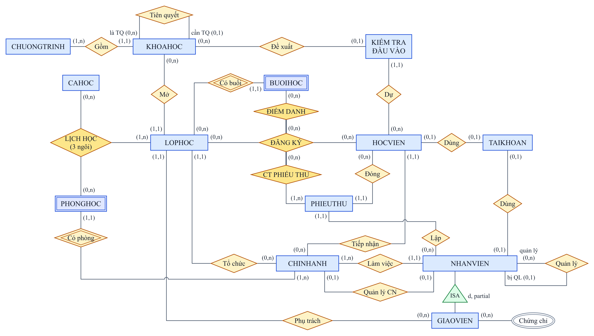
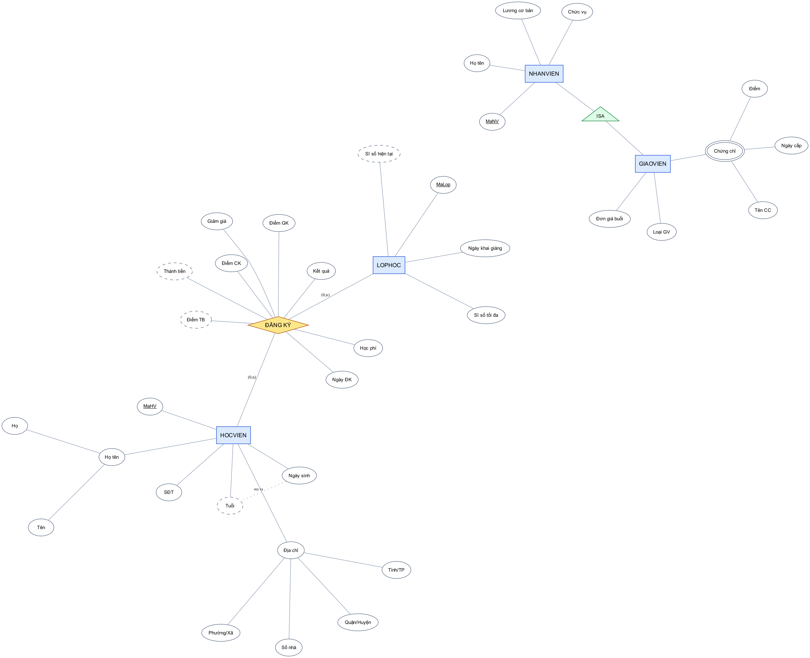

# Chương 2. Tổ chức thông tin

## 2.1 Mô hình thực thể – mối kết hợp (ERD)

### 2.1.1 Tập thực thể

Từ khảo sát ở Chương 1, nhóm xác định **17 tập thực thể** chính (cộng 2 bảng hệ thống TAIKHOAN, NHATKY và 3 bảng phụ trợ NGAYLE, CANHBAO_CHUYENCAN, BANGLUONG phát sinh khi cài đặt):

| Thực thể | Loại | Mô tả | Khoá |
|---|---|---|---|
| CHINHANH | Mạnh | Chi nhánh của trung tâm | MaCN |
| NHANVIEN | Mạnh (tổng quát) | Mọi nhân viên: quản lý, giáo vụ, kế toán, giáo viên | MaNV |
| GIAOVIEN | Chuyên biệt của NHANVIEN | Nhân viên giảng dạy, có thêm loại GV, trình độ, đơn giá | MaGV (= MaNV) |
| PHONGHOC | **Yếu** (phụ thuộc CHINHANH) | Phòng học, số phòng chỉ duy nhất trong một chi nhánh | (MaCN, MaPhong) |
| CAHOC | Mạnh | Ca học trong ngày | MaCa |
| CHUONGTRINH | Mạnh | IELTS, TOEIC, Giao tiếp, Thiếu nhi | MaCT |
| KHOAHOC | Mạnh | Khoá học thuộc một chương trình | MaKH |
| LOPHOC | Mạnh | Một lần mở khoá học tại một chi nhánh | MaLop |
| BUOIHOC | **Yếu** (phụ thuộc LOPHOC) | Buổi học thứ *n* của lớp | (MaLop, STT) |
| HOCVIEN | Mạnh | Người học | MaHV |
| KIEMTRA_DAUVAO | Mạnh | Một lần kiểm tra xếp lớp | MaKT |
| PHIEUTHU | Mạnh | Phiếu thu học phí | MaPT |
| TAIKHOAN | Mạnh | Tài khoản đăng nhập ứng dụng | TenDangNhap |
| NHATKY | Mạnh | Nhật ký thay đổi dữ liệu | MaNK |

Ba mối kết hợp có thuộc tính riêng được **thực thể hoá** khi cài đặt: ĐĂNG KÝ (HOCVIEN – LOPHOC), ĐIỂM DANH (ĐĂNG KÝ – BUOIHOC), CT PHIẾU THU (PHIEUTHU – ĐĂNG KÝ); thêm LỊCH HỌC là mối kết hợp 3 ngôi. Thuộc tính đa trị *Chứng chỉ* của giáo viên tách thành CHUNGCHI_GV.

### 2.1.2 Sơ đồ ERD (ký hiệu Chen)

*Hình 2.1 – ERD tổng quan: thực thể (chữ nhật), thực thể yếu (viền đôi), mối kết hợp (thoi, viền đôi là quan hệ xác định), bản số (min,max). File nguồn: `docs/design/erd.drawio`.*

*Hình 2.2 – Minh hoạ các loại thuộc tính: khoá (gạch chân), phức hợp (Họ tên, Địa chỉ), đa trị (Chứng chỉ – elip đôi), suy diễn (Tuổi, Thành tiền, Điểm TB, Sĩ số hiện tại – nét đứt), thuộc tính của mối kết hợp (ĐĂNG KÝ).*

### 2.1.3 Phân loại thuộc tính

| Loại thuộc tính | Ví dụ trong ECMS | Cách cài đặt |
|---|---|---|
| Đơn trị, đơn | NgaySinh, SoDienThoai, HocPhi | Một cột |
| Khoá | MaHV, MaLop; khoá bộ phận của thực thể yếu: MaPhong, STT | PRIMARY KEY |
| **Phức hợp** | Họ tên = Họ + Tên; Địa chỉ HV = Số nhà + Phường/Xã + Quận/Huyện + Tỉnh/TP | Tách thành nhiều cột; `HoTen` là cột tính toán ghép lại |
| **Đa trị** | Một giáo viên có nhiều chứng chỉ (IELTS 8.0, TESOL, CELTA) | Bảng riêng CHUNGCHI_GV (MaGV, TenChungChi, …) |
| **Suy diễn** | Tuổi ← NgaySinh; Thành tiền ← Học phí, Giảm giá; Điểm TB ← GK, CK; Sĩ số hiện tại ← đếm ĐĂNG KÝ; Tổng tiền phiếu thu ← Σ chi tiết | Computed column (Tuổi, ThanhTien, DiemTB) hoặc cột lưu sẵn duy trì bằng trigger (SiSoHienTai, TongTien) |
| Thuộc tính của mối kết hợp | ĐĂNG KÝ: Ngày ĐK, Học phí, Giảm giá, Điểm GK/CK, Kết quả; ĐIỂM DANH: Trạng thái | Cột của bảng liên kết |
| Bán cấu trúc | Kết quả chi tiết kiểm tra đầu vào (4 kỹ năng, nhận xét) | Kiểu XML có XML Schema (T10) |

### 2.1.4 Mối kết hợp và bản số

| # | Mối kết hợp | Thực thể tham gia | Bản số | Loại | Giải thích |
|:-:|---|---|---|---|---|
| 1 | Làm việc | CHINHANH – NHANVIEN | (1,n) – (1,1) | 1–N | Mỗi nhân viên thuộc đúng một chi nhánh; chi nhánh có ít nhất một nhân viên |
| 2 | Quản lý CN | CHINHANH – NHANVIEN | (0,1) – (0,1) | **1–1** | Mỗi chi nhánh có tối đa một quản lý, một nhân viên quản lý tối đa một chi nhánh |
| 3 | Quản lý | NHANVIEN – NHANVIEN | (0,n) – (0,1) | **Đệ quy** 1–N | Nhân viên có thể có một người quản lý trực tiếp |
| 4 | ISA | NHANVIEN ⊃ GIAOVIEN | – | **Chuyên biệt hoá** (rời nhau, không toàn phần) | Giáo viên là nhân viên có thêm thuộc tính riêng; nhân viên khác không là giáo viên |
| 5 | Có phòng | CHINHANH – PHONGHOC | (1,n) – (1,1) | 1–N, **xác định** | Phòng chỉ định danh được khi biết chi nhánh (thực thể yếu) |
| 6 | Gồm | CHUONGTRINH – KHOAHOC | (1,n) – (1,1) | 1–N | Chương trình có nhiều khoá theo cấp độ |
| 7 | Tiên quyết | KHOAHOC – KHOAHOC | (0,n) – (0,1) | **Đệ quy** 1–N | Một khoá yêu cầu tối đa một khoá phải học trước |
| 8 | Mở | KHOAHOC – LOPHOC | (0,n) – (1,1) | 1–N | Một khoá được mở thành nhiều lớp |
| 9 | Tổ chức | CHINHANH – LOPHOC | (0,n) – (1,1) | 1–N | Lớp học tại một chi nhánh |
| 10 | Phụ trách | GIAOVIEN – LOPHOC | (0,n) – (1,1) | 1–N | Mỗi lớp có một giáo viên phụ trách |
| 11 | **Lịch học** | LOPHOC – PHONGHOC – CAHOC | (1,n) – (0,n) – (0,n) | **3 ngôi** | Lớp học vào một ca, ở một phòng, theo thứ trong tuần |
| 12 | Có buổi | LOPHOC – BUOIHOC | (0,n) – (1,1) | 1–N, **xác định** | Buổi học thứ *n* của lớp (thực thể yếu) |
| 13 | Tiếp nhận | CHINHANH – HOCVIEN | (0,n) – (1,1) | 1–N | Chi nhánh lập hồ sơ học viên |
| 14 | Dự | HOCVIEN – KIEMTRA_DAUVAO | (0,n) – (1,1) | 1–N | Học viên có thể test nhiều lần |
| 15 | Đề xuất | KHOAHOC – KIEMTRA_DAUVAO | (0,n) – (0,1) | 1–N | Kết quả test đề xuất một khoá học |
| 16 | **Đăng ký** | HOCVIEN – LOPHOC | (0,n) – (0,n) | **N–M** | Học viên học nhiều lớp, lớp có nhiều học viên; có thuộc tính học phí, điểm |
| 17 | **Điểm danh** | ĐĂNG KÝ – BUOIHOC | (0,n) – (0,n) | **N–M** (kết hợp hoá) | Mỗi đăng ký được điểm danh ở mỗi buổi của lớp |
| 18 | Đóng | HOCVIEN – PHIEUTHU | (0,n) – (1,1) | 1–N | Phiếu thu của một học viên |
| 19 | Lập | NHANVIEN – PHIEUTHU | (0,n) – (1,1) | 1–N | Kế toán lập phiếu thu |
| 20 | **CT phiếu thu** | PHIEUTHU – ĐĂNG KÝ | (1,n) – (0,n) | **N–M** | Một phiếu thu nhiều đăng ký; một đăng ký có thể đóng nhiều lần |
| 21 | Dùng | NHANVIEN – TAIKHOAN | (0,1) – (0,1) | **1–1** | Tài khoản ứng dụng của nhân viên |
| 22 | Dùng | HOCVIEN – TAIKHOAN | (0,1) – (0,1) | **1–1** | Tài khoản ứng dụng của học viên |

**Đối chiếu yêu cầu đề cương:** ERD có đủ 1–1 (#2, #21, #22), 1–N (#1, #6, #8…), N–M (#16, #17, #20), đệ quy (#3, #7), 3 ngôi (#11), thực thể yếu (#5, #12) và chuyên biệt hoá (#4).

## 2.2 Từ điển dữ liệu

Từ điển dưới đây được sinh trực tiếp từ CSDL sau khi cài đặt (`01_schema.sql`, mục 2.7) nên luôn khớp với script. Ký hiệu: **PK** khoá chính, FK khoá ngoại, ✓ cho phép NULL.

#### CHINHANH – Chi nhánh trung tâm

| Cột | Ý nghĩa | Kiểu | Null | Ràng buộc / miền giá trị |
|---|---|---|:---:|---|
| MaCN | Mã chi nhánh | CHAR(4) |  | **PK**; CHECK `([MaCN] like 'CN[0-9][0-9]')` |
| TenCN | Tên chi nhánh | NVARCHAR(100) |  |  |
| DiaChi | Địa chỉ | NVARCHAR(200) |  |  |
| SoDienThoai | Số điện thoại | VARCHAR(15) |  | CHECK `(NOT [SoDienThoai] like '%[^0-9]%')` |
| NgayThanhLap | Ngày thành lập | DATE |  |  |
| MaNVQuanLy | Mã nhân viên quản lý | CHAR(6) | ✓ | FK → NHANVIEN |

#### NHANVIEN – Nhân viên

| Cột | Ý nghĩa | Kiểu | Null | Ràng buộc / miền giá trị |
|---|---|---|:---:|---|
| MaNV | Mã nhân viên | CHAR(6) |  | **PK**; CHECK `([MaNV] like 'NV[0-9][0-9][0-9][0-9]')` |
| HoNV | Họ và tên lót | NVARCHAR(50) |  |  |
| TenNV | Tên | NVARCHAR(20) |  |  |
| NgaySinh | Ngày sinh | DATE |  |  |
| GioiTinh | Giới tính | NVARCHAR(3) |  | CHECK `([GioiTinh]=N'Nữ' OR [GioiTinh]=N'Nam')` |
| SoDienThoai | Số điện thoại | VARCHAR(15) |  |  |
| Email | Thư điện tử | VARCHAR(100) |  | CHECK `([Email] like '%_@_%._%')` |
| ChucVu | Chức vụ | NVARCHAR(20) |  | CHECK `([ChucVu]=N'Giáo viên' OR [ChucVu]=N'Kế toán' OR [ChucVu]=N'Giáo vụ' OR [ChucVu]=N'Quản lý')` |
| LuongCoBan | Lương cơ bản / tháng (VNĐ) | DECIMAL(12,0) |  | DEFAULT `((0))`; CHECK `([LuongCoBan]>=(0))` |
| NgayVaoLam | Ngày vào làm | DATE |  | DEFAULT `(CONVERT([date],getdate()))` |
| MaCN | Mã chi nhánh | CHAR(4) |  | FK → CHINHANH |
| MaNVQuanLy | Mã nhân viên quản lý | CHAR(6) | ✓ | FK → NHANVIEN |
| TrangThai | Trạng thái | BIT |  | DEFAULT `((1))` |
| HoTen | Họ tên đầy đủ (suy diễn) | (tính toán) |  | Tính toán: `(([HoNV]+N' ')+[TenNV])` |

#### GIAOVIEN – Giáo viên (chuyên biệt hoá NHANVIEN)

| Cột | Ý nghĩa | Kiểu | Null | Ràng buộc / miền giá trị |
|---|---|---|:---:|---|
| MaGV | Mã giáo viên (= MaNV) | CHAR(6) |  | **PK**; FK → NHANVIEN |
| LoaiGV | Loại giáo viên | NVARCHAR(20) |  | CHECK `([LoaiGV]=N'Bản ngữ' OR [LoaiGV]=N'Việt Nam')` |
| QuocTich | Quốc tịch | NVARCHAR(50) |  | DEFAULT `(N'Việt Nam')` |
| TrinhDo | Trình độ học vấn | NVARCHAR(30) |  | CHECK `([TrinhDo]=N'Tiến sĩ' OR [TrinhDo]=N'Thạc sĩ' OR [TrinhDo]=N'Cử nhân')` |
| DonGiaBuoi | Đơn giá mỗi buổi dạy (VNĐ) | DECIMAL(10,0) |  | CHECK `([DonGiaBuoi]>=(100000) AND [DonGiaBuoi]<=(5000000))` |

#### CHUNGCHI_GV – Chứng chỉ giáo viên (thuộc tính đa trị)

| Cột | Ý nghĩa | Kiểu | Null | Ràng buộc / miền giá trị |
|---|---|---|:---:|---|
| MaGV | Mã giáo viên (= MaNV) | CHAR(6) |  | **PK**; FK → GIAOVIEN |
| TenChungChi | Tên chứng chỉ | NVARCHAR(50) |  | **PK** |
| Diem | Điểm chứng chỉ | DECIMAL(5,1) | ✓ | CHECK `([Diem] IS NULL OR [Diem]>=(0))` |
| NgayCap | Ngày cấp | DATE |  |  |
| NoiCap | Nơi cấp | NVARCHAR(100) | ✓ |  |

#### PHONGHOC – Phòng học (thực thể yếu)

| Cột | Ý nghĩa | Kiểu | Null | Ràng buộc / miền giá trị |
|---|---|---|:---:|---|
| MaCN | Mã chi nhánh | CHAR(4) |  | **PK**; FK → CHINHANH |
| MaPhong | Số phòng | VARCHAR(5) |  | **PK** |
| SucChua | Sức chứa (người) | TINYINT |  | CHECK `([SucChua]>=(5) AND [SucChua]<=(60))` |
| LoaiPhong | Loại phòng | NVARCHAR(20) |  | DEFAULT `(N'Thường')`; CHECK `([LoaiPhong]=N'Hội trường' OR [LoaiPhong]=N'Lab' OR [LoaiPhong]=N'Thường')` |

#### CAHOC – Ca học

| Cột | Ý nghĩa | Kiểu | Null | Ràng buộc / miền giá trị |
|---|---|---|:---:|---|
| MaCa | Mã ca | TINYINT |  | **PK** |
| TenCa | Tên ca | NVARCHAR(30) |  |  |
| GioBatDau | Giờ bắt đầu | TIME(0) |  |  |
| GioKetThuc | Giờ kết thúc | TIME(0) |  |  |

#### CHUONGTRINH – Chương trình đào tạo

| Cột | Ý nghĩa | Kiểu | Null | Ràng buộc / miền giá trị |
|---|---|---|:---:|---|
| MaCT | Mã chương trình | VARCHAR(5) |  | **PK** |
| TenCT | Tên chương trình | NVARCHAR(100) |  |  |
| DoiTuong | Đối tượng học viên | NVARCHAR(100) |  |  |
| MoTa | Mô tả | NVARCHAR(500) | ✓ |  |

#### KHOAHOC – Khoá học

| Cột | Ý nghĩa | Kiểu | Null | Ràng buộc / miền giá trị |
|---|---|---|:---:|---|
| MaKH | Mã khoá học | VARCHAR(6) |  | **PK** |
| TenKH | Tên khoá học | NVARCHAR(100) |  |  |
| MaCT | Mã chương trình | VARCHAR(5) |  | FK → CHUONGTRINH |
| CapDo | Cấp độ trong chương trình | TINYINT |  |  |
| DiemDauVaoTu | Điểm test đầu vào tối thiểu | DECIMAL(3,1) |  |  |
| DiemDauVaoDen | Điểm test đầu vào tối đa | DECIMAL(3,1) |  |  |
| MucTieuDauRa | Mục tiêu đầu ra | NVARCHAR(50) |  |  |
| SoBuoi | Số buổi | TINYINT |  | CHECK `([SoBuoi]>=(8) AND [SoBuoi]<=(60))` |
| HocPhi | Học phí (VNĐ) | DECIMAL(12,0) |  | CHECK `([HocPhi]>(0))` |
| MaKHTienQuyet | Mã khoá tiên quyết | VARCHAR(6) | ✓ | FK → KHOAHOC |

#### LOPHOC – Lớp học

| Cột | Ý nghĩa | Kiểu | Null | Ràng buộc / miền giá trị |
|---|---|---|:---:|---|
| MaLop | Mã lớp | VARCHAR(10) |  | **PK** |
| TenLop | Tên lớp | NVARCHAR(100) |  |  |
| MaKH | Mã khoá học | VARCHAR(6) |  | FK → KHOAHOC |
| MaCN | Mã chi nhánh | CHAR(4) |  | FK → CHINHANH |
| MaGV | Mã giáo viên (= MaNV) | CHAR(6) |  | FK → GIAOVIEN |
| NgayKhaiGiang | Ngày khai giảng | DATE |  |  |
| NgayKetThuc | Ngày kết thúc | DATE | ✓ |  |
| SiSoToiDa | Sĩ số tối đa | TINYINT |  | DEFAULT `((20))`; CHECK `([SiSoToiDa]>=(5) AND [SiSoToiDa]<=(40))` |
| SiSoHienTai | Sĩ số hiện tại (suy diễn, trigger) | TINYINT |  | DEFAULT `((0))` |
| TrangThai | Trạng thái | NVARCHAR(20) |  | DEFAULT `(N'Sắp mở')`; CHECK `([TrangThai]=N'Huỷ' OR [TrangThai]=N'Đã kết thúc' OR [TrangThai]=N'Đang học' OR [TrangThai]=N'Sắp mở')` |

#### LICHHOC – Lịch học (liên kết 3 ngôi)

| Cột | Ý nghĩa | Kiểu | Null | Ràng buộc / miền giá trị |
|---|---|---|:---:|---|
| MaLop | Mã lớp | VARCHAR(10) |  | **PK**; FK → LOPHOC |
| Thu | Thứ trong tuần (2–8) | TINYINT |  | **PK**; CHECK `([Thu]>=(2) AND [Thu]<=(8))` |
| MaCa | Mã ca | TINYINT |  | **PK**; FK → CAHOC |
| MaCN | Mã chi nhánh | CHAR(4) |  | FK → LOPHOC |
| MaPhong | Số phòng | VARCHAR(5) |  | FK → PHONGHOC |

#### BUOIHOC – Buổi học (thực thể yếu)

| Cột | Ý nghĩa | Kiểu | Null | Ràng buộc / miền giá trị |
|---|---|---|:---:|---|
| MaLop | Mã lớp | VARCHAR(10) |  | **PK**; FK → LOPHOC |
| STT | Số thứ tự buổi | TINYINT |  | **PK**; CHECK `([STT]>=(1))` |
| NgayHoc | Ngày học | DATE |  |  |
| MaCa | Mã ca | TINYINT |  | FK → CAHOC |
| MaPhong | Số phòng | VARCHAR(5) | ✓ |  |
| NoiDung | Nội dung buổi học | NVARCHAR(200) | ✓ |  |
| TrangThai | Trạng thái | NVARCHAR(20) |  | DEFAULT `(N'Đã lên lịch')`; CHECK `([TrangThai]=N'Nghỉ' OR [TrangThai]=N'Đã dạy' OR [TrangThai]=N'Đã lên lịch')` |

#### NGAYLE – Ngày nghỉ lễ (phụ trợ)

| Cột | Ý nghĩa | Kiểu | Null | Ràng buộc / miền giá trị |
|---|---|---|:---:|---|
| Ngay | Ngày | DATE |  | **PK** |
| TenNgayLe | Tên ngày lễ | NVARCHAR(100) |  |  |

#### HOCVIEN – Học viên

| Cột | Ý nghĩa | Kiểu | Null | Ràng buộc / miền giá trị |
|---|---|---|:---:|---|
| MaHV | Mã học viên | CHAR(6) |  | **PK**; CHECK `([MaHV] like 'HV[0-9][0-9][0-9][0-9]')` |
| HoHV | Họ và tên lót | NVARCHAR(50) |  |  |
| TenHV | Tên | NVARCHAR(20) |  |  |
| NgaySinh | Ngày sinh | DATE |  |  |
| GioiTinh | Giới tính | NVARCHAR(3) |  | CHECK `([GioiTinh]=N'Nữ' OR [GioiTinh]=N'Nam')` |
| SoDienThoai | Số điện thoại | VARCHAR(15) |  | CHECK `(len([SoDienThoai])>=(9) AND len([SoDienThoai])<=(11) AND NOT [SoDienThoai] like '%[^0-9]%')` |
| Email | Thư điện tử | VARCHAR(100) | ✓ | CHECK `([Email] IS NULL OR [Email] like '%_@_%._%')` |
| SoNha | Số nhà, đường | NVARCHAR(100) | ✓ |  |
| PhuongXa | Phường / xã | NVARCHAR(50) | ✓ |  |
| QuanHuyen | Quận / huyện | NVARCHAR(50) | ✓ |  |
| TinhTP | Tỉnh / thành phố | NVARCHAR(50) |  | DEFAULT `(N'TP. Hồ Chí Minh')` |
| HoTenPhuHuynh | Họ tên phụ huynh | NVARCHAR(70) | ✓ |  |
| NgayTao | Ngày tạo | DATE |  | DEFAULT `(CONVERT([date],getdate()))` |
| MaCN | Mã chi nhánh | CHAR(4) |  | FK → CHINHANH |
| TrangThai | Trạng thái | BIT |  | DEFAULT `((1))` |
| HoTen | Họ tên đầy đủ (suy diễn) | (tính toán) |  | Tính toán: `(([HoHV]+N' ')+[TenHV])` |
| Tuoi | Tuổi (suy diễn) | (tính toán) | ✓ | Tính toán: `(datediff(year,[NgaySinh],getdate())-case when dateadd(year,datediff(year,[NgaySinh],getdate()),[NgaySinh])>getdate() then (1) else (0) end)` |

#### KIEMTRA_DAUVAO – Kiểm tra đầu vào

| Cột | Ý nghĩa | Kiểu | Null | Ràng buộc / miền giá trị |
|---|---|---|:---:|---|
| MaKT | Mã lần kiểm tra | INT |  | **PK**; IDENTITY |
| MaHV | Mã học viên | CHAR(6) |  | FK → HOCVIEN |
| NgayKT | Ngày kiểm tra | DATE |  | DEFAULT `(CONVERT([date],getdate()))` |
| DiemTong | Điểm tổng (TB 4 kỹ năng) | DECIMAL(3,1) |  | CHECK `([DiemTong]>=(0) AND [DiemTong]<=(10))` |
| KetQuaChiTiet | Kết quả chi tiết (XML) | XML |  |  |
| MaKHDeXuat | Khoá học đề xuất | VARCHAR(6) | ✓ | FK → KHOAHOC |
| MaNVCham | Nhân viên chấm | CHAR(6) | ✓ | FK → NHANVIEN |

#### DANGKY – Đăng ký học (N–M có thuộc tính)

| Cột | Ý nghĩa | Kiểu | Null | Ràng buộc / miền giá trị |
|---|---|---|:---:|---|
| MaDK | Mã đăng ký | INT |  | **PK**; IDENTITY |
| MaHV | Mã học viên | CHAR(6) |  | FK → HOCVIEN |
| MaLop | Mã lớp | VARCHAR(10) |  | FK → LOPHOC |
| NgayDK | Ngày đăng ký | DATE |  | DEFAULT `(CONVERT([date],getdate()))` |
| HocPhi | Học phí (VNĐ) | DECIMAL(12,0) |  | CHECK `([HocPhi]>(0))` |
| GiamGia | Giảm giá (%) | DECIMAL(5,2) |  | DEFAULT `((0))`; CHECK `([GiamGia]>=(0) AND [GiamGia]<=(50))` |
| ThanhTien | Thành tiền = HocPhi × (100 − GiamGia)% | (tính toán) | ✓ | Tính toán PERSISTED: `(CONVERT([decimal](12,0),round(([HocPhi]*((100)-[GiamGia]))/(100),(-3))))` |
| HanDongHP | Hạn đóng học phí = NgayDK + 14 | (tính toán) | ✓ | Tính toán PERSISTED: `(dateadd(day,(14),[NgayDK]))` |
| TrangThaiHP | Trạng thái học phí (trigger) | NVARCHAR(20) |  | DEFAULT `(N'Chưa đóng')`; CHECK `([TrangThaiHP]=N'Đã đóng' OR [TrangThaiHP]=N'Đóng một phần' OR [TrangThaiHP]=N'Chưa đóng')` |
| DiemGK | Điểm giữa kỳ | DECIMAL(4,2) | ✓ | CHECK `([DiemGK]>=(0) AND [DiemGK]<=(10))` |
| DiemCK | Điểm cuối kỳ | DECIMAL(4,2) | ✓ | CHECK `([DiemCK]>=(0) AND [DiemCK]<=(10))` |
| DiemTB | Điểm TB = 0,4·GK + 0,6·CK | (tính toán) | ✓ | Tính toán PERSISTED: `(CONVERT([decimal](4,2),round([DiemGK]*(0.4)+[DiemCK]*(0.6),(2))))` |
| KetQua | Kết quả (trigger) | NVARCHAR(10) | ✓ | CHECK `([KetQua]=N'Không đạt' OR [KetQua]=N'Đạt')` |
| TrangThai | Trạng thái | NVARCHAR(20) |  | DEFAULT `(N'Đang học')`; CHECK `([TrangThai]=N'Huỷ' OR [TrangThai]=N'Đã chuyển lớp' OR [TrangThai]=N'Bảo lưu' OR [TrangThai]=N'Hoàn thành' OR [TrangThai]=N'Đang học')` |

#### DIEMDANH – Điểm danh

| Cột | Ý nghĩa | Kiểu | Null | Ràng buộc / miền giá trị |
|---|---|---|:---:|---|
| MaDK | Mã đăng ký | INT |  | **PK**; FK → DANGKY |
| MaLop | Mã lớp | VARCHAR(10) |  | **PK**; FK → DANGKY |
| STT | Số thứ tự buổi | TINYINT |  | **PK**; FK → BUOIHOC |
| TrangThai | Trạng thái | NVARCHAR(10) |  | DEFAULT `(N'Có mặt')`; CHECK `([TrangThai]=N'Có phép' OR [TrangThai]=N'Muộn' OR [TrangThai]=N'Vắng' OR [TrangThai]=N'Có mặt')` |
| GhiChu | Ghi chú | NVARCHAR(200) | ✓ |  |

#### CANHBAO_CHUYENCAN – Cảnh báo chuyên cần (phụ trợ)

| Cột | Ý nghĩa | Kiểu | Null | Ràng buộc / miền giá trị |
|---|---|---|:---:|---|
| MaCB | Mã cảnh báo | INT |  | **PK**; IDENTITY |
| MaDK | Mã đăng ký | INT |  | FK → DANGKY |
| NgayCanhBao | Ngày cảnh báo | DATE |  | DEFAULT `(CONVERT([date],getdate()))` |
| SoBuoiDaHoc | Số buổi đã diễn ra | TINYINT |  |  |
| SoBuoiVang | Số buổi vắng | TINYINT |  |  |
| TyLeVang | Tỷ lệ vắng (%) | DECIMAL(5,2) |  |  |
| MucDo | Mức độ | NVARCHAR(20) |  | CHECK `([MucDo]=N'Nghiêm trọng' OR [MucDo]=N'Nhắc nhở')` |
| DaXuLy | Đã xử lý | BIT |  | DEFAULT `((0))` |

#### PHIEUTHU – Phiếu thu (master)

| Cột | Ý nghĩa | Kiểu | Null | Ràng buộc / miền giá trị |
|---|---|---|:---:|---|
| MaPT | Mã phiếu thu | INT |  | **PK**; IDENTITY |
| SoPhieu | Số phiếu (suy diễn) | (tính toán) | ✓ | Tính toán PERSISTED: `('PT'+right('000000'+CONVERT([varchar](10),[MaPT]),(6)))` |
| MaHV | Mã học viên | CHAR(6) |  | FK → HOCVIEN |
| MaNV | Mã nhân viên | CHAR(6) |  | FK → NHANVIEN |
| NgayThu | Thời điểm thu | DATETIME2(0) |  | DEFAULT `(sysdatetime())` |
| HinhThuc | Hình thức thanh toán | NVARCHAR(20) |  | DEFAULT `(N'Tiền mặt')`; CHECK `([HinhThuc]=N'Thẻ' OR [HinhThuc]=N'Chuyển khoản' OR [HinhThuc]=N'Tiền mặt')` |
| TongTien | Tổng tiền = Σ chi tiết (trigger) | DECIMAL(12,0) |  | DEFAULT `((0))`; CHECK `([TongTien]>=(0))` |
| GhiChu | Ghi chú | NVARCHAR(200) | ✓ |  |

#### CT_PHIEUTHU – Chi tiết phiếu thu (detail)

| Cột | Ý nghĩa | Kiểu | Null | Ràng buộc / miền giá trị |
|---|---|---|:---:|---|
| MaPT | Mã phiếu thu | INT |  | **PK**; FK → PHIEUTHU |
| MaDK | Mã đăng ký | INT |  | **PK**; FK → DANGKY |
| SoTien | Số tiền thu cho đăng ký | DECIMAL(12,0) |  | CHECK `([SoTien]>(0))` |

#### BANGLUONG – Bảng lương giáo viên (phụ trợ)

| Cột | Ý nghĩa | Kiểu | Null | Ràng buộc / miền giá trị |
|---|---|---|:---:|---|
| Thang | Tháng lương (yyyy-MM) | CHAR(7) |  | **PK**; CHECK `([Thang] like '[2][0-9][0-9][0-9]-[01][0-9]')` |
| MaGV | Mã giáo viên (= MaNV) | CHAR(6) |  | **PK**; FK → GIAOVIEN |
| SoBuoiDay | Số buổi đã dạy | SMALLINT |  |  |
| DonGiaBuoi | Đơn giá mỗi buổi dạy (VNĐ) | DECIMAL(10,0) |  |  |
| LuongCoBan | Lương cơ bản / tháng (VNĐ) | DECIMAL(12,0) |  |  |
| TongLuong | Tổng lương (suy diễn) | (tính toán) | ✓ | Tính toán PERSISTED: `([LuongCoBan]+[SoBuoiDay]*[DonGiaBuoi])` |
| NgayTinh | Ngày tính | DATETIME2(0) |  | DEFAULT `(sysdatetime())` |

#### TAIKHOAN – Tài khoản ứng dụng

| Cột | Ý nghĩa | Kiểu | Null | Ràng buộc / miền giá trị |
|---|---|---|:---:|---|
| TenDangNhap | Tên đăng nhập | VARCHAR(30) |  | **PK** |
| MatKhauHash | Mật khẩu đã băm SHA2_256 | VARBINARY(32) |  |  |
| Salt | Chuỗi ngẫu nhiên trộn khi băm | VARBINARY(16) |  |  |
| VaiTro | Vai trò | VARCHAR(10) |  | CHECK `([VaiTro]='HocVien' OR [VaiTro]='GiaoVien' OR [VaiTro]='KeToan' OR [VaiTro]='GiaoVu' OR [VaiTro]='QuanLy')` |
| MaNV | Mã nhân viên | CHAR(6) | ✓ | FK → NHANVIEN |
| MaHV | Mã học viên | CHAR(6) | ✓ | FK → HOCVIEN |
| TrangThai | Trạng thái | BIT |  | DEFAULT `((1))` |
| SoLanSai | Số lần nhập sai liên tiếp | TINYINT |  | DEFAULT `((0))` |
| LanDangNhapCuoi | Lần đăng nhập cuối | DATETIME2(0) | ✓ |  |
| NgayTao | Ngày tạo | DATETIME2(0) |  | DEFAULT `(sysdatetime())` |

#### NHATKY – Nhật ký kiểm toán

| Cột | Ý nghĩa | Kiểu | Null | Ràng buộc / miền giá trị |
|---|---|---|:---:|---|
| MaNK | Mã nhật ký | BIGINT |  | **PK**; IDENTITY |
| TenBang | Bảng bị thay đổi | SYSNAME |  |  |
| ThaoTac | Thao tác | VARCHAR(6) |  | CHECK `([ThaoTac]='DELETE' OR [ThaoTac]='UPDATE' OR [ThaoTac]='INSERT')` |
| KhoaChinh | Khoá chính dòng bị thay đổi | NVARCHAR(100) | ✓ |  |
| DuLieuCu | Dữ liệu cũ (JSON) | NVARCHAR(MAX) | ✓ | CHECK `([DuLieuCu] IS NULL OR isjson([DuLieuCu])=(1))` |
| DuLieuMoi | Dữ liệu mới (JSON) | NVARCHAR(MAX) | ✓ | CHECK `([DuLieuMoi] IS NULL OR isjson([DuLieuMoi])=(1))` |
| NguoiThucHien | Login SQL Server thực hiện | NVARCHAR(128) |  | DEFAULT `(suser_sname())` |
| NguoiDungUD | Tài khoản ứng dụng | NVARCHAR(30) | ✓ |  |
| ThoiGian | Thời điểm | DATETIME2(3) |  | DEFAULT `(sysdatetime())` |

