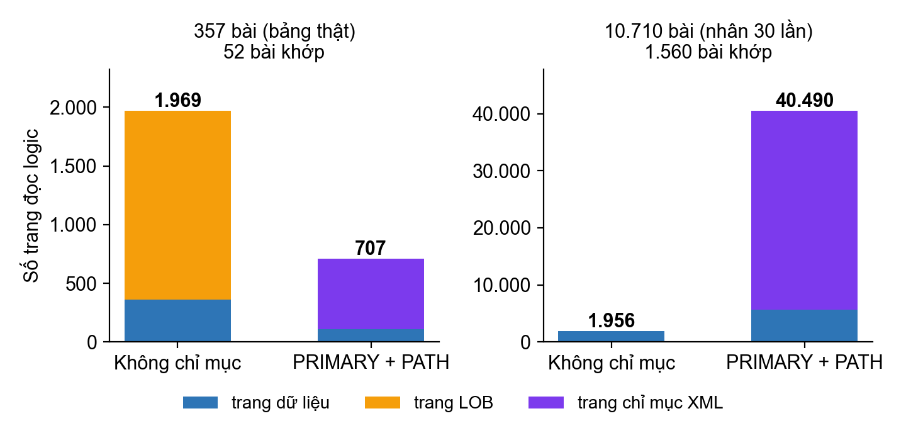
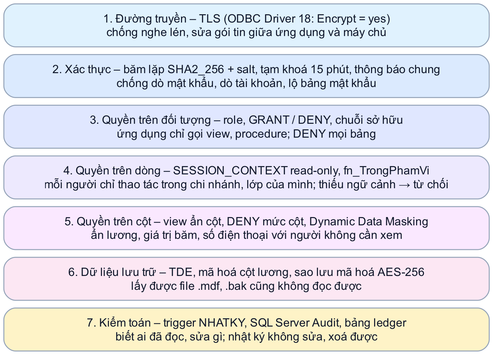
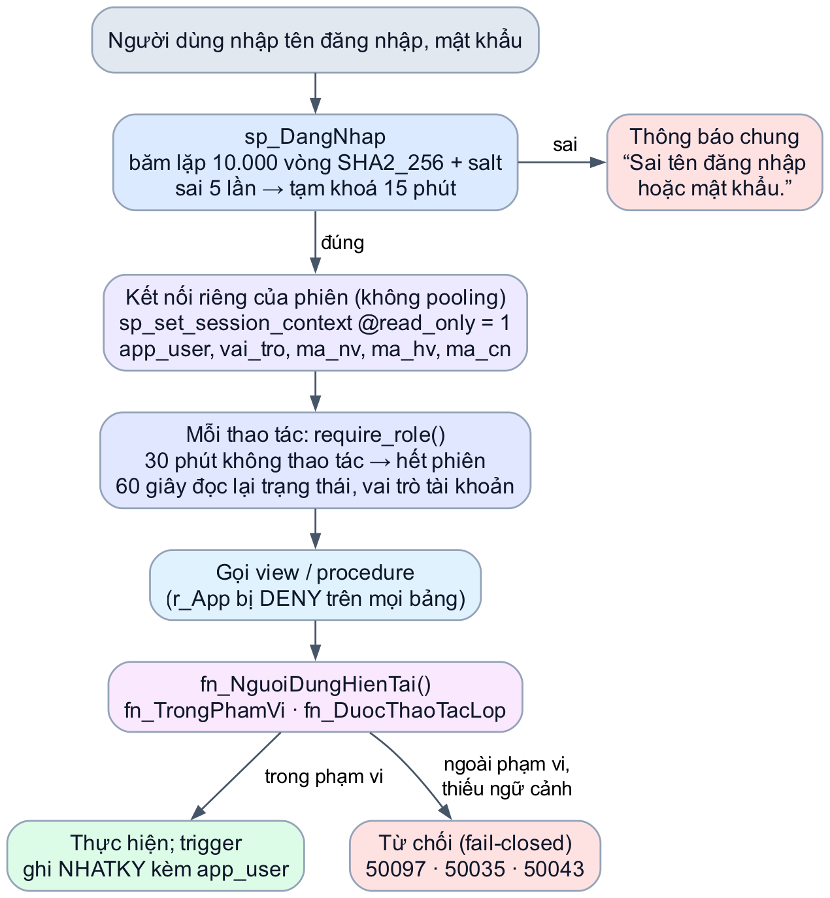
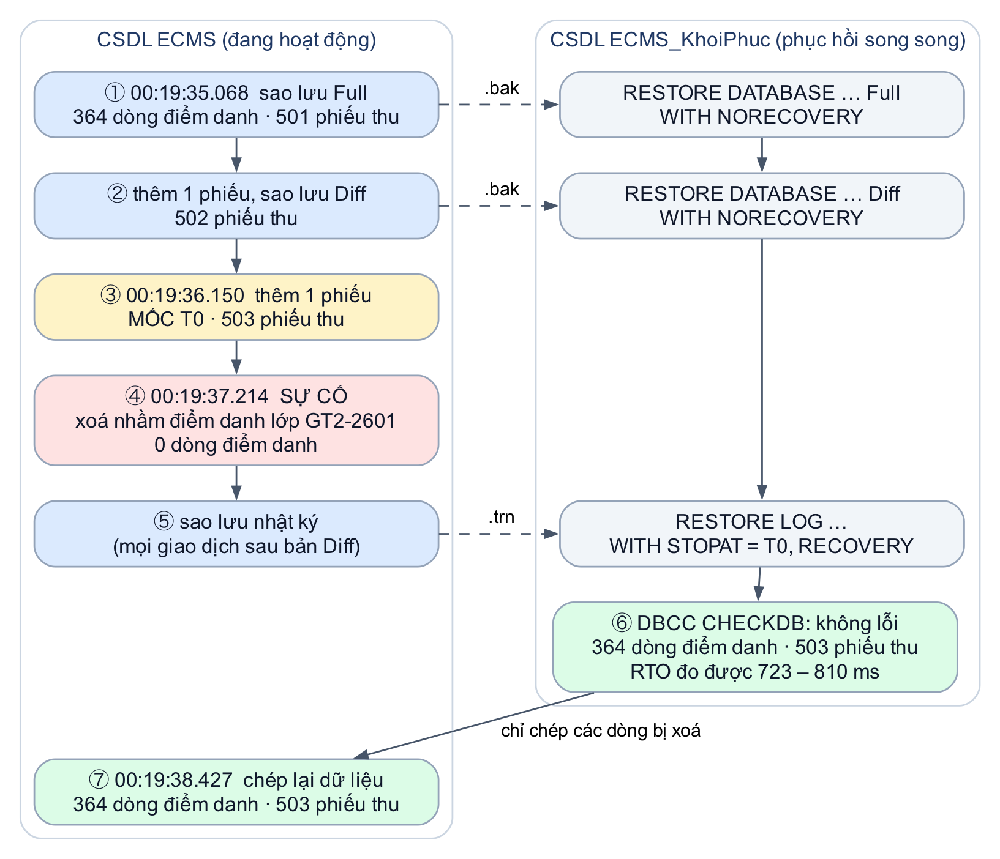
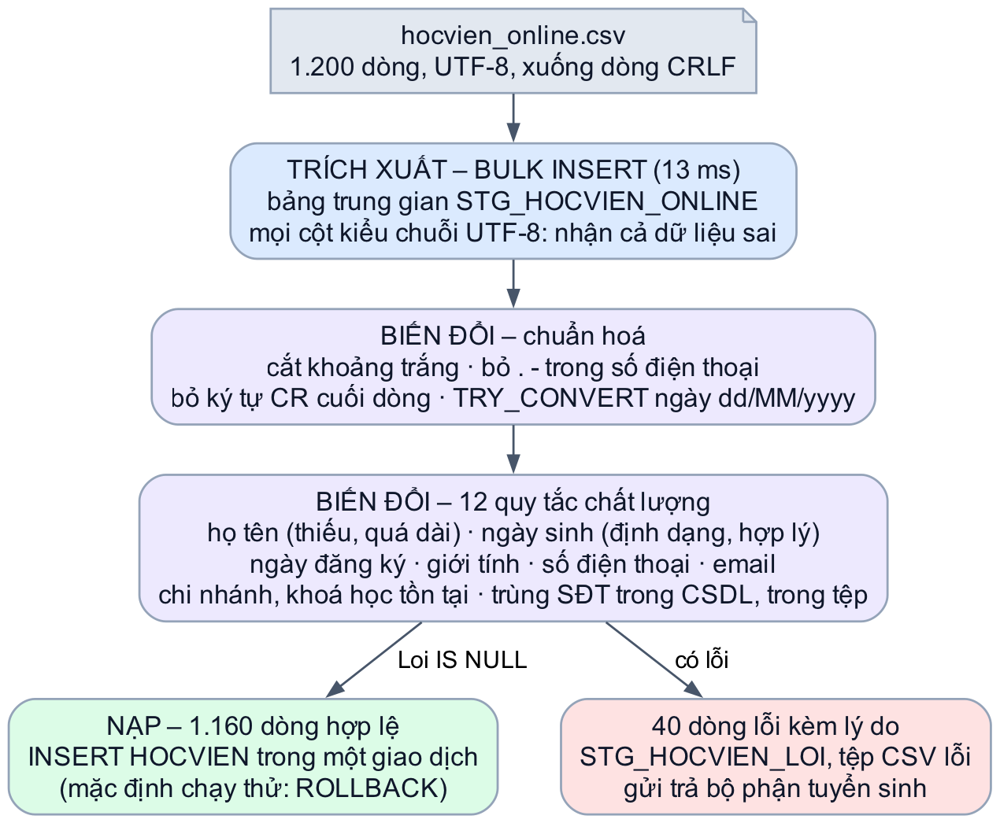
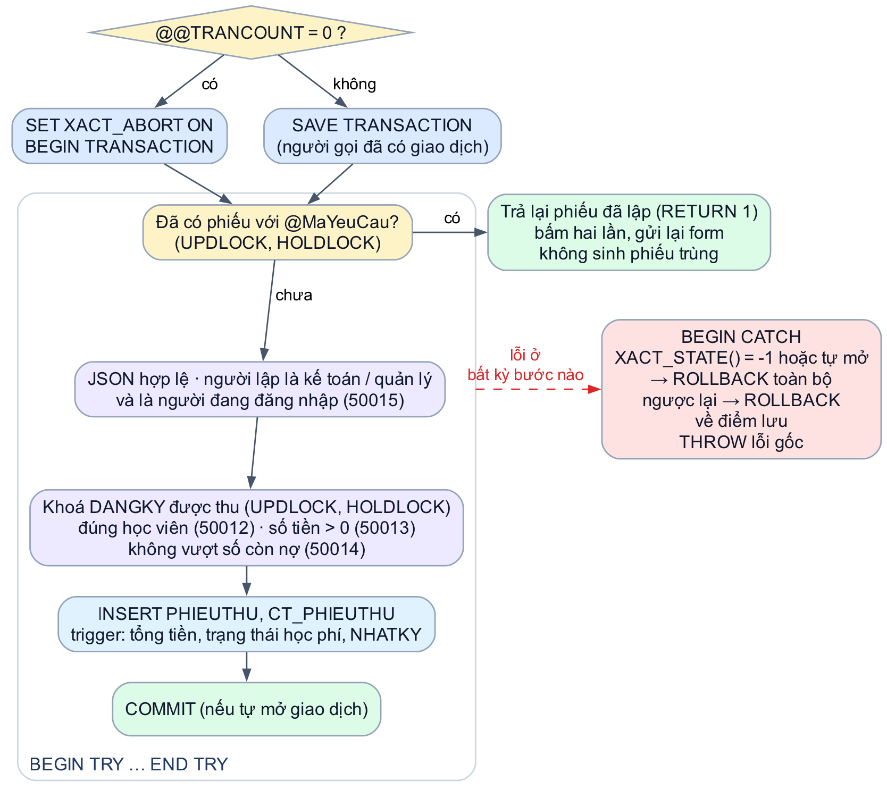
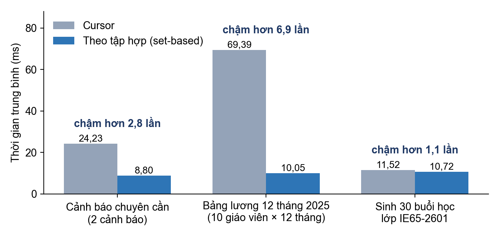

# Chương 3. Xử lý thông tin

Nếu Chương 2 trả lời câu hỏi "dữ liệu được tổ chức thế nào", thì Chương 3 trả lời câu hỏi "dữ liệu được biến thành thông tin và được bảo vệ ra sao". Chương gồm ba phần. Phần thứ nhất trình bày bộ truy vấn SQL và XML trả lời các câu hỏi quản lý thực tế, kèm đo đạc hiệu quả của chỉ mục. Phần thứ hai trình bày an ninh dữ liệu: xác thực, phân quyền, view bảo mật, sao lưu – phục hồi, nhập – xuất dữ liệu, mã hoá và kiểm toán. Phần thứ ba trình bày lập trình trên CSDL bằng stored procedure, function, trigger và cursor. Mọi kết quả trong chương được đo trên CSDL dựng mới từ script, chạy trên SQL Server 2025 trong Docker. Dữ liệu mẫu lấy ngày tham chiếu 15/10/2026; các cột tính theo ngày hiện tại (như số ngày quá hạn) sẽ tăng dần khi chạy lại vào những ngày sau.

## 3.1 Truy vấn dữ liệu

### 3.1.1 Bộ truy vấn nghiệp vụ

**Phân tích.** Thay vì viết truy vấn để minh hoạ cú pháp, nhóm xuất phát từ các câu hỏi mà quản lý, giáo vụ, kế toán thực sự đặt ra hằng ngày, rồi chọn kỹ thuật SQL phù hợp để trả lời. Kết quả là bộ 31 truy vấn chia thành sáu nhóm kỹ thuật, mỗi nhóm có ít nhất năm câu. Cột cuối là số dòng kết quả trên dữ liệu mẫu, dùng để đối chiếu khi chạy lại.

*Bảng 3.1 – Bộ 31 truy vấn nghiệp vụ trong 10_queries.sql*

| Nhóm | Câu | Câu hỏi nghiệp vụ | Kỹ thuật | Số dòng |
|---|:-:|---|---|--:|
| Cơ bản | Q01 | Học viên họ Nguyễn hoặc Trần ở chi nhánh Thủ Đức | `LIKE`, `IN`, `ORDER BY` | 34 |
| | Q02 | Khoá học có học phí 4 – 6 triệu và học phí mỗi buổi | `BETWEEN`, biểu thức | 7 |
| | Q03 | Học viên chưa có email | `IS NULL` | 101 |
| | Q04 | 5 phiếu thu lớn nhất năm 2026 | `TOP … WITH TIES` | 5 |
| | Q05 | Lớp quý IV/2026 chưa đạt 60% sĩ số | Điều kiện kết hợp | 2 |
| Kết nối | Q06 | Lớp đang học kèm khoá, chi nhánh, giáo viên, lịch | `INNER JOIN` 6 bảng, `STRING_AGG` | 5 |
| | Q07 | Mọi giáo viên và số lớp phụ trách, kể cả 0 lớp | `LEFT JOIN` | 10 |
| | Q08 | Phòng chưa từng được xếp lịch | `RIGHT JOIN … IS NULL` | 6 |
| | Q09 | Cung – cầu theo khoá: khách tiềm năng và chỗ trống | `FULL OUTER JOIN` hai truy vấn con | 12 |
| | Q10 | Nhân viên và người quản lý trực tiếp | Kết nối với chính nó | 20 |
| Gom nhóm | Q11 | Doanh thu theo chi nhánh của lớp và tháng năm 2026 | `GROUP BY`, `SUM` | 18 |
| | Q12 | Sĩ số trung bình, nhỏ nhất, lớn nhất theo khoá | `AVG`, `MIN`, `MAX`, `HAVING` | 12 |
| | Q13 | Chương trình có tỷ lệ đạt dưới 95% | `HAVING` với biểu thức | 4 |
| | Q14 | Cơ cấu hình thức thanh toán theo năm | `GROUP BY` hai cột | 6 |
| | Q15 | Doanh thu chi nhánh có tổng phụ và tổng cộng | `ROLLUP` | 10 |
| Lồng | Q16 | Học viên từng học chương trình IELTS | `IN (truy vấn con)` | 93 |
| | Q17 | Khách đã kiểm tra đầu vào nhưng chưa ghi danh | `NOT EXISTS` | 15 |
| | Q18 | Học viên có điểm trung bình cao hơn trung bình lớp | Truy vấn con tương quan | 174 |
| | Q19 | Lớp năm 2026 lấp đầy hơn mọi lớp cùng khoá năm 2025 | `> ALL` | 7 |
| | Q20 | Học viên còn nợ học phí (không tính đăng ký đã huỷ, đã chuyển lớp) | Truy vấn con trong `SELECT` và `FROM` | 58 |
| Tập hợp | Q21 | Danh bạ chung của nhân viên và học viên | `UNION` | 369 |
| | Q22 | Học viên học cả IELTS và TOEIC | `INTERSECT` | 2 |
| | Q23 | Đạt cấp 1 nhưng chưa học cấp 2 | `EXCEPT` | 69 |
| | Q24 | Học viên học tất cả khoá của một chương trình | Phép chia bằng `NOT EXISTS` lồng | 36 |
| | Q24b | Như Q24, viết bằng cách đếm | `HAVING COUNT = (truy vấn con)` | 36 |
| Nâng cao | Q25 | Doanh thu tháng, luỹ kế và chênh lệch với tháng trước | CTE, `SUM() OVER`, `LAG` | 7 |
| | Q26 | Lộ trình tiên quyết tới IELTS 6.5+ và TOEIC 850+ | CTE đệ quy | 2 |
| | Q27 | Cây quản lý nhân viên | CTE đệ quy | 20 |
| | Q28 | Ba học viên điểm cao nhất mỗi lớp | `RANK`, `DENSE_RANK`, `NTILE`, `PARTITION BY` | 49 |
| | Q29 | Doanh thu chi nhánh theo quý năm 2025 | `PIVOT` | 3 |
| | Q30 | Thống kê điểm danh các lớp đang học | `PIVOT` kết hợp tỷ lệ | 5 |

Hai câu được viết lại sau đợt rà soát. Q20 trước đây trừ cả các đăng ký "Đã chuyển lớp", trong khi số tiền đã đóng của đăng ký đó đã đi theo đăng ký mới, nên tính nợ hai lần; nay Q20 cho cùng kết quả với hàm `fn_SoTienConNo`. Q09 trước đây nối khoá học với lớp học – hai bảng có khoá ngoại bắt buộc nên mọi lớp đều khớp một khoá, phía phải của `FULL OUTER JOIN` không bao giờ thiếu và phép nối ngoài đầy đủ không thể hiện được gì. Dưới đây phân tích năm truy vấn tiêu biểu cho các kỹ thuật khó, bắt đầu từ Q09 mới.

**Kết nối ngoài đầy đủ (Q09).** Câu hỏi của giáo vụ là "khoá nào có khách mà không còn lớp nhận, khoá nào còn chỗ mà chưa có khách". Hai tập được tính độc lập: *cầu* là số khách đã được kiểm tra đầu vào đề xuất một khoá nhưng chưa ghi danh khoá đó; *cung* là tổng số chỗ trống của các lớp còn nhận ghi danh. Vì hai tập không phụ thuộc nhau, cả hai phía đều có thể không khớp – đúng trường hợp cần `FULL OUTER JOIN`; dùng `LEFT JOIN` hay `RIGHT JOIN` sẽ đánh mất một trong hai nhóm.

```sql title="Mã lệnh – Q09: Cung – cầu theo khoá học"
SELECT COALESCE(cau.MaKH, cung.MaKH) AS MaKH,
       ISNULL(cau.SoTiemNang, 0) AS KhachTiemNang,
       ISNULL(cung.SoChoTrong, 0) AS ChoTrong,
       CASE WHEN cung.MaKH IS NULL THEN N'Có khách, không còn lớp nhận'
            WHEN cau.MaKH IS NULL THEN N'Còn chỗ, chưa có khách'
            ELSE N'Khớp' END AS NhanXet
FROM (SELECT t.MaKHDeXuat AS MaKH, COUNT(DISTINCT t.MaHV) AS SoTiemNang
      FROM KIEMTRA_DAUVAO t
      WHERE t.MaKHDeXuat IS NOT NULL
        AND NOT EXISTS (SELECT 1 FROM DANGKY d
                        JOIN LOPHOC l ON l.MaLop = d.MaLop
                        WHERE d.MaHV = t.MaHV AND l.MaKH = t.MaKHDeXuat)
      GROUP BY t.MaKHDeXuat) cau
FULL OUTER JOIN
     (SELECT MaKH, SUM(SiSoToiDa - SiSoHienTai) AS SoChoTrong
      FROM LOPHOC
      WHERE TrangThai IN (N'Sắp mở', N'Đang học')
        AND SiSoHienTai < SiSoToiDa
      GROUP BY MaKH) cung
  ON cung.MaKH = cau.MaKH;
```

*Bảng 3.2 – Kết quả Q09 gom theo nhận xét*

| Nhận xét | Khoá học (số khách hoặc số chỗ) | Hành động gợi ý |
|---|---|---|
| Có khách, không còn lớp nhận | GT1 (1 khách), IEF (2), KD1 (1), TC450 (3) | Mở lớp mới cho 7 khách đang chờ |
| Còn chỗ, chưa có khách | IE55 (2 chỗ), IE65 (6 chỗ) | Tư vấn, chạy quảng cáo cho hai khoá IELTS |
| Khớp | GT2, GT3, KD2, KD3, TC650, TC850 | Gọi khách đã kiểm tra đầu vào để ghi danh |

**Phép chia (Q24).** Câu hỏi "học viên *h* đã học mọi khoá của chương trình *ct*" là bài toán chia trong đại số quan hệ. SQL không có phép chia trực tiếp nên nhóm chuyển câu hỏi về dạng phủ định kép tương đương: "không tồn tại khoá *k* thuộc *ct* mà *h* chưa đăng ký".

```sql title="Mã lệnh – Q24: Học viên đã học mọi khoá của một chương trình"
SELECT h.MaHV, h.HoTen, ct.TenCT
FROM HOCVIEN h CROSS JOIN CHUONGTRINH ct
WHERE NOT EXISTS (
        SELECT 1 FROM KHOAHOC k
        WHERE k.MaCT = ct.MaCT
          AND NOT EXISTS (SELECT 1
                          FROM DANGKY d JOIN LOPHOC l ON l.MaLop = d.MaLop
                          WHERE d.MaHV = h.MaHV AND l.MaKH = k.MaKH));
```

Để kiểm chứng, nhóm viết thêm cách thứ hai (Q24b) bằng cách đếm số khoá đã học của mỗi học viên trong chương trình rồi so với tổng số khoá của chương trình. Hai cách viết độc lập cho cùng **36** cặp học viên – chương trình, xác nhận kết quả đúng.

**CTE đệ quy (Q26).** Lộ trình học là một chuỗi khoá tiên quyết có độ dài không biết trước. CTE đệ quy bắt đầu từ khoá đích và lần ngược theo cột `MaKHTienQuyet` cho tới khi gặp khoá không có tiên quyết. Kết quả:

*Bảng 3.3 – Lộ trình tiên quyết tìm được bằng CTE đệ quy (Q26)*

| Khoá xuất phát | Số bước | Lộ trình |
|---|:-:|---|
| IEF | 2 | IELTS Foundation → IELTS 5.5 → IELTS 6.5+ |
| TC450 | 2 | TOEIC 450 → TOEIC 650 → TOEIC 850+ |

**Tổng phụ bằng ROLLUP (Q15).** `GROUP BY ROLLUP (MaCN, Nam)` sinh thêm dòng tổng của từng chi nhánh và dòng tổng toàn trung tâm trong cùng một câu truy vấn, thay cho việc cộng tay như khi dùng Excel. Doanh thu được tính theo chi nhánh *của lớp* mà khoản thu thuộc về. Trích kết quả:

*Bảng 3.4 – Trích kết quả Q15: doanh thu có tổng phụ theo chi nhánh*

| Chi nhánh | Năm | Doanh thu (đồng) |
|---|---|--:|
| CN01 | 2025 | 352.950.000 |
| CN01 | 2026 | 459.525.000 |
| CN01 | Cả kỳ | 812.475.000 |
| CN02 | Cả kỳ | 711.627.000 |
| CN03 | Cả kỳ | 719.315.000 |
| TỔNG | Cả kỳ | 2.243.417.000 |

**Xoay bảng bằng PIVOT (Q29).** Doanh thu năm 2025 của từng chi nhánh được xoay từ dạng dòng sang dạng cột theo quý, đúng hình thức báo cáo mà quản lý quen đọc:

*Bảng 3.5 – Kết quả Q29: doanh thu năm 2025 theo chi nhánh và quý (đồng)*

| Chi nhánh | Quý I | Quý II | Quý III | Quý IV |
|---|--:|--:|--:|--:|
| CN01 | 168.650.000 | 62.475.000 | 0 | 121.825.000 |
| CN02 | 78.750.000 | 173.610.000 | 19.530.000 | 74.000.000 |
| CN03 | 52.500.000 | 71.100.000 | 0 | 259.650.000 |

**Nhận xét.** Bảng PIVOT cho thấy doanh thu dồn vào các quý có đợt khai giảng (quý I, II, IV), trong khi quý III gần như không có doanh thu ở hai chi nhánh. Đây là ví dụ điển hình của việc biến dữ liệu thành thông tin: từ hàng trăm phiếu thu rời rạc, quản lý nhận được một bảng mười hai con số đủ để lên kế hoạch dòng tiền và mở chiến dịch tuyển sinh cho quý III. Tương tự, Q09 biến 357 bài kiểm tra đầu vào và 9 lớp còn nhận ghi danh thành ba nhóm hành động cụ thể cho giáo vụ.

### 3.1.2 Hiệu năng truy vấn và vai trò của chỉ mục

**Phân tích.** Dữ liệu mẫu chỉ có 10.063 dòng điểm danh – quá nhỏ để thấy khác biệt khi có và không có chỉ mục. Vì vậy nhóm nhân bản bảng DIEMDANH thành một bảng tạm **1.000.000 dòng**, rồi chạy cùng một truy vấn trước và sau khi tạo chỉ mục. Số liệu được thu bằng `SET STATISTICS IO, TIME ON`; số trang đọc logic (logical reads) được dùng làm thước đo chính vì ổn định giữa các lần chạy, còn thời gian CPU chỉ để tham khảo.

*Bảng 3.6 – Số trang đọc trước và sau khi có chỉ mục (bảng 1.000.000 dòng)*

| Truy vấn | Không có chỉ mục | Có chỉ mục | Mức giảm |
|---|---|---|--:|
| P1 – chuyên cần của một đăng ký (`WHERE MaDK = …`) | Quét toàn bộ, 6.023 trang, CPU 81 ms | Tìm trực tiếp trên `IX_DD_MaDK`, 3 trang, CPU 1 ms | 99,9% |
| P2 – thống kê một lớp (`WHERE MaLop = … GROUP BY`) | Quét toàn bộ, 6.023 trang, CPU 202 ms | Tìm trực tiếp trên `IX_DD_MaLop`, 150 trang, CPU 14 ms | 97,5% |
| P3 – phiếu thu tháng 3/2026 viết `YEAR(NgayThu) = 2026 AND MONTH(NgayThu) = 3` | Quét chỉ mục, 4 trang | – | |
| P3' – cùng điều kiện viết `NgayThu >= '2026-03-01' AND NgayThu < '2026-04-01'` | – | Tìm trực tiếp trên `IX_PHIEUTHU_NgayThu`, 2 trang | 50% |

**Nhận xét.**

- Chỉ mục của P1 có cột `INCLUDE (TrangThai)` nên là **chỉ mục bao phủ**: truy vấn đọc được mọi cột cần thiết ngay trên chỉ mục mà không phải tra lại bảng, vì thế chỉ còn 3 trang.
- Lớp IE55-2602 của P2 chiếm 31.680 trên 1.000.000 dòng, tức khoảng **3,2%** bảng, nên vẫn phải đọc 150 trang, nhưng ít hơn quét toàn bộ khoảng 40 lần. Độ chọn lọc càng thấp (lọc ra càng nhiều dòng) thì lợi ích của chỉ mục càng giảm.
- Cặp P3 và P3' cho thấy một lỗi thường gặp: bọc cột trong hàm `YEAR()`, `MONTH()` làm điều kiện **không khai thác được chỉ mục** (non-SARGable), dù chỉ mục đã có. Nhóm áp dụng quy tắc viết điều kiện theo khoảng cho mọi view báo cáo và procedure thống kê doanh thu.

### 3.1.3 Truy vấn dữ liệu XML

**Phân tích.** Kết quả kiểm tra đầu vào có cấu trúc linh hoạt: bốn kỹ năng, mỗi kỹ năng có điểm và nhận xét, thêm nhận xét chung và khoá đề xuất; trong tương lai có thể bổ sung kỹ năng hoặc điểm thành phần. Nhóm lưu phần này trong cột `KIEMTRA_DAUVAO.KetQuaChiTiet` kiểu XML và dùng nó để thực hiện nội dung Bài thực hành số 2 trên chính dữ liệu của đồ án.

**XML Schema.** Để cột XML không trở thành nơi chứa dữ liệu tuỳ tiện, nhóm định nghĩa tập lược đồ `XSC_KetQuaKiemTra` với các quy định: phần tử gốc `KetQua` có thuộc tính bắt buộc `HinhThuc` nhận một trong hai giá trị *Online* hoặc *Tại trung tâm*; có **đúng bốn** phần tử `KyNang`, mỗi phần tử có thuộc tính `Ten` thuộc {Listening, Reading, Writing, Speaking} và `Diem` là số thập phân từ 0 đến 10 với một chữ số lẻ; các phần tử `NhanXetChung`, `DeXuat` là tuỳ chọn. Lược đồ được gắn vào cột bằng lệnh:

```sql title="Mã lệnh – Gắn XML Schema vào cột kết quả kiểm tra"
ALTER TABLE dbo.KIEMTRA_DAUVAO
    ALTER COLUMN KetQuaChiTiet XML(DOCUMENT dbo.XSC_KetQuaKiemTra);
```

Khi gắn lược đồ, SQL Server kiểm tra lại toàn bộ 357 tài liệu đã có và tất cả đều hợp lệ. Sau đó nhóm thử ghi các tài liệu sai cấu trúc:

*Bảng 3.7 – Kiểm thử XML Schema với tài liệu sai cấu trúc (X12)*

| Trường hợp thử | Kết quả |
|---|---|
| Điểm một kỹ năng bằng 11 | Bị từ chối – lỗi 6926: Invalid simple type value '11' tại `/KetQua[1]/KyNang[1]/@Diem` |
| Chỉ có ba kỹ năng | Bị từ chối – lỗi 6908: Invalid content, thiếu phần tử `KyNang` |
| Tên kỹ năng "Grammar" | Bị từ chối – lỗi 6926: Invalid simple type value 'Grammar' |
| Thiếu thuộc tính `HinhThuc` | Bị từ chối – lỗi 6906: Required attribute 'HinhThuc' is missing |
| Tài liệu đúng lược đồ | Được chấp nhận |

Lược đồ còn giúp truy vấn: vì SQL Server biết `@Diem` là kiểu số nên phép so sánh `@Diem >= 7` không cần ép kiểu. Đổi lại, các thao tác sửa bằng `.modify()` phải đưa vào đúng kiểu dữ liệu đã khai báo.

**Bộ truy vấn XML.** Nhóm viết 18 truy vấn bao quát đủ các phương thức của kiểu XML, XQuery, các cách chuyển đổi giữa dữ liệu quan hệ với XML và chỉ mục XML:

*Bảng 3.8 – Bộ 18 truy vấn XML trong 09_xml.sql*

| Câu | Câu hỏi | Phương thức, kỹ thuật |
|:-:|---|---|
| X01 | Điểm từng kỹ năng của các bài kiểm tra gần nhất | `.value()` với vị từ `[@Ten="Listening"]` |
| X02 | Bài có điểm Speaking thấp hơn điểm tổng từ 0,7 trở lên (25 bài) | `.exist()` kết hợp `sql:column()` |
| X03 | Tách bốn kỹ năng thành bốn dòng | `.nodes()` với `CROSS APPLY` |
| X04 | Điểm trung bình từng kỹ năng theo hình thức thi | `.nodes()` kết hợp `GROUP BY` |
| X05 | Trích các kỹ năng đạt từ 7 điểm trở lên | `.query()` |
| X06 | Kỹ năng yếu nhất của mỗi bài | Biểu thức FLWOR `let / for / where / order by / return` |
| X07 | Chênh lệch giữa kỹ năng mạnh nhất và yếu nhất | Hàm `max()`, `min()` trong XQuery |
| X08 | Khoá đề xuất trong XML có khớp cột quan hệ không | `sql:column()`, `sql:variable()` |
| X09 | Phúc khảo: sửa điểm Writing rồi tính lại điểm tổng | `.modify(replace value of …)`, `.nodes()` với `AVG` |
| X10 | Thêm hoặc sửa nhận xét chung | `.modify(insert … after …)` |
| X11 | Xoá nhận xét kỹ năng Listening | `.modify(delete …)` |
| X12 | Tài liệu sai cấu trúc bị từ chối | XML Schema |
| X13 | Xuất danh mục khoá học | `FOR XML RAW, ROOT` |
| X14 | Xuất chương trình kèm khoá học | `FOR XML AUTO` |
| X15 | Xuất chi nhánh, lớp đang học và học viên | `FOR XML PATH` lồng ba cấp, `TYPE` |
| X16 | Nhập kết quả thi từ đối tác | `OPENXML` với `sp_xml_preparedocument` |
| X17 | Chuyển XML của đối tác sang cấu trúc ECMS và kiểm tra bằng lược đồ | `.nodes()`, `FOR XML PATH`, ép kiểu về XML có lược đồ |
| X18 | Chỉ mục XML có lợi khi nào | `PRIMARY XML INDEX`, chỉ mục phụ `FOR PATH`, `STATISTICS IO` |

Truy vấn X06 minh hoạ sức mạnh của XQuery: biểu thức FLWOR tìm điểm thấp nhất trong bốn kỹ năng, duyệt lại các kỹ năng để chọn kỹ năng có điểm bằng giá trị đó và dựng một phần tử XML mới làm kết quả.

```sql title="Mã lệnh – X06: Kỹ năng yếu nhất của mỗi bài kiểm tra"
SELECT MaKT, KetQuaChiTiet.query('
    let $min := min(/KetQua/KyNang/@Diem)
    for $k in /KetQua/KyNang
    where $k/@Diem = $min
    order by $k/@Ten
    return <YeuNhat KyNang="{data($k/@Ten)}"
                    Diem="{data($k/@Diem)}"/>') AS KyNangYeu
FROM KIEMTRA_DAUVAO;
```

Kết quả (trích ba dòng đầu):

*Bảng 3.9 – Trích kết quả X06*

| MaKT | KyNangYeu |
|--:|---|
| 1 | `<YeuNhat KyNang="Writing" Diem="1.3"/>` |
| 2 | `<YeuNhat KyNang="Speaking" Diem="2.3"/>` |
| 3 | `<YeuNhat KyNang="Speaking" Diem="3.6"/>` |

Truy vấn X04 cho một kết quả có giá trị quản lý: học viên thi tại trung tâm có điểm cao hơn thi trực tuyến ở cả bốn kỹ năng (Listening 4,22 so với 3,49; Reading 4,33 so với 3,47; Writing 4,22 so với 3,54; Speaking 4,14 so với 3,52). Đây là dấu hiệu để trung tâm xem lại độ khó hoặc điều kiện làm bài của đề trực tuyến. Truy vấn X15 xuất danh sách lớp đang học kèm học viên thành một tệp XML phân cấp ba mức để gửi cho đối tác.

**Sửa XML và thuộc tính suy diễn (X09).** Cột `DiemTong` là trung bình bốn kỹ năng, được tách ra khỏi XML thành cột quan hệ để lọc và sắp xếp nhanh. Không có trigger nào duy trì cột này, vì vậy mọi thao tác sửa điểm trong XML phải tính lại `DiemTong` trong cùng giao dịch. X09 thực hiện phúc khảo cho bài số 1: điểm Writing được sửa từ 1,3 thành 5,5 bằng `.modify(replace value of …)`, rồi điểm tổng được tính lại từ chính tài liệu XML bằng `.nodes()` và `AVG`, tăng từ 1,7 lên 2,7. Ứng dụng web không sửa XML trực tiếp mà ghi cả tài liệu qua `sp_GhiKetQuaKiemTra`, nơi điểm tổng được tính cùng lúc với việc dựng XML.

**Chỉ mục XML (X18).** Khi không có chỉ mục, mỗi lần gọi `.exist()` hay `.value()` SQL Server phải phân tích lại từng tài liệu. Chỉ mục XML chính (`PRIMARY XML INDEX`) lưu sẵn mọi nút của mọi tài liệu thành một bảng nội bộ; chỉ mục phụ `FOR PATH` sắp xếp các nút theo đường dẫn và giá trị, phù hợp với điều kiện dạng `/KetQua/KyNang[@Ten="Speaking"][@Diem >= 7]`. Nhóm đo cùng truy vấn tìm bài có Speaking từ 7 điểm trở lên ở hai quy mô: 357 bài thật và một bảng tạm nhân 30 lần (10.710 bài). Chỉ mục được tạo trong giao dịch rồi huỷ nên không để lại gì trong CSDL.

*Bảng 3.10 – Số trang đọc của X18 khi có và không có chỉ mục XML*

| Quy mô | Bài khớp | Không chỉ mục | Có chỉ mục PRIMARY + PATH |
|---|--:|---|---|
| 357 bài (bảng thật) | 52 (14,6%) | 361 trang dữ liệu + 1.608 lượt đọc LOB = 1.969 | 106 trang dữ liệu + 601 trang chỉ mục = 707 |
| 10.710 bài (bảng tạm) | 1.560 (14,6%) | 1.956 trang dữ liệu | 5.658 trang dữ liệu + 34.832 trang chỉ mục (10.712 lượt tra) = 40.490 |
| Dung lượng | | Dữ liệu XML 0,33 MB | Chỉ mục 1,09 MB, gấp 3,3 lần dữ liệu |



*Hình 3.1 – Số trang đọc của truy vấn X18 khi có và không có chỉ mục XML ở hai quy mô dữ liệu*

**Nhận xét.** Kết quả đo cho thấy chỉ mục XML không phải lúc nào cũng có lợi. Ở quy mô thật, chỉ mục giúp không phải phân tích lại XML (không còn lượt đọc LOB) nên tổng số trang giảm từ 1.969 xuống 707. Nhưng ở quy mô gấp 30 lần, bộ tối ưu chọn kế hoạch tra chỉ mục cho *từng* tài liệu (10.712 lượt tra), nên số trang đọc tăng gấp khoảng 20 lần, từ 1.956 lên 40.490. Nguyên nhân là điều kiện chỉ loại được khoảng 85% số bài – độ chọn lọc thấp, giống trường hợp P2 ở mục 3.1.2. Chỉ mục còn chiếm dung lượng gấp 3,3 lần dữ liệu XML và phải cập nhật mỗi khi ghi. Vì vậy ECMS không tạo chỉ mục XML cố định; nhu cầu lọc phổ biến nhất (theo điểm tổng) đã được phục vụ bằng cột `DiemTong` với chỉ mục B-tree thông thường. Chỉ mục XML chỉ nên dùng khi tài liệu lớn, số lượng nhiều và điều kiện lọc rất chọn lọc.

**Phục vụ ứng dụng web.** Phần XML không chỉ dừng ở truy vấn minh hoạ mà được dùng trực tiếp trong form kiểm tra đầu vào (mục 4.2). View `vw_KiemTraChiTiet` tách XML thành các cột bằng `.value()`; procedure `sp_GhiKetQuaKiemTra` dựng tài liệu XML bằng `FOR XML PATH` vào một biến kiểu XML có lược đồ, tính điểm tổng và gợi ý khoá học bằng hàm `fn_GoiYKhoaHoc`. Khi thử nhập Listening 5,5, Reading 6, Writing 5, Speaking 4,5 cho chương trình IELTS, procedure trả về điểm tổng 5,3 và đề xuất khoá **IE55**; nhập Listening bằng 11 thì bị lược đồ XML từ chối.

**So sánh lưu XML với tách thành bảng quan hệ.** Một phương án khác là tách kết quả kiểm tra thành bảng KETQUA_KYNANG (MaKT, KyNang, Diem, NhanXet). Hai phương án được so sánh như sau:

*Bảng 3.11 – So sánh lưu kết quả kiểm tra bằng cột XML và bằng bảng quan hệ*

| Tiêu chí | Cột XML (phương án ECMS dùng) | Bảng quan hệ KETQUA_KYNANG |
|---|---|---|
| Thay đổi cấu trúc (thêm kỹ năng, thêm điểm thành phần) | Sửa XML Schema, dữ liệu cũ vẫn giữ nguyên | Phải ALTER TABLE hoặc thêm bảng, di chuyển dữ liệu |
| Đọc nguyên một kết quả | Một dòng, một cột | Kết nối và đọc bốn dòng |
| Thống kê theo kỹ năng | `.nodes()` và `.value()`, chậm hơn, cú pháp phức tạp | `GROUP BY` đơn giản, dùng chỉ mục thường |
| Ràng buộc | XSD: kiểu, miền giá trị, số lần xuất hiện | CHECK, khoá ngoại, UNIQUE (MaKT, KyNang) |
| Trao đổi với hệ thống khác | Xuất, nhập nguyên văn | Phải dựng lại XML bằng `FOR XML` |
| Thuộc tính suy diễn (điểm tổng) | Phải tự tính lại khi sửa XML (X09) | Tính bằng `AVG` khi cần, hoặc view |
| Chỉ mục | Chỉ mục XML gấp 3,3 lần dữ liệu, chỉ có lợi khi điều kiện rất chọn lọc (X18) | Chỉ mục B-tree thông thường |

**Nhận xét.** Lưu XML phù hợp với ECMS vì kết quả kiểm tra chủ yếu được ghi một lần, đọc nguyên khối và gửi đi; riêng điểm tổng cần lọc và sắp xếp thường xuyên đã được tách sẵn thành cột `DiemTong`. Nếu trung tâm cần phân tích sâu từng kỹ năng thường xuyên, phương án bảng quan hệ sẽ phù hợp hơn.

## 3.2 An ninh dữ liệu

Hệ thống bảo vệ dữ liệu theo nhiều lớp, đi từ ngoài vào trong (Hình 3.2): kẻ tấn công vượt qua được một lớp vẫn bị lớp bên trong chặn lại. Các mục dưới đây trình bày lần lượt xác thực (lớp 2), phân quyền trên đối tượng, dòng và cột (lớp 3 – 5), sao lưu – phục hồi và nhập – xuất dữ liệu, cuối cùng là mã hoá và kiểm toán (lớp 1, 6, 7).



*Hình 3.2 – Bảy lớp bảo vệ dữ liệu của ECMS và mối đe doạ mỗi lớp ngăn chặn*

### 3.2.1 Xác thực

**Hai cơ chế xác thực của SQL Server.** SQL Server hỗ trợ hai cách xác thực người kết nối, mỗi cách có ưu, nhược điểm riêng:

*Bảng 3.12 – So sánh Windows Authentication và SQL Server Authentication*

| Tiêu chí | Windows Authentication | SQL Server Authentication |
|---|---|---|
| Bên xác thực | Windows, Active Directory (Kerberos, NTLM) | SQL Server; mật khẩu được băm và lưu trong CSDL `master` |
| Ưu điểm | Không truyền mật khẩu; dùng chính sách mật khẩu và khoá tài khoản của domain; đăng nhập một lần | Dùng được từ Linux, macOS, container và ứng dụng web ngoài domain |
| Nhược điểm | Cần máy trong domain hoặc tài khoản Windows | Phải tự quản lý mật khẩu; dễ lộ nếu để trong chuỗi kết nối |
| Sử dụng trong ECMS | Thành viên dùng Windows kết nối quản trị bằng SSMS | Ứng dụng web (`ecms_app`) và năm login minh hoạ vai trò |

Vì cần cả hai, ECMS chạy ở **chế độ hỗn hợp** (Mixed mode). Script kiểm tra chế độ hiện tại bằng `SERVERPROPERTY('IsIntegratedSecurityOnly')`; trên Windows, chế độ này được bật trong *Server Properties → Security → SQL Server and Windows Authentication mode* rồi khởi động lại dịch vụ.

**Login và user.** Nhóm tạo sáu login, mỗi login gắn với một user trong CSDL ECMS và một role. Script tạo login nếu chưa có, chạy lại thì chỉ đổi mật khẩu.

*Bảng 3.13 – Sáu login, user và role của ECMS*

| Login | User | Role | Kiểm tra độ mạnh mật khẩu | Buộc đổi mật khẩu định kỳ |
|---|---|---|:-:|:-:|
| `ecms_app` | u_app | r_App | Có | Không (tài khoản dịch vụ, không được hết hạn đột ngột) |
| `ecms_quanly` | u_quanly | r_QuanLy | Có | Có |
| `ecms_giaovu` | u_giaovu | r_GiaoVu | Có | Có |
| `ecms_ketoan` | u_ketoan | r_KeToan | Có | Có |
| `ecms_giaovien` | u_giaovien | r_GiaoVien | Có | Có |
| `ecms_hocvien` | u_hocvien | r_HocVien | Có | Có |

**Tài khoản ứng dụng và băm mật khẩu.** Người dùng web không có login SQL Server riêng: họ đăng nhập bằng bảng TAIKHOAN, còn kết nối tới CSDL luôn dùng login `ecms_app`. Mật khẩu không bao giờ được lưu ở dạng rõ. Hàm `fn_BamMatKhau` trộn mật khẩu với một chuỗi ngẫu nhiên (salt) 16 byte riêng cho từng tài khoản rồi băm bằng SHA2-256, sau đó **băm lặp thêm 9.999 lần**. Nhờ salt, hai người đặt cùng mật khẩu vẫn có giá trị băm khác nhau và kẻ tấn công không dùng được bảng băm tính sẵn. Nhờ băm lặp, mỗi lần thử mật khẩu tốn khoảng 80 – 90 ms thay vì vài micro giây: người dùng không nhận ra độ trễ khi đăng nhập, nhưng kẻ lấy được bảng TAIKHOAN phải tốn thời gian gấp hàng nghìn lần để dò mật khẩu ngoại tuyến. Cái giá là việc dựng CSDL lâu hơn – băm 80 tài khoản mẫu làm `run_all` tăng từ khoảng 10 giây lên 18 giây.

```sql title="Mã lệnh – Hàm băm lặp mật khẩu có salt"
CREATE OR ALTER FUNCTION dbo.fn_BamMatKhau
    (@MatKhau NVARCHAR(100), @Salt VARBINARY(16))
RETURNS VARBINARY(32)
WITH SCHEMABINDING
AS
BEGIN
    DECLARE @h VARBINARY(32) = HASHBYTES('SHA2_256',
                @Salt + CAST(@MatKhau AS VARBINARY(200))),
            @i INT = 1;
    WHILE @i < 10000
    BEGIN
        SET @h = HASHBYTES('SHA2_256', @h + @Salt);
        SET @i += 1;
    END
    RETURN @h;
END
GO
-- Khi tạo tài khoản hoặc đổi mật khẩu: Salt = CRYPT_GEN_RANDOM(16)
```

Các procedure quản lý tài khoản được thiết kế như sau:

*Bảng 3.14 – Các procedure và view quản lý tài khoản*

| Đối tượng | Chức năng và quy tắc an ninh |
|---|---|
| `sp_DangNhap` | So sánh giá trị băm. Đúng thì trả thông tin người dùng và phạm vi chi nhánh. Sai 5 lần liên tiếp thì **tạm khoá 15 phút** (cột `KhoaDen`) chứ không khoá vĩnh viễn, để người cố ý gõ sai không khoá hẳn được tài khoản của quản lý. Mọi trường hợp không đăng nhập được – sai tên, sai mật khẩu, tài khoản đang tạm khoá hoặc bị quản lý khoá – đều nhận cùng một câu "Sai tên đăng nhập hoặc mật khẩu, hoặc tài khoản đang bị khoá"; tài khoản không tồn tại vẫn được băm một lần giả để thời gian phản hồi như tài khoản có thật. Tài khoản đang khoá bị từ chối trước khi xét mật khẩu: nếu mật khẩu đúng được báo khác đi, kẻ dò mật khẩu cứ đoán tiếp trong 15 phút khoá và nhận ra lần đoán trúng qua thông báo, khoá tạm thời mất tác dụng |
| `sp_DoiMatKhau` | Kiểm tra mật khẩu cũ (sai cũng tính vào số lần sai) và độ mạnh của mật khẩu mới (từ 8 ký tự, có chữ hoa, chữ thường, chữ số và ký tự đặc biệt), sinh salt mới. Kết nối của ứng dụng chỉ đổi được mật khẩu của chính tài khoản đang đăng nhập |
| `sp_TaoTaiKhoan`, `sp_CapNhatTaiKhoan` | Chỉ quản lý được gọi (50096). Vai trò tài khoản phải khớp chức vụ của nhân viên (50098), nên quyền luôn đi theo chức vụ thật. Không tự khoá hoặc tự đổi vai trò của chính mình (50099). Đặt lại mật khẩu đồng thời gỡ tạm khoá |
| `vw_TaiKhoan` | Danh sách tài khoản cho trang quản trị, có trạng thái và thời điểm hết tạm khoá, **không** có cột giá trị băm và salt |

**Phân tích một quyết định thiết kế.** `sp_DangNhap` và `sp_DoiMatKhau` không ném lỗi (`THROW`) khi sai mật khẩu mà trả kết quả qua tham số `@ThongBao`. Nếu ném lỗi, ứng dụng sẽ huỷ giao dịch, và lệnh tăng số lần sai cũng bị huỷ theo, khiến cơ chế tạm khoá sau 5 lần sai không bao giờ có hiệu lực.

**Ngữ cảnh phiên – biết "ai đang gọi" một cách không giả mạo được.** Vì mọi người dùng web đều kết nối bằng cùng login `ecms_app`, CSDL cần biết tài khoản ứng dụng nào đang gọi để lọc dữ liệu theo chi nhánh, giới hạn giáo viên trong lớp của mình và ghi nhật ký đúng người. Hình 3.3 mô tả luồng xử lý:



*Hình 3.3 – Luồng xác thực và ngữ cảnh phiên: từ đăng nhập tới kiểm tra quyền trên từng dòng*

- **Đặt ngữ cảnh ở chế độ chỉ đọc.** Sau khi đăng nhập thành công, ứng dụng mở một kết nối vật lý riêng cho phiên làm việc và gọi `sp_set_session_context` với `@read_only = 1` cho năm khoá: `app_user`, `vai_tro`, `ma_nv`, `ma_hv`, `ma_cn`. Từ đó đến khi đóng kết nối, không câu lệnh nào – kể cả câu lệnh bị chèn mã – sửa được các giá trị này; thử ghi đè `ma_cn` nhận lỗi 15664.
- **Không dùng connection pool.** Nhóm đã thử nghiệm và thấy kết nối lấy lại từ pool của ODBC Driver 18 *giữ nguyên* SESSION_CONTEXT của người dùng trước (cùng SPID, khoá chỉ đọc vẫn còn), nên người sau có thể "thừa hưởng" phạm vi chi nhánh của người trước. Vì vậy pooling bị tắt và mỗi phiên giữ một kết nối riêng; chi phí mở kết nối mới (khoảng 135 ms) chỉ phát sinh một lần khi đăng nhập.
- **Một nguồn danh tính duy nhất.** Hàm nội tuyến `fn_NguoiDungHienTai()` trả về người đang gọi: với kết nối của ứng dụng, đọc từ SESSION_CONTEXT; với các login minh hoạ (`u_giaovu`, `u_giaovien`…), suy ra từ tài khoản cùng tên trong TAIKHOAN, nên người dùng SSMS tự gọi `sp_set_session_context N'ma_cn', 'ALL'` cũng không mở rộng được phạm vi. View, function và procedure đều kiểm tra quyền qua hàm này.
- **Mặc định từ chối (fail-closed).** `fn_TrongPhamVi(@MaCN)` và `fn_DuocThaoTacLop(@MaLop)` chỉ trả 1 khi xác định được người gọi *và* người đó có quyền; kết nối không có ngữ cảnh người dùng bị từ chối (lỗi 50043 khi nhập điểm), thay vì được thông qua như thiết kế ban đầu chỉ chặn khi `vai_tro = 'GiaoVien'`.
- **Kiểm tra lại phiên.** Thông tin lưu lúc đăng nhập không được tin mãi: cứ sau 60 giây, thao tác kế tiếp đọc lại trạng thái và vai trò tài khoản từ `vw_TaiKhoan`; tài khoản bị khoá hoặc đổi vai trò thì tab đang mở bị đăng xuất ngay. Phiên không thao tác quá 30 phút cũng hết hạn.

### 3.2.2 Phân quyền

**Nguyên tắc.** Sáu role tương ứng sáu tác nhân ở mục 1.5.1 được cấp quyền theo nguyên tắc **quyền tối thiểu**: mỗi role chỉ có đúng những quyền cần cho công việc. Mọi bảng, view, function và procedure đều thuộc schema `dbo` của cùng một chủ sở hữu, nên khi người dùng gọi một view hoặc procedure, SQL Server **không kiểm tra lại quyền trên các bảng bên dưới** – cơ chế này gọi là chuỗi sở hữu (ownership chaining). Nhờ đó có thể cấm truy cập bảng gốc mà view và procedure vẫn hoạt động. Để không làm đứt chuỗi sở hữu, các procedure nghiệp vụ không dùng SQL động.

**Quyền của ứng dụng web.** Role `r_App` của login `ecms_app` được cấp tự động bằng một vòng lặp trên khung nhìn hệ thống `sys.objects`: cấp quyền thực thi cho mọi procedure và hàm vô hướng, quyền đọc cho mọi view và hàm trả về bảng, đồng thời **cấm mọi thao tác trên mọi bảng**.

```sql title="Mã lệnh – Sinh lệnh cấp quyền cho r_App theo loại đối tượng"
DECLARE @sql NVARCHAR(MAX) = N'';
-- Viết gọn: script gốc lặp nguyên biểu thức
--   QUOTENAME(s.name) + N'.' + QUOTENAME(o.name)
-- trong từng nhánh WHEN; ở đây gọi chung là <ten>
SELECT @sql += CASE o.type
    WHEN 'P'  THEN N'GRANT EXECUTE ON ' + <ten> + N' TO r_App;' -- procedure
    WHEN 'FN' THEN N'GRANT EXECUTE ON ' + <ten> + N' TO r_App;' -- hàm
    WHEN 'V'  THEN N'GRANT SELECT ON '  + <ten> + N' TO r_App;' -- view
    WHEN 'IF' THEN N'GRANT SELECT ON '  + <ten> + N' TO r_App;' -- hàm bảng
    WHEN 'TF' THEN N'GRANT SELECT ON '  + <ten> + N' TO r_App;' -- hàm bảng
    WHEN 'U'  THEN N'DENY SELECT, INSERT, UPDATE, DELETE ON '    -- bảng
                   + <ten> + N' TO r_App;'
END
FROM sys.objects o JOIN sys.schemas s ON s.schema_id = o.schema_id
WHERE o.is_ms_shipped = 0 AND s.name = 'dbo'
  AND o.type IN ('P', 'FN', 'V', 'IF', 'TF', 'U');
EXEC sp_executesql @sql;
```

Thiết kế này có ý nghĩa bảo mật quan trọng: kể cả khi ứng dụng bị tấn công chèn mã SQL, kẻ tấn công cũng không thể đọc bảng TAIKHOAN hay sửa trực tiếp một phiếu thu, vì login của ứng dụng không có bất kỳ quyền nào trên bảng; và cũng không đổi được phạm vi của mình vì ngữ cảnh phiên đã khoá ở chế độ chỉ đọc (mục 3.2.1).

**Ma trận phân quyền.** Bảng dưới đây tóm tắt quyền của từng role trên các đối tượng chính, chia thành hai nhóm: quyền được cấp (GRANT) và quyền bị cấm tường minh (DENY). Những gì không được liệt kê là không được cấp.

*Bảng 3.15 – Ma trận phân quyền của sáu role*

| Role | Được cấp (GRANT) | Bị cấm (DENY) |
|---|---|---|
| `r_QuanLy` | SELECT toàn bộ schema; UPDATE trên NHANVIEN (điều chỉnh lương); EXECUTE `sp_ThongKeDoanhThu`, `sp_TinhLuongGiaoVien`, `sp_CanhBaoChuyenCan`. Riêng user `u_quanly` được SELECT `vw_SiSoLop` kèm quyền cấp tiếp (WITH GRANT OPTION) | SELECT hai cột `MatKhauHash`, `Salt` của TAIKHOAN; INSERT, UPDATE, DELETE trên PHIEUTHU và CT_PHIEUTHU |
| `r_GiaoVu` | SELECT các view `vw_HocVien_ChiNhanh`, `vw_NhanVien_CongKhai`, `vw_DangKyChiTiet`, `vw_SiSoLop`, `vw_LopHoc_DangMo`, `vw_CongNoHocVien`, `vw_KiemTraChiTiet`; SELECT KHOAHOC, CHUONGTRINH, KIEMTRA_DAUVAO và hàm `fn_GoiYKhoaHoc`; EXECUTE `sp_LuuHocVien`, `sp_GhiKetQuaKiemTra`, `sp_DangKyHoc`, `sp_ChuyenLop`, `sp_XepLichLop`, `sp_SinhBuoiHoc`, `sp_TimKiemHocVien`. **Không** có quyền trên bảng HOCVIEN: đọc qua view lọc chi nhánh, ghi qua procedure kiểm tra chi nhánh | SELECT trên NHANVIEN (có cột lương); SELECT, INSERT, UPDATE, DELETE trên PHIEUTHU |
| `r_KeToan` | SELECT trên NHANVIEN, BANGLUONG, PHIEUTHU, CT_PHIEUTHU; SELECT các cột học phí của DANGKY (mức cột, không gồm điểm); SELECT `vw_CongNoHocVien`, `vw_DoanhThuThang`, `vw_HocVien_ChiNhanh`; EXECUTE `sp_ThuHocPhi`, `sp_ThongKeDoanhThu`, `sp_TinhLuongGiaoVien` | UPDATE trên DANGKY; UPDATE, DELETE trên PHIEUTHU (phiếu đã lập không sửa, không xoá) |
| `r_GiaoVien` | SELECT `vw_LichDayGiaoVien`, `vw_BangDiem` và các hàm `fn_LopCuaGiaoVien`, `fn_BangDiemLop`; EXECUTE `sp_DiemDanhBuoi`, `sp_NhapDiem`, `sp_CanhBaoChuyenCan` | SELECT trên NHANVIEN, PHIEUTHU và `vw_CongNoHocVien` |
| `r_HocVien` | SELECT trên KHOAHOC và các hàm `fn_LichHocHocVien`, `fn_GoiYKhoaHoc` | – (lệnh DENY toàn schema được thu hồi bằng REVOKE để minh hoạ) |
| `r_App` (ứng dụng web) | EXECUTE mọi procedure và hàm vô hướng; SELECT mọi view và hàm trả về bảng | SELECT, INSERT, UPDATE, DELETE trên **mọi bảng** |

Role quyết định *loại đối tượng* được dùng; còn *dòng nào* được thấy, được sửa thì do lớp thứ hai quyết định: `vw_HocVien_ChiNhanh` lọc theo chi nhánh, `fn_LopCuaGiaoVien` và `fn_LichHocHocVien` chỉ trả dữ liệu của chính giáo viên, học viên đang gọi, và các procedure ghi dữ liệu kiểm tra `fn_TrongPhamVi` hoặc `fn_DuocThaoTacLop` trước khi ghi (lỗi 50097 nếu ngoài chi nhánh).

**GRANT, REVOKE, DENY và WITH GRANT OPTION.** Script minh hoạ đủ bốn câu lệnh phân quyền:

- `GRANT` cấp quyền; `DENY` cấm tường minh và **luôn thắng** mọi GRANT, kể cả GRANT nhận qua role khác hay ở mức schema. Ví dụ `DENY SELECT ON TAIKHOAN (MatKhauHash, Salt)` vẫn chặn quản lý xem giá trị băm dù r_QuanLy đã được cấp quyền đọc toàn schema.
- `REVOKE` gỡ một GRANT hoặc một DENY đã có, đưa về trạng thái "không được cấp". Script minh hoạ bằng cách cấm r_HocVien đọc toàn schema rồi thu hồi lệnh cấm đó; học viên chỉ còn các quyền được cấp riêng.
- `WITH GRANT OPTION`: user u_quanly được cấp quyền đọc `vw_SiSoLop` kèm quyền cấp tiếp, nên có thể tự cấp cho giáo viên và tự thu hồi; giáo vụ không có quyền cấp tiếp nên không làm được.
- Quyền **mức cột**: kế toán chỉ được đọc các cột học phí của DANGKY, không xem được điểm.

**Kiểm thử.** Bộ kiểm thử `test_security.sql` dùng lệnh `EXECUTE AS USER` để lần lượt đóng vai từng user và thử các thao tác được phép lẫn không được phép. Trích kết quả tiêu biểu:

*Bảng 3.16 – Trích kết quả kiểm thử phân quyền (test_security.sql)*

| Người dùng | Thao tác | Mong đợi | Kết quả |
|---|---|---|:-:|
| u_app | Đọc trực tiếp bảng HOCVIEN; thêm thẳng vào DANGKY | Bị chặn (lỗi 229) | Đạt |
| u_app | Gọi `sp_TimKiemHocVien` (bên trong đọc HOCVIEN) | Được phép nhờ chuỗi sở hữu | Đạt |
| u_app | Đọc cột `MatKhauHash` của TAIKHOAN | Bị chặn (lỗi 229) | Đạt |
| u_giaovu | Xem lương trong NHANVIEN; xem `vw_NhanVien_CongKhai` | Bị chặn; được phép | Đạt |
| u_giaovu | Tự lập phiếu thu; sửa thẳng bảng HOCVIEN | Bị chặn (lỗi 229) | Đạt |
| u_ketoan | Đọc cột điểm cuối kỳ; đọc cột thành tiền của DANGKY | Bị chặn mức cột (lỗi 230); được phép | Đạt |
| u_ketoan | Sửa phiếu thu đã lập | Bị chặn (lỗi 229) | Đạt |
| u_quanly | Xem `MatKhauHash` dù có quyền đọc toàn schema | Bị chặn (lỗi 230) – DENY thắng GRANT | Đạt |
| u_giaovien | Xem phiếu thu; xem công nợ; xem bảng điểm | Bị chặn; bị chặn; được phép | Đạt |
| u_quanly cấp cho u_giaovien | Cấp tiếp quyền xem `vw_SiSoLop`, rồi thu hồi | Giáo viên xem được, sau khi thu hồi bị chặn lại | Đạt |
| u_giaovu | Cấp tiếp quyền khi không có grant option | Bị chặn (lỗi 15151) | Đạt |
| quanly / khongtontai | Sai mật khẩu và tài khoản không tồn tại | Cùng một thông báo, không dò được tài khoản | Đạt |
| test.a, test.b | Hai tài khoản cùng mật khẩu `Test@12345` | Hai salt, hai giá trị băm khác nhau | Đạt |
| test.a | Sai 5 lần rồi nhập sai tiếp; rồi nhập **đúng** khi đang tạm khoá; quản lý đặt lại mật khẩu | Vẫn chỉ báo câu chung; vẫn đúng câu chung đó và không vào được (không dò được mật khẩu trong lúc khoá); đăng nhập được | Đạt |
| test.a | Quản lý khoá hẳn tài khoản rồi nhập đúng mật khẩu | Cùng câu chung như nhập sai | Đạt |
| u_giaovu | Tự đặt `ma_cn = 'ALL'` rồi xem học viên chi nhánh khác | 0 dòng (chi nhánh mình CN01: 133 dòng) | Đạt |
| u_giaovien, u_hocvien | Xem lớp, lịch học của người khác bằng cách đổi tham số | 0 dòng | Đạt |
| u_app (giáo viên) | Nhập điểm lớp của giáo viên khác | Bị chặn (50043) | Đạt |
| u_app (không ngữ cảnh) | Nhập điểm khi kết nối không có ngữ cảnh người dùng | Bị chặn (50043) – mặc định từ chối | Đạt |
| u_app (kế toán) | Tạo tài khoản; lập phiếu thu dưới tên kế toán khác | Bị chặn (50096; 50015) | Đạt |
| u_app (kế toán CN01; giáo vụ CN01) | Lập phiếu thu cho học viên chi nhánh CN02; chuyển đăng ký ra khỏi lớp của CN02 | Bị chặn (50097) | Đạt |
| u_app | Ghi đè `ma_cn` đã đặt chỉ đọc (giả lập câu lệnh bị chèn mã) | Bị chặn (lỗi 15664) | Đạt |

Kết quả **53/53 ca đạt**. Nhóm cũng kết nối thật bằng login `ecms_app` từ Python: `sp_DangNhap` trả về thông tin người dùng, còn `SELECT * FROM NHANVIEN` bị từ chối – ứng dụng chỉ có đúng quyền tối thiểu.

### 3.2.3 View bảo mật và view phục vụ báo cáo

**Phân tích.** CSDL có tổng cộng 27 view. Ứng dụng web và các role nghiệp vụ được cấp quyền đọc trên view thay vì bảng gốc, nhờ đó view vừa là lớp bảo mật vừa là lớp trừu tượng cho giao diện. Chín view chính về bảo mật và báo cáo được trình bày dưới đây; các view còn lại cung cấp dữ liệu cho form danh mục và nhập liệu ở Chương 4.

*Bảng 3.17 – Chín view chính về bảo mật và báo cáo*

| View | Loại | Mục đích | Kỹ thuật |
|---|---|---|---|
| `vw_NhanVien_CongKhai` | Bảo mật theo cột | Danh bạ nhân viên, ẩn lương và ngày sinh | Kết nối với chính bảng để lấy tên người quản lý |
| `vw_HocVien_ChiNhanh` | Bảo mật theo dòng | Mỗi chi nhánh chỉ thấy học viên của mình | `fn_NguoiDungHienTai()` đọc ngữ cảnh phiên |
| `vw_LichDayGiaoVien` | Bảo mật theo cột | Lịch dạy, không lộ học viên, học phí, lương | Tính thứ trong tuần không phụ thuộc cấu hình ngôn ngữ của phiên |
| `vw_DangKyChiTiet` | Nghiệp vụ | Nguồn dữ liệu cho form ghi danh; cho phép thêm qua view | INSTEAD OF trigger (mục 3.3.3) |
| `vw_CongNoHocVien` | Báo cáo | Đăng ký chưa đóng đủ, số ngày quá hạn | `OUTER APPLY` |
| `vw_BangDiem` | Báo cáo | Điểm, xếp loại, chuyên cần | Gọi `fn_XepLoai`, `fn_TyLeChuyenCan` |
| `vw_DoanhThuThang` | Báo cáo | Doanh thu theo chi nhánh của lớp và tháng | Indexed view: `WITH SCHEMABINDING` và chỉ mục phân cụm duy nhất |
| `vw_SiSoLop` | Báo cáo | Sĩ số, tỷ lệ lấp đầy, lịch học dạng chuỗi | `FOR XML PATH` để ghép chuỗi |
| `vw_LopHoc_DangMo` | Form | Lớp đang mở hoặc sắp mở, cập nhật được | `WITH CHECK OPTION` |

**Bảo mật theo dòng.** View chỉ trả về các dòng thuộc chi nhánh trong phạm vi của người đang gọi; quản lý cấp trung tâm có phạm vi `'ALL'`. Phạm vi lấy từ hàm `fn_NguoiDungHienTai()` (mục 3.2.1) chứ không đọc thẳng SESSION_CONTEXT, nên login minh hoạ tự đặt ngữ cảnh cũng không thấy thêm dòng nào:

```sql title="Mã lệnh – View lọc học viên theo chi nhánh của người gọi"
CREATE OR ALTER VIEW dbo.vw_HocVien_ChiNhanh
AS
SELECT h.MaHV, h.HoHV, h.TenHV, h.HoTen, h.NgaySinh, h.Tuoi, h.GioiTinh,
       h.SoDienThoai, h.Email, h.SoNha, h.PhuongXa, h.QuanHuyen, h.TinhTP,
       CONCAT_WS(N', ', h.SoNha, h.PhuongXa, h.QuanHuyen, h.TinhTP)
           AS DiaChi,
       h.HoTenPhuHuynh, h.NgayTao, h.MaCN, cn.TenCN, h.TrangThai
FROM dbo.HOCVIEN h
JOIN dbo.CHINHANH cn ON cn.MaCN = h.MaCN
WHERE EXISTS (SELECT 1 FROM dbo.fn_NguoiDungHienTai() u
              WHERE u.PhamViCN IN (h.MaCN, 'ALL'));
```

Kiểm thử với các ngữ cảnh phiên khác nhau, cùng chạy câu `SELECT MaCN, COUNT(*) FROM vw_HocVien_ChiNhanh GROUP BY MaCN`:

*Bảng 3.18 – Kết quả lọc theo dòng của vw_HocVien_ChiNhanh*

| Người gọi và ngữ cảnh phiên | Kết quả |
|---|---|
| Chưa đặt ngữ cảnh | 0 dòng – mặc định không thấy gì, an toàn khi ứng dụng quên đặt ngữ cảnh |
| `ma_cn = 'CN02'` | CN02: 119 học viên |
| `ma_cn = 'ALL'` (đặt chỉ đọc) | CN01: 133, CN02: 119, CN03: 97 học viên; sau đó đổi sang `'CN01'` bị từ chối (lỗi 15664) |
| Login `u_giaovu` tự đặt `ma_cn = 'ALL'` | Vẫn chỉ CN01: 133 học viên – phạm vi lấy theo tài khoản `giaovu` |

**WITH CHECK OPTION.** Tuỳ chọn này chặn việc sửa dữ liệu qua view làm cho dòng không còn thoả điều kiện của view. Ví dụ, cập nhật trạng thái một lớp thành "Đã kết thúc" qua view `vw_LopHoc_DangMo` (chỉ chứa lớp đang mở) bị từ chối:

```sql title="Kiểm thử – Sửa dữ liệu qua view có WITH CHECK OPTION"
UPDATE vw_LopHoc_DangMo SET TrangThai = N'Đã kết thúc'
WHERE MaLop = 'GT3-2601';
-- Msg 550: The attempted insert or update failed because the target view
-- either specifies WITH CHECK OPTION ... did not qualify under the
-- CHECK OPTION constraint.
```

**Kết quả của các view báo cáo.** View `vw_CongNoHocVien` liệt kê 67 đăng ký còn nợ với tổng số tiền **283.218.000 đồng**, trong đó 44 đăng ký đã quá hạn. Trích ba dòng (số ngày quá hạn tính tại ngày tham chiếu 15/10/2026):

*Bảng 3.19 – Trích kết quả vw_CongNoHocVien*

| Mã ĐK | Học viên | Lớp | Thành tiền | Đã thu | Còn nợ | Hạn đóng | Số ngày quá hạn |
|--:|---|---|--:|--:|--:|---|--:|
| 182 | Hoàng Kim Xuân | IE65-2501 | 9.000.000 | 0 | 9.000.000 | 09/10/2025 | 370 |
| 376 | Mai Đức Bảo | IE55-2601 | 7.500.000 | 0 | 7.500.000 | 23/08/2026 | 52 |
| 487 | Nguyễn Mai Chi | IE65-2601 | 8.100.000 | 0 | 8.100.000 | 29/10/2026 | – |

View `vw_SiSoLop` trên các lớp chưa kết thúc (trích):

*Bảng 3.20 – Trích kết quả vw_SiSoLop*

| Lớp | Khoá | Chi nhánh | Sĩ số | Lấp đầy | Lịch học |
|---|---|---|:-:|--:|---|
| IE55-2602 | IELTS 5.5 | Thủ Đức | 20/20 | 100,0% | T4 Tối 2 (P101), T6 Tối 2 (P101) |
| IE55-2601 | IELTS 5.5 | Bình Thạnh | 28/30 | 93,3% | T7 Sáng 1 (P101), CN Sáng 1 (P101) |
| GT3-2601 | Giao tiếp Nâng cao | Bình Thạnh | 10/25 | 40,0% | T3 Tối 1 (P101), T5 Tối 1 (P101) |

**Indexed view.** View `vw_DoanhThuThang` được tạo với `WITH SCHEMABINDING` và một chỉ mục phân cụm duy nhất, nên kết quả gộp được lưu sẵn như một bảng. Nhóm so sánh số trang đọc khi tính tổng doanh thu theo chi nhánh và năm bằng hai cách:

*Bảng 3.21 – Số trang đọc khi tính doanh thu từ bảng gốc và từ indexed view*

| Cách truy vấn | Số trang đọc | Ghi chú |
|---|--:|---|
| Gộp trực tiếp từ 4 bảng gốc | 14 (DANGKY 4, CT_PHIEUTHU 4, PHIEUTHU 4, LOPHOC 2) và bảng tạm | Phải kết nối và gộp nhóm mỗi lần chạy |
| Đọc từ `vw_DoanhThuThang WITH (NOEXPAND)` | 2 | Kết quả đã gộp sẵn theo tháng trong chỉ mục của view |

**Nhận xét.** Khoảng cách giữa hai cách sẽ tăng theo kích thước dữ liệu, vì indexed view chỉ lưu một dòng cho mỗi cặp chi nhánh – tháng có doanh thu (33 dòng trên dữ liệu mẫu, tối đa 3 chi nhánh × 24 tháng = 72 dòng) dù số phiếu thu có tăng lên hàng trăm nghìn. Cái giá phải trả là mỗi lần thêm hoặc sửa chi tiết phiếu thu, SQL Server phải cập nhật thêm chỉ mục của view; vì vậy indexed view chỉ phù hợp với dữ liệu *đọc nhiều, ghi ít* như doanh thu. Indexed view cũng có nhiều điều kiện khắt khe: phải có `SCHEMABINDING`, tên đối tượng hai phần `dbo.X`, không dùng kết nối ngoài, phải có `COUNT_BIG(*)` khi gộp nhóm, và mọi phiên ghi vào bảng gốc phải bật `QUOTED_IDENTIFIER`, `ANSI_NULLS`.

### 3.2.4 Sao lưu và phục hồi

**Phân tích.** Để có thể phục hồi về một thời điểm bất kỳ, CSDL được đặt ở mô hình phục hồi **FULL** – điều kiện bắt buộc để sao lưu nhật ký giao dịch. Nhóm sử dụng cả ba loại sao lưu và đo kích thước thực tế trên CSDL ECMS (2.040 trang dữ liệu, khoảng 16 MB):

*Bảng 3.22 – Ba loại sao lưu và kích thước đo được*

| Loại sao lưu | Nội dung | Kích thước (gốc → nén) | Khi phục hồi cần |
|---|---|--:|---|
| Toàn bộ (Full) | Toàn bộ CSDL và phần nhật ký đủ để nhất quán | 17,09 MB → 1,97 MB (giảm 88,5%) | Chỉ bản Full |
| Vi sai (Differential) | Các vùng dữ liệu thay đổi kể từ bản Full gần nhất | 2,09 MB → 0,12 MB (giảm 94,1%) | Bản Full và bản vi sai mới nhất |
| Nhật ký (Transaction log) | Mọi giao dịch kể từ lần sao lưu nhật ký trước | 0,33 MB → 0,09 MB (giảm 74,3%) | Bản Full, bản vi sai và **mọi** bản nhật ký sau đó theo đúng thứ tự; cho phép dừng tại một thời điểm |

Script `11_backup_restore.sql` tạo procedure dùng chung `sp_SaoLuuECMS` nhận tham số loại sao lưu, tự đặt tên tệp theo thời điểm, bật nén (tự tắt trên bản Express) và kiểm tra checksum.

**Kịch bản diễn tập sự cố.** Nhóm mô phỏng tình huống giáo vụ lỡ tay xoá toàn bộ điểm danh của một lớp, rồi phục hồi về đúng thời điểm trước sự cố (Hình 3.4):

*Bảng 3.23 – Các bước diễn tập sự cố và phục hồi về thời điểm T0*

| Bước | Thời điểm | Số dòng điểm danh lớp GT2-2601 | Số phiếu thu |
|---|---|--:|--:|
| 1. Sao lưu Full | 00:19:35.068 | 364 | 501 |
| 2. Thêm một phiếu thu, sao lưu vi sai | 00:19:35.149 | 364 | 502 |
| 3. Thêm một phiếu thu – **mốc T0** | 00:19:36.150 | 364 | 503 |
| 4. **Sự cố**: xoá toàn bộ điểm danh của lớp | 00:19:37.214 | **0** | 503 |
| 5. Sao lưu nhật ký, phục hồi Full + vi sai + nhật ký dừng tại T0 ra CSDL `ECMS_KhoiPhuc`, chạy `DBCC CHECKDB` | (T0) | **364** | 503 |
| 6. Chép các dòng bị xoá từ `ECMS_KhoiPhuc` về ECMS | 00:19:38.427 | **364** | 503 |



*Hình 3.4 – Chuỗi sao lưu Full → vi sai → nhật ký và phục hồi song song về thời điểm T0*

```sql title="Mã lệnh – Phục hồi về thời điểm T0 ra một CSDL mới và đo RTO"
DECLARE @BatDau DATETIME2(3) = SYSDATETIME();
RESTORE DATABASE ECMS_KhoiPhuc FROM DISK = '.../ECMS_demo_full.bak'
    WITH MOVE ..., NORECOVERY, REPLACE;
RESTORE DATABASE ECMS_KhoiPhuc FROM DISK = '.../ECMS_demo_diff.bak'
    WITH NORECOVERY;
RESTORE LOG ECMS_KhoiPhuc FROM DISK = '.../ECMS_demo_log.trn'
    WITH STOPAT = @T0, RECOVERY;
DECLARE @RTO INT = DATEDIFF(MILLISECOND, @BatDau, SYSDATETIME());
-- Bản phục hồi phải toàn vẹn trước khi lấy dữ liệu ra dùng
DBCC CHECKDB (ECMS_KhoiPhuc) WITH NO_INFOMSGS, ALL_ERRORMSGS;
```

**Kết quả.** Bản phục hồi có đủ 503 phiếu thu – tức là giữ được cả hai phiếu lập sau lần sao lưu Full, một phiếu nằm trong bản vi sai và một phiếu chỉ có trong nhật ký – và đủ 364 dòng điểm danh đã bị xoá. `DBCC CHECKDB` không báo lỗi nào. Thời gian phục hồi đo được từ lúc bắt đầu `RESTORE` tới khi CSDL dùng được là **723 – 810 ms** qua hai lần chạy trên Docker (macOS) và **607 – 735 ms** qua ba lần chạy trên SQL Server 2025 Developer cài trên Windows 11 (một lần đo khác lên tới 15,9 giây – thời gian phục hồi phụ thuộc vào tình trạng đĩa lúc chạy, nên cần đo nhiều lần chứ không dựa vào một lần). Nhóm chọn phục hồi *song song* ra một CSDL mới thay vì ghi đè lên ECMS: ứng dụng không phải dừng, các giao dịch hợp lệ xảy ra sau sự cố không bị mất, chỉ những dòng bị xoá được chép lại. Phục hồi ghi đè chỉ nên dùng khi toàn bộ CSDL bị hỏng, và khi đó phải sao lưu phần nhật ký cuối (tail-log) trước.

**Kiểm tra bản sao lưu.** Một bản sao lưu chưa từng được kiểm tra thì chưa chắc dùng được. Nhóm dùng năm công cụ kiểm tra:

*Bảng 3.24 – Các công cụ kiểm tra bản sao lưu*

| Lệnh | Mục đích | Kết quả |
|---|---|---|
| `RESTORE VERIFYONLY … WITH CHECKSUM` | Bản sao lưu đọc được, checksum từng trang đúng | Hợp lệ cho cả ba tệp và bản sao lưu mã hoá |
| `RESTORE HEADERONLY` | Loại sao lưu, LSN đầu và cuối, thời điểm, có nén không, bảng mã | Loại Full, có nén, `Vietnamese_CI_AS` |
| `RESTORE FILELISTONLY` | Tên logic và vật lý của các tệp bên trong, cần cho `WITH MOVE` | `ECMS` → ECMS.mdf, `ECMS_log` → ECMS_log.ldf |
| `msdb.dbo.backupset` | Lịch sử sao lưu, kích thước trước và sau khi nén | Số liệu ở Bảng 3.22 |
| `DBCC CHECKDB` trên bản phục hồi | Toàn vẹn vật lý và logic của dữ liệu sau khi phục hồi | Không có lỗi |

**Chiến lược sao lưu đề xuất.** Dựa trên quy mô và giờ hoạt động của trung tâm (07:00 – 22:00), nhóm đề xuất lịch sao lưu sau:

*Bảng 3.25 – Chiến lược sao lưu đề xuất cho ECMS*

| Thành phần | Lịch | Thời gian lưu giữ | Lý do |
|---|---|---|---|
| Sao lưu Full | Chủ nhật 01:00 | 4 tuần | Ngoài giờ học; làm nền cho chuỗi phục hồi |
| Sao lưu vi sai | Thứ Hai – thứ Bảy 01:00 | 1 tuần | Rút ngắn chuỗi phục hồi: tối đa một bản vi sai thay vì nhật ký của sáu ngày |
| Sao lưu nhật ký | Mỗi 15 phút từ 07:00 đến 22:00 | 2 tuần | Giới hạn lượng dữ liệu có thể mất trong 15 phút |
| Bản sao ngoài máy chủ | Đồng bộ thư mục sao lưu lên lưu trữ đám mây hằng ngày | 3 tháng | Phòng hỏng ổ đĩa, mã độc tống tiền (quy tắc 3-2-1) |
| Diễn tập phục hồi | Hằng tháng chạy lại kịch bản trên ra CSDL thử, kèm `DBCC CHECKDB` | – | Bảo đảm bản sao lưu thực sự dùng được |

Với lịch này, lượng dữ liệu tối đa có thể mất (RPO) là **15 phút** – đúng chu kỳ sao lưu nhật ký. Thời gian khôi phục (RTO) đặt mục tiêu **dưới 30 phút**: phần phục hồi kỹ thuật chỉ mất chưa tới một giây với CSDL 16 MB như đo ở trên, và vẫn ở mức vài phút nếu phải áp dụng thêm tối đa 60 bản nhật ký của một ngày; phần lớn thời gian còn lại dành cho việc phát hiện sự cố và xác định thời điểm T0. Cả hai chỉ số đều đạt yêu cầu NFR04.

**Tự động hoá bằng SQL Server Agent.** Script tạo ba job theo đúng lịch đề xuất bằng `sp_add_job`, `sp_add_jobstep`, `sp_add_jobschedule`. Các job được tạo ở trạng thái **tắt** để máy demo không sinh tệp sao lưu liên tục; job nhật ký được chạy thử một lần bằng `sp_start_job` và đọc kết quả từ lịch sử job:

*Bảng 3.26 – Ba job sao lưu trên SQL Server Agent*

| Job | Lịch | Bước thực hiện | Lần chạy thử |
|---|---|---|---|
| ECMS – Full hằng tuần | Hằng tuần, Chủ nhật, 01:00 | `EXEC master.dbo.sp_SaoLuuECMS 'FULL'` | – |
| ECMS – Diff hằng ngày | Thứ Hai – thứ Bảy, 01:00 | `EXEC master.dbo.sp_SaoLuuECMS 'DIFF'` | – |
| ECMS – Log 15 phút | Hằng ngày, mỗi 15 phút từ 00:00 | `EXEC master.dbo.sp_SaoLuuECMS 'LOG'` | Thành công |

Khung giờ lặp của job nhật ký phải bắt đầu từ 00:00: nếu đặt giờ bắt đầu 01:00 như hai job kia thì từ 00:00 đến 01:00 mỗi ngày không có bản sao lưu nhật ký nào, RPO thực tế thành 75 phút thay vì 15 phút. Bật lịch thật bằng `sp_update_job @enabled = 1`. Script chỉ lập lịch khi dịch vụ Agent đang chạy (bản Developer cài Agent ở chế độ khởi động thủ công nên sau khi khởi động lại máy thường đang dừng); bản Express không có Agent nên script tự bỏ qua phần này, khi đó dùng Task Scheduler (Windows) hoặc cron gọi `scripts/backup.sh`.

**Sao lưu có mã hoá.** Bản sao lưu bị lấy cắp sẽ làm lộ toàn bộ dữ liệu, kể cả khi CSDL đang chạy được bảo vệ tốt. Script tạo certificate `ECMS_BackupCert` trong `master` và sao lưu với `ENCRYPTION (ALGORITHM = AES_256, SERVER CERTIFICATE = ECMS_BackupCert)`. Bản sao lưu mã hoá có nén nặng 1,97 MB, `RESTORE VERIFYONLY` xác nhận hợp lệ, và lịch sử sao lưu ghi nhận thuật toán `aes_256`, loại khoá `CERTIFICATE_OAEP_256`. Certificate và khoá riêng được sao lưu ra tệp ngay sau khi tạo – mất certificate đồng nghĩa với không thể phục hồi bản sao lưu.

### 3.2.5 Nhập và xuất dữ liệu

**Bài toán nhập dữ liệu.** Bộ phận tuyển sinh định kỳ gửi tệp CSV gồm 1.200 đăng ký trực tuyến, trong đó có những dòng sai. Dữ liệu không thể nạp thẳng vào HOCVIEN; nhóm xử lý theo quy trình ETL ba bước (Hình 3.5):

1. **Trích xuất (Extract)** – nạp tệp bằng `BULK INSERT` vào bảng trung gian `STG_HOCVIEN_ONLINE` có mọi cột kiểu chuỗi để nhận cả dữ liệu sai. Các cột dùng bảng mã UTF-8 nên đọc đúng tiếng Việt trên cả Windows lẫn Linux.
2. **Biến đổi (Transform)** – chuẩn hoá dữ liệu (cắt khoảng trắng, bỏ dấu chấm và gạch trong số điện thoại, chuyển ngày bằng `TRY_CONVERT`), kiểm tra **12 quy tắc chất lượng** và ghi lý do lỗi vào cột `Loi`.
3. **Nạp (Load)** – chuyển các dòng hợp lệ vào HOCVIEN với mã mới trong một giao dịch; các dòng lỗi được lưu vào bảng `STG_HOCVIEN_LOI` để gửi trả bộ phận tuyển sinh.



*Hình 3.5 – Quy trình ETL nhập 1.200 đăng ký trực tuyến vào bảng HOCVIEN*

Mười hai quy tắc gồm: thiếu họ tên; họ tên dài hơn cột đích (báo lỗi thay vì lặng lẽ cắt chuỗi); ngày đăng ký sai định dạng; ngày sinh sai định dạng; ngày sinh không hợp lý (chưa đủ 4 tuổi hoặc ở tương lai); giới tính ngoài Nam, Nữ; số điện thoại không phải 9 – 11 chữ số; email sai dạng; chi nhánh không tồn tại; khoá học quan tâm không tồn tại; trùng số điện thoại với học viên đã có; trùng số điện thoại trong chính tệp (giữ dòng đầu tiên).

*Bảng 3.27 – Kết quả nhập tệp hocvien_online.csv*

| Kết quả | Số dòng |
|---|--:|
| Đọc từ tệp CSV | 1.200 (13 ms) |
| Hợp lệ, nạp vào HOCVIEN | **1.160** |
| Lỗi | **40**, gồm: khoá học không tồn tại 8, ngày sinh sai định dạng 8, chi nhánh không tồn tại 6, email sai 6, trùng số điện thoại trong tệp 5, thiếu họ tên 4, số điện thoại sai 3 |

**Một lỗi dữ liệu được phát hiện khi rà soát.** Tệp CSV xuất từ Excel trên Windows xuống dòng bằng hai ký tự CR LF. `BULK INSERT` tách dòng theo LF nên cột cuối cùng (`NgayDangKy`) còn dính ký tự CR, khiến `TRY_CONVERT` trả NULL; phiên bản đầu của script lại thay NULL bằng ngày hôm nay, nên mọi học viên nhập từ tệp đều mang ngày đăng ký sai mà không có thông báo nào. Script hiện bỏ ký tự CR trước khi đổi kiểu, và một ngày đăng ký không đọc được trở thành lỗi "Ngày đăng ký sai định dạng" thay vì bị thay thế lặng lẽ. Đây là ví dụ cho thấy bước biến đổi phải *báo lỗi* chứ không được *tự sửa* dữ liệu.

Script mặc định chạy ở chế độ thử (huỷ giao dịch ở cuối) để có thể chạy lại nhiều lần. Chương trình Python `scripts/import_export.py` dùng pandas áp dụng **cùng 12 quy tắc** và cho **cùng kết quả 1.160 dòng hợp lệ, 40 dòng lỗi** với cùng phân bố lỗi, đồng thời ghi tệp các dòng lỗi. Ngoài ra, `OPENROWSET(BULK …)` được dùng để đọc trực tiếp tệp XML kết quả thi của đối tác và tệp CSV danh mục khoá học ngay trong câu SELECT mà không cần bảng trung gian.

**Xuất dữ liệu.** Hệ thống xuất được bốn định dạng, mỗi định dạng làm được cả phía CSDL lẫn bằng Python (`import_export.py export --format csv xlsx json xml`):

*Bảng 3.28 – Bốn định dạng xuất dữ liệu*

| Định dạng | Phía SQL Server | Python | Ứng dụng |
|---|---|---|---|
| CSV | Công cụ `bcp … queryout` với bảng mã UTF-8 | `DataFrame.to_csv` có BOM | Mở bằng Excel không lỗi tiếng Việt |
| Excel | SQL Server Import and Export Wizard (lưu được thành gói SSIS) | openpyxl: hai trang tính sĩ số và công nợ | Gửi báo cáo cho quản lý |
| JSON | `FOR JSON PATH, ROOT`: lớp đang học kèm mảng học viên lồng bên trong; `OPENJSON … WITH` đọc ngược thành bảng | `DataFrame.to_json` | Cung cấp cho API, ứng dụng di động |
| XML | `FOR XML PATH, ROOT`: công nợ theo học viên | `DataFrame.to_xml` | Trao đổi với hệ thống kế toán |

**So sánh tốc độ nhập 10.000 dòng.** Nhóm nhập cùng một tệp 10.000 dòng vào bảng trung gian bằng sáu cách để so sánh. Hai cách phía máy chủ được đo trong `12_import_export.sql`; bốn cách phía máy khách được đo bằng `import_export.py bench` (riêng `bcp in` chạy bằng tay, tính cả thời gian khởi động tiến trình). Mỗi cách được đo trên hai môi trường: SQL Server 2025 chạy trong Docker trên macOS, máy khách đi qua mạng ảo của Docker; và SQL Server 2025 Developer cài trên Windows 11, máy khách cùng máy kết nối qua bộ nhớ chia sẻ (trung vị của 5 lần đo):

*Bảng 3.29 – Tốc độ nhập 10.000 dòng bằng sáu cách trên hai môi trường*

| Phương pháp | Docker (macOS) | Windows, cùng máy | Số dòng mỗi giây (Windows) | Ghi chú |
|---|--:|--:|--:|---|
| `BULK INSERT` (tệp trên máy chủ, khoá bảng) | **32 ms** | **27 ms** | khoảng 370.000 | Nhanh nhất: máy chủ đọc tệp trực tiếp, ghi nhật ký tối thiểu; nhưng tệp phải nằm trên máy chủ |
| `bcp in` | 513 ms | 85 ms | khoảng 118.000 | Đọc tệp phía máy khách, gửi theo lô; thời gian gồm cả khởi động tiến trình |
| Python `executemany` với `fast_executemany` | 352 ms | 235 ms | khoảng 42.600 | Gửi cả mảng tham số trong ít lượt gọi; cách ứng dụng web nên dùng |
| Python `executemany` mặc định | 10.133 ms | 1.395 ms | khoảng 7.200 | Mỗi dòng một lượt gọi ODBC |
| Python `execute` từng dòng | 16.865 ms | 1.370 ms | khoảng 7.300 | Mỗi dòng một lượt gọi tới máy chủ |
| T-SQL `INSERT` từng dòng (10.000 câu lệnh trong cùng phiên) | 5.708 ms | 1.489 ms | khoảng 6.700 | Không có lượt gọi từ máy khách nhưng vẫn là 10.000 câu lệnh |

**Nhận xét.** Trên Docker, cách chậm nhất chậm hơn cách nhanh nhất hơn 500 lần; trên Windows cùng máy chỉ còn khoảng 55 lần. `BULK INSERT` gần như không đổi giữa hai môi trường (32 so với 27 ms), trong khi `execute` từng dòng nhanh lên khoảng 12 lần khi bỏ được mạng ảo của Docker. Điều đó cho thấy chi phí chính của cách nhập từng dòng là số lượt trao đổi giữa máy khách và máy chủ: khi máy chủ ở xa qua mạng thật, khoảng cách còn lớn hơn số đo trên Docker. Từ kết quả đo, nhóm đánh giá các công cụ như sau:

*Bảng 3.30 – Đánh giá các công cụ nhập, xuất dữ liệu*

| Công cụ | Tốc độ | Tiện dụng | Kiểm soát chất lượng dữ liệu | Phù hợp cho |
|---|:-:|---|---|---|
| BULK INSERT | Rất cao | Cần quyền thao tác hàng loạt, tệp phải ở trên máy chủ | Qua bảng trung gian và T-SQL | Nạp định kỳ số lượng lớn |
| bcp | Cao | Chạy dòng lệnh từ máy khách, dễ đưa vào script | Gần như không có | Sao chép dữ liệu giữa các máy chủ |
| Import and Export Wizard, SSIS | Trung bình | Giao diện trực quan, lưu được thành gói SSIS để chạy lại theo lịch | Chỉ ánh xạ kiểu cơ bản (SSIS có thêm bước biến đổi) | Thao tác một lần của người không lập trình; ETL định kỳ trên Windows |
| Python pandas và pyodbc | Cao (với `fast_executemany`) | Linh hoạt, xuất được Excel, JSON, XML | Mạnh nhất | Ứng dụng web ECMS, báo cáo |
| OPENROWSET, OPENJSON, FOR JSON, FOR XML | Cao | Thực hiện ngay trong câu SQL | Bằng T-SQL | Trao đổi dữ liệu bán cấu trúc |

### 3.2.6 Mã hoá và kiểm toán

**Phân tích.** Phân quyền chỉ bảo vệ dữ liệu khi người ta truy cập *qua* SQL Server. Ba tình huống còn lại cần cơ chế khác: dữ liệu bị nghe lén trên đường truyền, tệp dữ liệu hoặc tệp sao lưu bị sao chép ra ngoài, và người có quyền hợp lệ lạm dụng quyền đó. Script `14_encryption_audit.sql` minh hoạ đủ các cơ chế của SQL Server cho ba tình huống này. Các phần làm thay đổi cấu trúc được thực hiện trên CSDL thử `ECMS_BaoMat` (bản sao bảng nhân viên, xoá ở cuối script) hoặc trong giao dịch rồi huỷ, nên không ảnh hưởng tới ECMS.

*Bảng 3.31 – Các cơ chế mã hoá và che dữ liệu, kết quả chạy thử*

| Cơ chế | Chống lại | Cách làm | Kết quả |
|---|---|---|---|
| TLS (mã hoá đường truyền) | Nghe lén, sửa gói tin giữa ứng dụng và máy chủ | ODBC Driver 18 mặc định `Encrypt=yes`; môi trường thật cài chứng chỉ do CA cấp, đặt `TrustServerCertificate=no` và bật *Force Encryption* trên máy chủ | `sys.dm_exec_connections`: kết nối của sqlcmd có `encrypt_option = TRUE` |
| TDE (mã hoá dữ liệu lưu trữ) | Sao chép tệp .mdf, .ldf, .bak | Khoá mã hoá CSDL AES-256, bảo vệ bằng certificate `ECMS_TDECert` trong `master`; sao lưu certificate ra tệp ngay khi tạo | `ECMS_BaoMat`: ENCRYPTED, AES 256; tempdb cũng tự được mã hoá |
| Mã hoá cột | Người có quyền đọc bảng nhưng không được xem lương | Khoá đối xứng AES-256 bảo vệ bằng certificate; `ENCRYPTBYKEY` kèm `MaNV` làm authenticator để bản mã chép sang dòng khác không giải mã được | Có khoá: 27.000.000; không có quyền trên khoá: NULL; cột chỉ còn bản mã 84 byte. Hai người cùng lương 27.000.000 có bản mã khác nhau (`0x23E2806C…` và `0x820EFCAC…`, phần sau GUID của khoá) nhờ IV ngẫu nhiên, nên không suy ra được ai cùng mức lương |
| Dynamic Data Masking | Hiển thị thừa thông tin cá nhân | `partial(0, "xxxxxxx", 3)` cho số điện thoại, `default()` cho tên phụ huynh | Quản trị thấy `0938494732`; giáo vụ thấy `xxxxxxx732` và `xxxx` |
| Sao lưu mã hoá | Lấy cắp tệp sao lưu | `BACKUP … WITH ENCRYPTION (AES_256, SERVER CERTIFICATE)` (mục 3.2.4) | 1,97 MB, `VERIFYONLY` hợp lệ |

Các cơ chế này bổ sung chứ không thay thế nhau. TDE không bảo vệ trước người đã có quyền đọc trong CSDL – với họ, dữ liệu vẫn là bản rõ; đó là việc của phân quyền và mã hoá cột. Masking chỉ che khi *hiển thị*, không phải mã hoá: người dùng vẫn lọc `WHERE SoDienThoai = …` theo giá trị thật được, nên chỉ dùng kèm phân quyền chặt. Cột Email không gắn mask được vì đang có chỉ mục duy nhất có lọc (lỗi 5074). Always Encrypted – mã hoá ở phía máy khách để máy chủ không bao giờ thấy bản rõ – mạnh hơn mã hoá cột nhưng cần cấu hình khoá trên máy ứng dụng nên chỉ được nêu, không minh hoạ.

**Kiểm toán.** ECMS có ba cách ghi lại "ai đã làm gì", với điểm mạnh khác nhau. Nhật ký bằng trigger (mục 3.3.3) ghi giá trị cũ, mới và tên tài khoản ứng dụng nhưng không thấy thao tác *đọc*. SQL Server Audit do máy chủ ghi ra tệp bên ngoài CSDL, ghi được cả SELECT: đặc tả `ECMS_AuditDuLieuNhayCam` theo dõi mọi lần đọc bảng NHANVIEN, TAIKHOAN và mọi lần gọi `sp_CapNhatTaiKhoan`. Khi chạy thử, tệp audit ghi đúng ba sự kiện đọc (`SL`): quản lý (`ecms_quanly`) đọc bảng lương NHANVIEN, và ứng dụng (`ecms_app`) đọc NHANVIEN, TAIKHOAN qua `vw_TaiKhoan` – audit ghi cả bảng gốc bên dưới view. Bảng ledger chỉ-ghi-thêm (SQL Server 2022 trở lên) chặn sửa, xoá ngay ở tầng máy chủ: lệnh UPDATE bị từ chối với lỗi 37359, TRUNCATE với lỗi 13545, kể cả khi chạy bằng `sa`; mỗi giao dịch được băm nối chuỗi để kiểm chứng bằng `sys.sp_verify_database_ledger`.

*Bảng 3.32 – So sánh ba cách kiểm toán: trigger, SQL Server Audit và bảng ledger*

| Tiêu chí | Trigger ghi bảng NHATKY | SQL Server Audit | Bảng ledger chỉ-ghi-thêm |
|---|---|---|---|
| Ghi thao tác đọc (SELECT) | Không | Có | Không |
| Biết người dùng web nào | Có – đọc `app_user` qua `fn_NguoiDungHienTai()` | Không – chỉ thấy login `ecms_app` | Tuỳ dữ liệu được ghi |
| Ghi giá trị cũ, mới | Có, dạng JSON | Không – chỉ ghi câu lệnh | Có – chính là dữ liệu |
| Nơi lưu | Bảng trong CSDL ECMS | Tệp `.sqlaudit` ngoài CSDL | Bảng trong CSDL kèm chuỗi băm |
| Chống sửa, xoá | Trigger INSTEAD OF chặn UPDATE, DELETE; nhưng db_owner vẫn `DISABLE TRIGGER` hoặc `TRUNCATE` được | Người trong CSDL không sửa được tệp; quản trị máy chủ tắt được audit, và việc tắt cũng được ghi | Máy chủ chặn mọi UPDATE, DELETE, TRUNCATE kể cả `sa`; phát hiện can thiệp bằng chuỗi băm |
| Phiên bản SQL Server | Mọi phiên bản | Mọi phiên bản từ 2016 SP1 | Từ 2022 |
| Chi phí | Thêm một lệnh INSERT cho mỗi thao tác ghi | Ghi bất đồng bộ (QUEUE_DELAY 1 giây) | Thêm cột ẩn và phép băm cho mỗi giao dịch |

**Nhận xét.** Không cách nào đủ một mình. ECMS dùng trigger làm nhật ký nghiệp vụ hiển thị cho quản trị (vì biết đúng người dùng web và giá trị đã đổi), và đề xuất bật thêm SQL Server Audit cho các bảng nhạy cảm (lương, tài khoản) trên máy chủ thật để ghi cả thao tác đọc. Khi chuyển sang SQL Server 2022 trở lên, bảng NHATKY nên được tạo lại dưới dạng ledger chỉ-ghi-thêm để loại bỏ điểm yếu "db_owner tắt được trigger".

## 3.3 Lập trình trên CSDL

Phần này trình bày bốn loại đối tượng lập trình của SQL Server. Bộ script dựng CSDL tạo trong ECMS **40 stored procedure**, **17 function** và **14 trigger**; script sao lưu tạo thêm procedure `sp_SaoLuuECMS` trong CSDL `master` (mục 3.2.4). Bốn mươi procedure gồm: 13 procedure nghiệp vụ, 6 procedure của phần cursor (3 bản dùng cursor và 3 bản xử lý theo tập hợp để đối chứng), 4 procedure tài khoản và 17 procedure thêm, sửa, xoá cho các form danh mục. Mỗi mục dưới đây giới thiệu các đối tượng chính, phân tích một đối tượng tiêu biểu, kiểm thử và nhận xét.

### 3.3.1 Stored procedure và giao dịch

**Vai trò.** Ứng dụng web chỉ được thực thi procedure (mục 3.2.2), vì vậy mọi nghiệp vụ ghi dữ liệu đều được đóng gói thành procedure và mọi quy tắc nghiệp vụ được kiểm tra tại CSDL. Chín procedure nghiệp vụ chính được tóm tắt dưới đây.

*Bảng 3.33 – Chín procedure nghiệp vụ chính*

| Procedure | Tham số vào | Tham số ra | Giao dịch | Kiểm tra chính |
|---|---|---|:-:|---|
| `sp_DangKyHoc` | Mã học viên, mã lớp, giảm giá | Mã đăng ký | Có | Học viên tồn tại, lớp trong phạm vi chi nhánh, đang mở, không trùng, còn chỗ, đủ điều kiện tiên quyết |
| `sp_ThuHocPhi` | Mã học viên, mã nhân viên, hình thức, danh sách chi tiết (JSON), ghi chú, mã yêu cầu | Mã phiếu thu, tổng tiền | Có | Gửi lại cùng mã yêu cầu thì trả phiếu đã lập (mã đã dùng cho học viên khác thì báo lỗi); người lập là kế toán hoặc quản lý đang đăng nhập; học viên trong phạm vi chi nhánh; đăng ký thuộc học viên; không thu vượt số nợ |
| `sp_XepLichLop`, `sp_XoaLichLop` | Mã lớp, thứ, ca, phòng | – | Có | Khoá ứng dụng chống xếp lịch đồng thời; lớp chưa điểm danh; phòng thuộc chi nhánh, đủ sức chứa; không trùng phòng, không trùng giáo viên; xoá các buổi đã sinh theo lịch cũ |
| `sp_DiemDanhBuoi` | Mã lớp, số buổi, danh sách (JSON) | – | Có | Người gọi được thao tác trên lớp; buổi đã tới ngày; học viên thuộc lớp; lưu cả lớp một lần bằng `MERGE`; ghi giáo viên đã dạy buổi |
| `sp_NhapDiem` | Mã lớp, danh sách (JSON) | Số dòng | Có | Người gọi được thao tác trên lớp; điểm từ 0 đến 10; học viên đang học; phân biệt "không gửi điểm" với "xoá điểm" |
| `sp_ChuyenLop` | Mã đăng ký, mã lớp mới | Mã đăng ký mới | Có | Cùng khoá, lớp mới còn chỗ; cả lớp cũ và lớp mới trong phạm vi; chuyển cả số tiền đã đóng |
| `sp_ThongKeDoanhThu` | Từ ngày, đến ngày, mã chi nhánh | Tổng doanh thu | | Trả bảng chi nhánh × tháng và tổng qua tham số ra |
| `sp_TimKiemHocVien` | Từ khoá, chi nhánh, khoá học, còn nợ, trang, số dòng mỗi trang | Tổng số kết quả | | Tiêu chí tuỳ chọn, phân trang `OFFSET … FETCH` |

Bốn procedure nghiệp vụ còn lại gồm `sp_HuyDangKy` (chỉ huỷ đăng ký chưa đi học và chưa đóng tiền), `sp_XuLyCanhBao` (đánh dấu cảnh báo chuyên cần đã xử lý), `sp_CapNhatTrangThaiLop` (chuyển lớp "Sắp mở" đã tới ngày khai giảng và có học viên sang "Đang học"; ứng dụng gọi sau mỗi lần đăng nhập) và `sp_GhiKetQuaKiemTra` (mục 3.1.3).

**Phân tích procedure tiêu biểu – sp_DangKyHoc.** Ghi danh là nghiệp vụ quan trọng nhất và có nhiều điều kiện nhất. Procedure kiểm tra lần lượt các điều kiện dưới đây; điều kiện đầu tiên không thoả sẽ dừng procedure với một mã lỗi và thông báo tiếng Việt riêng, giúp giao diện hiển thị đúng lý do cho giáo vụ.

*Bảng 3.34 – Các điều kiện sp_DangKyHoc kiểm tra và mã lỗi tương ứng*

| Thứ tự | Điều kiện kiểm tra | Mã lỗi | Thông báo |
|:-:|---|:-:|---|
| 1 | Học viên tồn tại và đang hoạt động | 50001 | Học viên không tồn tại hoặc đã ngừng học |
| 2 | Lớp tồn tại | 50002 | Lớp học không tồn tại |
| 3 | Lớp thuộc chi nhánh trong phạm vi của người đang đăng nhập | 50097 | Lớp thuộc chi nhánh nằm ngoài phạm vi của tài khoản đang đăng nhập |
| 4 | Lớp đang ở trạng thái Sắp mở hoặc Đang học | 50002 | Lớp đã kết thúc hoặc đã huỷ, không nhận ghi danh |
| 5 | Học viên chưa đăng ký lớp này | 50003 | Học viên đã đăng ký lớp này |
| 6 | Lớp còn chỗ | 50004 | Lớp đã đủ sĩ số |
| 7 | Giảm giá từ 0 đến 50% | 50006 | Giảm giá phải từ 0 đến 50% |
| 8 | Đã đạt khoá tiên quyết hoặc có điểm đầu vào đủ cao | 50005 | Chưa đủ điều kiện: cần đạt khoá tiên quyết hoặc điểm kiểm tra đầu vào đủ cao |
| – | Tất cả hợp lệ | – | Thêm đăng ký với học phí lấy từ khoá học, trả về mã đăng ký |

```sql title="Mã lệnh – Procedure sp_DangKyHoc"
CREATE OR ALTER PROCEDURE dbo.sp_DangKyHoc
    @MaHV    CHAR(6),
    @MaLop   VARCHAR(10),
    @GiamGia DECIMAL(5,2) = 0,
    @MaDK    INT OUTPUT
AS
BEGIN
    SET NOCOUNT ON;
    DECLARE @tc INT = @@TRANCOUNT;
    IF @tc = 0 SET XACT_ABORT ON;     -- chỉ khi tự mở giao dịch
    IF @tc = 0 BEGIN TRANSACTION; ELSE SAVE TRANSACTION sp_DangKyHoc;
    BEGIN TRY
        IF NOT EXISTS (SELECT 1 FROM dbo.HOCVIEN
                       WHERE MaHV = @MaHV AND TrangThai = 1)
            THROW 50001, N'Học viên không tồn tại hoặc đã ngừng học.', 1;

        DECLARE @MaKH VARCHAR(6), @TrangThaiLop NVARCHAR(20),
                @ToiDa TINYINT, @HienTai TINYINT, @MaCN CHAR(4);
        -- Khoá dòng lớp tới hết giao dịch:
        -- hai giáo vụ ghi danh cùng lúc phải chờ nhau
        SELECT @MaKH = MaKH, @TrangThaiLop = TrangThai, @ToiDa = SiSoToiDa,
               @HienTai = SiSoHienTai, @MaCN = MaCN
        FROM dbo.LOPHOC WITH (UPDLOCK, HOLDLOCK) WHERE MaLop = @MaLop;

        IF @MaKH IS NULL
            THROW 50002, N'Lớp học không tồn tại.', 1;
        IF dbo.fn_TrongPhamVi(@MaCN) = 0     -- thông báo đầy đủ: Bảng 3.34
            THROW 50097, N'Lớp thuộc chi nhánh nằm ngoài phạm vi …', 1;
        IF @TrangThaiLop NOT IN (N'Sắp mở', N'Đang học')
            THROW 50002,
                N'Lớp đã kết thúc hoặc đã huỷ, không nhận ghi danh.', 1;
        IF EXISTS (SELECT 1 FROM dbo.DANGKY
                   WHERE MaHV = @MaHV AND MaLop = @MaLop)
            THROW 50003, N'Học viên đã đăng ký lớp này.', 1;
        IF @HienTai >= @ToiDa
            THROW 50004, N'Lớp đã đủ sĩ số.', 1;
        IF @GiamGia NOT BETWEEN 0 AND 50
            THROW 50006, N'Giảm giá phải từ 0 đến 50%.', 1;

        DECLARE @TienQuyet VARCHAR(6), @DiemCan DECIMAL(3,1);
        SELECT @TienQuyet = MaKHTienQuyet, @DiemCan = DiemDauVaoTu
        FROM dbo.KHOAHOC WHERE MaKH = @MaKH;
        IF @TienQuyet IS NOT NULL
           AND NOT EXISTS (SELECT 1
                           FROM dbo.DANGKY d
                           JOIN dbo.LOPHOC l ON l.MaLop = d.MaLop
                           WHERE d.MaHV = @MaHV AND l.MaKH = @TienQuyet
                             AND d.KetQua = N'Đạt')
           AND NOT EXISTS (SELECT 1 FROM dbo.KIEMTRA_DAUVAO
                           WHERE MaHV = @MaHV AND DiemTong >= @DiemCan)
        BEGIN
            DECLARE @msg NVARCHAR(300) = CONCAT(
                N'Chưa đủ điều kiện: cần Đạt khoá ', @TienQuyet,
                N' hoặc điểm kiểm tra đầu vào từ ', @DiemCan, N' trở lên.');
            THROW 50005, @msg, 1;
        END

        INSERT dbo.DANGKY (MaHV, MaLop, HocPhi, GiamGia)
        SELECT @MaHV, @MaLop, HocPhi, @GiamGia
        FROM dbo.KHOAHOC WHERE MaKH = @MaKH;
        -- sĩ số do trigger trg_DangKy_SiSo cập nhật
        SET @MaDK = SCOPE_IDENTITY();

        IF @tc = 0 COMMIT TRANSACTION;
    END TRY
    BEGIN CATCH
        IF XACT_STATE() = -1 OR (XACT_STATE() = 1 AND @tc = 0)
            ROLLBACK TRANSACTION;
        ELSE IF XACT_STATE() = 1 ROLLBACK TRANSACTION sp_DangKyHoc;
        THROW;
    END CATCH
END
```

Procedure này thể hiện các quyết định thiết kế mà nhóm áp dụng cho mọi procedure ghi dữ liệu. Hình 3.6 minh hoạ các quyết định đó trên luồng của `sp_ThuHocPhi`, procedure có nhiều cơ chế nhất.



*Hình 3.6 – Luồng giao dịch của sp_ThuHocPhi: giao dịch lồng được, khoá chống tranh chấp và mã yêu cầu chống lập phiếu trùng*

- **Giao dịch lồng được.** Procedure tự mở giao dịch khi được gọi độc lập; nếu người gọi đã có giao dịch thì chỉ đặt điểm lưu (`SAVE TRANSACTION`). Khi có lỗi, khối CATCH dựa vào `XACT_STATE()` để quyết định huỷ toàn bộ (giao dịch hỏng hoặc do chính procedure mở) hay chỉ quay về điểm lưu, rồi ném lại lỗi gốc cho ứng dụng.
- **XACT_ABORT chỉ khi procedure sở hữu giao dịch.** Với `SET XACT_ABORT ON`, khi máy khách huỷ lệnh giữa chừng (hết thời gian chờ, mất kết nối), SQL Server huỷ toàn bộ giao dịch thay vì để lại một giao dịch mở cùng các khoá treo trên máy chủ. Tuy nhiên, nếu bật khi đang chạy trong giao dịch của người gọi, mọi lỗi sẽ làm giao dịch ngoài hỏng hẳn (`XACT_STATE() = -1`) và không quay về điểm lưu được nữa. Vì vậy procedure chỉ bật tuỳ chọn này khi `@@TRANCOUNT = 0`. Ca kiểm thử 35 xác nhận: lỗi trong `sp_SinhBuoiHoc` được gọi bên trong một giao dịch khác vẫn giữ nguyên giao dịch ngoài (`@@TRANCOUNT = 1`).
- **Chống ghi danh vượt sĩ số khi có truy cập đồng thời.** Nếu hai giáo vụ cùng ghi danh vào chỗ cuối cùng của một lớp, cả hai có thể cùng đọc thấy "còn 1 chỗ" rồi cùng thêm đăng ký. Gợi ý khoá `UPDLOCK, HOLDLOCK` giữ khoá cập nhật trên dòng LOPHOC tới hết giao dịch, nên phiên thứ hai phải chờ, đọc lại thấy lớp đã đầy và nhận lỗi 50004. `sp_ThuHocPhi` khoá theo cách tương tự các đăng ký được thu, để hai kế toán thu cùng một khoản không thu vượt. Trigger ở mục 3.3.3 là lớp bảo vệ thứ hai.
- **Khoá ứng dụng cho kiểm tra trên nhiều dòng.** `sp_XepLichLop` phải kiểm tra rằng *không tồn tại* lớp nào khác dùng cùng phòng hoặc cùng giáo viên vào thứ và ca đó – không có dòng nào để khoá bằng `UPDLOCK`. Procedure dùng `sp_getapplock` giữ khoá độc quyền trên tài nguyên `'ECMS.XepLich'` tới hết giao dịch, chờ tối đa 10 giây; quá thời gian thì báo lỗi 50028 "Đang có người xếp lịch khác, vui lòng thử lại sau ít giây".
- **Mã yêu cầu chống lập phiếu trùng (idempotency key).** Ứng dụng sinh một mã `@MaYeuCau` kiểu `UNIQUEIDENTIFIER` cho mỗi *nội dung* phiếu (học viên và các khoản thu); đổi học viên hay khoản thu là một yêu cầu mới với mã mới. Nếu kế toán bấm nút hai lần, hoặc lần trước mất kết nối sau khi máy chủ đã ghi rồi bấm lại, procedure tìm thấy phiếu đã lập với cùng mã và trả lại phiếu đó thay vì lập phiếu thứ hai; chỉ mục duy nhất có lọc `UX_PHIEUTHU_MaYeuCau` là lớp bảo vệ cuối. Mã đã dùng cho phiếu của học viên khác thì procedure báo lỗi 50016 chứ không trả nhầm phiếu cũ. Tham số OUTPUT `@MaPT` được xoá về NULL trước khi tra, nên biến của người gọi còn giữ mã phiếu lần trước cũng không bị hiểu thành "đã lập". Ca kiểm thử 27 gửi cùng mã hai lần và chỉ có một phiếu được lập; ca 38 và 39 kiểm tra hai tình huống còn lại.
- **Truyền danh sách bằng JSON.** Các procedure thu học phí, điểm danh, nhập điểm nhận cả danh sách trong một tham số chuỗi JSON và tách bằng `OPENJSON … WITH`. So với tham số kiểu bảng, JSON gọi được trực tiếp từ pyodbc mà không cần tạo kiểu dữ liệu riêng, trong khi vẫn xử lý theo tập hợp trong một giao dịch – cả lớp được lưu trong một lần. Với `sp_NhapDiem`, hàm `JSON_PATH_EXISTS` (SQL Server 2022 trở lên) phân biệt phần tử *không có* khoá `DiemCK` (giữ nguyên điểm cũ) với phần tử có `"DiemCK": null` (xoá điểm nhập nhầm). Phiên bản đầu dùng `ISNULL(mới, cũ)` nên không xoá được điểm, trong khi ứng dụng vẫn báo "Đã lưu".
- **SQL tĩnh thay cho SQL động.** `sp_TimKiemHocVien` có nhiều tiêu chí tuỳ chọn nhưng không ghép chuỗi SQL; điều kiện được viết dạng `(@x IS NULL OR cot = @x)` kèm `OPTION (RECOMPILE)` để mỗi lần chạy được tối ưu theo giá trị thực. Cách này loại bỏ nguy cơ chèn mã SQL và giữ nguyên chuỗi sở hữu.

**Mã lỗi bổ sung sau đợt rà soát.** Các quy tắc mới được thêm vào procedure và trigger đều có mã lỗi và thông báo tiếng Việt riêng, theo quy ước dải mã của từng nhóm nghiệp vụ:

*Bảng 3.35 – Các mã lỗi bổ sung sau đợt rà soát*

| Mã lỗi | Đối tượng ném lỗi | Ý nghĩa |
|:-:|---|---|
| 50015 | `sp_ThuHocPhi` | Người lập phiếu phải là chính nhân viên đang đăng nhập, không lập hộ người khác |
| 50016 | `sp_ThuHocPhi` | Mã yêu cầu đã dùng cho phiếu thu của học viên khác – không trả nhầm phiếu cũ cho yêu cầu mới |
| 50027 | `sp_XepLichLop`, `sp_XoaLichLop` | Lớp đã điểm danh thì không sửa lịch cố định (các buổi đã học gắn với lịch cũ) |
| 50028 | `sp_XepLichLop` | Đang có người xếp lịch khác – chờ khoá ứng dụng quá 10 giây |
| 50037 | `sp_XuLyCanhBao` | Tài khoản không có quyền xử lý cảnh báo của lớp này |
| 50077 | `trg_vwDangKyChiTiet_Insert` | Ghi danh qua view: giảm giá phải từ 0 đến 50% |
| 50078 | `trg_vwDangKyChiTiet_Insert` | Ghi danh qua view: học viên chưa đủ điều kiện khoá tiên quyết (cùng luật với `sp_DangKyHoc`) |
| 50079 | `trg_vwDangKyChiTiet_Delete` | Học viên đã đi học thì không huỷ đăng ký, phải dùng chuyển lớp |
| 50085 | `sp_SinhBuoiHoc` và bản set-based | Không sinh đủ số buổi trước ngày giới hạn – lịch cố định hoặc ngày lễ không hợp lý |
| 50096 | `sp_TaoTaiKhoan`, `sp_CapNhatTaiKhoan` | Chỉ quản lý được tạo hoặc cập nhật tài khoản |
| 50097 | Các procedure ghi dữ liệu theo chi nhánh, lớp | Đối tượng thuộc chi nhánh nằm ngoài phạm vi của tài khoản đang đăng nhập |
| 50098 | `sp_TaoTaiKhoan`, `sp_CapNhatTaiKhoan` | Vai trò tài khoản không khớp chức vụ của nhân viên |
| 50099 | `sp_CapNhatTaiKhoan` | Không thể tự khoá hoặc tự đổi vai trò của tài khoản đang đăng nhập |
| 50132 | `sp_LuuNhanVien` | Giáo viên đã có bảng lương hoặc buổi dạy thì không đổi chức vụ (tránh mất bảng lương lịch sử) |
| 50133 | `sp_LuuNhanVien` | Đã dùng hết mã nhân viên NV0001 – NV9999 |
| 50155 | `sp_LuuKhoaHoc` | Mã khoá học từ 2 đến 5 ký tự in hoa không dấu và chữ số, để mã lớp sinh ra không vượt độ dài cột |
| 50156 | `sp_LuuLopHoc` | Khoá học đã mở đủ 99 lớp trong năm, không sinh thêm được mã lớp |
| 50167 | `sp_LuuHocVien` | Đã dùng hết mã học viên HV0001 – HV9999 |

**Kiểm thử.** Bộ kiểm thử `test_procedures.sql` chạy 39 ca trong một giao dịch rồi huỷ ở cuối; kết quả từng ca được ghi vào biến bảng vì biến bảng không bị ảnh hưởng khi huỷ giao dịch. Kết quả:

*Bảng 3.36 – Kết quả kiểm thử procedure (test_procedures.sql)*

| STT | Procedure | Ca kiểm thử | Mong đợi | Thực tế | Đánh giá |
|:-:|---|---|---|---|:-:|
| 1 | sp_DangKyHoc | Ghi danh hợp lệ vào lớp KD2-2601 | Thành công | Thành công, mã đăng ký 550 | Đạt |
| 2 | | Đăng ký trùng | 50003 | 50003 Học viên đã đăng ký lớp này | Đạt |
| 3 | | Lớp IE55-2602 đã đủ sĩ số | 50004 | 50004 Lớp đã đủ sĩ số | Đạt |
| 4 | | Thiếu khoá tiên quyết (lớp GT3-2601) | 50005 | 50005 Chưa đủ điều kiện: cần Đạt khoá GT2 hoặc điểm kiểm tra đầu vào từ 6.5 trở lên | Đạt |
| 5 | | Lớp đã kết thúc | 50002 | 50002 Lớp đã kết thúc hoặc đã huỷ | Đạt |
| 6 | | Học viên không tồn tại | 50001 | 50001 | Đạt |
| 7 | sp_ThuHocPhi | Thu một phần 1.000.000 đồng | Thành công | Thành công, mã phiếu 514 | Đạt |
| 8 | | Thu phần còn lại, không ghi số tiền | Thành công | Thành công, tổng 2.990.000 đồng | Đạt |
| 9 | | Thu vượt số còn nợ | 50014 | 50014 | Đạt |
| 10 | | Đăng ký của học viên khác | 50012 | 50012 | Đạt |
| 11 | | Giáo vụ lập phiếu | 50011 | 50011 Chỉ kế toán hoặc quản lý được lập phiếu thu | Đạt |
| 12 | sp_XepLichLop | Thêm lịch thứ Ba ca 2 vào phòng trống | Thành công | Thành công | Đạt |
| 13 | | Trùng lịch với lớp IE55-2602 | 5002x | 50025 Trùng phòng P101 với lớp IE55-2602 | Đạt |
| 14 | | Sửa lịch lớp đã điểm danh | 50027 | 50027 Lớp đã điểm danh – không sửa được lịch cố định | Đạt |
| 15 | | Phòng không thuộc chi nhánh của lớp | 50022 | 50022 | Đạt |
| 16 | sp_DiemDanhBuoi | Điểm danh cả lớp IE55-2601 buổi 22 trong một lần lưu | Thành công | Thành công, 28 dòng | Đạt |
| 17 | | Buổi học chưa tới ngày | 50031 | 50031 | Đạt |
| 18 | | Học viên của lớp khác | 50033 | 50033 | Đạt |
| 19 | sp_NhapDiem | Nhập điểm giữa kỳ cả lớp | Thành công | Thành công, 28 học viên | Đạt |
| 20 | | Điểm ngoài khoảng 0 – 10 | 50042 | 50042 Điểm phải nằm trong khoảng 0 – 10 | Đạt |
| 21 | sp_ChuyenLop | Chuyển đăng ký 387 sang lớp IE55-2601 | Thành công | Thành công, chuyển đủ 6.750.000 đồng đã đóng | Đạt |
| 22 | | Chuyển sang lớp khác khoá | 50053 | 50053 | Đạt |
| 23 | sp_ThongKeDoanhThu | Năm 2025 | Thành công | 15 dòng, tổng 1.082.090.000 đồng bằng tổng chi tiết | Đạt |
| 24 | | Khoảng ngày ngược | 50060 | 50060 | Đạt |
| 25 | sp_TimKiemHocVien | Từ khoá "Nguyễn", trang 2, 10 dòng mỗi trang | Thành công | Tổng 35 kết quả, trang 2 có 10 dòng | Đạt |
| 26 | | Trang số 0 | 50061 | 50061 | Đạt |
| 27 | sp_ThuHocPhi | Gửi lại cùng mã yêu cầu (bấm nút hai lần) | 1 phiếu | 1 phiếu, hai lần gọi cùng trả mã phiếu 516 | Đạt |
| 28 | sp_NhapDiem | Xoá điểm cuối kỳ nhập nhầm (null), giữ điểm giữa kỳ | Thành công | GK = 7,50, CK = NULL | Đạt |
| 29 | sp_DiemDanhBuoi | Ghi giáo viên đã dạy buổi (`BUOIHOC.MaGVDay`) | Thành công | NV0020 | Đạt |
| 30 | sp_LuuKhoaHoc | Mã khoá học 6 ký tự | 50155 | 50155 | Đạt |
| 31 | sp_LuuLopHoc | Mở lớp cho khoá có mã 5 ký tự | Thành công | TC450-2701 (10 ký tự, vừa cột) | Đạt |
| 32 | | Lớp thứ 100 của khoá trong năm | 50156 | 50156 | Đạt |
| 33 | sp_LuuNhanVien | Đổi chức vụ giáo viên đã có bảng lương | 50132 | 50132 | Đạt |
| 34 | sp_TinhLuongGiaoVien | Tháng 2026-13 | 50084 | 50084 Tháng phải có dạng yyyy-MM (tháng 01 – 12) | Đạt |
| 35 | sp_SinhBuoiHoc | Lỗi khi đang ở trong giao dịch của người gọi | Giữ giao dịch ngoài | `@@TRANCOUNT = 1`, lỗi 50080 | Đạt |
| 36 | sp_SinhBuoiHoc_SetBased | Bản cursor và bản set-based sinh 20 buổi cho GT3-2601 | 0 dòng khác nhau | 0 dòng khác nhau | Đạt |
| 37 | sp_CapNhatTrangThaiLop | Lớp IE65-2601 tới ngày khai giảng | Đang học | Đang học (1 lớp) | Đạt |
| 38 | sp_ThuHocPhi | Mã yêu cầu đã dùng cho phiếu của học viên khác | 50016 | 50016 Mã yêu cầu đã dùng cho phiếu thu của học viên khác | Đạt |
| 39 | | Biến `@MaPT` còn giữ mã phiếu lần trước, mã yêu cầu mới | Phiếu mới | Phiếu mới, mã phiếu 504 → 505 | Đạt |

Kết quả **39/39 ca đạt**; sau khi chạy, dữ liệu mẫu giữ nguyên (bộ kiểm tra nhất quán vẫn không có lỗi). Giá trị tự tăng đã cấp trong giao dịch bị huỷ không được trả lại, nên mã đăng ký và mã phiếu ở mỗi lần chạy khác nhau và có khoảng trống – đây là hành vi bình thường của SQL Server.

### 3.3.2 Hàm do người dùng định nghĩa

**Phân loại.** SQL Server có ba loại hàm người dùng. ECMS có 17 hàm thuộc đủ ba loại: 11 hàm vô hướng, 5 hàm bảng nội tuyến và 1 hàm bảng nhiều câu lệnh. Mười hàm nghiệp vụ và bốn hàm an ninh được liệt kê dưới đây; ba hàm còn lại phục vụ băm mật khẩu (`fn_BamMatKhau`), kiểm tra độ mạnh mật khẩu (`fn_MatKhauHopLe`) và tách kỹ năng từ XML (`fn_KyNangKiemTra`).

*Bảng 3.37 – Các hàm nghiệp vụ và hàm an ninh*

| Hàm | Loại | Tham số và kết quả | Được dùng ở |
|---|---|---|---|
| `fn_TinhTuoi` | Vô hướng, có `SCHEMABINDING` | Ngày sinh, ngày tính → tuổi | Ràng buộc CHECK tuổi nhân viên, báo cáo |
| `fn_TyLeChuyenCan` | Vô hướng | Mã đăng ký → tỷ lệ có mặt (%) | View bảng điểm, procedure cảnh báo, trang điểm danh |
| `fn_XepLoai` | Vô hướng, có `SCHEMABINDING` | Điểm trung bình → Xuất sắc, Giỏi, Khá, Trung bình, Yếu | Bảng điểm, báo cáo |
| `fn_SoTienDaDong` | Vô hướng | Mã đăng ký → tổng số tiền đã thu | Công nợ, phiếu thu |
| `fn_SoTienConNo` | Vô hướng | Mã học viên → tổng số tiền còn nợ | Hồ sơ học viên |
| `fn_SoChoConLai` | Vô hướng | Mã lớp → số chỗ trống | Form ghi danh |
| `fn_LichHocHocVien` | Bảng nội tuyến | Mã học viên, một ngày → lịch của tuần chứa ngày đó | Trang của học viên; học viên chỉ xem được lịch của chính mình |
| `fn_LopCuaGiaoVien` | Bảng nội tuyến | Mã giáo viên → các lớp phụ trách | Giáo viên chỉ thấy lớp mình; đổi tham số sang mã giáo viên khác nhận 0 dòng |
| `fn_GoiYKhoaHoc` | Bảng nội tuyến | Điểm, chương trình → khoá phù hợp và số lớp còn chỗ | Form kiểm tra đầu vào |
| `fn_BangDiemLop` | Bảng nhiều câu lệnh | Mã lớp → bảng điểm có xếp loại, chuyên cần, thứ hạng, ghi chú | Báo cáo bảng điểm |
| `fn_NguoiDungHienTai` | Bảng nội tuyến | – → tài khoản, vai trò, mã nhân viên hoặc học viên, phạm vi chi nhánh của người gọi | Mọi kiểm tra quyền mức dòng, trigger nhật ký |
| `fn_TrongPhamVi` | Vô hướng | Mã chi nhánh → người gọi có được thao tác không | Procedure ghi dữ liệu theo chi nhánh (50097) |
| `fn_DuocThaoTacLop` | Vô hướng | Mã lớp → người gọi có được ghi dữ liệu học tập của lớp không | Điểm danh, nhập điểm, cảnh báo (50035, 50043) |
| `fn_VaiTroTheoChucVu` | Vô hướng | Mã nhân viên, mã học viên → vai trò đúng với chức vụ | Nguồn duy nhất của ánh xạ chức vụ → vai trò: tạo, cập nhật tài khoản (50098), đổi chức vụ ở `sp_LuuNhanVien`, trang Tài khoản |

**Phân tích hàm tiêu biểu – fn_TyLeChuyenCan.** Hàm này là "tầng thông tin" trong ví dụ DIKW ở mục 1.6.2. Theo quy định của trung tâm, đi muộn vẫn tính là có mặt, còn vắng có phép không tính vào tổng số buổi. Hàm trả về NULL khi chưa có buổi nào được điểm danh để phân biệt "chưa có dữ liệu" với "chuyên cần 0%".

```sql title="Mã lệnh – Hàm fn_TyLeChuyenCan"
CREATE OR ALTER FUNCTION dbo.fn_TyLeChuyenCan (@MaDK INT)
RETURNS DECIMAL(5,2)
AS
BEGIN
    DECLARE @CoMat INT, @Tong INT;
    SELECT @CoMat = SUM(CASE WHEN TrangThai IN (N'Có mặt', N'Muộn')
                             THEN 1 ELSE 0 END),
           @Tong  = SUM(CASE WHEN TrangThai <> N'Có phép' THEN 1 ELSE 0 END)
    FROM dbo.DIEMDANH WHERE MaDK = @MaDK;
    RETURN CASE WHEN ISNULL(@Tong, 0) = 0 THEN NULL
                ELSE CAST(100.0 * @CoMat / @Tong AS DECIMAL(5,2)) END;
END
```

**Kiểm thử các loại hàm.** Hàm vô hướng được gọi ở mọi vị trí của câu truy vấn – SELECT, WHERE, ORDER BY và GROUP BY:

```sql title="Kiểm thử – Hàm vô hướng trong SELECT, WHERE, ORDER BY và GROUP BY"
SELECT TOP 3 MaHV, HoTen, dbo.fn_SoTienConNo(MaHV) AS ConNo
FROM HOCVIEN WHERE dbo.fn_SoTienConNo(MaHV) > 0 ORDER BY ConNo DESC;

SELECT dbo.fn_XepLoai(DiemTB) AS XepLoai, COUNT(*) AS SoHV
FROM DANGKY WHERE DiemTB IS NOT NULL GROUP BY dbo.fn_XepLoai(DiemTB);
```

Kết quả – ba học viên nợ nhiều nhất và phân bố xếp loại trên toàn bộ đăng ký đã có điểm:

*Bảng 3.38 – Ba học viên còn nợ nhiều nhất (fn_SoTienConNo)*

| Mã HV | Họ tên | Còn nợ (đồng) |
|---|---|--:|
| HV0019 | Nguyễn Thành Khoa | 15.275.000 |
| HV0162 | Đặng Quang Hưng | 13.500.000 |
| HV0022 | Bùi Kim Xuân | 9.000.000 |

*Bảng 3.39 – Phân bố xếp loại trên các đăng ký đã có điểm (fn_XepLoai)*

| Xuất sắc | Giỏi | Khá | Trung bình | Yếu |
|:-:|:-:|:-:|:-:|:-:|
| 22 | 55 | 115 | 111 | 41 |

Hàm bảng nội tuyến được dùng trong mệnh đề FROM như một view có tham số. Với học viên có điểm kiểm tra 5,0, `fn_GoiYKhoaHoc(5.0, NULL)` gợi ý bốn khoá thuộc bốn chương trình:

*Bảng 3.40 – Kết quả fn_GoiYKhoaHoc(5.0, NULL)*

| Mã KH | Tên khoá | Mục tiêu | Học phí (đồng) | Số lớp còn chỗ |
|---|---|---|--:|:-:|
| GT2 | Giao tiếp Trung cấp | B1 | 3.500.000 | 1 |
| IE55 | IELTS 5.5 | IELTS 5.5 | 7.500.000 | 1 |
| KD2 | Kids Movers | Cambridge Movers | 4.200.000 | 1 |
| TC650 | TOEIC 650 | TOEIC 650 | 4.500.000 | 1 |

`fn_LichHocHocVien('HV0004', '2026-10-15')` trả về lịch của tuần 12 – 18/10/2026:

*Bảng 3.41 – Kết quả fn_LichHocHocVien('HV0004', '2026-10-15')*

| Ngày học | Thứ | Ca | Lớp | Phòng | Buổi | Giáo viên |
|---|---|---|---|---|:-:|---|
| 17/10/2026 | Thứ Bảy | Sáng 1 | IE55-2601 | P101 | 19 | Wilson David |
| 18/10/2026 | Chủ nhật | Sáng 1 | IE55-2601 | P101 | 20 | Wilson David |

Hàm xác định ngày thứ Hai đầu tuần bằng biểu thức `DATEDIFF(DAY, '19000101', @Tuan) % 7` (ngày 01/01/1900 là thứ Hai), nên kết quả không phụ thuộc vào cấu hình `SET DATEFIRST` hay `SET LANGUAGE` của phiên kết nối – một lỗi thường gặp khi ứng dụng và SSMS dùng ngôn ngữ khác nhau. Hàm còn kiểm tra người gọi qua `fn_NguoiDungHienTai()`: nếu người gọi là học viên thì chỉ nhận được lịch của chính mình, đổi tham số sang mã học viên khác nhận 0 dòng.

Hàm bảng nhiều câu lệnh `fn_BangDiemLop` cần nhiều bước xử lý: nạp biến bảng, cập nhật xếp loại và chuyên cần bằng hàm vô hướng, tính thứ hạng bằng `RANK()`, ghép ghi chú cảnh báo. Viết cùng logic trong một câu SELECT duy nhất (hàm nội tuyến) sẽ khó viết và khó đọc hơn nhiều. Kết quả cho lớp GT1-2501 (trích ba dòng đầu):

*Bảng 3.42 – Trích kết quả fn_BangDiemLop('GT1-2501')*

| Hạng | Họ tên | GK | CK | TB | Xếp loại | Chuyên cần (%) | Kết quả |
|:-:|---|:-:|:-:|:-:|---|:-:|---|
| 1 | Trần Mai Vân | 10,00 | 10,00 | 10,00 | Xuất sắc | 100 | Đạt |
| 2 | Hoàng Kim Mai | 7,50 | 9,00 | 8,40 | Giỏi | 100 | Đạt |
| 3 | Bùi Minh Chi | 9,00 | 7,75 | 8,25 | Giỏi | 100 | Đạt |

**Hàm trong ràng buộc CHECK.** Hàm vô hướng có `SCHEMABINDING` còn được dùng trong ràng buộc CHECK để thực thi RB07 (nhân viên từ 18 đến 65 tuổi khi vào làm):

```sql title="Mã lệnh – Ràng buộc CHECK gọi hàm và kiểm thử"
ALTER TABLE NHANVIEN ADD CONSTRAINT CK_NHANVIEN_TuoiLaoDong
    CHECK (dbo.fn_TinhTuoi(NgaySinh, NgayVaoLam) BETWEEN 18 AND 65);

INSERT NHANVIEN (..., NgaySinh, ..., NgayVaoLam)
VALUES (..., '1950-01-01', ..., '2026-01-01');
-- Msg 547: The INSERT statement conflicted with the CHECK constraint
-- "CK_NHANVIEN_TuoiLaoDong".
```

Khi chạy lại script, ràng buộc này phải được xoá trước rồi tạo lại, vì SQL Server không cho sửa một hàm đang được ràng buộc CHECK tham chiếu.

**So sánh function và stored procedure.**

*Bảng 3.43 – So sánh function và stored procedure*

| Tiêu chí | Function | Stored procedure |
|---|---|---|
| Giá trị trả về | Bắt buộc: một giá trị vô hướng hoặc một bảng | Tuỳ chọn: tập kết quả, tham số ra, mã trả về |
| Dùng trong câu lệnh | Được: SELECT, WHERE, JOIN, CHECK, cột tính toán | Không, chỉ gọi bằng EXEC |
| Thay đổi dữ liệu | Không (chỉ sửa được biến bảng cục bộ) | Được |
| Giao dịch, TRY…CATCH | Không | Có |
| Gọi đối tượng khác | Chỉ gọi được function | Gọi được cả function và procedure |
| Hiệu năng | Hàm bảng nội tuyến được tối ưu như view; hàm vô hướng chạy từng dòng | Kế hoạch thực thi được lưu đệm |
| Vai trò trong ECMS | Tính toán dùng lại: chuyên cần, xếp loại, công nợ, lịch; xác định người gọi và phạm vi | Nghiệp vụ ghi dữ liệu: ghi danh, thu phí, điểm danh |

### 3.3.3 Trigger và nhật ký kiểm toán

**Vai trò.** Trigger là lớp bảo vệ cuối cùng: dù dữ liệu được thay đổi qua procedure, qua câu lệnh trực tiếp hay qua bất kỳ ứng dụng nào, trigger vẫn tự động kích hoạt. ECMS có 14 trigger, gồm 11 trigger AFTER và 3 trigger INSTEAD OF:

*Bảng 3.44 – Mười bốn trigger của ECMS*

| Trigger | Bảng hoặc view | Loại và sự kiện | Nhiệm vụ | RBTV |
|---|---|---|---|---|
| `trg_DangKy_KiemTraSiSo` | DANGKY | AFTER INSERT, UPDATE – chạy đầu tiên | Chặn ghi danh làm lớp vượt sĩ số | RB06 |
| `trg_DangKy_SiSo` | DANGKY | AFTER INSERT, UPDATE, DELETE – chạy cuối cùng | Tính lại sĩ số hiện tại của lớp | RB14 |
| `trg_DangKy_KetQua` | DANGKY | AFTER INSERT, UPDATE điểm | Xác định kết quả Đạt hoặc Không đạt | – |
| `trg_CTPhieuThu_TongTien` | CT_PHIEUTHU | AFTER INSERT, UPDATE, DELETE | Chặn sai học viên, thu vượt; cập nhật tổng tiền phiếu và trạng thái học phí | RB15, RB16 |
| `trg_LichHoc_KiemTraTrung` | LICHHOC | AFTER INSERT, UPDATE | Chặn trùng phòng, trùng giáo viên khi thời gian hai lớp giao nhau | RB09, RB10 |
| `trg_NhatKy_DangKy` | DANGKY | AFTER INSERT, UPDATE, DELETE | Ghi nhật ký, bỏ qua lệnh sửa không làm đổi giá trị | NFR03 |
| `trg_NhatKy_PhieuThu` | PHIEUTHU | AFTER INSERT, UPDATE, DELETE | Ghi nhật ký phiếu thu | NFR03 |
| `trg_NhatKy_CTPhieuThu` | CT_PHIEUTHU | AFTER INSERT, UPDATE, DELETE | Ghi từng khoản tiền đã thu của mỗi đăng ký, kể cả khi chuyển sang đăng ký mới lúc chuyển lớp | NFR03 |
| `trg_NhatKy_Luong` | NHANVIEN | AFTER UPDATE cột lương | Ghi lương cũ, lương mới và phần trăm thay đổi | NFR03 |
| `trg_NhatKy_TaiKhoan` | TAIKHOAN | AFTER INSERT, UPDATE, DELETE | Ghi tạo, xoá, đổi vai trò, khoá, mở khoá, đổi mật khẩu; **không** ghi giá trị băm, salt; bỏ qua cập nhật số lần đăng nhập để nhật ký không bị nhiễu | NFR03 |
| `trg_NhatKy_HocVien` | HOCVIEN | AFTER INSERT, UPDATE, DELETE | Ghi thay đổi hồ sơ cá nhân; so sánh bằng `EXCEPT` để bỏ qua lệnh sửa không đổi giá trị (kể cả NULL) | NFR03 |
| `trg_NhatKy_ChiDoc` | NHATKY | INSTEAD OF UPDATE, DELETE | Nhật ký chỉ được thêm, không được sửa, xoá | NFR03 |
| `trg_vwDangKyChiTiet_Insert` | View vw_DangKyChiTiet | INSTEAD OF INSERT | Ghi danh qua view kết nối bốn bảng: học phí lấy từ khoá học, ngày đăng ký luôn là hôm nay, kiểm tra giảm giá và khoá tiên quyết như `sp_DangKyHoc` | – |
| `trg_vwDangKyChiTiet_Delete` | View vw_DangKyChiTiet | INSTEAD OF DELETE | "Xoá" qua view nghĩa là huỷ đăng ký (xoá mềm); chặn nếu đã có phiếu thu hoặc học viên đã đi học | – |

**Bảng ảo inserted và deleted.** Khi trigger chạy, SQL Server cung cấp hai bảng ảo có cùng cấu trúc với bảng gốc:

*Bảng 3.45 – Nội dung bảng ảo inserted và deleted theo thao tác*

| Thao tác | Bảng `inserted` | Bảng `deleted` |
|---|---|---|
| INSERT | Các dòng vừa thêm | Rỗng |
| DELETE | Rỗng | Các dòng vừa xoá |
| UPDATE | Giá trị sau khi sửa | Giá trị trước khi sửa |

**Phân tích trigger tiêu biểu – trg_DangKy_SiSo.** Trigger trong SQL Server chạy **một lần cho mỗi câu lệnh**, không phải cho mỗi dòng: một câu `INSERT … SELECT` có thể thêm 30 đăng ký cùng lúc và trigger chỉ chạy một lần với 30 dòng trong bảng `inserted`. Vì vậy mọi trigger của ECMS được viết theo hướng tập hợp. Trigger sĩ số không cộng, trừ 1 mà **đếm lại** sĩ số cho mọi lớp bị ảnh hưởng – gồm lớp của các dòng mới (trong `inserted`) và lớp của các dòng cũ (trong `deleted`). Cách này đúng cho cả thêm, xoá, chuyển lớp và đổi trạng thái sang bảo lưu, với một hay nhiều dòng. Lệnh UPDATE không đụng tới lớp hay trạng thái (nhập điểm, đóng học phí) được bỏ qua ngay bằng hàm `UPDATE(cột)` để không đếm lại vô ích.

```sql title="Mã lệnh – Trigger trg_DangKy_SiSo"
CREATE OR ALTER TRIGGER dbo.trg_DangKy_SiSo
ON dbo.DANGKY
AFTER INSERT, UPDATE, DELETE
AS
BEGIN
    SET NOCOUNT ON;
    IF NOT EXISTS (SELECT 1 FROM inserted)
       AND NOT EXISTS (SELECT 1 FROM deleted) RETURN;
    -- sửa cột khác (điểm, học phí) thì sĩ số không đổi
    IF EXISTS (SELECT 1 FROM inserted) AND EXISTS (SELECT 1 FROM deleted)
       AND NOT (UPDATE(MaLop) OR UPDATE(TrangThai)) RETURN;
    UPDATE l
    SET SiSoHienTai = (SELECT COUNT(*) FROM dbo.DANGKY d
                       WHERE d.MaLop = l.MaLop
                         AND d.TrangThai IN (N'Đang học', N'Hoàn thành'))
    FROM dbo.LOPHOC l
    WHERE l.MaLop IN (SELECT MaLop FROM inserted
                      UNION SELECT MaLop FROM deleted);
END
```

Cách viết sai phổ biến là gán `@MaLop = (SELECT MaLop FROM inserted)`: câu lệnh này chỉ đúng khi có một dòng và cho kết quả sai, hoặc báo lỗi, khi câu lệnh gốc tác động nhiều dòng.

**Thứ tự kích hoạt.** Bảng DANGKY có bốn trigger AFTER cho sự kiện INSERT. Nhóm dùng `sp_settriggerorder` để `trg_DangKy_KiemTraSiSo` chạy **đầu tiên** – chặn sớm và trả thông báo tiếng Việt thay vì lỗi ràng buộc CHECK khó hiểu – và `trg_DangKy_SiSo` chạy **cuối cùng**; hai trigger còn lại chạy theo thứ tự không xác định. Thứ tự đầy đủ khi thực hiện một câu INSERT vào DANGKY là: kiểm tra ràng buộc (CHECK, khoá ngoại, UNIQUE), ghi dữ liệu, chạy các trigger AFTER từ đầu đến cuối, xác nhận giao dịch. Trigger INSTEAD OF thì chạy *thay cho* thao tác, trước cả bước kiểm tra ràng buộc.

**Nhật ký kiểm toán.** Mỗi dòng nhật ký lưu dữ liệu cũ và mới dạng JSON (tạo bằng `FOR JSON PATH, WITHOUT_ARRAY_WRAPPER`), login SQL Server thực hiện và tài khoản ứng dụng thực hiện. Thông tin thứ hai là cần thiết vì mọi người dùng web đều kết nối bằng cùng một login `ecms_app`; trigger lấy tên tài khoản ứng dụng từ `fn_NguoiDungHienTai()`, tức từ ngữ cảnh phiên chỉ đọc mà ứng dụng đặt khi đăng nhập (mục 3.2.1). Nhật ký bao phủ sáu bảng: đăng ký, phiếu thu, chi tiết phiếu thu, lương nhân viên, tài khoản và hồ sơ học viên. Ví dụ một dòng nhật ký khi tăng lương:

```text title="Ví dụ – Một dòng nhật ký thay đổi lương"
Bảng       NHANVIEN
Dữ liệu cũ {"LuongCoBan":11500000}
Dữ liệu mới {"LuongCoBan":12650000,"PhanTramThayDoi":10.00}
Người thực hiện  sa (login SQL) / kiemthu (tài khoản ứng dụng)
```

**Kiểm thử.** Bộ kiểm thử `test_triggers.sql` thao tác **trực tiếp lên bảng**, bỏ qua procedure, để chứng minh CSDL tự bảo vệ được mình. Lỗi xảy ra trong trigger luôn làm giao dịch không thể xác nhận được nữa, vì vậy mỗi ca chạy trong một giao dịch riêng rồi huỷ.

*Bảng 3.46 – Kết quả kiểm thử trigger (test_triggers.sql, gom theo trigger)*

| Trigger | Ca kiểm thử | Kết quả | Đánh giá |
|---|---|---|:-:|
| trg_DangKy_KiemTraSiSo | Thêm thẳng một đăng ký vào lớp đã đầy IE55-2602 | 50070 Lớp IE55-2602 đã đủ sĩ số, không thể ghi danh thêm | Đạt |
| trg_DangKy_SiSo | Thêm một đăng ký, rồi chuyển đăng ký đó sang Bảo lưu | Sĩ số 10 → 11 → 10 | Đạt |
| trg_DangKy_KetQua | Điểm GK 4, CK 5, sau đó sửa CK thành 7 | 4,60 Không đạt → 5,80 Đạt | Đạt |
| trg_CTPhieuThu_TongTien | Thêm dòng 1,5 triệu, sửa thành 4 triệu, rồi xoá | Đóng một phần → Đã đóng → Chưa đóng; tổng tiền phiếu luôn khớp | Đạt |
| | Thu thêm cho đăng ký đã đóng đủ | 50072 Tổng số tiền đã thu vượt quá học phí phải đóng | Đạt |
| | Dòng chi tiết là đăng ký của học viên khác | 50071 | Đạt |
| trg_LichHoc_KiemTraTrung | Xếp lớp GT3-2601 vào thứ Bảy, ca 1, phòng P101 | 50073 Trùng phòng P101 (CN03) với lớp IE55-2601 | Đạt |
| trg_NhatKy_DangKy, trg_NhatKy_PhieuThu | Các thao tác ở trên | 17 dòng nhật ký ghi đúng tài khoản `kiemthu` | Đạt |
| trg_NhatKy_Luong | Tăng lương 10% rồi sửa một cột khác | Ghi một dòng kèm phần trăm thay đổi; sửa cột khác không ghi | Đạt |
| trg_NhatKy_ChiDoc | Sửa một dòng nhật ký | 50074 Nhật ký kiểm toán chỉ được thêm, không được sửa hoặc xoá | Đạt |
| trg_vwDangKyChiTiet_Insert | Thêm qua view; thêm vào lớp đã kết thúc; thêm khi chưa đủ khoá tiên quyết | Học phí 4.000.000, thành tiền 3.600.000, sĩ số tăng 1; lỗi 50075; lỗi 50078 | Đạt |
| trg_vwDangKyChiTiet_Delete | Xoá qua view; xoá đăng ký đã điểm danh | Huỷ đăng ký, sĩ số giảm 1; lỗi 50079 | Đạt |
| trg_NhatKy_TaiKhoan | Khoá tài khoản, rồi tăng số lần đăng nhập sai | Ghi đúng một dòng (khoá), lần đăng nhập sai không ghi | Đạt |
| trg_NhatKy_CTPhieuThu | Xoá một chi tiết phiếu thu | Ghi thao tác DELETE kèm số tiền và tài khoản `kiemthu` | Đạt |
| trg_NhatKy_HocVien | Lệnh UPDATE giữ nguyên giá trị, rồi đổi địa chỉ | Chỉ lần đổi địa chỉ được ghi | Đạt |

Kết quả **22/22 ca đạt**. Bộ kiểm thử procedure vẫn đạt 39/39 ca khi các trigger hoạt động, chứng tỏ procedure và trigger không xung đột nhau.

**So sánh trigger và ràng buộc CHECK.**

*Bảng 3.47 – So sánh ràng buộc CHECK và trigger*

| Tiêu chí | Ràng buộc CHECK | Trigger |
|---|---|---|
| Phạm vi | Một dòng của một bảng | Nhiều dòng, nhiều bảng |
| Ví dụ trong ECMS | Giờ kết thúc sau giờ bắt đầu; sĩ số không vượt tối đa | Trùng phòng giữa các lớp; tổng tiền phiếu thu |
| Thời điểm | Trước khi ghi dòng | Sau khi ghi (AFTER) hoặc thay cho thao tác (INSTEAD OF) |
| Thay đổi dữ liệu khác | Không | Có: cập nhật sĩ số, ghi nhật ký |
| Hiệu năng | Rất nhanh, bộ tối ưu tận dụng được | Chậm hơn vì chạy thêm truy vấn mỗi lần ghi |
| Thông báo lỗi | Thông báo chuẩn của SQL Server kèm tên ràng buộc | Tự viết bằng tiếng Việt |
| Có thể bị vô hiệu khi | Dùng `NOCHECK` | Dùng `DISABLE TRIGGER` |

Nguyên tắc nhóm áp dụng: dùng CHECK, khoá ngoại, UNIQUE trước; chỉ dùng trigger khi ràng buộc vượt quá phạm vi một dòng hoặc cần cập nhật dữ liệu khác.

### 3.3.4 Cursor

**Vai trò.** Cursor cho phép xử lý tập kết quả theo từng dòng. ECMS dùng cursor cho ba nghiệp vụ có tính tuần tự, đồng thời viết thêm ba phiên bản xử lý theo tập hợp (set-based) để đối chiếu kết quả và tốc độ:

*Bảng 3.48 – Ba procedure dùng cursor và bản đối chứng xử lý theo tập hợp*

| Procedure | Cursor | Loại cursor | Nghiệp vụ |
|---|---|---|---|
| `sp_SinhBuoiHoc` | Các dòng lịch học trùng thứ của ngày đang xét | `LOCAL FAST_FORWARD` | Duyệt từng ngày từ ngày khai giảng, bỏ qua ngày lễ, sinh buổi học tới đủ số buổi của khoá, cập nhật ngày kết thúc lớp; không cho sinh lại khi lớp đã điểm danh |
| `sp_TinhLuongGiaoVien` | Các giáo viên đang làm việc hoặc có buổi dạy trong tháng | `LOCAL STATIC READ_ONLY` | Đếm số buổi đã dạy trong tháng theo người dạy thật (`MaGVDay`) nhân đơn giá, cộng lương cơ bản, ghi hoặc cập nhật bảng lương |
| `sp_CanhBaoChuyenCan` | Các đăng ký đang học | `LOCAL FAST_FORWARD` | Tính tỷ lệ vắng; vượt ngưỡng (mặc định 20%, từ 4 buổi trở lên) thì ghi cảnh báo, trên 30% là mức Nghiêm trọng |
| Ba bản đối chứng `…_SetBased` | – | – | Cùng kết quả bằng `INSERT … SELECT` với bảng số và `ROW_NUMBER`, `MERGE`, hoặc `INSERT … SELECT … GROUP BY` |

**Vòng đời của cursor.** Đoạn mã trích từ `sp_SinhBuoiHoc` thể hiện đủ năm giai đoạn: khai báo, mở, đọc, đóng và giải phóng.

```sql title="Mã lệnh – Vòng đời cursor trong sp_SinhBuoiHoc"
-- 1. DECLARE: định nghĩa câu SELECT
DECLARE cur_Lich CURSOR LOCAL FAST_FORWARD FOR
    SELECT MaCa, MaPhong FROM dbo.LICHHOC
    WHERE MaLop = @MaLop AND Thu = @Thu ORDER BY MaCa;
OPEN cur_Lich;                                  -- 2. OPEN: tạo tập kết quả
FETCH NEXT FROM cur_Lich INTO @MaCa, @MaPhong;  -- 3. FETCH: đọc từng dòng
-- @@FETCH_STATUS: 0 đọc được; -1 hết dòng; -2 dòng đã bị xoá
WHILE @@FETCH_STATUS = 0 AND @STT < @SoBuoi
BEGIN
    SET @STT += 1;
    INSERT dbo.BUOIHOC (...)
    VALUES (@MaLop, @STT, @Ngay, @MaCa, @MaPhong, ...);
    FETCH NEXT FROM cur_Lich INTO @MaCa, @MaPhong;
END
CLOSE cur_Lich;        -- 4. CLOSE: giải phóng tập kết quả và khoá
DEALLOCATE cur_Lich;   -- 5. DEALLOCATE: huỷ định nghĩa cursor
```

Từ khoá `LOCAL` giới hạn cursor trong phạm vi procedure để không trùng tên với phiên khác; khối CATCH kiểm tra `CURSOR_STATUS` để giải phóng cursor khi lỗi xảy ra giữa chừng. Thiếu lệnh FETCH ở cuối thân vòng lặp sẽ tạo vòng lặp vô hạn – lỗi phổ biến nhất khi viết cursor. Nếu lịch cố định không đủ để sinh hết số buổi trước ngày giới hạn, procedure báo lỗi 50085 thay vì tạo một lớp thiếu buổi.

**Kết quả chạy.** `sp_SinhBuoiHoc 'IE65-2601', 1` sinh **30 buổi học** với ngày kết thúc 07/02/2027, trùng khớp hoàn toàn với lịch trong dữ liệu mẫu. Gọi procedure cho lớp IE55-2602 đã điểm danh thì bị từ chối với lỗi 50083 "Lớp đã điểm danh, không thể sinh lại buổi học". Kết quả tính lương tháng 9/2026 (trích):

*Bảng 3.49 – Trích bảng lương giáo viên tháng 9/2026 (sp_TinhLuongGiaoVien)*

| Giáo viên | Số buổi dạy | Đơn giá (đồng) | Lương cơ bản (đồng) | Tổng lương (đồng) |
|---|:-:|--:|--:|--:|
| Wilson David | 8 | 700.000 | 7.000.000 | 12.600.000 |
| Smith John | 8 | 800.000 | 6.000.000 | 12.400.000 |
| Lê Thanh Yến | 8 | 450.000 | 7.500.000 | 11.100.000 |
| Bùi Đức Nhiên | 0 | 400.000 | 8.000.000 | 8.000.000 |

Chạy cảnh báo chuyên cần với ngưỡng mặc định 20% sinh ra 2 cảnh báo; hạ ngưỡng xuống 15% thì có 11 cảnh báo. Ba cảnh báo đầu danh sách ở ngưỡng 15%:

*Bảng 3.50 – Ba cảnh báo chuyên cần đầu tiên (ngưỡng vắng 15%)*

| Học viên | Lớp | Số buổi đã học | Số buổi vắng | Tỷ lệ vắng | Mức độ |
|---|---|:-:|:-:|--:|---|
| Phạm Khánh Duyên | TC650-2601 | 16 | 7 | 43,75% | Nghiêm trọng |
| Trần Phương Dương | KD2-2601 | 13 | 3 | 23,08% | Nhắc nhở |
| Vũ Minh Châu | KD2-2601 | 10 | 2 | 20,00% | Nhắc nhở |

**Các loại cursor.** Để thấy rõ khác biệt giữa các loại cursor, nhóm mở cursor trên một bảng ba dòng, đọc dòng thứ nhất, rồi trong khi cursor đang mở thì **sửa dòng 2** và **thêm dòng 4**:

*Bảng 3.51 – Hành vi của bốn loại cursor khi dữ liệu thay đổi trong lúc đang duyệt*

| Loại | Thấy dòng bị sửa | Thấy dòng mới | Các giá trị đọc được | Đặc điểm |
|---|:-:|:-:|---|---|
| `STATIC` | Không | Không | 1:10, 2:20, 3:30 | Chụp toàn bộ kết quả vào tempdb lúc mở; cuộn tới lui được; không cập nhật được |
| `KEYSET` | Có | Không | 1:10, **2:999**, 3:30 | Lưu tập khoá lúc mở, đọc giá trị mới nhất theo khoá |
| `DYNAMIC` | Có | Có | 1:10, **2:999**, 3:30, **4:40** | Đánh giá lại ở mỗi lần đọc, tốn tài nguyên nhất |
| `FAST_FORWARD` | Có | Có | 1:10, 2:999, 3:30, 4:40 | Chỉ đọc, chỉ tiến; nhẹ nhất, nên là lựa chọn mặc định |

**So sánh cursor với xử lý theo tập hợp.** Để phép so sánh công bằng, hai phiên bản của mỗi bài toán làm **đúng cùng một việc**, kể cả phần ghi dữ liệu: cùng ghi cảnh báo vào CANHBAO_CHUYENCAN, cùng ghi bảng lương 12 tháng, cùng xoá buổi cũ, ghi 30 buổi mới và cập nhật ngày kết thúc lớp. (Phiên bản đầu của phép đo cho bản set-based chỉ tính toán mà không ghi, nên chênh lệch bị phóng đại.) Mỗi bài toán chạy 20 lần bằng cả hai cách, mỗi lần trong một giao dịch rồi huỷ, lấy thời gian trung bình; kết quả hai bên được đối chiếu – số cảnh báo, tổng quỹ lương, và từng buổi học bằng `EXCEPT` hai chiều.

*Bảng 3.52 – Thời gian trung bình 20 lần chạy: cursor và xử lý theo tập hợp*

| Bài toán | Cursor (ms) | Theo tập hợp (ms) | Cursor chậm hơn | Kết quả giống nhau |
|---|--:|--:|--:|:-:|
| Cảnh báo chuyên cần cho toàn bộ đăng ký đang học (2 cảnh báo) | 24,23 | 8,80 | 2,8 lần | Có |
| Bảng lương 12 tháng năm 2025 (tổng 1.000.400.000 đồng) | 69,39 | 10,05 | 6,9 lần | Có |
| Sinh 30 buổi học cho lớp IE65-2601 | 11,52 | 10,72 | 1,1 lần | Có, từng buổi trùng khớp |



*Hình 3.7 – Thời gian trung bình của cursor và xử lý theo tập hợp trên ba bài toán*

**Nhận xét.** Khoảng cách phụ thuộc vào việc cursor phải làm bao nhiêu truy vấn con cho mỗi dòng. Bảng lương chênh lệch lớn nhất (6,9 lần) vì cursor đếm số buổi dạy rồi ghi bảng lương riêng cho *từng* giáo viên của *từng* tháng – 10 giáo viên × 12 tháng là 120 lần đếm và 120 lệnh ghi – còn bản tập hợp gộp tất cả vào một câu `MERGE` mỗi tháng và để bộ tối ưu chọn một kế hoạch thực thi duy nhất. Cảnh báo chuyên cần chênh 2,8 lần vì cursor đếm điểm danh cho từng đăng ký. Ngược lại, khi sinh buổi học hai cách gần như ngang nhau (1,1 lần): phần lớn thời gian của cả hai nằm ở việc ghi 30 buổi học, trong khi bản tập hợp phải tự dựng lịch ngày bằng bảng số và `ROW_NUMBER` – phức tạp và khó đọc hơn hẳn bản cursor. Từ đó, nguyên tắc nhóm áp dụng là: **mặc định xử lý theo tập hợp; chỉ dùng cursor `LOCAL FAST_FORWARD` khi bài toán thực sự tuần tự** – bước sau phụ thuộc kết quả bước trước như sinh buổi học, cần gọi procedure cho từng dòng, hoặc cần xử lý theo lô nhỏ để tránh giữ khoá lâu – vì khi đó cursor không chậm hơn đáng kể mà dễ viết, dễ kiểm tra hơn.

## 3.4 Tiểu kết chương

Chương 3 đã xây dựng toàn bộ lớp xử lý và bảo vệ thông tin ngay trong CSDL. Về truy vấn, bộ 31 truy vấn SQL và 18 truy vấn XML trả lời các câu hỏi quản lý thực tế, kèm số liệu đo cho thấy tác dụng của chỉ mục, cách viết điều kiện đúng và cả trường hợp chỉ mục XML làm truy vấn chậm đi. Về an ninh, hệ thống bảo vệ theo bảy lớp: mã hoá đường truyền; băm lặp mật khẩu có salt với tạm khoá chống dò; phân quyền tối thiểu với login ứng dụng bị cấm trên mọi bảng; phân quyền theo dòng dựa trên ngữ cảnh phiên chỉ đọc và mặc định từ chối; che, ẩn dữ liệu theo cột; mã hoá dữ liệu lưu trữ và bản sao lưu; kiểm toán bằng trigger, SQL Server Audit và bảng ledger. Chiến lược sao lưu đạt RPO 15 phút, đã được diễn tập phục hồi về đúng thời điểm với RTO đo được dưới một giây và kiểm tra toàn vẹn bằng `DBCC CHECKDB`; quy trình nhập dữ liệu kiểm tra 12 quy tắc chất lượng. Về lập trình, 40 procedure, 17 function, 14 trigger và các cursor đóng gói mọi quy tắc nghiệp vụ, an toàn khi có truy cập đồng thời và khi người dùng bấm nút hai lần. Tổng cộng **114 ca kiểm thử tự động** (39 procedure, 22 trigger, 53 phân quyền) đều đạt. Lớp xử lý này là nền tảng để Chương 4 xây dựng giao diện chỉ gọi view và procedure mà không truy cập bảng gốc.
