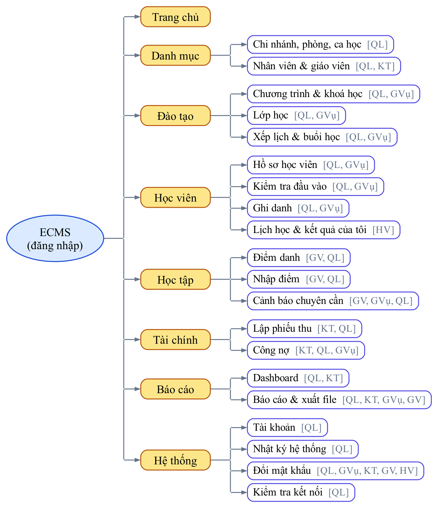
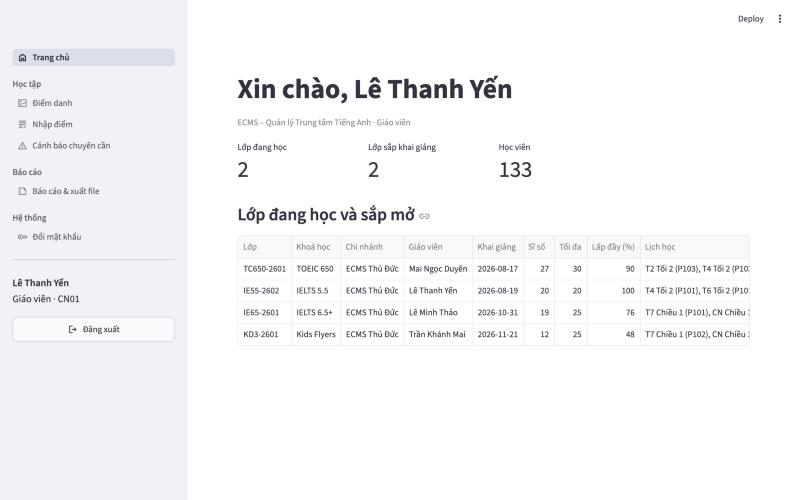

# Chương 4. Trình bày thông tin

Chương 2 và Chương 3 đã xây dựng CSDL cùng lớp xử lý gồm view, procedure, trigger và phân quyền. Chương này trình bày tầng giao diện – nơi người dùng thực sự tiếp xúc với thông tin – và đối chiếu từng nguyên tắc thiết kế menu, form, báo cáo của môn học với ứng dụng web ECMS.

**Kiến trúc ứng dụng.** Ứng dụng được viết bằng Python với thư viện Streamlit, kết nối SQL Server qua pyodbc bằng login riêng `ecms_app` – login chỉ có quyền thực thi procedure và đọc view (mục 3.2.2). Ứng dụng gồm ba tầng: tầng trang (mỗi chức năng một tệp), tầng dùng chung (kết nối CSDL, xác thực, menu, các thành phần giao diện) và tầng báo cáo (sinh PDF, Excel). Ba nguyên tắc kỹ thuật được áp dụng xuyên suốt:

1. **Giao diện chỉ gọi view, function và procedure**, không truy cập bảng gốc và không ghép chuỗi SQL – mọi tham số đều được truyền qua dấu `?`. Nghiệp vụ và ràng buộc nằm trong CSDL nên giao diện không thể "đi vòng".
2. **Mỗi kết nối được gắn ngữ cảnh người dùng** bằng `sp_set_session_context`: tên tài khoản, chi nhánh, vai trò, mã nhân viên hoặc học viên. Nhờ đó view tự lọc dữ liệu theo chi nhánh và trigger ghi đúng người thao tác vào nhật ký.
3. **Lỗi nghiệp vụ được hiển thị bằng tiếng Việt**, đúng nội dung thông báo mà procedure hoặc trigger ném ra; phần thông tin kỹ thuật của trình điều khiển ODBC được lược bỏ trước khi hiển thị.

Các hình trong chương được chụp từ ứng dụng chạy trên dữ liệu mẫu, đăng nhập bằng tài khoản Quản lý cấp trung tâm, trừ khi có ghi chú khác.

## 4.1 Thiết kế menu

### 4.1.1 Cây chức năng

Toàn bộ menu được khai báo **tại một chỗ** dưới dạng một danh sách, mỗi dòng gồm nhóm, tệp trang, tiêu đề, biểu tượng và các vai trò được thấy. Thanh điều hướng được dựng tự động từ danh sách này theo vai trò của người đăng nhập; sơ đồ cây chức năng ở Hình 4.1 cũng được sinh tự động từ cùng danh sách nên luôn khớp với ứng dụng. Ký hiệu vai trò trong hình: QL là Quản lý, GVụ là Giáo vụ, KT là Kế toán, GV là Giáo viên, HV là Học viên.

*Hình 4.1 – Cây chức năng và vai trò được thấy từng mục*

### 4.1.2 Đối chiếu nguyên tắc thiết kế menu

Bảng dưới đây đối chiếu từng nguyên tắc thiết kế menu của môn học với cách ECMS áp dụng:

| Nguyên tắc | Cách ECMS áp dụng | Minh hoạ |
|---|---|---|
| Rộng và nông: ít cấp, mỗi cấp vừa đủ lựa chọn | Đúng hai cấp: nhóm và chức năng. Tám nhóm, mỗi nhóm từ một đến bốn mục, không có menu con lồng nhau. Mọi chức năng đến được bằng một cú nhấp từ thanh bên | Hình 4.1, 4.3 |
| Nhóm theo nghiệp vụ, sắp theo luồng công việc | Thứ tự nhóm bám theo quy trình ở mục 1.2: Danh mục, Đào tạo, Học viên, Học tập, Tài chính, Báo cáo, Hệ thống; trong mỗi nhóm cũng theo thứ tự thao tác (mở lớp rồi xếp lịch; kiểm tra đầu vào rồi ghi danh) | Hình 4.1 |
| Tên rõ nghĩa, nhất quán | Tiêu đề là danh từ nghiệp vụ quen thuộc như "Lập phiếu thu", "Công nợ", trùng với tiêu đề trang; mỗi mục có biểu tượng cùng một phong cách | Hình 4.3 |
| Chỉ hiện chức năng được phép | Danh sách menu được lọc theo vai trò; mục không có quyền bị **ẩn hẳn** chứ không chỉ làm mờ | Hình 4.3, 4.4 |
| Chặn cả đường vòng | Ẩn menu là chưa đủ: đầu mỗi trang đều kiểm tra vai trò, nên gõ thẳng địa chỉ của trang không được phép sẽ nhận thông báo "Bạn không có quyền truy cập chức năng này". Lớp bảo vệ cuối cùng là quyền SQL của từng role | – |
| Cho biết người dùng đang ở đâu | Mục đang mở được tô nền đậm trên thanh bên; tiêu đề trang lặp lại tên mục; cuối thanh bên luôn hiện họ tên, vai trò, chi nhánh và phạm vi dữ liệu | Hình 4.6, 4.13 |
| Lối thoát rõ ràng | Nút Đăng xuất cố định ở cuối thanh bên; Trang chủ là điểm xuất phát chung cho mọi vai trò | Hình 4.3 |
| Dễ mở rộng | Thêm một chức năng chỉ cần tạo tệp trang và thêm một dòng vào danh sách menu; trang chưa có tệp tự động bị ẩn | – |

Độ rộng của menu thay đổi theo vai trò. Quản lý thấy nhiều chức năng nhất, học viên chỉ thấy ba mục:

| Vai trò | Số nhóm | Số chức năng | Các nhóm thấy được |
|---|:-:|:-:|---|
| Quản lý | 8 | 20 | Tất cả, trừ trang dành riêng cho học viên |
| Giáo vụ | 7 | 11 | Trang chủ, Đào tạo, Học viên, Học tập (cảnh báo), Tài chính (công nợ), Báo cáo, Hệ thống |
| Kế toán | 5 | 7 | Trang chủ, Danh mục (nhân viên), Tài chính, Báo cáo, Hệ thống |
| Giáo viên | 4 | 6 | Trang chủ, Học tập, Báo cáo, Hệ thống |
| Học viên | 3 | 3 | Trang chủ, Lịch học và kết quả của tôi, Đổi mật khẩu |

Màn hình đăng nhập (Hình 4.2) chỉ gồm hai ô nhập và một nút. Mật khẩu được kiểm tra bằng procedure `sp_DangNhap` với cơ chế băm có salt và khoá tài khoản sau năm lần sai (mục 3.2.1). Khung "Tài khoản demo" chỉ phục vụ buổi trình diễn và cần được gỡ bỏ khi triển khai thật.

*Hình 4.2 – Màn hình đăng nhập*

Sau khi đăng nhập, thanh bên chỉ hiện các nhóm chức năng của vai trò tương ứng. Hình 4.3 và Hình 4.4 so sánh cùng một ứng dụng với hai vai trò: Quản lý thấy đủ tám nhóm cùng các chỉ số tóm tắt theo phạm vi chi nhánh; Giáo viên chỉ còn ba nhóm Học tập, Báo cáo, Hệ thống, và trang chủ chỉ hiện các lớp của chi nhánh CN01.

*Hình 4.3 – Trang chủ và menu đầy đủ của vai trò Quản lý*

*Hình 4.4 – Trang chủ và menu rút gọn của vai trò Giáo viên*

## 4.2 Thiết kế form

### 4.2.1 Bố cục chung của một trang nghiệp vụ

Mọi trang danh mục và nghiệp vụ dùng chung một khuôn bố cục, đi theo trình tự tự nhiên **tìm – xem – chọn – sửa**:

1. **Tiêu đề và một dòng mô tả** cho biết trang dùng để làm gì và CSDL sẽ kiểm tra những ràng buộc nào.
2. **Thanh lọc** nằm ngang, gồm các bộ lọc thường dùng nhất như chi nhánh, trạng thái, ô tìm kiếm.
3. **Bảng kết quả** cho phép chọn một dòng; cột tiền được định dạng `6.750.000 đ`, ngày theo dạng `dd/mm/yyyy`, ô trống thay cho giá trị NULL.
4. **Form bên dưới bảng**: khi chưa chọn dòng nào, form ở chế độ Thêm mới; khi chọn một dòng, form được điền sẵn để sửa, kèm nút xoá ghi rõ đối tượng, ví dụ "Xoá chi nhánh CN02".
5. **Thông báo kết quả** xuất hiện sau khi lưu và vẫn còn hiển thị khi trang tải lại.

Trang có nhiều đối tượng cùng loại được chia thành các **thẻ** (tab), chẳng hạn Chi nhánh, Phòng học, Ca học, thay vì thêm mục menu mới; nhờ đó menu vẫn giữ được độ nông. Hình 4.5 minh hoạ khuôn bố cục này trên trang danh mục chi nhánh.

*Hình 4.5 – Khuôn bố cục chung trên trang danh mục chi nhánh*

### 4.2.2 Đối chiếu nguyên tắc thiết kế form

| Nguyên tắc | Cách ECMS áp dụng | Minh hoạ |
|---|---|---|
| Bố cục theo nhóm logic, trình tự tự nhiên | Trường được sắp theo thứ tự trên giấy tờ thật: mã, tên, địa chỉ, liên hệ; form dài được chia cột và nhóm trong khung viền. Form phiếu thu đánh số bước: thông tin phiếu (master) rồi đến chi tiết (detail) | Hình 4.5, 4.16 |
| Điều khiển phù hợp kiểu dữ liệu | Ngày dùng ô chọn lịch; số, tiền, điểm dùng ô số có giới hạn và bước nhảy (điểm từ 0 đến 10, bước 0,25); tập nhỏ cố định dùng nút chọn một; danh mục dùng hộp chọn lấy từ view thay vì gõ mã tay; bật tắt dùng công tắc; ngưỡng dùng thanh trượt; nhập hàng loạt dùng lưới sửa trực tiếp | Hình 4.11, 4.13, 4.15 |
| Giảm gõ phím, giá trị mặc định hợp lý | Ô tìm học viên chấp nhận tên, số điện thoại hoặc mã; chọn lớp thì tự điền khoá, học phí, số chỗ trống; điểm danh mặc định Có mặt cho cả lớp, chỉ cần sửa người vắng; phiếu thu tự chọn sẵn các khoản còn nợ và điền số tiền bằng số còn nợ | Hình 4.12, 4.13, 4.16 |
| Kiểm tra dữ liệu ở hai lớp | Lớp giao diện kiểm tra định dạng và trường bắt buộc, hiện lỗi ngay dưới ô sai (Hình 4.6). Lớp CSDL kiểm tra bằng CHECK, UNIQUE, khoá ngoại, procedure và trigger – giao diện không thể bỏ qua; lỗi trả về bằng tiếng Việt như "Lớp đã đủ sĩ số" | Hình 4.6, 4.12 |
| Thông báo rõ ràng, đúng chỗ | Lỗi theo trường nằm ngay dưới trường; lỗi nghiệp vụ hiện trong khung đỏ phía trên nút lưu; thành công hiện khung xanh kèm mã vừa tạo, ví dụ "Đã lập phiếu PT000527"; biểu tượng dấu hỏi trên nhãn giải thích quy tắc nhập ở 16 vị trí | Hình 4.6, 4.16 |
| Ngăn thao tác sai thay vì báo lỗi sau | Nút Lưu bị khoá khi chưa có thay đổi (21 vị trí); lớp đã đầy được đánh dấu "ĐẦY"; mặc định chỉ liệt kê lớp thuộc khoá được đề xuất theo kết quả kiểm tra đầu vào; người dùng chỉ chọn được học viên trong phạm vi chi nhánh của mình | Hình 4.12, 4.14 |
| Master – detail | Phiếu thu: một phiếu (master) có nhiều dòng thu cho nhiều đăng ký (detail), tổng phiếu cập nhật tức thời, lưu một lần trong một giao dịch. Hồ sơ học viên: chọn học viên rồi xem các thẻ đăng ký, bảng điểm, kiểm tra đầu vào. Lớp học: chọn lớp rồi xem lịch cố định và danh sách buổi học | Hình 4.9, 4.16 |
| Nhập liệu hàng loạt dạng lưới | Điểm danh và nhập điểm dùng lưới sửa trực tiếp: cột được sửa có biểu tượng bút; cột tính toán (điểm trung bình, xếp loại, chuyên cần) chỉ đọc và cập nhật ngay; dòng chữ dưới lưới đếm số học viên có thay đổi chưa lưu | Hình 4.13, 4.14 |
| Nhất quán | Cùng vị trí nút, cùng định dạng tiền và ngày, cùng quy ước màu (đỏ là cảnh báo, nợ quá hạn) trên mọi trang nhờ dùng chung một thư viện thành phần giao diện | Toàn chương |

Hình 4.6 minh hoạ nguyên tắc kiểm tra dữ liệu ngay tại trường: khi nhấn Lưu với form còn trống, lỗi hiện ngay dưới từng ô ("Mã phải có dạng CN + 2 chữ số", "Tên chi nhánh không được để trống") và dữ liệu chưa hề được gửi xuống CSDL.

*Hình 4.6 – Lỗi nhập liệu hiển thị ngay dưới ô tương ứng*

### 4.2.3 Ánh xạ giữa form và đối tượng CSDL

Bảng dưới đây cho biết mỗi form đọc dữ liệu từ đâu và ghi dữ liệu qua đâu. Không có form nào thêm, sửa, xoá trực tiếp trên bảng, vì login của ứng dụng bị cấm trên mọi bảng (mục 3.2.2).

| Nhóm | Form | Đọc từ (view, function) | Ghi qua (procedure) | Bảng và trigger liên quan |
|---|---|---|---|---|
| – | Trang chủ | `vw_SiSoLop`, `vw_HocVien_ChiNhanh`, `vw_CongNoHocVien` | – | – |
| Danh mục | Chi nhánh, phòng, ca học | `vw_DM_ChiNhanh`, `vw_DM_PhongHoc`, `vw_DM_CaHoc`, `vw_NhanVien` | `sp_LuuChiNhanh`, `sp_XoaChiNhanh`, `sp_LuuPhongHoc`, `sp_XoaPhongHoc`, `sp_LuuCaHoc`, `sp_XoaCaHoc` | CHINHANH, PHONGHOC, CAHOC |
| | Nhân viên và giáo viên | `vw_NhanVien`, `vw_ChungChiGV` | `sp_LuuNhanVien`, `sp_XoaNhanVien`, `sp_LuuChungChi`, `sp_XoaChungChi` | NHANVIEN, GIAOVIEN, CHUNGCHI_GV; trigger nhật ký đổi lương |
| Đào tạo | Chương trình và khoá học | `vw_DM_ChuongTrinh`, `vw_DM_KhoaHoc` | `sp_LuuChuongTrinh`, `sp_XoaChuongTrinh`, `sp_LuuKhoaHoc`, `sp_XoaKhoaHoc` | CHUONGTRINH, KHOAHOC |
| | Lớp học | `vw_SiSoLop`, `vw_DM_KhoaHoc`, `vw_NhanVien` | `sp_LuuLopHoc`, `sp_XoaLopHoc` | LOPHOC |
| | Xếp lịch và buổi học | `vw_LichHoc`, `vw_BuoiHoc`, `vw_DM_PhongHoc`, `vw_DM_CaHoc` | `sp_XepLichLop`, `sp_XoaLichLop`, `sp_SinhBuoiHoc` | LICHHOC, BUOIHOC; trigger chặn trùng phòng và giáo viên |
| Học viên | Hồ sơ học viên | `vw_HocVien_ChiNhanh`, `vw_DangKyChiTiet`, `vw_BangDiem`, `vw_KiemTraChiTiet` | `sp_TimKiemHocVien`, `sp_LuuHocVien` | HOCVIEN |
| | Kiểm tra đầu vào | `vw_KiemTraChiTiet`, `fn_KyNangKiemTra`, `fn_GoiYKhoaHoc` | `sp_GhiKetQuaKiemTra` | KIEMTRA_DAUVAO (cột XML có lược đồ) |
| | Ghi danh | `vw_DangKyChiTiet`, `vw_SiSoLop`, `vw_KiemTraChiTiet` | `sp_DangKyHoc`, `sp_ChuyenLop`, `sp_HuyDangKy` | DANGKY; trigger kiểm tra sĩ số, cập nhật sĩ số, nhật ký |
| | Lịch học và kết quả của tôi | `fn_LichHocHocVien`, `vw_DangKyChiTiet`, `vw_BangDiem`, `vw_CongNoHocVien` (lọc theo mã học viên của phiên) | – | – |
| Học tập | Điểm danh | `vw_BuoiHoc`, `vw_DiemDanh`, `vw_DangKyChiTiet` | `sp_DiemDanhBuoi` (cả lớp dạng JSON) | DIEMDANH, BUOIHOC |
| | Nhập điểm | `vw_BangDiem` | `sp_NhapDiem` | DANGKY; trigger xác định kết quả |
| | Cảnh báo chuyên cần | `vw_CanhBao` | `sp_CanhBaoChuyenCan` (cursor), `sp_XuLyCanhBao` | CANHBAO_CHUYENCAN |
| Tài chính | Lập phiếu thu | `vw_CongNoHocVien`, `vw_PhieuThu`, `vw_CTPhieuThu` | `sp_ThuHocPhi` (master kèm chi tiết JSON) | PHIEUTHU, CT_PHIEUTHU, DANGKY; trigger tổng tiền, nhật ký |
| | Công nợ | `vw_CongNoHocVien` | – | – |
| Báo cáo | Dashboard | `vw_DoanhThuThang` (indexed view), `vw_BaoCaoDoanhThu`, `vw_SiSoLop`, `vw_BangDiem`, `vw_CongNoHocVien` | – | – |
| | Báo cáo và xuất tệp | `vw_DangKyChiTiet`, `vw_BaoCaoDoanhThu`, `fn_BangDiemLop`, `vw_BangLuong`, `vw_CongNoHocVien`, `fn_LopCuaGiaoVien` | `sp_TinhLuongGiaoVien` | – |
| Hệ thống | Tài khoản | `vw_TaiKhoan`, `vw_NhanVien` | `sp_TaoTaiKhoan`, `sp_CapNhatTaiKhoan` | TAIKHOAN |
| | Nhật ký hệ thống | `vw_NhatKy` | – (chỉ trigger được ghi) | NHATKY |
| | Đổi mật khẩu | – | `sp_DoiMatKhau` | TAIKHOAN |
| | Đăng nhập | – | `sp_DangNhap` | TAIKHOAN (đếm số lần sai, khoá tài khoản) |

### 4.2.4 Các form tiêu biểu theo phân hệ

**Danh mục và đào tạo.** Form nhân viên gom thông tin chung và phần riêng của giáo viên (trình độ, đơn giá, chứng chỉ) vào cùng một trang, phản ánh đúng quan hệ chuyên biệt hoá giữa NHANVIEN và GIAOVIEN ở mục 2.1. Trang Lớp học có bộ lọc đa chọn theo trạng thái, mặc định chỉ hiện lớp Sắp mở và Đang học, và form mở lớp mới đặt ngay dưới bảng. Trang Xếp lịch là ví dụ master – detail ba cấp: chọn lớp, xem lịch cố định của lớp, rồi xem danh sách buổi học được sinh tự động; dòng tóm tắt in đậm khoá học, giáo viên, ngày khai giảng và sĩ số. Một thẻ riêng hiển thị lịch tuần của toàn chi nhánh dạng lưới thứ × ca để tìm phòng trống.

*Hình 4.7 – Danh mục nhân viên và giáo viên*

*Hình 4.8 – Danh sách lớp học và form mở lớp mới*

*Hình 4.9 – Lịch cố định và danh sách buổi học của một lớp*

**Học viên.** Trang hồ sơ học viên dùng procedure tìm kiếm nhiều tiêu chí, phân trang 15 dòng; câu mô tả đầu trang nhắc người dùng rằng dữ liệu đã được lọc theo chi nhánh. Trang kiểm tra đầu vào là form nhập **dữ liệu XML**: bốn kỹ năng, mỗi kỹ năng gồm điểm và nhận xét; procedure dựng tài liệu XML và CSDL kiểm tra theo lược đồ, nên điểm ngoài khoảng 0 – 10 hay thiếu kỹ năng đều bị từ chối. Thẻ "Xem chi tiết" đọc ngược lại từ XML. Trang ghi danh hiển thị kết quả kiểm tra gần nhất cùng khoá được đề xuất và mặc định chỉ liệt kê các lớp phù hợp; công tắc "Chỉ hiện lớp của khoá đề xuất" cho phép bỏ lọc khi cần.

*Hình 4.10 – Tìm kiếm và phân trang hồ sơ học viên*

*Hình 4.11 – Form nhập kết quả kiểm tra đầu vào (dữ liệu XML)*

*Hình 4.12 – Ghi danh với khoá học được đề xuất từ kết quả kiểm tra*

**Học tập.** Hai lưới nhập hàng loạt phục vụ giáo viên: điểm danh cả lớp trong một lần lưu và nhập điểm giữa kỳ, cuối kỳ. Ở trang điểm danh, buổi đã điểm danh được đánh dấu riêng; chỉ cột Trạng thái và Ghi chú được sửa. Ở trang nhập điểm, điểm trung bình được tính theo công thức 0,4 × GK + 0,6 × CK và kết quả Đạt khi điểm trung bình từ 5 trở lên – các giá trị này do cột tính toán và trigger quyết định, giao diện chỉ hiển thị lại. Trang cảnh báo chuyên cần gọi procedure dùng cursor (mục 3.3.4) theo ngưỡng chọn bằng thanh trượt, phân mức Nghiêm trọng (vắng trên 30%) và Nhắc nhở, kèm số điện thoại phụ huynh để liên hệ.

*Hình 4.13 – Điểm danh cả lớp trên lưới*

*Hình 4.14 – Nhập điểm giữa kỳ, cuối kỳ*

*Hình 4.15 – Danh sách cảnh báo chuyên cần sau khi quét*

**Tài chính.** Phiếu thu là ví dụ master – detail đầy đủ nhất: phần master gồm học viên, hình thức thanh toán, ghi chú; phần detail là lưới các đăng ký còn nợ, trong đó cột "Thu lần này" sửa được để thu một phần và khoản quá hạn có dấu cảnh báo. Tổng phiếu được tính ngay trên màn hình để người dùng đối chiếu, nhưng số chính thức do trigger cập nhật trong CSDL. Lưu xong, người dùng có thể in phiếu thu PDF (Hình 4.21). Trang công nợ đặt ba chỉ số tóm tắt ở trên cùng và tô đỏ các dòng quá hạn theo nguyên tắc làm nổi bật ngoại lệ.

*Hình 4.16 – Lập phiếu thu master – detail*

*Hình 4.17 – Theo dõi công nợ học phí*

**Hệ thống.** Trang tài khoản chỉ Quản lý thấy, hiển thị vai trò, chi nhánh, trạng thái, số lần đăng nhập sai và lần đăng nhập cuối; mật khẩu không bao giờ được hiển thị vì CSDL chỉ lưu giá trị băm. Trang nhật ký là màn hình **chỉ đọc**: dữ liệu chỉ do trigger ghi vào. Mỗi dòng nhật ký có cả tài khoản ứng dụng (lấy từ ngữ cảnh phiên) lẫn login SQL – nhờ đó trả lời được câu hỏi "ai thật sự đã thao tác" dù mọi người dùng web cùng kết nối bằng một login.

*Hình 4.18 – Quản lý tài khoản người dùng*

*Hình 4.19 – Nhật ký thay đổi dữ liệu*

## 4.3 Thiết kế báo cáo và dashboard

### 4.3.1 Cấu trúc một báo cáo

Mọi báo cáo PDF được sinh bởi một bộ dựng dùng chung, viết bằng thư viện ReportLab với phông chữ DejaVu hỗ trợ tiếng Việt. Bộ dựng tổ chức báo cáo theo đúng năm vùng của một report theo lý thuyết môn học:

| Vùng | Nội dung trong ECMS |
|---|---|
| Report Header | Tên trung tâm, tên báo cáo và dòng tham số, ví dụ "Từ 01/01/2026 đến 15/10/2026" hoặc "Lớp IE55-2601" |
| Page Header | Dòng tiêu đề cột, được lặp lại ở đầu mỗi trang |
| Group Header và Group Footer | Khi có cột phân nhóm: dòng tên nhóm ở đầu và dòng "Cộng …" (tổng phụ) ở cuối mỗi nhóm |
| Detail | Mỗi dòng dữ liệu; cột tiền và số căn phải, định dạng `1.234.000 đ`, các dòng xen kẽ màu nền |
| Report Footer và Page Footer | Dòng TỔNG CỘNG và số dòng ở cuối báo cáo; chân trang ghi thời điểm in và "Trang X / Y" |

Để in được "Trang X / Y", bộ dựng vẽ báo cáo hai lượt: lượt đầu đếm tổng số trang, lượt sau mới in chân trang. Khổ giấy dọc hay ngang được chọn tự động theo số cột; nếu tổng độ rộng cột vượt khổ giấy, các cột được co lại theo tỷ lệ. Mỗi báo cáo cũng xuất được sang **Excel** với tiêu đề, dòng tham số, tiêu đề cột in đậm, cột tiền định dạng số và dòng tổng dùng công thức.

Hình 4.20 là báo cáo doanh thu theo chi nhánh và tháng, thể hiện đủ năm vùng: Report Header, Group Header là tên chi nhánh, các dòng Detail, Group Footer "Cộng ECMS Thủ Đức 467.625.000 đ", Report Footer "TỔNG CỘNG 1.172.802.000 đ" và Page Footer "Trang 1 / 1". Hình 4.21 là phiếu thu – một báo cáo dạng biểu mẫu (form report) gồm thông tin chi nhánh, số phiếu, chi tiết từng lớp, tổng cộng, số tiền bằng chữ và chỗ ký.

*Hình 4.20 – Báo cáo doanh thu có nhóm, tổng phụ và tổng cộng*

*Hình 4.21 – Phiếu thu in dạng biểu mẫu*

### 4.3.2 Phân loại báo cáo

Trang "Báo cáo & xuất file" gom các báo cáo theo đúng ba loại của môn học: định kỳ, theo yêu cầu và tổng hợp, cộng thêm báo cáo dạng biểu mẫu. Mỗi vai trò chỉ thấy báo cáo của mình; giáo viên chỉ thấy các lớp mình dạy nhờ hàm `fn_LopCuaGiaoVien`.

| Báo cáo | Loại | Tham số | Nguồn dữ liệu | Vai trò |
|---|---|---|---|---|
| Danh sách học viên theo lớp | Định kỳ – đầu khoá | Lớp | `vw_DangKyChiTiet` | QL, GVụ, GV |
| Doanh thu theo chi nhánh và tháng | Định kỳ – tháng, quý | Khoảng ngày | `vw_BaoCaoDoanhThu` | QL, KT |
| Bảng lương giáo viên | Định kỳ – tháng | Tháng, năm | `sp_TinhLuongGiaoVien`, `vw_BangLuong` | QL, KT |
| Bảng điểm lớp | Theo yêu cầu | Lớp | `fn_BangDiemLop` (xếp hạng bằng `RANK()`) | QL, GVụ, GV |
| Lịch sử học tập của học viên | Theo yêu cầu | Học viên | `vw_DangKyChiTiet`, `vw_BangDiem` | QL, GVụ |
| Công nợ học viên | Theo yêu cầu, ngoại lệ | Ngưỡng nợ, chỉ nợ quá hạn | `vw_CongNoHocVien` | QL, KT, GVụ |
| Tổng hợp theo chương trình | Tổng hợp | Năm | `vw_SiSoLop`, `vw_BaoCaoDoanhThu`, `vw_BangDiem` | QL, KT |
| Phiếu thu | Biểu mẫu | Số phiếu | `vw_PhieuThu`, `vw_CTPhieuThu` | QL, KT |
| Dashboard | Tổng hợp, tương tác | Chi nhánh, năm | `vw_DoanhThuThang` và các view báo cáo | QL, KT |

Người dùng chọn báo cáo (tên báo cáo có ghi kèm loại), nhập tham số, xem trước trên màn hình rồi tải về dạng PDF hoặc Excel (Hình 4.22).

*Hình 4.22 – Trang chọn báo cáo, nhập tham số và tải tệp*

### 4.3.3 Dashboard

Dashboard là tầng **tri thức** trong mô hình DIKW (mục 1.6.2): từ dữ liệu giao dịch, hệ thống tổng hợp thành các chỉ số giúp quản lý ra quyết định. Dashboard gồm ba phần:

- **Hàng chỉ số (KPI)**: học viên mới trong tháng, doanh thu tháng, doanh thu năm, tỷ lệ lấp đầy các lớp đang mở, tỷ lệ chuyên cần các lớp đang học và công nợ hiện tại. Mỗi chỉ số có mũi tên so sánh với tháng trước – xanh khi tăng, đỏ khi giảm.
- **Biểu đồ**: doanh thu theo tháng dạng cột xếp chồng theo chi nhánh kèm đường luỹ kế trên trục phụ; cơ cấu doanh thu theo chương trình dạng vành khuyên; tỷ lệ lấp đầy theo lớp dạng cột ngang; số học viên mới theo tháng dạng đường; tương quan giữa chuyên cần và điểm trung bình theo lớp dạng bong bóng, kích thước bong bóng là sĩ số.
- **Bộ lọc** chi nhánh và năm ở đầu trang. Dữ liệu doanh thu được đọc từ indexed view `vw_DoanhThuThang` nên trang vẫn tải nhanh khi số phiếu thu tăng lên.

*Hình 4.23 – Dashboard toàn trung tâm năm 2026*

### 4.3.4 Đối chiếu nguyên tắc thiết kế báo cáo

| Nguyên tắc | Cách ECMS áp dụng |
|---|---|
| Đúng người, đúng lúc, đúng mức chi tiết | Báo cáo được lọc theo vai trò và chi nhánh; nhân viên tác nghiệp xem chi tiết (danh sách lớp, bảng điểm), quản lý xem tổng hợp (dashboard, tổng hợp theo chương trình) |
| Tiêu đề và tham số rõ ràng | Mọi báo cáo có tên in hoa và dòng tham số ngay bên dưới; tên tệp tải về mang tên báo cáo |
| Làm nổi bật ngoại lệ | Công nợ quá hạn tô đỏ; bảng điểm tô đỏ học viên không đạt hoặc chuyên cần dưới 80%, tô xanh học viên Giỏi và Xuất sắc; cảnh báo chuyên cần chia mức độ |
| Tổng phụ và tổng cộng | Group Footer và Report Footer trong PDF; dòng tổng bằng công thức trong Excel |
| Định dạng số nhất quán | Tiền dạng `1.234.000 đ`, số căn phải, ngày dạng `dd/mm/yyyy` – dùng chung một hàm định dạng cho cả giao diện và PDF |
| Phân trang, đánh số trang | Tiêu đề cột lặp lại ở mỗi trang; "Trang X / Y" ở chân trang |
| Chọn đúng loại biểu đồ | Xu hướng theo thời gian dùng cột và đường; cơ cấu dùng vành khuyên; so sánh giữa các lớp dùng cột ngang; tương quan hai chỉ số dùng bong bóng |

## 4.4 Đánh giá

**Kết quả đạt được.** Ứng dụng có menu hai cấp theo vai trò, mọi chức năng đến được bằng một cú nhấp; 20 trang chức năng dùng chung một khuôn bố cục; dữ liệu được kiểm tra ở hai lớp giao diện và CSDL; có hai form master – detail và hai lưới nhập hàng loạt; chín báo cáo thuộc đủ các loại định kỳ, theo yêu cầu, tổng hợp và biểu mẫu, xuất được PDF và Excel; một dashboard KPI tương tác. Bộ kiểm thử tự động mở **mọi trang với từng vai trò** và sinh **mọi báo cáo** để bảo đảm không trang nào lỗi sau mỗi lần thay đổi (mục 6.1.3).

**Hạn chế.** Streamlit tải lại toàn trang sau mỗi tương tác nên khi thao tác nhanh liên tục có độ trễ nhỏ; nút xoá chưa có hộp thoại xác nhận mà dựa vào khoá ngoại để chặn xoá dữ liệu đang được tham chiếu; giao diện chưa được tối ưu cho điện thoại; chưa hỗ trợ in nhiều phiếu thu cùng lúc.

## 4.5 Tiểu kết chương

Chương 4 đã trình bày tầng giao diện của ECMS theo ba nhóm nguyên tắc menu, form và báo cáo của môn học, với mỗi nguyên tắc đều có minh chứng cụ thể trên ứng dụng. Điểm nhất quán xuyên suốt là giao diện chỉ làm nhiệm vụ trình bày và thu thập thông tin, còn mọi quy tắc nghiệp vụ, phân quyền và tính toán đều nằm trong CSDL đã xây dựng ở Chương 2 và Chương 3. Nhờ vậy giao diện có thể thay thế bằng công nghệ khác trong tương lai mà không phải viết lại phần nghiệp vụ.
