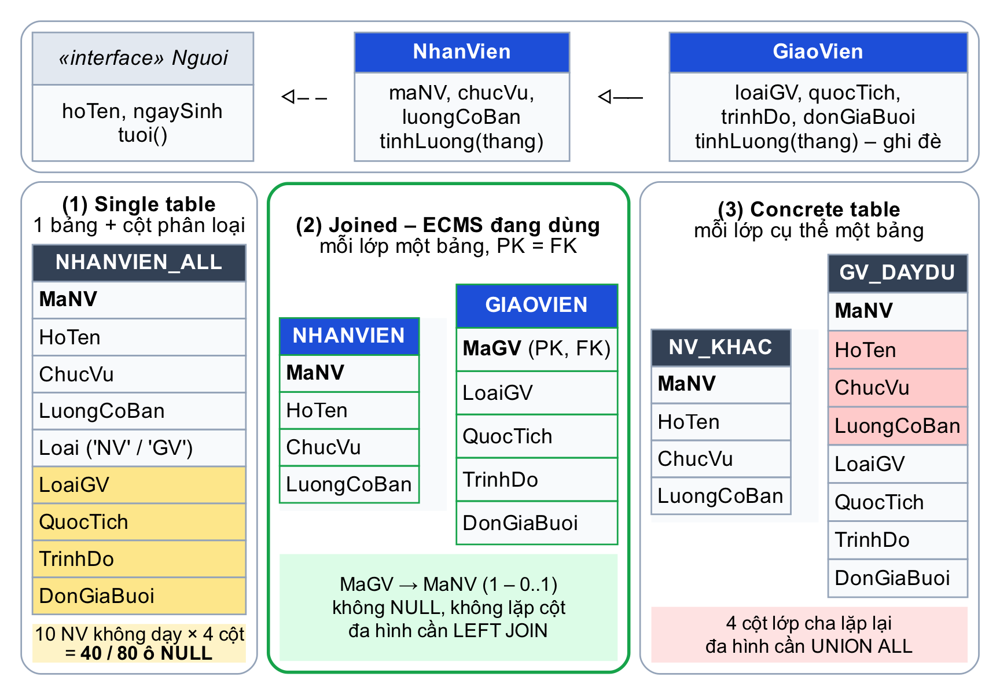
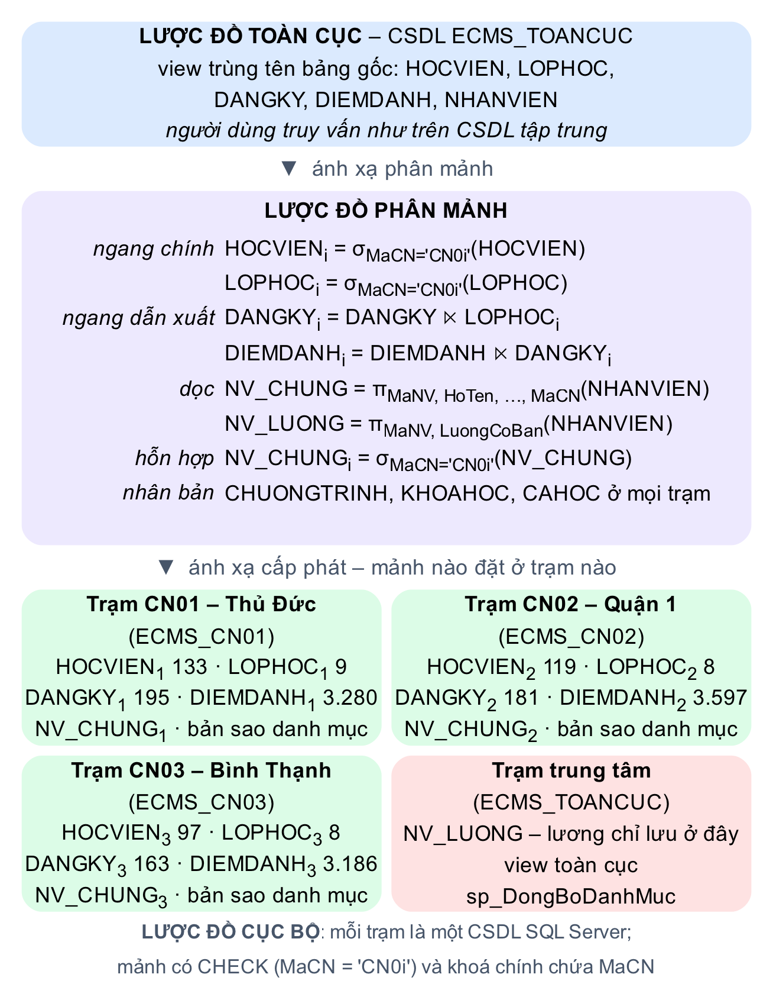
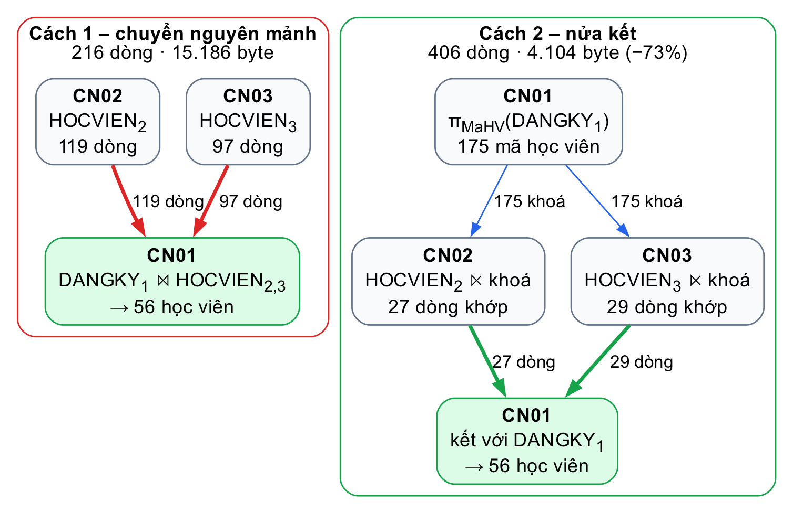
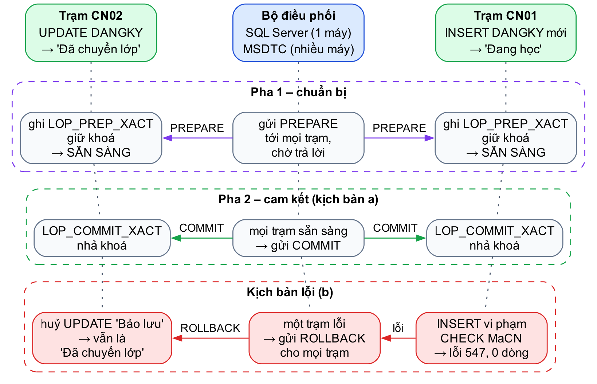
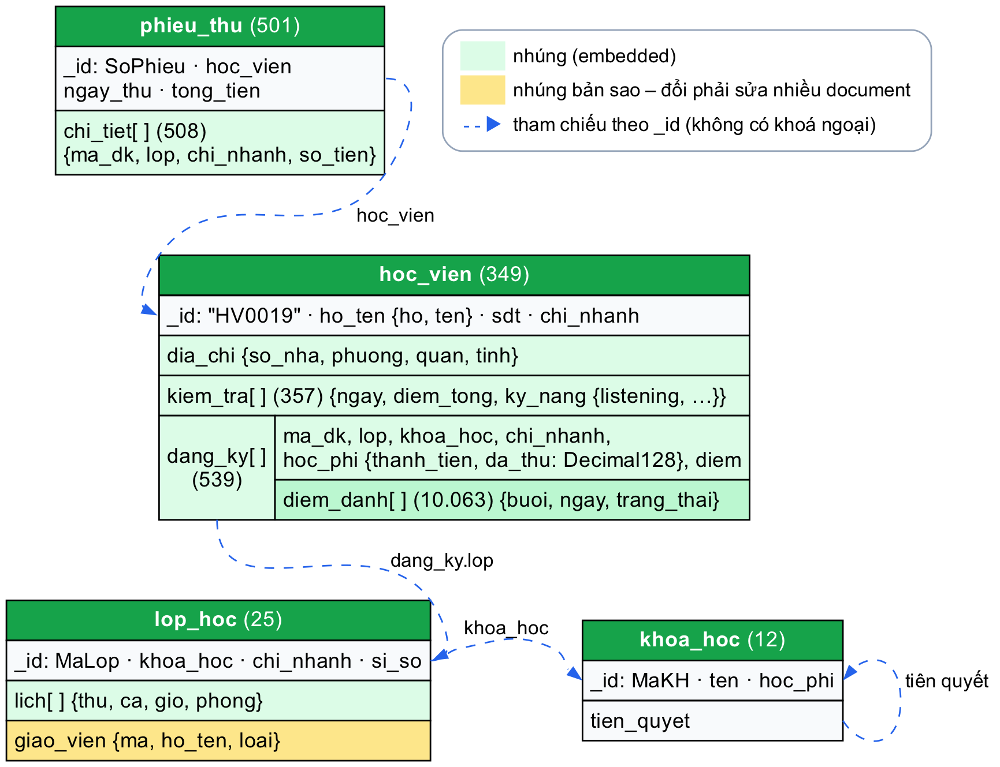

# Chương 5. Mô hình cơ sở dữ liệu tiên tiến

Mô hình quan hệ là lựa chọn trung tâm của đồ án, nhưng không phải là mô hình duy nhất. Chương này tìm hiểu ba mô hình CSDL tiên tiến của môn học – hướng đối tượng, phân tán và phi quan hệ (NoSQL) – theo cùng một cách tiếp cận: trình bày đặc điểm của mô hình, chuyển chính dữ liệu ECMS sang mô hình đó, chạy thử và đo đạc, rồi so sánh với mô hình quan hệ. Mục cuối tổng hợp đánh giá cả bốn mô hình cho bài toán của trung tâm. Mọi thử nghiệm trong chương được chạy trên CSDL vừa dựng lại từ dữ liệu mẫu, nên số liệu khớp với Chương 2 và Chương 3.

## 5.1 Cơ sở dữ liệu hướng đối tượng

### 5.1.1 Đặc điểm của mô hình

CSDL hướng đối tượng (OODB) lưu trữ trực tiếp các **đối tượng** của ngôn ngữ lập trình thay vì các dòng trong bảng. Các khái niệm chính theo chuẩn ODMG 3.0 và cách chúng thể hiện trên bài toán ECMS như sau:

*Bảng 5.1 – Các khái niệm của mô hình hướng đối tượng theo ODMG 3.0 trên bài toán ECMS*

| Khái niệm | Ý nghĩa | Ví dụ trên ECMS |
|---|---|---|
| Đối tượng và định danh (OID) | Mỗi đối tượng có định danh do hệ thống cấp, không đổi suốt vòng đời và độc lập với giá trị thuộc tính | Học viên đổi số điện thoại hay đổi họ tên vẫn là cùng một đối tượng; quan hệ trỏ bằng OID, không cần khoá ngoại |
| Đóng gói | Dữ liệu và hành vi nằm chung trong lớp; bên ngoài chỉ thao tác qua phương thức | `LopHoc.ghiDanh(hv)`, `DangKy.datGiamGia(p)` thay cho các procedure rời |
| Kế thừa | Lớp con nhận thuộc tính và phương thức của lớp cha | `Nguoi` → `HocVien`; `Nguoi` → `NhanVien` → `GiaoVien` |
| Đa hình | Cùng một lời gọi, mỗi lớp có cách thực hiện riêng | `tinhLuong(thang)`: nhân viên nhận lương cơ bản; giáo viên nhận lương cơ bản cộng số buổi nhân đơn giá |
| Kiểu phức | Thuộc tính có thể là cấu trúc, tập hợp, danh sách | `diaChi : DiaChi`, `chungChis : set<ChungChi>`, `buoiHocs : list<BuoiHoc>` |
| Quan hệ và quan hệ ngược | Khai báo `relationship … inverse …`, hệ quản trị tự giữ hai chiều nhất quán | `LopHoc.giaoVien` và `GiaoVien.lopPhuTrach` |
| Ngôn ngữ | ODL định nghĩa lược đồ; OQL truy vấn với cú pháp gần SQL nhưng duyệt theo đường dẫn và gọi được phương thức | `select l.khoaHoc.tenKH from l in cacLopHoc` |
| Lưu bền | Đối tượng tồn tại sau khi chương trình kết thúc và được nạp lại khi truy cập | Đối tượng mới được cấp OID ngay khi tạo, `luu()` ghi xuống CSDL; quan hệ được nạp lười |

Giữa hai cực "quan hệ thuần" và "đối tượng thuần" còn có mô hình **đối tượng – quan hệ** (ORDBMS) do chuẩn SQL:1999 đưa vào: giữ bảng và SQL nhưng bổ sung kiểu do người dùng định nghĩa, kiểu phức và kế thừa. Ba thế hệ hệ quản trị được so sánh như sau:

*Bảng 5.2 – So sánh hệ quản trị quan hệ, hướng đối tượng và đối tượng – quan hệ*

| Tiêu chí | Quan hệ (RDBMS) | Hướng đối tượng (OODBMS) | Đối tượng – quan hệ (ORDBMS) |
|---|---|---|---|
| Đơn vị dữ liệu | Dòng trong bảng, giá trị nguyên tố | Đối tượng của ngôn ngữ lập trình | Dòng trong bảng, cột có thể mang kiểu phức |
| Định danh | Khoá chính do người thiết kế chọn | OID do hệ thống cấp | Khoá chính, thêm tham chiếu tới dòng (kiểu `REF` của Oracle) |
| Kiểu phức, tập hợp | Không – phải tách bảng | Có: struct, set, list, bag | Có một phần: kiểu cấu trúc, mảng, XML, JSON |
| Kế thừa và đa hình | Không | Có | Có: kế thừa kiểu và bảng (Oracle `UNDER`, PostgreSQL `INHERITS`) |
| Hành vi | Procedure, function, trigger tách rời dữ liệu | Phương thức trong lớp | Phương thức gắn với kiểu, hàm do người dùng định nghĩa |
| Ngôn ngữ | SQL | ODL, OQL hoặc API của ngôn ngữ lập trình | SQL:1999 trở đi |
| Sản phẩm | SQL Server, MySQL | db4o, ObjectDB, Versant | PostgreSQL, Oracle; SQL Server có một phần (XML có lược đồ, kiểu CLR, `hierarchyid`) |
| Vai trò trong ECMS | Lõi của hệ thống | Mô phỏng bằng Python (mục 5.1.4) | Cột XML có XML Schema (mục 3.1.3), cột tính toán, hàm trả về bảng |

### 5.1.2 Chuyển lược đồ quan hệ sang lược đồ hướng đối tượng

Nhóm chuyển toàn bộ lược đồ ECMS sang ngôn ngữ ODL, thu được **16 lớp, 1 interface** `Nguoi`, 4 kiểu cấu trúc, 4 ngoại lệ nghiệp vụ và 47 khai báo `relationship`, mỗi khai báo đều có quan hệ ngược. Các quy tắc chuyển đổi chính và hệ quả của chúng:

*Bảng 5.3 – Quy tắc chuyển lược đồ quan hệ ECMS sang lược đồ ODL*

| Cấu trúc quan hệ | Cấu trúc hướng đối tượng | Hệ quả |
|---|---|---|
| Khoá ngoại 1 – 1 (CHINHANH.MaNVQuanLy) | `relationship NhanVien quanLy inverse NhanVien::chiNhanhQuanLy` – mỗi phía một tham chiếu đơn | Không cần ràng buộc UNIQUE trên khoá ngoại; hai chiều luôn khớp nhau |
| Khoá ngoại 1 – N (LOPHOC.MaGV) | `relationship GiaoVien giaoVien inverse GiaoVien::lopPhuTrach` | Duyệt `lop.giaoVien.hoTen` thay cho phép kết nối |
| Bảng N – M có thuộc tính (DANGKY) | Lớp liên kết `DangKy` với hai relationship | Giữ nguyên như sơ đồ lớp ở mục 2.3 |
| Chuyên biệt hoá NHANVIEN – GIAOVIEN (hai bảng, khoá chính đồng thời là khoá ngoại) | `class GiaoVien extends NhanVien` | Một đối tượng duy nhất, không phải kết nối hai bảng |
| Thuộc tính đa trị CHUNGCHI_GV (bảng riêng) | `attribute set<ChungChi> chungChis` | Bỏ được một bảng |
| Thuộc tính phức hợp tách cột (SoNha, PhuongXa…) | `struct DiaChi` | Giữ được cấu trúc tự nhiên |
| Thực thể yếu BUOIHOC | `relationship list<BuoiHoc> buoiHocs` – danh sách có thứ tự | Không cần cột STT làm khoá |
| Cột suy diễn duy trì bằng trigger (SiSoHienTai, TongTien) | Phương thức `siSoHienTai()`, `tinhTong()` | Không thể lệch dữ liệu, nhưng phải tính lại mỗi lần gọi |
| Procedure nghiệp vụ (sp_DangKyHoc) | `DangKy dangKy(in LopHoc, in float) raises (LopDay, ThieuTienQuyet)` | Nghiệp vụ gắn liền với lớp |

Trích lược đồ ODL của hai lớp `GiaoVien` và `HocVien` cho thấy ba điểm khác biệt rõ nhất so với lược đồ quan hệ: kế thừa thay cho bảng con, tập hợp thay cho bảng đa trị và phương thức có khai báo ngoại lệ thay cho procedure.

```text title="Lược đồ ODL – Lớp GiaoVien và HocVien"
// chuyên biệt hoá → kế thừa
class GiaoVien extends NhanVien (extent cacGiaoVien) {
    attribute string        loaiGV;
    attribute string        trinhDo;
    attribute double        donGiaBuoi;
    // đa trị → tập hợp, không cần bảng riêng
    attribute set<ChungChi> chungChis;
    relationship Set<LopHoc> lopPhuTrach inverse LopHoc::giaoVien;
    // ghi đè cách tính lương của NhanVien
    double tinhLuong(in string thang);
};

class HocVien : Nguoi (extent cacHocVien key maHV) {
    attribute string  maHV;
    attribute string  email;
    attribute DiaChi  diaChi;              // phức hợp → struct
    attribute string  hoTenPhuHuynh;
    relationship ChiNhanh           chiNhanh  inverse ChiNhanh::hocViens;
    relationship Set<DangKy>        dangKys   inverse DangKy::hocVien;
    relationship Set<KiemTraDauVao> kiemTras
                                    inverse KiemTraDauVao::hocVien;
    relationship Set<PhieuThu>      phieuThus inverse PhieuThu::hocVien;
    DangKy dangKy(in LopHoc lop, in float giamGia)
        raises (LopDay, ThieuTienQuyet);
    double congNo();
    list<BuoiHoc> lichHoc(in date tuan);
};
```

### 5.1.3 Ba chiến lược ánh xạ kế thừa sang bảng

Khi lưu một cây kế thừa vào CSDL quan hệ – trường hợp của mọi ORM và của chính ECMS với `NhanVien` và `GiaoVien` – có ba chiến lược kinh điển (Hình 5.1). Nhóm dựng cả ba trên 20 nhân viên của dữ liệu mẫu, trong đó 10 người là giáo viên, rồi chạy cùng hai truy vấn: một truy vấn đa hình trên mọi nhân viên và một truy vấn chỉ trên giáo viên.



*Hình 5.1 – Ba chiến lược ánh xạ cây kế thừa NhanVien ← GiaoVien sang bảng*

*Bảng 5.4 – So sánh ba chiến lược ánh xạ kế thừa trên dữ liệu mẫu*

| Tiêu chí | Single table | Joined (ECMS đang dùng) | Concrete table |
|---|---|---|---|
| Cấu trúc | 1 bảng chứa cột của cả cây và cột phân loại `Loai` | Mỗi lớp một bảng; `GIAOVIEN.MaGV` vừa là khoá chính vừa là khoá ngoại | Mỗi lớp cụ thể một bảng đầy đủ cột |
| Ô NULL | **40 / 80** ô cột giáo viên để trống (10 nhân viên × 4 cột) | 0 | 0 |
| Lặp cột | Không | Không | 4 cột của lớp cha lặp ở cả hai bảng |
| Truy vấn mọi nhân viên | 1 bảng, không kết nối | `LEFT JOIN` | `UNION ALL` hai bảng |
| Truy vấn chỉ giáo viên | Lọc `Loai = 'GV'` | `JOIN` | 1 bảng |
| Ràng buộc | Không khai báo được NOT NULL cho cột giáo viên, phải viết CHECK theo `Loai` | Đủ NOT NULL và khoá ngoại | Không bảo đảm được MaNV duy nhất giữa hai bảng; thêm cột cho lớp cha phải sửa hai bảng |
| Kết quả | Giống nhau: 20 nhân viên, tổng đơn giá buổi 5.200.000 đồng | Giống nhau | Giống nhau |

Cả ba chiến lược cho cùng kết quả, khác nhau ở chỗ dữ liệu được tổ chức thế nào. *Single table* hợp khi lớp con có ít thuộc tính riêng và truy vấn đa hình chiếm đa số, nhưng phải trả giá bằng một nửa số ô của nhóm cột giáo viên bị bỏ trống. *Concrete table* hợp khi gần như không cần truy vấn trên cả cây. ECMS chọn **joined** vì nó giữ được ràng buộc NOT NULL cho thuộc tính riêng của giáo viên, không lặp dữ liệu, và việc đổi một nhân viên thành giáo viên chỉ là thêm một dòng vào bảng GIAOVIEN. Chiều ngược lại bị `sp_LuuNhanVien` chặn (lỗi 50132) nếu giáo viên đã có bảng lương hoặc buổi dạy, để chứng từ lương không bị mất theo dòng GIAOVIEN.

### 5.1.4 Thử nghiệm bằng Python

Vì các hệ quản trị OODB thuần tuý hiện ít được sử dụng, nhóm hiện thực một phần lược đồ ODL bằng các lớp Python ánh xạ từ bảng của ECMS – một dạng ORM tối giản không dùng thư viện ngoài – để quan sát hành vi của mô hình hướng đối tượng trên dữ liệu thật:

- **OID thật.** Lớp `Session` cấp cho mỗi đối tượng một OID lấy từ bộ đếm tăng dần ngay khi đối tượng xuất hiện lần đầu, và giữ một *bảng đối tượng* ánh xạ OID tới đối tượng. Thuộc tính `oid` chỉ đọc: đổi họ tên giáo viên không làm OID thay đổi, còn lệnh gán `gv.oid = 999` bị từ chối. Mã nghiệp vụ như MaHV, MaNV chỉ còn là thuộc tính dùng để tìm đối tượng.
- **Identity map theo lớp gốc.** Cùng một khoá nghiệp vụ luôn trả về **cùng một đối tượng** trong bộ nhớ, kể cả khi lấy qua lớp cha hay lớp con: `s.get(GiaoVien, 'NV0015')` và `s.get(NhanVien, 'NV0015')` là một.
- **Nạp lười.** Các relationship như `lop.giao_vien`, `hoc_vien.dang_kys` chỉ đọc CSDL khi được truy cập lần đầu; `Session` đếm số câu SQL đã gửi để thấy cái giá của cách nạp này.
- **Kế thừa và đa hình.** `GiaoVien` kế thừa `NhanVien`, `NhanVien` kế thừa `Nguoi`; phương thức `tinh_luong()` được ghi đè ở lớp con.
- **Đóng gói.** `LopHoc.ghi_danh(hv, giam_gia)` tự kiểm tra lớp còn nhận ghi danh, học viên chưa đăng ký và lớp còn chỗ; `DangKy.dat_giam_gia()` giữ bất biến giảm giá từ 0 đến 50%. Các luật này tương ứng `sp_DangKyHoc` và trigger sĩ số phía CSDL.
- **Đối tượng bền.** Đối tượng `DangKy` mới có OID ngay khi tạo nhưng chưa có MaDK; `Session.luu()` ghi nó xuống bảng DANGKY và nhận MaDK do CSDL cấp. Toàn bộ chạy trong một giao dịch rồi hoàn tác để không đổi dữ liệu mẫu.

```python title="Mã lệnh – OID, identity map, đóng gói và đa hình (oodb/models.py, rút gọn)"
class Session:
    _oid = itertools.count(1)        # nguồn OID: hệ thống cấp, không dùng lại

    def get(self, cls, key, row=None):
        """Cùng khoá → đúng một đối tượng (identity map theo lớp gốc)."""
        k = (getattr(cls, "ROOT", cls).__name__, key)
        if k not in self.identity:
            row = row or self.rows(cls.SQL_ONE, key)[0]
            self.identity[k] = self.cap_oid(cls.from_row(self, row))
        return self.identity[k]

class LopHoc(CoOID):
    def ghi_danh(self, hv, giam_gia=0):
        """Luật ghi danh nằm trong phương thức của đối tượng."""
        if self.trang_thai not in ("Sắp mở", "Đang học"):
            raise LoiNghiepVu(f"Lớp {self.ma_lop} không còn nhận ghi danh.")
        if self.si_so_con_lai() <= 0:
            raise LoiNghiepVu(f"Lớp {self.ma_lop} đã đủ sĩ số.")
        dk = DangKy(None, self.khoa_hoc.hoc_phi, 0, None, None,
                    "Đang học", hv.ma_hv, self.ma_lop, self._s)
        dk.dat_giam_gia(giam_gia)    # bất biến 0–50%
        return self._s.them(dk)      # có OID ngay, chờ luu()

class GiaoVien(NhanVien):
    def tinh_luong(self, thang):     # đa hình: ghi đè NhanVien
        so_buoi = ...                # đếm buổi 'Đã dạy' trong tháng
        return self.luong_co_ban + so_buoi * self.don_gia_buoi
```

Kết quả chạy `oodb/demo.py` cho thấy các tính chất trên hoạt động đúng. Cùng lời gọi `tinh_luong`, nhân viên văn phòng nhận đúng lương cơ bản, còn giáo viên nhận lương cơ bản cộng tiền dạy. Các lỗi nghiệp vụ bị chặn ngay trong phương thức, trước khi có câu SQL nào được gửi; khi lưu, trigger phía CSDL vẫn cập nhật sĩ số như với mọi nguồn ghi khác.

```text title="Kết quả – OID, identity map, đa hình, đóng gói và đối tượng bền"
OID 1022 NhanVien  Dương Mai Yến   27,000,000  ← lương cơ bản
OID 1027 GiaoVien  Lê Thanh Yến    11,100,000  ← 7.500.000 + 8 buổi × 450.000
lop.giao_vien is s.get(NhanVien, 'NV0015')         → True
s.get(GiaoVien, …) is s.get(NhanVien, …)            → True
OID 1035 → sau khi đổi tên vẫn là 1035; gán gv.oid = 999 → không gán được
ghi_danh: lớp đã đủ sĩ số  → LoiNghiepVu: Lớp IE55-2602 đã đủ sĩ số.
ghi_danh: giảm giá 70%     → LoiNghiepVu: Giảm giá phải từ 0 đến 50%.
ghi_danh hợp lệ            → DangKy OID 1119, chưa có MaDK, thành tiền 3,600,000
s.luu() ghi 1 đối tượng    → MaDK = 549; DANGKY 539 → 540 dòng; sĩ số GT3-2601 = 11
rollback                   → DANGKY còn 539 dòng
```

**So sánh với SQL.** Nhóm giải cùng bốn bài toán bằng cách duyệt đối tượng và bằng một câu SQL, so sánh kết quả, thời gian và số câu SQL thực tế gửi xuống CSDL. Bài toán cuối là một **truy vấn đường dẫn kiểu OQL** – `select l.maLop from g in cacGiaoVien, l in g.lopPhuTrach where l.khoaHoc.tenKH like "IELTS%"` – được viết trong Python bằng cách duyệt `g.lop_phu_trach` rồi `l.khoa_hoc`.

*Bảng 5.5 – Duyệt đối tượng so với một câu SQL trên cùng bài toán*

| Bài toán | Cách làm | Kết quả | Thời gian | Số câu SQL |
|---|---|---|--:|--:|
| Lộ trình tiên quyết tới IELTS 6.5+ | Hướng đối tượng: `KhoaHoc('IE65').lo_trinh()` | IEF → IE55 → IE65 | 15,4 ms | 3 |
| | SQL: CTE đệ quy (Q26) | IEF → IE55 → IE65 | 6,8 ms | 1 |
| Số chỗ trống của các lớp đang học | Hướng đối tượng: `l.si_so_con_lai()` cho từng lớp | Giống nhau | 28,5 ms | 6 |
| | SQL: `SiSoToiDa − SiSoHienTai` | Giống nhau | 4,6 ms | 1 |
| Tổng công nợ toàn trung tâm | Hướng đối tượng: cộng `h.cong_no()` của mọi học viên | 283.218.000 đồng | 1.315,1 ms | **889** |
| | SQL: `SUM` trên `vw_CongNoHocVien` | 283.218.000 đồng | 23,0 ms | 1 |
| Lớp IELTS của mọi giáo viên (đường dẫn kiểu OQL) | Hướng đối tượng: `g.lop_phu_trach` → `l.khoa_hoc` | 7 lớp | 53,0 ms | 23 |
| | SQL: kết nối GIAOVIEN – LOPHOC – KHOAHOC | 7 lớp | 6,7 ms | 1 |

**Nhận xét.** Cả hai cách cho cùng kết quả. Thời gian dao động giữa các lần chạy, còn số câu SQL thì ổn định nên là thước đo đáng tin hơn. Cách hướng đối tượng viết tự nhiên hơn – đọc như mô tả nghiệp vụ, không cần nhớ điều kiện kết nối – nhưng khi nạp lười thì gặp **vấn đề N+1 truy vấn**. Tính tổng công nợ cần 889 câu SQL: một câu lấy danh sách học viên, mỗi học viên một câu lấy đăng ký, mỗi đăng ký một câu lấy số tiền đã thu. Kết quả chậm gấp khoảng 57 lần so với một câu `SUM` để hệ quản trị quan hệ tối ưu theo tập hợp. Truy vấn đường dẫn cũng vậy: 23 câu, gồm 1 câu lấy giáo viên, 10 câu lấy lớp của từng giáo viên và 12 câu lấy khoá học – identity map giúp mỗi khoá học chỉ phải đọc một lần. Các ORM thực tế như SQLAlchemy, Entity Framework giảm vấn đề này bằng nạp trước (eager loading), nhưng truy vấn thống kê trên toàn bộ dữ liệu vẫn là thế mạnh của SQL.

### 5.1.5 So sánh mô hình quan hệ và hướng đối tượng cho ECMS

*Bảng 5.6 – So sánh mô hình quan hệ và mô hình hướng đối tượng cho ECMS*

| Tiêu chí | Mô hình quan hệ (ECMS hiện tại) | Mô hình hướng đối tượng |
|---|---|---|
| Đơn vị dữ liệu | Dòng trong bảng, định danh bằng khoá | Đối tượng, định danh bằng OID |
| Quan hệ | Khoá ngoại và phép kết nối lúc truy vấn | Tham chiếu trực tiếp, duyệt theo đường dẫn |
| Kế thừa (nhân viên và giáo viên) | Mô phỏng bằng hai bảng, khoá chính đồng thời là khoá ngoại | Hỗ trợ trực tiếp, có đa hình |
| Kiểu phức (địa chỉ, chứng chỉ, kết quả kiểm tra) | Tách cột, tách bảng hoặc dùng XML | Cấu trúc, tập hợp, danh sách một cách tự nhiên |
| Hành vi | Procedure, function, trigger tách rời dữ liệu | Phương thức đóng gói trong lớp |
| Truy vấn tự do, thống kê, báo cáo | Rất mạnh nhờ SQL, bộ tối ưu, chỉ mục, indexed view | Yếu hơn; OQL ít được hỗ trợ đầy đủ; dễ gặp N+1 |
| Ràng buộc toàn vẹn khai báo | CHECK, khoá ngoại, UNIQUE, giao dịch ACID trưởng thành | Phần lớn phải viết trong phương thức |
| Phân quyền, kiểm toán, sao lưu | Đầy đủ và chuẩn hoá (Chương 3) | Phụ thuộc từng sản phẩm |
| Lệch trở kháng với ứng dụng | Có – phải ánh xạ giữa dòng và đối tượng | Không |
| Công cụ, nhân lực, cộng đồng | Phổ biến (SQL Server, SSMS, Power BI…) | Ít (db4o, ObjectDB, Versant…), nhiều sản phẩm đã ngừng phát triển |
| Phù hợp nhất với | Nghiệp vụ giao dịch kết hợp báo cáo, như trung tâm ngoại ngữ | Dữ liệu có cấu trúc phức tạp, ít truy vấn thống kê (CAD, đa phương tiện, mô phỏng) |

**Đánh giá cho ECMS.** Nếu dùng OODB, ECMS mô hình hoá tự nhiên hơn quan hệ kế thừa giữa nhân viên và giáo viên, chứng chỉ đa trị và kết quả kiểm tra có cấu trúc lồng; mã ứng dụng cũng ngắn hơn vì không cần ánh xạ. Tuy nhiên phần lớn giá trị của ECMS nằm ở **báo cáo, thống kê** (doanh thu theo chi nhánh và tháng, công nợ, chuyên cần) và **ràng buộc giao dịch** (không vượt sĩ số, không thu vượt) – đúng thế mạnh của mô hình quan hệ; đội ngũ và công cụ của trung tâm cũng quen với SQL Server. Nhóm kết luận nên giữ **CSDL quan hệ làm lõi**, áp dụng tư tưởng hướng đối tượng ở **tầng ứng dụng** (lớp nghiệp vụ, ORM có nạp trước, ánh xạ kế thừa kiểu joined) và tận dụng các tính năng đối tượng – quan hệ sẵn có của SQL Server như kiểu XML có lược đồ, cột tính toán và hàm trả về bảng cho phần dữ liệu phức.

## 5.2 Cơ sở dữ liệu phân tán

### 5.2.1 Đặc điểm và sự phù hợp với chuỗi trung tâm

CSDL phân tán là tập hợp nhiều CSDL có liên quan logic, đặt tại nhiều trạm nối mạng, được quản lý sao cho người dùng thấy như **một CSDL duy nhất** – gọi là tính trong suốt phân tán. Dữ liệu được *phân mảnh* và *cấp phát* về nơi sử dụng nhiều nhất, có thể được *nhân bản*, và truy vấn, giao tác có thể trải trên nhiều trạm. Mô hình chuỗi ba chi nhánh của ECMS là một bối cảnh tự nhiên để xem xét phân tán:

*Bảng 5.7 – So sánh CSDL tập trung và phân tán theo chi nhánh cho ECMS*

| Tiêu chí | Tập trung (ECMS hiện tại) | Phân tán theo chi nhánh |
|---|---|---|
| Vị trí dữ liệu | Một máy chủ | Mỗi chi nhánh giữ dữ liệu của mình |
| Tốc độ truy cập tại chi nhánh | Phụ thuộc đường truyền tới trung tâm | Nhanh – đa số nghiệp vụ (điểm danh, ghi danh, thu phí) chỉ dùng dữ liệu tại chỗ |
| Khi mất kết nối hoặc trung tâm gặp sự cố | Mọi chi nhánh ngừng hoạt động | Chi nhánh vẫn hoạt động với dữ liệu cục bộ |
| Báo cáo toàn hệ thống | Đơn giản | Phải gom dữ liệu từ nhiều trạm |
| Toàn vẹn liên trạm (học viên học ở hai chi nhánh, chuyển lớp liên chi nhánh) | Một giao dịch cục bộ | Giao tác phân tán, cam kết hai pha |
| Bảo mật | Một điểm quản lý | Dữ liệu nhạy cảm như lương có thể chỉ đặt ở trung tâm |
| Chi phí vận hành | Thấp | Cao hơn: nhiều máy chủ, đồng bộ, sao lưu từng trạm |

Với ba chi nhánh, mỗi nơi khoảng một trăm học viên, mô hình tập trung vẫn đủ đáp ứng. Mô hình phân tán trở nên cần thiết khi chuỗi mở rộng ra nhiều tỉnh hoặc kết nối mạng không ổn định. Phần thử nghiệm dưới đây cho thấy cách thiết kế khi cần mở rộng.

### 5.2.2 Kiến trúc ba lược đồ, phân mảnh và cấp phát

Theo kiến trúc tham chiếu của CSDL phân tán, lược đồ được tách thành nhiều tầng để mỗi tầng che giấu một loại chi tiết (Hình 5.2):

- **Lược đồ toàn cục** mô tả dữ liệu như thể CSDL là tập trung. Trong thử nghiệm, đó là các view trùng tên bảng gốc tại CSDL `ECMS_TOANCUC`.
- **Lược đồ phân mảnh** định nghĩa cách chia mỗi quan hệ toàn cục thành các mảnh bằng phép chọn σ, phép chiếu π hoặc nửa kết ⋉.
- **Lược đồ cấp phát** cho biết mảnh nào đặt ở trạm nào, kể cả các bản sao.
- **Lược đồ cục bộ** tại mỗi trạm ánh xạ mảnh thành bảng của hệ quản trị tại chỗ – ở đây mỗi trạm là một CSDL SQL Server.



*Hình 5.2 – Kiến trúc lược đồ của CSDL phân tán ECMS và cấp phát mảnh cho bốn trạm*

Nhóm áp dụng đủ các kiểu phân mảnh của môn học, mỗi kiểu xuất phát từ một nhu cầu nghiệp vụ cụ thể:

*Bảng 5.8 – Lược đồ phân mảnh của ECMS*

| Quan hệ | Kiểu phân mảnh | Định nghĩa | Lý do |
|---|---|---|---|
| HOCVIEN | Ngang chính | HOCVIEN<sub>i</sub> = σ<sub>MaCN = 'CN0i'</sub>(HOCVIEN) | Học viên do chi nhánh lập hồ sơ quản lý |
| LOPHOC | Ngang chính | LOPHOC<sub>i</sub> = σ<sub>MaCN = 'CN0i'</sub>(LOPHOC) | Lớp mở tại một chi nhánh |
| DANGKY | Ngang dẫn xuất | DANGKY<sub>i</sub> = DANGKY ⋉ LOPHOC<sub>i</sub> | Đăng ký đi theo lớp: điểm danh, nhập điểm, thu phí của một lớp nằm cùng một trạm |
| DIEMDANH | Ngang dẫn xuất | DIEMDANH<sub>i</sub> = DIEMDANH ⋉ DANGKY<sub>i</sub> | Như trên |
| NHANVIEN | Dọc | NV_CHUNG = π<sub>MaNV, HoNV, TenNV, ChucVu, SĐT, Email, MaCN</sub>(NHANVIEN); NV_LUONG = π<sub>MaNV, LuongCoBan</sub>(NHANVIEN) | Lương là dữ liệu nhạy cảm, chỉ trung tâm cần |
| NV_CHUNG | Hỗn hợp (dọc rồi ngang) | NV_CHUNG<sub>i</sub> = σ<sub>MaCN = 'CN0i'</sub>(NV_CHUNG) | Danh bạ nhân viên tại từng chi nhánh |
| CHUONGTRINH, KHOAHOC, CAHOC | Nhân bản toàn phần | Mỗi trạm có một bản sao | Ít thay đổi, mọi nghiệp vụ đều cần đọc |

Các mảnh được cấp phát về bốn trạm như sau:

*Bảng 5.9 – Lược đồ cấp phát mảnh cho bốn trạm*

| Trạm | CSDL thử nghiệm | Các mảnh được cấp phát |
|---|---|---|
| Chi nhánh Thủ Đức | `ECMS_CN01` | HOCVIEN<sub>1</sub>, LOPHOC<sub>1</sub>, DANGKY<sub>1</sub>, DIEMDANH<sub>1</sub>, NV_CHUNG<sub>1</sub>, bản sao danh mục |
| Chi nhánh Quận 1 | `ECMS_CN02` | HOCVIEN<sub>2</sub>, LOPHOC<sub>2</sub>, DANGKY<sub>2</sub>, DIEMDANH<sub>2</sub>, NV_CHUNG<sub>2</sub>, bản sao danh mục |
| Chi nhánh Bình Thạnh | `ECMS_CN03` | HOCVIEN<sub>3</sub>, LOPHOC<sub>3</sub>, DANGKY<sub>3</sub>, DIEMDANH<sub>3</sub>, NV_CHUNG<sub>3</sub>, bản sao danh mục |
| Trung tâm | `ECMS_TOANCUC` | NV_LUONG và lược đồ toàn cục |

### 5.2.3 Cài đặt thử nghiệm và tính trong suốt

Ba trạm chi nhánh được mô phỏng bằng ba CSDL trên cùng một máy chủ SQL Server; trong thực tế đây sẽ là ba máy chủ nối với nhau bằng linked server. Mỗi mảnh ngang có ràng buộc `CHECK (MaCN = 'CN0i')` trên cột phân mảnh và khoá chính có chứa `MaCN`. Trạm trung tâm định nghĩa các view **trùng tên với bảng gốc** để người dùng truy vấn như trên CSDL tập trung:

```sql title="Mã lệnh – Lược đồ toàn cục tại trạm trung tâm"
-- trong suốt vị trí: hợp các mảnh ngang
CREATE VIEW dbo.HOCVIEN AS
    SELECT * FROM ECMS_CN01.dbo.HOCVIEN UNION ALL
    SELECT * FROM ECMS_CN02.dbo.HOCVIEN UNION ALL
    SELECT * FROM ECMS_CN03.dbo.HOCVIEN;

-- tái thiết mảnh dọc bằng phép kết
CREATE VIEW dbo.NHANVIEN AS
    SELECT c.*, l.LuongCoBan
    FROM (… hợp các NHANVIEN_CHUNG_i …) c
    JOIN dbo.NHANVIEN_LUONG l ON l.MaNV = c.MaNV;
```

Sau khi phân mảnh, số dòng ở mỗi trạm chi nhánh như sau:

*Bảng 5.10 – Số dòng của các mảnh tại từng trạm chi nhánh*

| Trạm | Học viên | Lớp | Đăng ký | Điểm danh |
|---|--:|--:|--:|--:|
| CN01 | 133 | 9 | 195 | 3.280 |
| CN02 | 119 | 8 | 181 | 3.597 |
| CN03 | 97 | 8 | 163 | 3.186 |

**Kiểm tra tính đúng đắn của phân mảnh.** Một thiết kế phân mảnh đúng phải thoả ba điều kiện. Nhóm kiểm tra từng điều kiện bằng truy vấn so sánh với CSDL gốc:

*Bảng 5.11 – Kiểm tra ba điều kiện đúng đắn của phân mảnh*

| Điều kiện | Cách kiểm tra | Kết quả |
|---|---|---|
| Đầy đủ – mọi dòng của quan hệ gốc nằm trong ít nhất một mảnh | So sánh số dòng và dùng `EXCEPT` giữa bảng gốc với hợp các mảnh | HOCVIEN 349 = 349, LOPHOC 25 = 25, DANGKY 539 = 539, DIEMDANH 10.063 = 10.063, NHANVIEN 20 = 20 – thoả |
| Rời nhau – không dòng nào thuộc hai mảnh ngang | Đếm khoá xuất hiện ở từ hai trạm trở lên trên HOCVIEN, LOPHOC, DANGKY, DIEMDANH, NV_CHUNG | 0 khoá trùng ở cả năm quan hệ – thoả |
| Tái thiết – ghép lại được quan hệ gốc | Mảnh ngang ghép bằng `UNION ALL`; mảnh dọc ghép bằng kết theo MaNV; so sánh từng cột với bảng gốc bằng `EXCEPT` | 0 dòng khác ở cả năm quan hệ – thoả |

**Truy vấn toàn cục.** Ba truy vấn được viết trên lược đồ toàn cục như thể CSDL là tập trung, rồi so sánh với kết quả trên CSDL gốc:

*Bảng 5.12 – Truy vấn trên lược đồ toàn cục so với CSDL tập trung*

| Truy vấn | Kết quả trên CSDL phân tán | Đối chiếu với CSDL tập trung |
|---|---|---|
| G1 – số đăng ký, số đạt, tổng phải thu theo 12 khoá học | 12 dòng | Không có dòng khác (so sánh `EXCEPT` hai chiều) |
| G2 – học viên học ở chi nhánh khác nơi lập hồ sơ (kết mảnh HOCVIEN của trạm A với DANGKY của trạm B) | 136 | 136 |
| G3 – quỹ lương theo chi nhánh | CN01 89 triệu, CN02 69,5 triệu, CN03 72 triệu đồng | Chỉ trả lời được tại trạm trung tâm |

**Nhận xét về G2.** 136 học viên, tức **39%** trong 349 học viên (204 trên 539 đăng ký, khoảng 38%), học ở chi nhánh khác chi nhánh lập hồ sơ. Tỷ lệ cao này một phần do chương trình sinh dữ liệu mẫu chọn lớp ngẫu nhiên giữa các chi nhánh; trong thực tế học viên thường học gần nơi đăng ký nên tỷ lệ thấp hơn nhiều. Dù vậy, con số cho thấy rủi ro của thiết kế: HOCVIEN được phân mảnh theo chi nhánh lập hồ sơ, còn DANGKY theo chi nhánh của lớp, nên với gần bốn phần mười học viên, mọi truy vấn kết học viên với đăng ký phải lấy dữ liệu từ hai trạm. Có ba cách giảm chi phí này:

1. Dùng **nửa kết** để chỉ chuyển những dòng thật sự cần (mục 5.2.5).
2. **Nhân bản một phần**: đặt một mảnh dọc gọn của HOCVIEN (MaHV, HoTen, SoDienThoai) ở mọi trạm, vì các cột này ít thay đổi.
3. Nếu tỷ lệ thực tế vẫn cao, phân mảnh lại HOCVIEN theo chi nhánh học gần nhất thay vì chi nhánh lập hồ sơ.

Thử nghiệm dùng cách 1; khi triển khai thật nhóm đề xuất kết hợp cách 1 và cách 2.

**Loại bỏ mảnh.** Câu `SELECT COUNT(*) FROM dbo.HOCVIEN WHERE MaCN = 'CN02'` trên view toàn cục chỉ đọc bảng của trạm CN02 (thống kê I/O cho thấy chỉ một bảng được đọc với 4 trang). Nhờ các ràng buộc CHECK trên cột phân mảnh, bộ tối ưu biết trạm CN01 và CN03 không thể chứa dòng thoả điều kiện nên không gửi truy vấn tới đó. Đây là cơ chế giúp truy vấn cục bộ trên CSDL phân tán vẫn nhanh.

**Ghi qua lược đồ toàn cục.** View `UNION ALL` cập nhật được khi cột phân mảnh nằm trong khoá chính và có CHECK ở từng mảnh. Lệnh `INSERT` học viên HV9001 với `MaCN = 'CN02'` vào view `dbo.HOCVIEN` – viết như ghi vào một bảng – được SQL Server tự đưa tới đúng trạm: CN01 nhận 0 dòng, CN02 nhận 1 dòng, CN03 nhận 0 dòng (lệnh được hoàn tác ngay sau khi kiểm tra).

Tổng hợp các mức trong suốt mà thử nghiệm đạt được:

*Bảng 5.13 – Các mức trong suốt phân tán trong thử nghiệm ECMS*

| Mức trong suốt | Ý nghĩa | Thể hiện trong thử nghiệm | Kết quả |
|---|---|---|---|
| Phân mảnh | Truy vấn trên quan hệ toàn cục, không cần biết quan hệ bị chia mảnh | G1 – G3 viết trên view HOCVIEN, DANGKY… như CSDL tập trung | Đạt – khớp hoàn toàn với CSDL tập trung |
| Vị trí | Không cần biết mảnh nằm ở trạm nào | View hợp các mảnh của ba trạm; lọc theo chi nhánh chỉ đọc một trạm | Đạt |
| Ánh xạ cục bộ | Không cần biết tên bảng và hệ quản trị tại trạm | Tên bảng ở trạm trùng tên toàn cục; giữa nhiều máy dùng linked server | Đạt một phần |
| Cập nhật | Ghi vào quan hệ toàn cục, hệ thống tự đưa dòng tới đúng mảnh | `INSERT` qua view → chỉ trạm CN02 nhận dòng | Đạt |
| Nhân bản | Không cần biết dữ liệu có nhiều bản sao | Danh mục đọc từ bản sao tại trạm, cập nhật ở bản gốc rồi đồng bộ (mục 5.2.4) | Đạt một phần – bản sao có thể cũ tới lần đồng bộ kế tiếp |
| Giao tác | Giao tác nhiều trạm vẫn bảo đảm ACID | Chuyển lớp CN02 → CN01 với cam kết hai pha (mục 5.2.6) | Đạt |
| Sự cố | Một trạm hỏng, hệ thống vẫn trả lời | CN03 ngừng hoạt động → view toàn cục báo lỗi (mục 5.2.6) | Không đạt – cần nhân bản mảnh |

### 5.2.4 Nhân bản và đồng bộ bản sao

Nhân bản giúp đọc nhanh tại chỗ và tăng khả năng chịu lỗi, đổi lại phải đồng bộ khi dữ liệu thay đổi. Ba mức nhân bản được áp dụng như sau:

*Bảng 5.14 – Các mức nhân bản và cách áp dụng trong ECMS*

| Mức nhân bản | Mô tả | Áp dụng trong ECMS |
|---|---|---|
| Không nhân bản (phân hoạch) | Mỗi mảnh nằm ở đúng một trạm | HOCVIEN<sub>i</sub>, LOPHOC<sub>i</sub>, DANGKY<sub>i</sub>, DIEMDANH<sub>i</sub>, NV_LUONG |
| Nhân bản một phần | Một số mảnh có bản sao ở vài trạm | Đề xuất: mảnh dọc gọn của HOCVIEN để giảm truy vấn liên trạm như G2 |
| Nhân bản toàn phần | Mọi trạm có bản sao | CHUONGTRINH, KHOAHOC, CAHOC |

Có hai cách đồng bộ. **Đồng bộ ngay** (synchronous, eager) cập nhật mọi bản sao trong cùng một giao tác: các bản luôn giống nhau nhưng mỗi lần ghi phải chờ mọi trạm, và một trạm hỏng là không ghi được. **Đồng bộ trễ** (asynchronous, lazy) cập nhật bản gốc trước rồi lan truyền sau: ghi nhanh, nhưng trong khoảng trễ các trạm có thể đọc dữ liệu cũ. SQL Server cung cấp snapshot, transactional và merge replication theo cách thứ hai.

Trong thử nghiệm, bản sao danh mục ở các trạm được tạo bằng `SELECT INTO`, tức là một ảnh chụp (snapshot). Procedure `sp_DongBoDanhMuc` mô phỏng snapshot replication bằng lệnh `MERGE` bảng gốc vào bản sao ở mọi trạm. Để thấy độ trễ nhất quán, nhóm tăng học phí khoá IE55 thêm 500.000 đồng ở bản gốc trong một giao dịch, đọc giá ở bốn nơi trước và sau khi đồng bộ, rồi hoàn tác:

*Bảng 5.15 – Học phí khoá IE55 ở bản gốc và các bản sao trước, sau khi đồng bộ*

| Thời điểm | Bản gốc | Bản sao CN01 | Bản sao CN02 | Bản sao CN03 |
|---|--:|--:|--:|--:|
| Trước đồng bộ | 8.000.000 | 7.500.000 | 7.500.000 | 7.500.000 |
| Sau `sp_DongBoDanhMuc` | 8.000.000 | 8.000.000 | 8.000.000 | 8.000.000 |

Trước khi đồng bộ, một chi nhánh ghi danh khoá IE55 sẽ tính học phí cũ. Vì vậy thay đổi học phí cần được đồng bộ ngay sau khi duyệt, và nghiệp vụ nên quy định học phí mới chỉ áp dụng từ một ngày cụ thể để chấp nhận được độ trễ này.

### 5.2.5 Tối ưu truy vấn phân tán bằng nửa kết

Trong CSDL phân tán, chi phí chủ yếu của truy vấn là **dữ liệu truyền qua mạng** chứ không phải số trang đọc. Xét câu hỏi tại trạm CN01: những học viên nào học lớp của CN01 nhưng hồ sơ thuộc chi nhánh khác? Có hai cách thực hiện (Hình 5.3):

- **Chuyển nguyên mảnh**: CN02 và CN03 gửi toàn bộ mảnh HOCVIEN về CN01 rồi kết nối tại đó.
- **Nửa kết** (semi-join): CN01 gửi danh sách mã học viên π<sub>MaHV</sub>(DANGKY<sub>1</sub>) sang CN02 và CN03; mỗi trạm chỉ trả về các dòng HOCVIEN khớp với danh sách, tức HOCVIEN<sub>j</sub> ⋉ DANGKY<sub>1</sub>; CN01 kết các dòng nhận được với DANGKY<sub>1</sub>.



*Hình 5.3 – Dữ liệu truyền qua mạng khi chuyển nguyên mảnh và khi dùng nửa kết tại trạm CN01*

Vì ba trạm nằm trên cùng một máy, nhóm ước lượng lượng dữ liệu truyền bằng tổng `DATALENGTH` của các cột phải gửi thay vì đo thời gian:

*Bảng 5.16 – Dữ liệu truyền qua mạng của hai phương án tại trạm CN01*

| Phương án | Dữ liệu gửi | Số dòng | Số byte | Kết quả |
|---|---|--:|--:|---|
| Chuyển nguyên mảnh | HOCVIEN<sub>2</sub> (119 dòng) và HOCVIEN<sub>3</sub> (97 dòng), đủ các cột | 216 | 15.186 | 56 học viên |
| Nửa kết | 175 mã học viên gửi tới 2 trạm, nhận về 27 + 29 dòng khớp | 406 | 4.104 | 56 học viên |

Nửa kết gửi **nhiều dòng hơn** (vì danh sách khoá phải gửi tới hai trạm) nhưng **ít byte hơn 73%**, vì mỗi khoá chỉ 6 byte và chỉ 56 trong 216 học viên (26%) thật sự cần chuyển về. Hai cách cho cùng 56 học viên. Nửa kết có lợi khi phép kết có độ chọn lọc cao và dòng dữ liệu rộng; nếu phần lớn dòng đều khớp thì nó chỉ thêm một lượt gửi qua mạng mà không giảm được bao nhiêu dữ liệu.

### 5.2.6 Giao tác phân tán và điều khiển đồng thời

**Cam kết hai pha.** Chuyển lớp liên chi nhánh – đóng đăng ký cũ ở CN02 và tạo đăng ký mới ở CN01 – phải cập nhật hai trạm như một đơn vị. Giao thức **cam kết hai pha** (2PC) bảo đảm điều đó (Hình 5.4). Ở *pha chuẩn bị*, bộ điều phối gửi PREPARE tới mọi trạm; mỗi trạm ghi nhật ký đủ để cam kết hay huỷ, giữ khoá rồi trả lời sẵn sàng. Ở *pha cam kết*, nếu mọi trạm sẵn sàng thì bộ điều phối gửi COMMIT; chỉ cần một trạm từ chối là bộ điều phối gửi ROLLBACK tới tất cả.



*Hình 5.4 – Cam kết hai pha khi chuyển lớp từ chi nhánh CN02 sang CN01*

Khi một giao dịch ghi vào nhiều CSDL trên cùng một máy chủ, SQL Server tự điều phối bằng cam kết hai pha nội bộ: pha chuẩn bị ghi bản ghi `LOP_PREP_XACT` vào nhật ký của **từng** CSDL tham gia, sau đó mới ghi `LOP_COMMIT_XACT`. Nhóm dùng hàm `fn_dblog` để đếm các bản ghi này ở mỗi trạm trước và sau giao tác, làm bằng chứng cho pha chuẩn bị, rồi chạy thêm một kịch bản lỗi:

*Bảng 5.17 – Kết quả hai kịch bản giao tác chuyển lớp liên trạm*

| Kịch bản | Trạm CN02 | Trạm CN01 | Bản ghi `LOP_PREP_XACT` mới | Kết luận |
|---|---|---|---|---|
| (a) Chuyển lớp hợp lệ | Đăng ký cũ thành "Đã chuyển lớp" | Đăng ký mới "Đang học" | CN01: 1, CN02: 1 | Cả hai trạm qua pha chuẩn bị rồi cùng cam kết |
| (b) Lệnh ghi ở CN01 vi phạm `CHECK (MaCN = 'CN01')` | Lệnh đổi sang "Bảo lưu" bị huỷ, trạng thái vẫn là "Đã chuyển lớp" | 0 dòng mới, lỗi 547 | – | Một trạm lỗi thì cả giao tác bị huỷ – bảo đảm tính nguyên tử |

**Cam kết hai pha giữa hai máy qua MSDTC.** Khi các trạm là **những máy chủ khác nhau**, giao tác được mở bằng `BEGIN DISTRIBUTED TRANSACTION` qua linked server, và dịch vụ MSDTC (Microsoft Distributed Transaction Coordinator) làm bộ điều phối. Linked server trỏ ngược về chính máy chủ đó không dùng được trong giao tác phân tán, nên nhóm chạy kịch bản này trên hai máy thật cùng một mạng Wi-Fi: trạm CN01 là SQL Server 2025 Developer trên Windows 11, trạm CN02 là SQL Server 2025 chạy trong Docker trên macOS (`database/13b_2pc_msdtc.sql`, cấu hình ở `database/tram_cn02/`). Ba kịch bản cho kết quả giống Bảng 5.17: chuyển lớp hợp lệ được cam kết ở cả hai máy; lệnh ghi vi phạm `CHECK` ở trạm CN01 làm MSDTC huỷ luôn cập nhật đã thực hiện trên máy macOS; bước hoàn tác cũng là một giao tác phân tán. Bằng chứng giao tác do MSDTC điều phối là mã đơn vị công việc (`transaction_uow`) đọc ở phiên của hai máy trong lúc giao tác đang mở là cùng một GUID (`725A682E-…`), và bộ đếm của MSDTC trên Windows (`Get-DtcTransactionsStatistics`) tăng đúng 2 giao tác cam kết, 1 giao tác huỷ. Muốn hai máy điều phối được với nhau phải mở cổng RPC 135 và cổng giao tác của MSDTC qua tường lửa, bật *Network DTC Access* ở chế độ không xác thực lẫn nhau vì hai máy không chung domain, và mỗi máy phải phân giải được tên máy kia. Đó chính là chi phí vận hành mà thiết kế phân mảnh dẫn xuất giúp phần lớn giao tác ECMS tránh được.

**Điểm yếu của 2PC** là các trạm phải giữ khoá suốt thời gian chờ quyết định, và nếu bộ điều phối gặp sự cố giữa hai pha thì các trạm bị treo ở trạng thái "đã chuẩn bị". Vì vậy thiết kế phân mảnh dẫn xuất ở mục 5.2.2 được chọn để **phần lớn giao tác chỉ chạm một trạm**: ghi danh, điểm danh, thu phí của một lớp đều là giao tác cục bộ.

**Khoá hai pha phân tán (2PL).** Mỗi trạm dùng khoá hai pha nghiêm ngặt: SQL Server giữ khoá ghi tới khi giao tác kết thúc, và ECMS bổ sung `UPDLOCK, HOLDLOCK` trong `sp_DangKyHoc`, `sp_ChuyenLop` để hai người không cùng ghi danh vào chỗ cuối cùng, cùng `sp_getapplock` trong `sp_XepLichLop` để hai lần xếp lịch không cùng lấy một phòng. Kết hợp với 2PC, khoá ở mọi trạm được giữ từ lúc thực hiện tới khi có quyết định chung, nhờ đó lịch thực hiện toàn cục khả tuần tự. Bế tắc trong một máy chủ được SQL Server tự phát hiện (lỗi 1205); bế tắc giữa các máy chủ không có đồ thị chờ chung nên chỉ được phá bằng hết thời gian chờ của MSDTC. Vì vậy giao tác toàn cục nên khoá các trạm theo một thứ tự cố định, ví dụ theo mã chi nhánh tăng dần, còn truy vấn báo cáo toàn cục nên dùng mức cô lập snapshot để không khoá dữ liệu của chi nhánh.

**Trạm gặp sự cố.** Nhóm đưa CSDL của trạm CN03 sang trạng thái OFFLINE rồi chạy lại ba truy vấn:

*Bảng 5.18 – Truy vấn khi trạm CN03 ngừng hoạt động*

| Truy vấn | Kết quả |
|---|---|
| View toàn cục, đọc mọi trạm | Lỗi 942: không mở được CSDL `ECMS_CN03` |
| View toàn cục, lọc `MaCN = 'CN02'` | Vẫn lỗi 942 – view phải được biên dịch với đủ các bảng thành phần, còn loại bỏ mảnh chỉ diễn ra khi thực thi |
| Truy vấn trực tiếp trạm CN02 | Được: 119 học viên |

Kết quả cho thấy **tính tự trị địa phương** vẫn còn – chi nhánh CN02 tiếp tục phục vụ nghiệp vụ tại chỗ – nhưng lược đồ toàn cục **không trong suốt với sự cố**. Muốn chịu lỗi, mỗi mảnh cần có bản sao ở trạm khác (Always On Availability Groups hoặc log shipping) để truy vấn được chuyển sang bản sao khi trạm chính hỏng.

## 5.3 Cơ sở dữ liệu phi quan hệ (NoSQL)

### 5.3.1 Hạn chế của mô hình quan hệ với một phần dữ liệu ECMS

Trong quá trình làm đồ án, nhóm nhận thấy một số loại dữ liệu của ECMS không thật sự "vừa" với mô hình quan hệ:

*Bảng 5.19 – Các loại dữ liệu ECMS khó biểu diễn trên mô hình quan hệ*

| Dữ liệu | Khó khăn trên mô hình quan hệ |
|---|---|
| Kết quả kiểm tra đầu vào (bốn kỹ năng, nhận xét, có thể thêm kỹ năng hoặc điểm thành phần) | Cấu trúc thay đổi theo đề thi nên phải dùng cột XML, XML Schema và XQuery (mục 3.1.3); truy vấn dài dòng |
| Hồ sơ học tập (đăng ký, điểm, điểm danh từng buổi) | Đọc một hồ sơ phải kết nối 4 – 5 bảng; bảng điểm danh tăng nhanh nhất, khoảng 10.000 dòng chỉ với 25 lớp |
| Nhật ký kiểm toán | Cấu trúc dữ liệu cũ và mới khác nhau theo từng bảng, hiện đang lưu JSON trong cột chuỗi |
| Phiên đăng nhập, bộ đếm sai mật khẩu, bộ nhớ đệm danh sách lớp | Đọc ghi rất thường xuyên, không cần kết nối, dữ liệu chỉ có tính tạm thời |
| Đồ thị khoá tiên quyết, gợi ý lộ trình | Phải dùng CTE đệ quy |

### 5.3.2 Định lý CAP và mô hình BASE

Các hệ NoSQL thường được thiết kế để chạy trên nhiều máy, nên chịu ràng buộc của **định lý CAP**: khi mạng giữa các máy bị chia cắt (*Partition tolerance*), hệ thống phải chọn giữa trả lời nhất quán (*Consistency*) – có thể phải từ chối phục vụ – và luôn trả lời (*Availability*) – có thể trả dữ liệu cũ. Nhiều hệ NoSQL chọn luôn trả lời và theo mô hình **BASE** (*Basically Available, Soft state, Eventually consistent*), đối lập với **ACID** của hệ quan hệ:

*Bảng 5.20 – So sánh ACID và BASE trong bối cảnh ECMS*

| Tiêu chí | ACID (SQL Server – lõi ECMS) | BASE (nhiều hệ NoSQL) |
|---|---|---|
| Nhất quán | Ngay sau khi giao dịch cam kết | Cuối cùng – các bản sao hội tụ sau một khoảng thời gian |
| Sẵn sàng | Có thể chờ hoặc từ chối để giữ nhất quán (khoá, cam kết hai pha) | Ưu tiên luôn trả lời, chấp nhận dữ liệu hơi cũ |
| Trạng thái | Chỉ thay đổi qua giao dịch | "Mềm" – có thể thay đổi do đồng bộ chạy nền |
| Mở rộng | Chủ yếu theo chiều dọc | Theo chiều ngang: chia shard, nhân bản |
| Phù hợp trong ECMS | Ghi danh, thu phí, nhập điểm – sai một đồng hay một chỗ ngồi cũng không chấp nhận được | Bộ nhớ đệm dashboard, cổng tra cứu hồ sơ, nhật ký truy cập |

Xếp theo CAP, **MongoDB** với replica set mặc định thiên về C: mọi lệnh ghi đi vào máy chính, khi mất máy chính thì tạm ngừng ghi tới khi bầu được máy chính mới, còn đọc từ máy phụ có thể nhận dữ liệu cũ. MongoDB cũng hỗ trợ giao dịch ACID trên nhiều document từ phiên bản 4.0. **Cassandra** thiên về A, mức nhất quán chỉnh được theo từng câu lệnh. Chính thử nghiệm nhân bản ở mục 5.2.4 – bản sao danh mục còn giá cũ tới lần đồng bộ – là một ví dụ của nhất quán cuối cùng. Với ECMS, dữ liệu tài chính và đăng ký phải nhất quán ngay nên vẫn đặt ở SQL Server; các bản sao chỉ đọc phục vụ tra cứu thì chấp nhận được nhất quán cuối cùng.

### 5.3.3 Bốn mô hình NoSQL áp dụng trên ECMS

Mỗi loại dữ liệu ở mục 5.3.1 phù hợp với một mô hình NoSQL khác nhau:

*Bảng 5.21 – Bốn mô hình NoSQL và cách áp dụng trên ECMS*

| Mô hình | Cấu trúc | Ví dụ áp dụng trên ECMS | Sản phẩm tiêu biểu |
|---|---|---|---|
| Key-value | Khoá ánh xạ tới một giá trị, hệ thống không đọc bên trong giá trị | `session:<token>` lưu thông tin người đăng nhập, tự hết hạn sau 8 giờ; `login_fail:<user>` đếm số lần sai, hết hạn sau 15 phút; bộ nhớ đệm `lop_dang_mo:CN01` | Redis |
| Document | Khoá ánh xạ tới một tài liệu JSON/BSON lồng nhau, lược đồ linh hoạt | Hồ sơ học viên nhúng kết quả kiểm tra, đăng ký, điểm danh; phiếu thu nhúng chi tiết | MongoDB (thử nghiệm) |
| Column-family | Mỗi dòng có nhiều họ cột, cột thưa, ghi rất nhanh, phân tán theo khoá phân vùng | Nhật ký điểm danh, nhật ký truy cập theo (lớp, ngày) khi mở rộng tới hàng trăm chi nhánh | Cassandra, HBase |
| Graph | Đỉnh và cạnh đều có thuộc tính, duyệt quan hệ nhiều bước | Khoá học nối với khoá học bằng cạnh TIEN_QUYET, học viên nối với khoá học bằng cạnh DA_HOC kèm điểm; dùng để gợi ý khoá tiếp theo và tìm học viên cùng lộ trình | Neo4j |

### 5.3.4 Thiết kế tài liệu MongoDB

Nhóm chọn MongoDB để thử nghiệm vì đây là mô hình có nhiều ứng dụng nhất cho ECMS. Nguyên tắc thiết kế: **nhúng** khi dữ liệu con luôn được đọc cùng dữ liệu cha và chỉ thuộc về một cha duy nhất; **tham chiếu** khi dữ liệu được dùng chung hoặc có thể tăng không giới hạn (Hình 5.5).



*Hình 5.5 – Bốn collection MongoDB của ECMS: phần nhúng, phần nhúng bản sao và tham chiếu*

*Bảng 5.22 – Thiết kế nhúng và tham chiếu của bốn collection*

| Collection | Dữ liệu nhúng | Dữ liệu tham chiếu | Lý do |
|---|---|---|---|
| `khoa_hoc` | Tên chương trình | `tien_quyet` trỏ tới `khoa_hoc._id` | Danh mục nhỏ, dùng chung; quan hệ tiên quyết có dạng đồ thị |
| `lop_hoc` | Lịch học (thứ, ca, phòng); bản sao tóm tắt giáo viên (mã, họ tên, loại) | `khoa_hoc` | Lịch và tên giáo viên luôn được đọc cùng lớp; đổi tên giáo viên phải sửa mọi lớp người đó dạy |
| `hoc_vien` | Địa chỉ, mảng `kiem_tra` (bốn kỹ năng), mảng `dang_ky` (học phí, điểm, mảng `diem_danh`) | `dang_ky.lop`, `dang_ky.khoa_hoc` | Hồ sơ học viên đọc được bằng **một truy vấn**; document lớn nhất chỉ khoảng 9,5 KB, rất xa giới hạn 16 MB |
| `phieu_thu` | Mảng `chi_tiet` (cặp master – detail), mỗi dòng ghi kèm chi nhánh của lớp | `hoc_vien`, `chi_tiet.ma_dk` | Phiếu thu không thay đổi sau khi lập; chi nhánh của lớp giúp tính doanh thu như `vw_DoanhThuThang` mà không cần kết nối |

Hai quyết định giúp bản thử nghiệm giữ được chất lượng dữ liệu dù MongoDB không có khoá ngoại hay CHECK:

- **Tiền lưu bằng `Decimal128`**, không dùng số thực `double`. Với số thực nhị phân, 0,1 + 0,2 ≠ 0,3; tổng học phí cộng dồn qua hàng trăm phiếu thu sẽ lệch vài đồng. `Decimal128` giữ đúng giá trị thập phân như kiểu `DECIMAL` của SQL Server.
- **Kiểm tra cấu trúc bằng `$jsonSchema`** khi tạo collection. Collection `hoc_vien` bắt buộc có `_id`, `ho_ten`, `sdt`, `chi_nhanh`, `dang_ky`. Mã học viên phải khớp mẫu `^HV[0-9]{4}$`, số điện thoại gồm 9 – 11 chữ số, chi nhánh thuộc {CN01, CN02, CN03} và trạng thái điểm danh thuộc bốn giá trị hợp lệ. Học phí và số tiền phải có kiểu `decimal`. Chạy thử, hai document sai – số điện thoại có chữ và thiếu `chi_nhanh` – đều bị chặn với mã lỗi 121 *Document failed validation*.

Cấu trúc một tài liệu học viên (đã lược bớt):

```text title="Tài liệu MongoDB – Hồ sơ học viên HV0019"
{
  "_id": "HV0019",
  "ho_ten": { "ho": "Nguyễn Thành", "ten": "Khoa" },
  "sdt": "0853337655", "chi_nhanh": "CN01",
  "kiem_tra": [
    { "ngay": ISODate("2024-12-22"), "diem_tong": NumberDecimal("0.6"),
      "de_xuat": "IEF",
      "ky_nang": { "listening": { "diem": 0.8, "nhan_xet": "Bắt từ khoá khá" },
                   "speaking":  { "diem": 0.4 }, … } }, … ],
  "dang_ky": [
    { "ma_dk": 19, "lop": "IEF-2501", "khoa_hoc": "IEF", "chi_nhanh": "CN01",
      "hoc_phi": { "goc": NumberDecimal("5500000"),
                   "thanh_tien": NumberDecimal("5500000"),
                   "da_thu": NumberDecimal("5500000"), "trang_thai": "Đã đóng" },
      "diem": { "gk": 6.25, "ck": 8.25, "tb": 7.45 }, "ket_qua": "Đạt",
      "diem_danh": [ { "buoi": 1, "ngay": ISODate("2025-02-10"),
                       "trang_thai": "Có mặt" }, … ] }, … ]
}
```

### 5.3.5 Chuyển dữ liệu từ SQL Server sang MongoDB

Chương trình `nosql/migrate.py` đọc dữ liệu từ SQL Server bằng pyodbc, tách XML kết quả kiểm tra thành tài liệu lồng, gom đăng ký và điểm danh theo học viên, ghi vào MongoDB bằng pymongo và tạo chỉ mục trên các trường thường tìm kiếm (số điện thoại, lớp đăng ký, ngày thu, chi nhánh kèm trạng thái lớp). Chương trình chuyển **14 bảng nghiệp vụ** – KHOAHOC, CHUONGTRINH, LOPHOC, LICHHOC, CAHOC, NHANVIEN, GIAOVIEN, HOCVIEN, KIEMTRA_DAUVAO, DANGKY, BUOIHOC, DIEMDANH, PHIEUTHU, CT_PHIEUTHU – thành **4 collection**. Tám bảng còn lại là danh mục, dữ liệu hệ thống hoặc kết quả tính toán (CHINHANH, PHONGHOC, CHUNGCHI_GV, NGAYLE, TAIKHOAN, NHATKY, CANHBAO_CHUYENCAN, BANGLUONG) nên vẫn để ở SQL Server. Kết quả đối chiếu số lượng giữa hai hệ:

*Bảng 5.23 – Đối chiếu số lượng giữa MongoDB và SQL Server sau khi chuyển*

| MongoDB | SQL Server | Số lượng |
|---|---|--:|
| `khoa_hoc` | KHOAHOC | 12 = 12 |
| `lop_hoc` | LOPHOC | 25 = 25 |
| `hoc_vien` | HOCVIEN | 349 = 349 |
| `phieu_thu` | PHIEUTHU | 501 = 501 |
| `hoc_vien.dang_ky[]` | DANGKY | 539 = 539 |
| `hoc_vien.dang_ky[].diem_danh[]` | DIEMDANH | 10.063 = 10.063 |
| `hoc_vien.kiem_tra[]` | KIEMTRA_DAUVAO | 357 = 357 |
| `phieu_thu.chi_tiet[]` | CT_PHIEUTHU | 508 = 508 |

Dữ liệu sau khi chuyển chiếm khoảng 1.197 KB BSON, quá trình chuyển mất 0,5 giây. Số lượng ở mọi cấp đều khớp, chứng tỏ không mất dữ liệu khi chuyển.

### 5.3.6 So sánh truy vấn đọc và thao tác ghi

Nhóm viết sáu cặp truy vấn đọc trả lời cùng một câu hỏi trên hai hệ và ba thao tác ghi tương đương, kiểm tra kết quả giống nhau rồi đo thời gian. Mỗi phép đo chạy một lần khởi động rồi **30 lần**; bảng ghi trung vị (median), phân vị 95 (p95) và độ lệch chuẩn (σ). Chênh lệch nhỏ hơn độ lệch chuẩn được coi là nằm trong nhiễu đo. Thao tác ghi được hoàn tác sau mỗi lần đo nên dữ liệu không đổi. Cả SQL Server 2025 và MongoDB 7 cùng chạy trong Docker trên một máy, truy vấn qua trình điều khiển Python.

*Bảng 5.24 – Sáu cặp truy vấn đọc tương đương trên SQL Server và MongoDB (ms, N = 30)*

| Câu | Câu hỏi | SQL Server | MongoDB | Số dòng | SQL median / p95 / σ | MongoDB median / p95 / σ | Khớp |
|:-:|---|---|---|--:|--:|--:|:-:|
| 1 | Hồ sơ học viên HV0019 kèm lớp, điểm, số buổi vắng | Kết nối 3 bảng và truy vấn con | `find_one` theo `_id` trên dữ liệu nhúng | 6 | 3,62 / 6,83 / 1,07 | 0,70 / 1,21 / 0,20 | Có |
| 2 | Doanh thu theo chi nhánh của lớp và tháng năm 2026 | Kết nối 4 bảng và `GROUP BY` | `$match`, `$unwind` chi tiết, `$group` | 18 | 4,43 / 5,11 / 0,54 | 1,90 / 2,56 / 0,31 | Có |
| 3 | Bài kiểm tra có điểm Speaking dưới 3 | XQuery `.exist()` trên cột XML | Lọc theo trường lồng `kiem_tra.ky_nang.speaking.diem` | 160 | 20,08 / 21,19 / 0,70 | 2,12 / 2,58 / 0,22 | Có |
| 4 | Mười đăng ký đang học có tỷ lệ vắng cao nhất | Kết nối, `GROUP BY`, `ORDER BY` | `$unwind`, `$filter`, `$sort` | 10 | 3,55 / 4,18 / 0,34 | 2,08 / 2,83 / 0,36 | Có |
| 5 | Chuỗi khoá tiên quyết của IE65 và TC850 | CTE đệ quy | `$graphLookup` | 4 | 0,74 / 1,44 / 0,21 | 1,29 / 1,74 / 0,26 | Có |
| 6 | Lớp đang mở còn chỗ kèm tên khoá | Kết nối | `$lookup` | 8 | 0,70 / 1,46 / 0,22 | 1,45 / 1,96 / 0,26 | Có |

*Bảng 5.25 – Ba thao tác ghi tương đương trên SQL Server và MongoDB (ms, N = 30)*

| Thao tác | SQL Server | MongoDB | Bị sửa | SQL median / p95 / σ | MongoDB median / p95 / σ |
|---|---|---|---|--:|--:|
| W1 – Sửa điểm danh một buổi của một học viên | `UPDATE DIEMDANH` | `update_one` với `arrayFilters` trên mảng lồng hai cấp | 1 dòng / 1 document | 1,70 / 3,75 / 0,60 | 0,80 / 1,11 / 0,16 |
| W2 – Ghi danh thêm một lớp | `INSERT DANGKY`, kích hoạt 4 trigger: kiểm tra sĩ số, cập nhật sĩ số, kết quả, nhật ký | `$push` vào mảng `dang_ky`; sĩ số của `lop_hoc` không tự cập nhật | 1 dòng / 1 document | 3,27 / 50,94 / 14,47 | 0,97 / 3,31 / 0,63 |
| W3 – Đổi họ tên giáo viên NV0011 (dạy 3 lớp) | `UPDATE NHANVIEN` | `update_many` trên `lop_hoc` | 1 dòng / **3 document** | 1,51 / 2,68 / 0,39 | 0,89 / 1,34 / 0,20 |

**Nhận xét về truy vấn đọc.** MongoDB nhanh hơn rõ rệt ở các truy vấn đọc theo **đơn vị đã nhúng**: hồ sơ học viên nhanh hơn khoảng 5 lần, lọc kết quả kiểm tra nhanh hơn khoảng 9 lần so với XQuery, vì không phải kết nối bảng hay phân tích XML. Doanh thu theo chi nhánh nhanh hơn khoảng 2 lần nhờ mỗi dòng chi tiết phiếu thu đã mang sẵn chi nhánh của lớp. Ngược lại, với truy vấn cần **kết nối nhiều tập dữ liệu** (câu 5, câu 6), MongoDB chậm hơn SQL Server vì phải dùng `$graphLookup` và `$lookup` để làm thay việc của phép kết nối – thế mạnh vốn có của hệ quản trị quan hệ. Chênh lệch ở hai câu này lớn hơn độ lệch chuẩn nên không phải do nhiễu, dù giá trị tuyệt đối chỉ dưới 1 ms.

**Nhận xét về thao tác ghi.** Tính theo trung vị, MongoDB ghi nhanh hơn ở cả ba thao tác, nhưng phải xem nó *không làm gì*. Ở W2, SQL Server chạy bốn trigger để kiểm tra sĩ số, cập nhật sĩ số và ghi nhật ký trong cùng giao dịch; MongoDB chỉ thêm một phần tử vào mảng, còn sĩ số lớp phải do ứng dụng tự cập nhật ở một bước khác. Độ lệch chuẩn 14,47 ms và p95 50,94 ms của SQL Server ở W2 cho thấy thỉnh thoảng có lần ghi chậm hẳn – cái giá của việc kiểm tra toàn vẹn ngay trong CSDL. W3 cho thấy **khuếch đại ghi** của dữ liệu nhúng: tên giáo viên chỉ lưu một nơi trong SQL Server, còn trong MongoDB được sao chép vào mọi lớp người đó dạy nên phải sửa 3 document. Nếu tên giáo viên còn được nhúng vào từng đăng ký của học viên, con số sẽ là hàng trăm document. Hơn nữa `update_many` chỉ nguyên tử trên từng document, nên nếu bị ngắt giữa chừng thì một số lớp mang tên mới, một số lớp mang tên cũ – trừ khi dùng giao dịch nhiều document. Tóm lại, nhúng làm đọc nhanh nhưng chuyển gánh nặng nhất quán từ CSDL sang ứng dụng.

**Kiểm chứng trên Windows.** Nhóm chạy lại `migrate.py` và `compare.py` trên Windows 11 với SQL Server 2025 Developer cài trực tiếp và MongoDB 7 trong Docker. Dữ liệu chuyển đủ 8 nhóm, `$jsonSchema` chặn cả hai document sai, sáu cặp truy vấn đọc cho kết quả giống hệt nhau. Thời gian ở đây không đặt vào hai bảng trên vì không cùng điều kiện: SQL Server được gọi qua bộ nhớ chia sẻ, còn MongoDB phải qua mạng ảo của Docker. Vì vậy SQL Server nhanh hơn ở cả ba thao tác ghi (trung vị 0,32 / 0,73 / 0,32 ms so với 1,07 / 1,11 / 0,98 ms) và ở câu 5, câu 6. Dù chịu thiệt như vậy, MongoDB vẫn nhanh hơn ở hai truy vấn đọc trên dữ liệu nhúng: hồ sơ học viên (1,25 so với 2,63 ms) và lọc điểm Speaking (2,78 so với 12,94 ms). Điều này củng cố kết luận rằng lợi thế của mô hình document nằm ở cách tổ chức dữ liệu, không phải ở môi trường đo.

### 5.3.7 Đánh giá các hệ NoSQL cho ECMS

*Bảng 5.26 – Đánh giá các hệ NoSQL và vai trò phù hợp trong ECMS*

| Hệ | Mô hình | Điểm mạnh | Hạn chế | Vai trò phù hợp trong ECMS |
|---|---|---|---|---|
| MongoDB | Document | Lược đồ linh hoạt có thể ràng buộc bằng `$jsonSchema`, truy vấn và aggregation mạnh, có chỉ mục phụ, `Decimal128` cho tiền, hỗ trợ giao dịch nhiều tài liệu | Không có khoá ngoại giữa các collection; dữ liệu lặp khi nhúng gây khuếch đại ghi | Lưu kết quả kiểm tra đầu vào; bản sao chỉ đọc của hồ sơ học tập để tra cứu nhanh |
| Redis | Key-value trên bộ nhớ | Độ trễ dưới một mili giây, tự xoá theo thời hạn, có cấu trúc danh sách và tập hợp | Dữ liệu chủ yếu nằm trên RAM, chỉ truy vấn theo khoá | Phiên đăng nhập, đếm sai mật khẩu, bộ nhớ đệm danh mục và dashboard |
| Cassandra | Column-family | Ghi cực nhanh, mở rộng theo chiều ngang, không có điểm lỗi đơn | Phải thiết kế bảng theo truy vấn, không có kết nối, nhất quán cuối cùng | Chỉ cần khi chuỗi có hàng trăm chi nhánh, dùng lưu nhật ký điểm danh và truy cập |
| Neo4j | Graph | Truy vấn đường đi nhiều bước rất nhanh | Không phù hợp cho thống kê tổng hợp | Lộ trình học, gợi ý khoá tiếp theo dựa trên học viên tương tự |

## 5.4 So sánh, đánh giá các mô hình cho bài toán ECMS

Bảng dưới đây tổng hợp đánh giá cả bốn mô hình đã tìm hiểu, kèm số liệu đo được trong các thử nghiệm của chương:

*Bảng 5.27 – So sánh bốn mô hình CSDL cho bài toán ECMS*

| Tiêu chí | Quan hệ (SQL Server) | Hướng đối tượng | Phân tán theo chi nhánh | NoSQL (MongoDB) |
|---|---|---|---|---|
| Mô hình hoá bài toán | Tốt, cần tách bảng cho thuộc tính đa trị và phức hợp | Tự nhiên nhất nhờ kế thừa và kiểu phức | Như mô hình quan hệ, thêm phân mảnh | Tự nhiên cho hồ sơ học viên và kết quả kiểm tra |
| Toàn vẹn và giao dịch | Mạnh nhất: khoá chính, khoá ngoại, CHECK, trigger, ACID | Phải viết trong phương thức | ACID cục bộ, cam kết hai pha giữa các trạm | Yếu: không có khoá ngoại; `$jsonSchema` chỉ kiểm tra cấu trúc |
| Truy vấn thống kê, báo cáo | Mạnh nhất | Yếu (vấn đề N+1, ít hỗ trợ OQL) | Tốt với truy vấn cục bộ, truy vấn toàn cục tốn chi phí truyền dữ liệu | Khá (aggregation), kém khi cần kết nối |
| Đọc trọn một hồ sơ | Cần nhiều phép kết nối | Duyệt đối tượng | Như mô hình quan hệ | Nhanh nhất – một tài liệu |
| Ghi, sửa dữ liệu dùng chung | Sửa một nơi | Sửa một đối tượng | Sửa ở trạm giữ mảnh, đồng bộ bản sao | Phải sửa mọi bản nhúng |
| Thay đổi lược đồ | ALTER TABLE | Sửa lớp | Phải sửa ở mọi trạm | Linh hoạt nhất |
| Mở rộng quy mô | Theo chiều dọc (máy mạnh hơn) | Theo chiều dọc | Theo chiều ngang, theo chi nhánh | Theo chiều ngang (sharding) |
| Bảo mật, kiểm toán, sao lưu | Đầy đủ | Phụ thuộc sản phẩm | Phải thực hiện ở mọi trạm | Có, nhưng kém chi tiết hơn |
| Số liệu thử nghiệm | – | Tổng công nợ: 889 câu SQL, 1.315 ms khi nạp lười, so với 1 câu, 23 ms | Truy vấn toàn cục khớp hoàn toàn; nửa kết giảm 73% byte truyền; một trạm hỏng làm view toàn cục ngừng | Hồ sơ học viên 0,70 ms so với 3,62 ms; lọc kết quả kiểm tra 2,12 ms so với 20,08 ms; đổi tên giáo viên sửa 3 document so với 1 dòng |

**Kết luận.** Với quy mô hiện tại – ba chi nhánh, vài trăm học viên – và yêu cầu chính là *giao dịch đúng* (ghi danh, thu phí) cùng *báo cáo* (doanh thu, công nợ, chuyên cần), **CSDL quan hệ tập trung** là lựa chọn phù hợp cho ECMS và cũng là phần nhóm đã cài đặt đầy đủ. Các mô hình khác được bổ sung có chọn lọc khi có nhu cầu:

1. **Hướng đối tượng** ở tầng ứng dụng – lớp nghiệp vụ, ORM có nạp trước, ánh xạ kế thừa kiểu joined – không thay thế CSDL.
2. **Phân tán** khi chuỗi mở rộng ra nhiều tỉnh: phân mảnh ngang theo chi nhánh với thiết kế đã được kiểm chứng ở mục 5.2, bổ sung nhân bản mảnh để chịu được sự cố trạm.
3. **NoSQL** làm kho phụ trợ: Redis cho phiên đăng nhập và bộ nhớ đệm; MongoDB làm bản sao chỉ đọc cho cổng thông tin học viên và lưu kết quả kiểm tra có cấu trúc linh hoạt. Kiến trúc kết hợp nhiều loại CSDL này gọi là *polyglot persistence*, trong đó SQL Server vẫn là nguồn dữ liệu gốc.

## 5.5 Tiểu kết chương

Chương 5 đã thử nghiệm ba mô hình CSDL tiên tiến trên chính dữ liệu của ECMS thay vì chỉ trình bày lý thuyết. Mô hình hướng đối tượng được hiện thực với OID do hệ thống cấp, identity map, đóng gói luật nghiệp vụ và đối tượng bền; nó mô tả bài toán tự nhiên nhất nhưng gặp vấn đề N+1 truy vấn khi thống kê, và phép so sánh ba chiến lược ánh xạ kế thừa giải thích vì sao ECMS chọn cách joined. Mô hình phân tán được thiết kế theo kiến trúc ba lược đồ với đủ các kiểu phân mảnh, kiểm chứng ba tính chất đầy đủ, rời nhau, tái thiết, cùng nhân bản, nửa kết, cam kết hai pha và tình huống một trạm gặp sự cố. Mô hình NoSQL với MongoDB đọc hồ sơ học viên nhanh hơn nhưng phải đánh đổi tính toàn vẹn và chịu khuếch đại ghi; định lý CAP và mô hình BASE giải thích vì sao đánh đổi đó chỉ chấp nhận được với dữ liệu tra cứu. Các số liệu đo được củng cố lựa chọn mô hình quan hệ làm lõi cho ECMS và chỉ ra vai trò bổ trợ phù hợp của từng mô hình còn lại.
